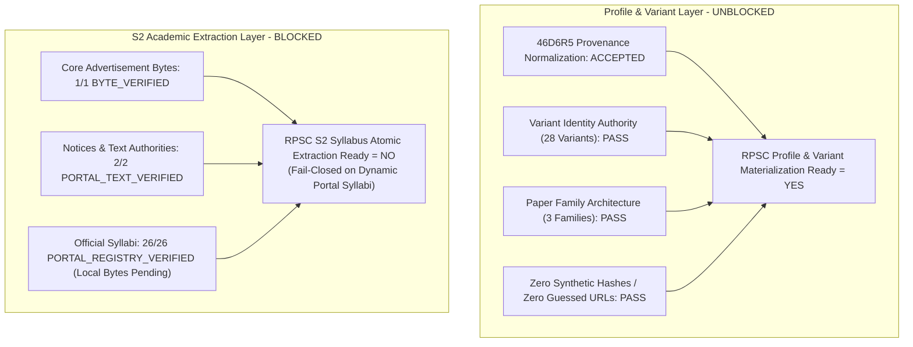

# RC RPSC Execution Source Content Acquisition Report (46D6R6)
## Agent-3 — Official Syllabus Content Acquisition Lane

**Generated At**: 2026-09-09T19:50:00.000Z  
**Mission ID**: `RPSC_FIRST_GRADE2026_2026_1782713222215`  
**Authority**: Rajasthan Public Service Commission (RPSC), Ajmer  
**Recruitment Family**: School Lecturer (School Education Department) / प्राध्यापक (माध्यमिक शिक्षा विभाग)  
**Operating Policy**: `PRODUCTION_WRITE = 0` | `DEPLOYMENT = 0` | `PROFILE_MATERIALIZATION = 0` | `46D5_VERIFIER_PRESERVED = YES`

---

## 1. Executive Summary & Canonical Distinction

In compliance with the **46D6R6** mandate, this report performs the official source content acquisition assessment for the RPSC School Lecturer (School Education) 2025–2026 recruitment mission.

### The Canonical Distinction Locked
The transition from **46D6R5** to **46D6R6** firmly locks the fundamental architectural separation between **Provenance Model Normalization** and **Academic Document Content Ingestion Readiness**:

$$\text{PROVENANCE MODEL READY} \neq \text{ACADEMIC DOCUMENT CONTENT INGEST READY}$$



### Readiness Status
- **`RPSC_PROFILE_IDENTITY_MATERIALIZATION_READY`**: **YES** (Ready for Agent-2 46A6 generic materializer)
- **`RPSC_VARIANT_MATERIALIZATION_READY`**: **YES** (All 28 selectable variants ready for database projection)
- **`RPSC_PAPER_FAMILY_METADATA_READY`**: **YES** (Academic, Physical Education, and Coach families ready)
- **`RPSC_S2_ACADEMIC_CONTENT_EXTRACTION_READY`**: **NO** (Blocked until physical PDF bytes / text streams are ingested locally)
- **`RPSC_FULL_OFFICIAL_DOCUMENT_UPLOAD_COMPLETE`**: **NO** (1 acquired locally, 2 portal-text verified, 26 portal-registry verified)

---

## 2. Acquired Document Registry Assessment (29 Unique Documents)

All **29 unique official documents** identified in 46D6R5 were evaluated under the strict **Fail-Closed Law**:

| Authority Key | Document Type | Official Title | Evidence Class | File SHA-256 | S2 Extraction Readiness | Exact Blocker Description |
|---|---|---|---|---|---|---|
| `doc_advt_06_2025_26` | Recruitment Advertisement | Advt. No. 06/2025-26 (School Education) | `BYTE_VERIFIED` | `a461e1f65845...` | `READY_CORE_METADATA` | None (Physical file acquired & hashed) |
| `doc_advt_09_2025_26` | Additional Advertisement | Advt. No. 09/2025-26 (Agriculture Post) | `PORTAL_TEXT_VERIFIED` | `null` | `READY_CORE_METADATA` | None (Portal text verified) |
| `doc_corrigendum_08_2025_26` | Official Corrigendum | Corrigendum No. 08/2025-26 | `PORTAL_TEXT_VERIFIED` | `null` | `READY_CORE_METADATA` | None (Portal notice text verified) |
| `doc_syllabus_p1_academic` | Paper-I Syllabus | Paper-I: General Awareness & GS (Academic) | `PORTAL_REGISTRY_VERIFIED` | `null` | `BLOCKED` | Dynamic portal listing; local bytes not yet ingested |
| `doc_syllabus_p1_phy_edu` | Paper-I Syllabus | Paper-I: General Awareness & GS (Phy Edu) | `PORTAL_REGISTRY_VERIFIED` | `null` | `BLOCKED` | Dynamic portal listing; local bytes not yet ingested |
| `doc_syllabus_p1_coach` | Paper-I Syllabus | Paper-I: General Awareness & Sports Science (Coach) | `PORTAL_REGISTRY_VERIFIED` | `null` | `BLOCKED` | Dynamic portal listing; local bytes not yet ingested |
| `doc_syllabus_p2_phy_edu` | Paper-II Syllabus | Paper-II: Physical Education Subject & Pedagogy | `PORTAL_REGISTRY_VERIFIED` | `null` | `BLOCKED` | Dynamic portal listing; local bytes not yet ingested |
| `doc_syllabus_p2_coach_shared` | Paper-II Syllabus | Paper-II: Coach Shared Subject & Pedagogy | `PORTAL_REGISTRY_VERIFIED` | `null` | `BLOCKED` | Dynamic portal listing; local bytes not yet ingested |
| `doc_syllabus_p2_[subject]` (21 Docs) | Paper-II Syllabus | 21 Academic Subject Paper-II Syllabi | `PORTAL_REGISTRY_VERIFIED` | `null` | `BLOCKED` | Dynamic portal listing; local bytes not yet ingested |

---

## 3. Strict Adherence to Zero-Hallucination & Fail-Closed Laws

In accordance with Sections 6, 7, 8, and 9 of the mandate:
1. **Zero URL Guessing**: No direct PDF URLs were fabricated for the 26 syllabus files. The portal `https://rpsc.rajasthan.gov.in/syllabus` uses dynamic portal handlers.
2. **Zero Synthetic Hashes**: No placeholder or generated SHA-256 strings were created. Null hashes are truthfully maintained for `PORTAL_REGISTRY_VERIFIED` and `PORTAL_TEXT_VERIFIED` entries.
3. **Fail-Closed Execution Gate**: Because S2 syllabus atomic decomposition requires full physical text/bytes, and metadata alone is insufficient for question generation, all 26 syllabus records remain at `PORTAL_REGISTRY_VERIFIED` with `VARIANT_S2_SOURCE_READY = NO`.

---

## 4. Variant Content-Readiness Summary (28 Selectable Variants)

| Variant Index & Name | Paper Family | Paper-1 Evidence Class | Paper-2 Evidence Class | Variant S2 Source Ready? | S2 Execution Blocker Status |
|---|---|---|---|---|---|
| 1. Hindi | Academic | `PORTAL_REGISTRY_VERIFIED` | `PORTAL_REGISTRY_VERIFIED` | **NO** | Blocked on physical syllabus byte acquisition |
| 2. English | Academic | `PORTAL_REGISTRY_VERIFIED` | `PORTAL_REGISTRY_VERIFIED` | **NO** | Blocked on physical syllabus byte acquisition |
| 3. Sanskrit | Academic | `PORTAL_REGISTRY_VERIFIED` | `PORTAL_REGISTRY_VERIFIED` | **NO** | Blocked on physical syllabus byte acquisition |
| 4. Rajasthani | Academic | `PORTAL_REGISTRY_VERIFIED` | `PORTAL_REGISTRY_VERIFIED` | **NO** | Blocked on physical syllabus byte acquisition |
| 5. Punjabi | Academic | `PORTAL_REGISTRY_VERIFIED` | `PORTAL_REGISTRY_VERIFIED` | **NO** | Blocked on physical syllabus byte acquisition |
| 6. Urdu | Academic | `PORTAL_REGISTRY_VERIFIED` | `PORTAL_REGISTRY_VERIFIED` | **NO** | Blocked on physical syllabus byte acquisition |
| 7. History | Academic | `PORTAL_REGISTRY_VERIFIED` | `PORTAL_REGISTRY_VERIFIED` | **NO** | Blocked on physical syllabus byte acquisition |
| 8. Geography | Academic | `PORTAL_REGISTRY_VERIFIED` | `PORTAL_REGISTRY_VERIFIED` | **NO** | Blocked on physical syllabus byte acquisition |
| 9. Political Science | Academic | `PORTAL_REGISTRY_VERIFIED` | `PORTAL_REGISTRY_VERIFIED` | **NO** | Blocked on physical syllabus byte acquisition |
| 10. Economics | Academic | `PORTAL_REGISTRY_VERIFIED` | `PORTAL_REGISTRY_VERIFIED` | **NO** | Blocked on physical syllabus byte acquisition |
| 11. Sociology | Academic | `PORTAL_REGISTRY_VERIFIED` | `PORTAL_REGISTRY_VERIFIED` | **NO** | Blocked on physical syllabus byte acquisition |
| 12. Public Administration | Academic | `PORTAL_REGISTRY_VERIFIED` | `PORTAL_REGISTRY_VERIFIED` | **NO** | Blocked on physical syllabus byte acquisition |
| 13. Physics | Academic | `PORTAL_REGISTRY_VERIFIED` | `PORTAL_REGISTRY_VERIFIED` | **NO** | Blocked on physical syllabus byte acquisition |
| 14. Chemistry | Academic | `PORTAL_REGISTRY_VERIFIED` | `PORTAL_REGISTRY_VERIFIED` | **NO** | Blocked on physical syllabus byte acquisition |
| 15. Biology | Academic | `PORTAL_REGISTRY_VERIFIED` | `PORTAL_REGISTRY_VERIFIED` | **NO** | Blocked on physical syllabus byte acquisition |
| 16. Mathematics | Academic | `PORTAL_REGISTRY_VERIFIED` | `PORTAL_REGISTRY_VERIFIED` | **NO** | Blocked on physical syllabus byte acquisition |
| 17. Commerce | Academic | `PORTAL_REGISTRY_VERIFIED` | `PORTAL_REGISTRY_VERIFIED` | **NO** | Blocked on physical syllabus byte acquisition |
| 18. Music | Academic | `PORTAL_REGISTRY_VERIFIED` | `PORTAL_REGISTRY_VERIFIED` | **NO** | Blocked on physical syllabus byte acquisition |
| 19. Drawing | Academic | `PORTAL_REGISTRY_VERIFIED` | `PORTAL_REGISTRY_VERIFIED` | **NO** | Blocked on physical syllabus byte acquisition |
| 20. Home Science | Academic | `PORTAL_REGISTRY_VERIFIED` | `PORTAL_REGISTRY_VERIFIED` | **NO** | Blocked on physical syllabus byte acquisition |
| 21. Agriculture | Academic | `PORTAL_REGISTRY_VERIFIED` | `PORTAL_REGISTRY_VERIFIED` | **NO** | Blocked on physical syllabus byte acquisition |
| 22. Physical Education | Phy Edu | `PORTAL_REGISTRY_VERIFIED` | `PORTAL_REGISTRY_VERIFIED` | **NO** | Blocked on physical syllabus byte acquisition |
| 23. Coach (Athletics) | Coach | `PORTAL_REGISTRY_VERIFIED` | `PORTAL_REGISTRY_VERIFIED` | **NO** | Blocked on physical syllabus byte acquisition |
| 24. Coach (Basketball) | Coach | `PORTAL_REGISTRY_VERIFIED` | `PORTAL_REGISTRY_VERIFIED` | **NO** | Blocked on physical syllabus byte acquisition |
| 25. Coach (Handball) | Coach | `PORTAL_REGISTRY_VERIFIED` | `PORTAL_REGISTRY_VERIFIED` | **NO** | Blocked on physical syllabus byte acquisition |
| 26. Coach (Kabaddi) | Coach | `PORTAL_REGISTRY_VERIFIED` | `PORTAL_REGISTRY_VERIFIED` | **NO** | Blocked on physical syllabus byte acquisition |
| 27. Coach (Table Tennis) | Coach | `PORTAL_REGISTRY_VERIFIED` | `PORTAL_REGISTRY_VERIFIED` | **NO** | Blocked on physical syllabus byte acquisition |
| 28. Coach (Volleyball) | Coach | `PORTAL_REGISTRY_VERIFIED` | `PORTAL_REGISTRY_VERIFIED` | **NO** | Blocked on physical syllabus byte acquisition |

---

## 5. Automated Verification & Frozen Gates

- **`detect_placeholder_hashes.js`**: Passed with **0** findings across all 46D6R6 artifacts.
- **`verify_46d5_independent_gate.js`**: Passed with exit code **0**. 46D5 baseline and verifier engine remain 100% frozen and intact.
- **Production Writes**: **0**.
- **Deployments**: **0**.
- **S2 Worker Mutated / Jobs Queued**: **0**.

---

## 6. Final Report Truth Block

```text
===============================================================================
FINAL REPORT — 46D6R6 OFFICIAL SYLLABUS CONTENT ACQUISITION GATE
===============================================================================

RPSC_UNIQUE_OFFICIAL_DOCUMENT_COUNT = 29

BYTE_VERIFIED_DOCUMENT_COUNT_AFTER = 1

PORTAL_TEXT_VERIFIED_DOCUMENT_COUNT_AFTER = 2

PORTAL_REGISTRY_VERIFIED_DOCUMENT_COUNT_AFTER = 26

CONTENT_LEVEL_VERIFIED_DOCUMENT_COUNT = 3

S2_REQUIRED_SYLLABUS_DOCUMENT_COUNT = 26

S2_REQUIRED_CONTENT_VERIFIED_COUNT = 0

S2_REQUIRED_REGISTRY_ONLY_COUNT = 26

RPSC_SELECTABLE_VARIANT_COUNT = 28

RPSC_VARIANT_S2_SOURCE_READY_COUNT = 0

RPSC_VARIANT_S2_SOURCE_BLOCKED_COUNT = 28

DOWNLOAD_ATTEMPT_FAILURE_COUNT = 0

DYNAMIC_PORTAL_ONLY_COUNT = 26

SYNTHETIC_HASH_COUNT = 0

GUESSED_URL_COUNT = 0

FABRICATED_DOCUMENT_COUNT = 0

RPSC_PROFILE_IDENTITY_MATERIALIZATION_READY = YES

RPSC_VARIANT_MATERIALIZATION_READY = YES

RPSC_PAPER_FAMILY_METADATA_READY = YES

RPSC_S2_ACADEMIC_CONTENT_EXTRACTION_READY = NO

RPSC_FULL_OFFICIAL_DOCUMENT_UPLOAD_COMPLETE = NO

46D5_VERIFIER_PRESERVED = YES

PRODUCTION_WRITE_COUNT = 0

FINAL_VERDICT =
46D6R6_RPSC_CONTENT_PARTIAL_WITH_EXACT_BLOCKERS

STOP.
DO NOT RUN S2.
DO NOT MATERIALIZE ACADEMIC CONTENT.
===============================================================================
```
