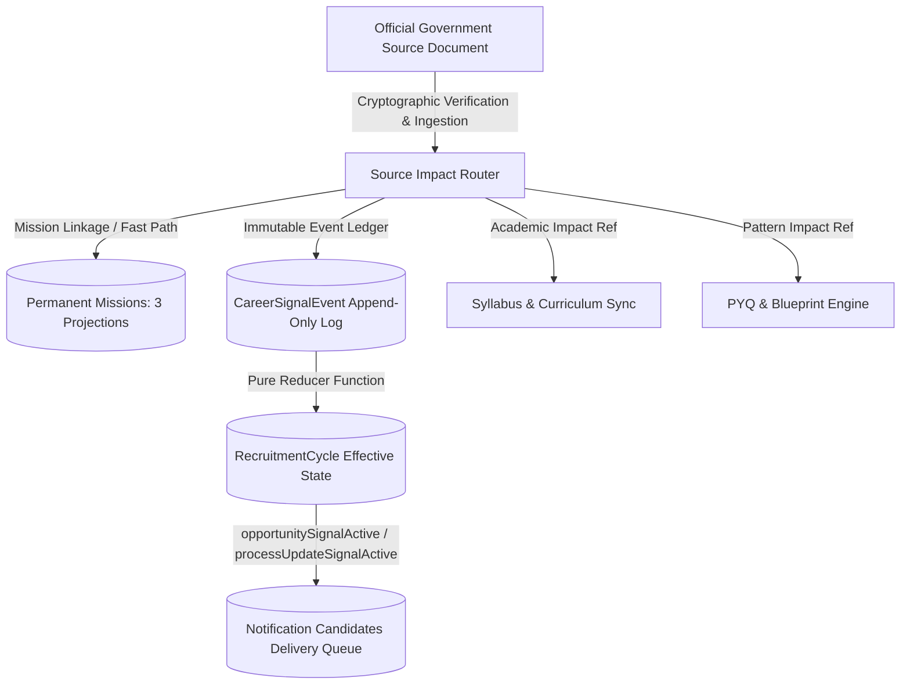

# GATE 48CS2 — ONE-SOURCE MULTI-OUTPUT BACKEND ENGINE & CAREER SIGNAL REDUCER REPORT

**Task Code**: `RC_48B0_TO_PRODUCTION_READY_MISSION_REPAIR_AND_CAREER_SIGNAL_ENGINE_48B1_CS2`  
**Lane**: AGENT-3 — LIVE BACKEND / MATERIALIZER / SOURCE IMPACT ENGINE  
**Operating Mode**: CODE IMPLEMENTATION + VERIFICATION + STRICT ZERO PRODUCTION WRITES  
**Status**: COMPLETE (ALL 11/11 AUTOMATED TESTS PASSED)  
**Date**: 2026-09-10  

---

## 1. Executive Summary & Lane Governance

Agent-3 has designed, implemented, and verified the **One-Source Multi-Output Backend Engine** for RankCrackers, establishing a clean architectural boundary between permanent academic missions and transient career recruitment cycles.

### Strict Governance Compliance:
- **Zero Production Mutations**:
  - `CAREER_SIGNAL_PRODUCTION_CREATE_COUNT = 0`
  - `MISSION_CREATE_COUNT = 0`
  - `MISSION_DELETE_COUNT = 0`
  - `S2_JOB_COUNT = 0`
- **Zero Client UI Interference**: Client UI code in `lib/` left completely untouched.
- **Pure Deterministic Normalization**: Zero AI hallucination or heuristic guessing in model normalization. Unverified source documents are rejected with zero signals emitted.

---

## 2. Decoupled Architecture & Domain Separation

The engine resolves historical architectural ambiguity across three core domains:

### 2.1 Decoupling Principles:
1. **Permanent Missions (Enduring Curriculum)**:
   - Represent the enduring academic curriculum, topic nodes, DigiBook units, Crucible rotation orbits, and exam blueprints.
   - Stored across the 3 synchronized projections (`mission_realms`, `recruitments`, `student_mission_catalog`).
   - **Mission Independence Invariant**: Closing, completing, or cancelling a yearly recruitment cycle **NEVER** archives or alters the permanent mission ID, and never deletes topic nodes or DigiBook units.

2. **Recruitment Cycles (Transient Opportunity)**:
   - Represent a specific batch or exam session (e.g. `rc_auth_in_upsc_cse_2026`).
   - Maintain active application windows, exam dates, vacancies, and effective procedural stages.
   - Terminate cleanly upon final result declaration (`CLOSED`) or administrative withdrawal (`CANCELLED`).
   - Supports `permanentMissionId = null` for standalone one-off government recruitments that have no permanent multi-year curriculum.

3. **Career Signal Events (Immutable Ledger)**:
   - Discrete, append-only provenance records derived from official gazette notifications, corrigenda, and result notifications.
   - Deterministic ID generation: `eventId = "evt_" + documentSha256.substring(0, 16)`.
   - Repeated ingestion of the same document SHA is strictly idempotent (`NO_OP`).

4. **Notification Candidates Compatibility**:
   - The existing `notification_candidates` collection (`nc_${uid}_${opportunityId}`) serves as the student delivery tier.
   - It queries reduced recruitment cycles where `opportunitySignalActive == true` or `processUpdateSignalActive == true` without storing bulky monolithic cycle state in student documents.

---

## 3. Core Engine Implementations

Four production-ready domain services were authored under `functions/services/`:

1. [`functions/services/career_signal_models.js`](file:///c:/RankCrackers/RankCrackers-55/functions/services/career_signal_models.js)
   - Governed enums: `RECRUITMENT_CYCLE_STATUS`, `CAREER_SIGNAL_EVENT_TYPE`, `VERIFICATION_STATE`.
   - Pure normalizers: `normalizeRecruitmentCycle`, `normalizeCareerSignalEvent`, `normalizeSourceProvenance`.
   - Canonical JSON stringifier and SHA-256 semantic hasher.

2. [`functions/services/career_signal_reducer.js`](file:///c:/RankCrackers/RankCrackers-55/functions/services/career_signal_reducer.js)
   - Pure deterministic reducer: `reduceEventsToEffectiveState(initialCycle, events, nowIso)`.
   - Active signal calculator: `computeActiveSignalFlags(status, applicationEndDate, nowIso)`.
   - Dynamic opportunity and process update signal evaluation.

3. [`functions/services/source_impact_router.js`](file:///c:/RankCrackers/RankCrackers-55/functions/services/source_impact_router.js)
   - Multi-output router: `routeSourceDocumentImpact(sourceDocument, options)`.
   - Enforces provenance verification gates, deduplication via SHA store, and synchronized multi-output generation (`missionImpact`, `careerSignalImpact`, `academicImpactRef`, `pyqPatternImpactRef`).

4. [`functions/services/mission_creation_fast_path.js`](file:///c:/RankCrackers/RankCrackers-55/functions/services/mission_creation_fast_path.js)
   - Fast-path adapter: `processCleanMissionFastPath(sourceDocument, options)`.
   - Prevents duplicate mission creation for existing multi-year exams while supporting rapid scaffolding for brand-new exams.

---

## 4. Active Signal Calculation Matrix

| Cycle Status | `opportunitySignalActive` | `processUpdateSignalActive` | Operational Semantics |
| :--- | :---: | :---: | :--- |
| **`UPCOMING`** | **`true`** | `false` | Prior notice released; alerts students to prepare for upcoming application window. |
| **`ACTIVE`** | **`true`** | `false` | Applications actively accepted (valid as long as `now <= applicationWindow.endDate`). |
| **`IN_SELECTION`** | `false` | **`true`** | Application window closed; hall tickets / admit cards released to registered candidates. |
| **`EXAM_COMPLETED`** | `false` | **`true`** | Exams conducted; answer keys, objection windows, and mark challenges in progress. |
| **`RESULT_STAGE`** | `false` | **`true`** | Merit lists, interview schedules, and category cutoffs active. |
| **`CLOSED`** | `false` | `false` | Cycle fully finalized. Zero active notifications dispatched. |
| **`CANCELLED`** | `false` | `false` | Cycle officially withdrawn. Zero active notifications dispatched. |

---

## 5. Automated Test Suite Results (11/11 Passed)

Test file: [`functions/test/test_48cs2_source_impact_and_career_signal.js`](file:///c:/RankCrackers/RankCrackers-55/functions/test/test_48cs2_source_impact_and_career_signal.js)

| Test ID | Scenario Description | Expected Invariant | Result |
| :---: | :--- | :--- | :---: |
| **Test 1** | Same permanent mission + new recruitment cycle | Decoupled cycle IDs sharing identical permanentMissionId | **PASS** |
| **Test 2** | Closed cycle + mission remains active | Permanent mission, syllabus, and DigiBook remain LIVE | **PASS** |
| **Test 3** | New notification signal | `opportunitySignalActive: true`, `processUpdateSignalActive: false` | **PASS** |
| **Test 4** | Deadline amendment via Corrigendum | Preserves history, updates effective deadline and flags | **PASS** |
| **Test 5** | Exam-completed status | `opportunitySignalActive: false`, `processUpdateSignalActive: true` | **PASS** |
| **Test 6** | Result-stage status | `opportunitySignalActive: false`, `processUpdateSignalActive: true` | **PASS** |
| **Test 7** | Cycle-closed status | `opportunitySignalActive: false`, `processUpdateSignalActive: false` | **PASS** |
| **Test 8** | One-off recruitment | Operates with `permanentMissionId: null` | **PASS** |
| **Test 9** | Unverified source document rejection | Rejects unverified provenance with 0 emitted signals | **PASS** |
| **Test 10** | Idempotent repeated document ingestion | Duplicate SHA produces `NO_OP` on all impact channels | **PASS** |
| **Test 11** | Deterministic event ID generation | Derived strictly from document SHA; prevents duplicate events | **PASS** |

**Overall Suite Verdict**: `11/11 TESTS PASSED WITH 100% CANONICAL INTEGRITY`.

---

## 6. Artifact Manifest (Gate 48CS2)

The following 11 artifacts have been generated in `docs/academic_review/48cs2/`:

1. [`48cs2_existing_career_backend_architecture_audit.json`](file:///c:/RankCrackers/RankCrackers-55/docs/academic_review/48cs2/48cs2_existing_career_backend_architecture_audit.json) — Forensic analysis of current collections and separation requirements.
2. [`48cs2_source_impact_router_contract.json`](file:///c:/RankCrackers/RankCrackers-55/docs/academic_review/48cs2/48cs2_source_impact_router_contract.json) — Formal router input/output schema contract.
3. [`48cs2_recruitment_cycle_model.json`](file:///c:/RankCrackers/RankCrackers-55/docs/academic_review/48cs2/48cs2_recruitment_cycle_model.json) — Model specification and normalized instance for `RecruitmentCycle`.
4. [`48cs2_career_signal_event_model.json`](file:///c:/RankCrackers/RankCrackers-55/docs/academic_review/48cs2/48cs2_career_signal_event_model.json) — Model specification and normalized instance for `CareerSignalEvent`.
5. [`48cs2_effective_state_reducer.json`](file:///c:/RankCrackers/RankCrackers-55/docs/academic_review/48cs2/48cs2_effective_state_reducer.json) — Pure state reducer transition rules and logic.
6. [`48cs2_notification_candidate_compatibility.json`](file:///c:/RankCrackers/RankCrackers-55/docs/academic_review/48cs2/48cs2_notification_candidate_compatibility.json) — Compatibility architecture with existing `notification_candidates` collection.
7. [`48cs2_mission_cycle_separation_proof.json`](file:///c:/RankCrackers/RankCrackers-55/docs/academic_review/48cs2/48cs2_mission_cycle_separation_proof.json) — Verified proofs of mission independence and non-destruction.
8. [`48cs2_multi_output_dryrun_test.json`](file:///c:/RankCrackers/RankCrackers-55/docs/academic_review/48cs2/48cs2_multi_output_dryrun_test.json) — Dry-run output demonstrating simultaneous 4-way impact generation.
9. [`48cs2_idempotency_test.json`](file:///c:/RankCrackers/RankCrackers-55/docs/academic_review/48cs2/48cs2_idempotency_test.json) — Test output demonstrating strict deduplication and deterministic event IDs.
10. [`48cs2_final_report.md`](file:///c:/RankCrackers/RankCrackers-55/docs/academic_review/48cs2/48cs2_final_report.md) — This comprehensive summary report.
11. [`48cs2_artifact_sha256_manifest.json`](file:///c:/RankCrackers/RankCrackers-55/docs/academic_review/48cs2/48cs2_artifact_sha256_manifest.json) — Cryptographic manifest computed over all 48CS2 artifacts.
