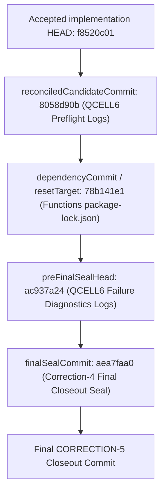

# Commit Graph & Ancestry Audit - Phase FUP-2C-REPOGUARD1-FIX3-CORRECTION-5

## 1. Non-Authorizing Statement
> [!IMPORTANT]
> This document grants no:
> - Founder approval
> - second gate
> - token authority
> - deployment authority
> - live execution authority
> - backfill authority

---

## 2. Commit Graph Layout & Lineages

### A. Mainline Acceptance Graph Lineage

This linear commit chain starts from the accepted production implementation codebase (`f8520c01`) and records all subsequent preflight logs, dependency packages model lockfile, and final closeout documentation:

#### 1. Commit `f8520c01653aeeae4a343e41d979eadcb5f0e849`
- **Subject**: `chore: bind final mission mirror acceptance evidence`
- **Files**: Documentation audits only.
- **Classification**: `SAFE_DOCUMENTATION_ONLY`

#### 2. Commit `8058d90bc1e45fad57d07a1843887dcf18fdc04c`
- **Subject**: `chore: record qcell6 gate1 live write readiness`
- **Files**: Preflight checks logs.
- **Classification**: `SAFE_READ_ONLY_AUDIT`

#### 3. Commit `78b141e111e0ea94c68253d87b87a9d4d62d4bde`
- **Subject**: `chore: update functions package lockfile for reproducible deployments`
- **Files**: `functions/package-lock.json`
- **Classification**: `CONTROLLED_DEPENDENCY_ARTIFACT`

#### 4. Commit `ac937a249d95db2d5ab2b61a6a36bee98ba1cf1f`
- **Subject**: `chore: confirm qcell6 live write created empty atomic question cells`
- **Files**: Diagnostics logs and script.
- **Classification**: `SAFE_READ_ONLY_AUDIT`

#### 5. Commit `aea7faa0a5dd0cb69fcd7c34bd498bdf31db09af`
- **Subject**: `chore: close acceptance reset and packaging evidence`
- **Files**: Correction-4 documentation files.
- **Classification**: `SAFE_DOCUMENTATION_ONLY`

- **unclassifiedMainlineCommits**: `0`

---

### B. Abandoned/Reflog Graphs (Non-Mainline Lineage)

These branches/tips were abandoned during resets or were system autocommits:

#### 1. Commit `9dabaf6b6c340c481ea17d309ca880fb6a80d866`
- **Ancestry**: Descends from `ec8763426a69cd3b91d57897dd820fd2f4a113de`.
- **Subject**: `chore: confirm qcell6 live write created empty atomic question cells`
- **Classification**: `BACKGROUND_AUTOCOMMIT`
- **Preservation Reference**: Tag `preserve_refine3_correction5_prereset_9dabaf6`

#### 2. Commit `ec8763426a69cd3b91d57897dd820fd2f4a113de`
- **Ancestry**: Descends from `f249a7065cba0afc9562313eabc03f51f55611b4`.
- **Subject**: `chore: record qcell6 gate1 live write readiness`
- **Classification**: `SAFE_READ_ONLY_AUDIT`
- **Preservation Reference**: Tag `preserve_unexpected_head_before_qcell6_gate1_recreate_adc0900f` / Tag `preserve_unexpected_head_before_qcell6_gate1_evidence_341894bf`

#### 3. Commit `c67b403c84cfcfc7bc4429df2221ebf6fc540c6b`
- **Ancestry**: Descends from `455f9c87efc68d1309f988c3cb9adf9e5d6c1092`.
- **Subject**: `chore: reconcile blocked p15 rollback execution clean state`
- **Classification**: `SAFE_DOCUMENTATION_ONLY`
- **Preservation Reference**: Tag `preserve_unexpected_head_before_qcell6_gate3_c67b403c`

#### 4. Commit `f249a7065cba0afc9562313eabc03f51f55611b4`
- **Ancestry**: Descends from `a078e50f4739871e69e07f8fdb7f9d0c538b5521`.
- **Subject**: `chore: record qcell5 fix4 corrected empty cell preflight`
- **Classification**: `SAFE_READ_ONLY_AUDIT`
- **Preservation Reference**: Tag `preserve_unexpected_head_before_qcell6_gate2_f249a706`

#### 5. Commit `a078e50f4739871e69e07f8fdb7f9d0c538b5521`
- **Ancestry**: Descends from `28ca7e2a8f6955ff7857c06df02776dadb51a8f5`.
- **Subject**: `chore: record clean qcell5 founder decision manifest`
- **Classification**: `SAFE_DOCUMENTATION_ONLY`
- **Preservation Reference**: Tag `preserve_unexpected_head_before_fix4_evidence_f2edb129`

#### 6. Commit `28ca7e2a8f6955ff7857c06df02776dadb51a8f5`
- **Ancestry**: Descends from `db07c05f1f474e6e8340c5ce8407cd2d1bf4544e`.
- **Subject**: `chore: verify clean blocked p15 rollback execution state`
- **Classification**: `SAFE_DOCUMENTATION_ONLY`
- **Preservation Reference**: Tag `preserve_unexpected_head_before_fix4_evidence_2eaa2176`

- **unclassifiedAbandonedCommits**: `0`
