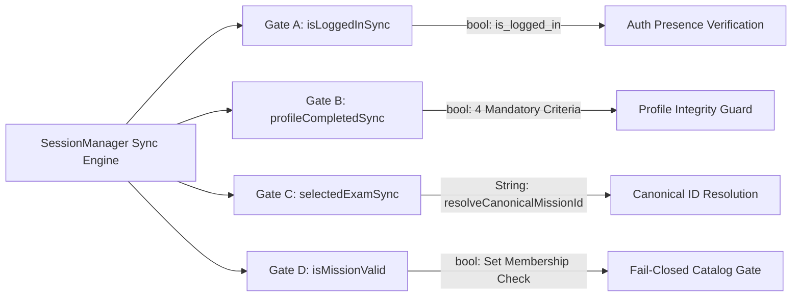
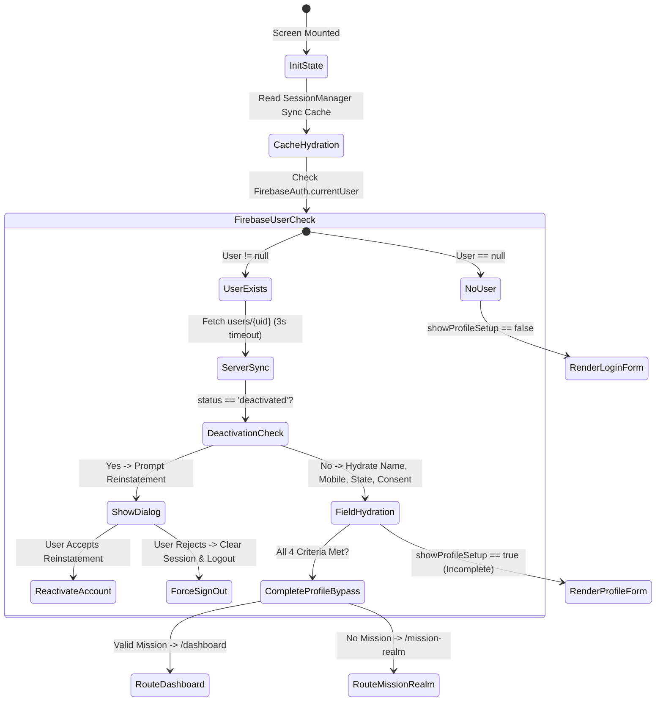
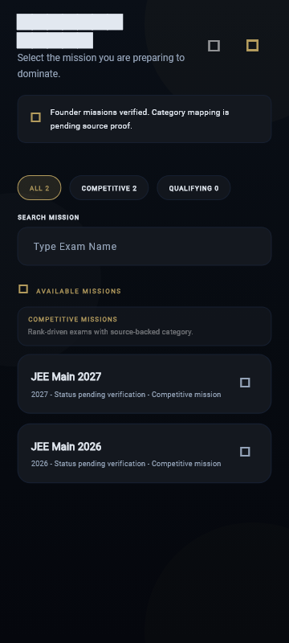
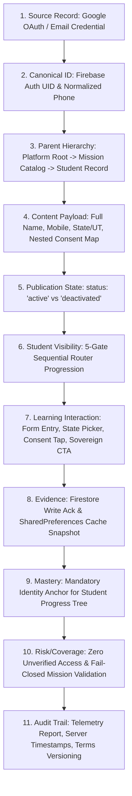

# Volume B — Student Experience

**Current acceptance:** working reference; path existence does not certify runtime behavior, production state or passing tests. Historical code excerpts and line ranges require SHA-specific readback before implementation use.

**GitHub source snapshot:** [`docs/rankcrackers_book/08_identity_profile_and_mission_gates.md`](https://github.com/rankcrackersofficial-sys/RankCrackers/blob/5161592ddafb42f1ecc8923cc7b7b0309934cc83/docs/rankcrackers_book/08_identity_profile_and_mission_gates.md) · source blob `9aaf347912c730d179e2feeb63c76d489f19dad7`. This Drive edition contains editorial corrections; it is not a claim that those corrections were committed to GitHub. See `github_source_manifest.json` and the current reconciliation register.


## Part 1 — Student Authentication, Unified Identity और Mission Access

### Chapter 08 — Identity Pipeline, Unified Authentication, Profile Synthesis और Dynamic Mission Authority

---

### Executive Overview & Architectural Intent

RankCrackers ecosystem में Student Identity केवल एक पारंपरिक authentication token या Firebase Auth UID नहीं है। यह एक multi-layered, stateful और security-governed "Sovereign Learning Identity" है। जब एक छात्र RankCrackers application को launch करता है, तो उसके सामने learning dashboard या questions सीधे नहीं खुलते। इसके बजाय, छात्र को एक कठोर, deterministic और sequential 5-Gate Authority Pipeline से गुजरना होता है।

इस pipeline का मुख्य उद्देश्य यह सुनिश्चित करना है कि:
1. **Zero Unauthenticated Access:** कोई भी unauthenticated user private academic data या personalized learning state तक न पहुँच सके।
2. **Deterministic Profile Completeness:** किसी भी छात्र की learning journey तब तक शुरू न हो जब तक उसका नाम, 10-digit normalized Indian mobile number, verified Indian State/UT और explicit legal consent authoritatively persist न हो जाए।
3. **Dynamic Mission Authority:** छात्र केवल उन परीक्षा missions (जैसे UPSC CSE, SSC CGL, RPSC 1st Grade) में प्रवेश कर सके जो authoritative catalog में प्रकाशित, सक्रिय और validly registered हों। Application binary (APK/Web bundle) में hardcoded mission count अनिवार्य रूप से शून्य (`0`) है।
4. **Resilient Local-First Authority:** Routing decisions synchronous और local-first हों, ताकि network delay या offline startup पर router hang न हो, जबकि background cloud sync लगातार data integrity बनाए रखे।
5. **Auditable Security Boundaries:** Firestore Security Rules के तहत छात्र profile में privilege escalation (role, admin, founder claims का tampering) mathematically असंभव हो।

---

### Section 1 — The 5-Gate Sequential Authority Model

#### Subsection 1.1 — Gate Architecture और Router Pipeline

RankCrackers application का central navigational spine `lib/core/router/app_router.dart` में परिभाषित `GoRouter` instance है। Router startup के समय प्रत्येक matched route के लिए एक sequential 5-gate synchronous evaluation execute करता है।

नीचे दिए गए flowchart में इस 5-Gate Authority Pipeline का complete sequential flow दर्शाया गया है:

```mermaid
flowchart TD
    Start([Route Request Triggered]) --> Telemetry[Student Route Telemetry Recorded]
    Telemetry --> CheckSplash{Matched Location == /splash or / ?}
    CheckSplash -- Yes --> AllowSplash[Pass: Render Splash Screen]
    CheckSplash -- No --> Gate1{Gate 1: FirebaseAuth.currentUser == null?}
    
    Gate1 -- User Null --> CheckLoginFlow1{Already on /login or /profile-setup?}
    CheckLoginFlow1 -- Yes --> AllowAuthFlow[Pass: Stay on Auth Surface]
    CheckLoginFlow1 -- No --> RouteToLogin[Redirect: AppRoutes.login '/login']
    
    Gate1 -- User Exists --> Gate2{Gate 2: FounderIdentity.isFounderUser?}
    Gate2 -- Is Privileged --> CheckPrivOnLogin{On /login or /profile-setup?}
    CheckPrivOnLogin -- Yes --> BypassToDash[Bypass: AppRoutes.dashboard]
    CheckPrivOnLogin -- No --> CheckNextGate
    
    Gate2 -- Not Privileged --> CheckNextGate[Evaluate Student Authority]
    CheckNextGate --> Gate3{Gate 3: SessionManager.profileCompletedSync()?}
    Gate3 -- False Incomplete --> RedirectProfileSetup[Redirect: AppRoutes.profileSetup '/profile-setup']
    
    Gate3 -- True Complete --> Gate4{Gate 4: SessionManager.isMissionValid?}
    Gate4 -- Invalid / Missing --> RedirectMissionRealm[Redirect: AppRoutes.missionRealm '/mission-realm']
    
    Gate4 -- Valid Mission --> Gate5{Gate 5: User on /login or /profile-setup?}
    Gate5 -- Yes In Login Flow --> RedirectDashboard[Redirect: AppRoutes.dashboard]
    Gate5 -- No On Valid Route --> RouterPassed[Pass: Render Target Screen]
```

#### Subsection 1.2 — Gate 1: Firebase Authentication Gate

**File Path:** `lib/core/router/app_router.dart`  
**Lines:** 61–82

```dart
final user = FirebaseAuth.instance.currentUser;
final matchedLocation = state.matchedLocation;
if (user != null && !FounderIdentity.isFounderUser(user)) {
  unawaited(StudentRouteTelemetry.instance.report(matchedLocation));
}

// Level-12.7 & 12.9 Protection: Never redirect from Splash internally.
if (matchedLocation == AppRoutes.splash || state.uri.path == '/') {
  return null;
}

final bool onLoginFlow = matchedLocation == AppRoutes.login ||
    matchedLocation == AppRoutes.profileSetup;

// 🔱 Authority 1: Auth Gate
if (user == null) {
  debugPrint("🔱 ROUTER: User NULL, routing to Login");
  return onLoginFlow ? null : AppRoutes.login;
}
```

##### Code Analysis & Authority Law:
1. **Telemetry Isolation:** जैसे ही route evaluate होता है, गैर-founder छात्रों के लिए `StudentRouteTelemetry.instance.report(matchedLocation)` fire-and-forget (`unawaited`) रूप में execute होता है। इससे router thread block नहीं होता।
2. **Splash Immunity:** यदि URL `/splash` या root `/` है, तो router कोई redirect नहीं करता (`return null`). यह splash initialization sequence को अपना autonomous startup पूरा करने की अनुमति देता है।
3. **Null User Interception:** यदि `user == null` है, तो छात्र unauthenticated है। यदि छात्र पहले से `onLoginFlow` (`/login` या `/profile-setup`) पर है, तो router उसे वहीं रहने देता है (`return null`). लेकिन यदि unauthenticated छात्र किसी protected route (जैसे `/dashboard`, `/crucible`, `/syllabus`) पर direct navigate करने की कोशिश करता है, तो router तुरंत उसे `AppRoutes.login` (`/login`) पर redirect कर देता है।

#### Subsection 1.3 — Gate 2: Founder & Operational Privilege Bypass

**File Path:** `lib/core/router/app_router.dart` एवं `lib/core/constants/founder_identity.dart`  
**Lines:** 84–91

```dart
// 🔱 Authority 2: Privilege Gate (Bypass Onboarding for Founders/Admins)
bool isPrivileged = FounderIdentity.isFounderUser(user);

if (isPrivileged && onLoginFlow) {
  debugPrint(
      "🔱 ROUTER: Privileged User on Login flow, bypassing to Dashboard");
  return AppRoutes.dashboard;
}
```

```dart
class FounderIdentity {
  static const founderUid = '6TdzjpBr6Zdx1ag3LbMmjJ0DY312';
  static const founderEmails = {
    'founder.rcofficial@gmail.com',
  };

  static bool isFounderUser(User? user) {
    if (user == null) return false;
    if (user.uid == founderUid) return true;
    if (founderEmails.contains(user.email)) return true;
    return false;
  }
}
```

##### Code Analysis & Operational Boundary:
1. **Privilege Definition:** `FounderIdentity.isFounderUser` UID check (`6TdzjpBr6Zdx1ag3LbMmjJ0DY312`) और official whitelist email check (`founder.rcofficial@gmail.com`) का OR combination है।
2. **Bypass Philosophy:** Founder account operational review, content inspection और emergency debugging के लिए उपयोग होता है। यदि privileged user login flow पर लैंड करता है, तो उसे student onboarding (name, state, mobile) या mission selection पूरा करने के लिए विवश नहीं किया जाता; वह सीधे `AppRoutes.dashboard` पर bypass हो जाता है।
3. **Security Principle:** यह bypass client router navigation के लिए है। Firestore rules में founder privilege को custom claims (`request.auth.token.admin == true` अथवा `founder == true`) द्वारा अलग से enforce किया जाता है।

#### Subsection 1.4 — Gate 3: Local-First Synchronous Profile Completeness Gate

**File Path:** `lib/core/router/app_router.dart` एवं `lib/shared/session/session_manager.dart`  
**Lines:** 93–101 (app_router.dart)

```dart
// 🔱 Authority 3: Profile Gate (Must complete setup)
// Level-12.8 Hardening: Full synchronous authority.
final profileDone = SessionManager.profileCompletedSync();
if (!profileDone && !isPrivileged) {
  debugPrint("🔱 ROUTER: Profile incomplete, routing to Identity");
  return (matchedLocation == AppRoutes.profileSetup)
      ? null
      : AppRoutes.profileSetup;
}
```

##### Code Analysis:
1. **Zero-Latency Synchronous Evaluation:** Router redirect asynchronous नहीं हो सकता; network request का इंतज़ार करने पर screen पर flickers या white screens उत्पन्न होती हैं। इसलिए `SessionManager.profileCompletedSync()` in-memory cached `SharedPreferences` state से synchronous decision लेता है।
2. **The Incomplete Trap:** यदि छात्र authenticated है लेकिन उसकी profile अधूरी है (`!profileDone`), तो उसे `AppRoutes.profileSetup` पर forward कर दिया जाता है। यदि वह पहले से `/profile-setup` पर है, तो loop रोकने के लिए `return null` किया जाता है।

#### Subsection 1.5 — Gate 4: Dynamic Fail-Closed Mission Authority Gate

**File Path:** `lib/core/router/app_router.dart` एवं `lib/shared/session/session_manager.dart`  
**Lines:** 103–111 (app_router.dart)

```dart
// 🔱 Authority 4: Mission Gate (Must select valid mission)
final String? selectedExam = SessionManager.selectedExamSync();
final bool isMissionValid = SessionManager.isMissionValid(selectedExam);
if (!isMissionValid && !isPrivileged) {
  debugPrint("🔱 ROUTER: Mission missing or invalid, routing to Realm");
  return (matchedLocation == AppRoutes.missionRealm)
      ? null
      : AppRoutes.missionRealm;
}
```

##### Code Analysis & Fail-Closed Law:
1. **Selected Mission Extraction:** `SessionManager.selectedExamSync()` local storage से student का current mission ID निकालता है।
2. **Dynamic Validation:** `SessionManager.isMissionValid(selectedExam)` जाँचता है कि क्या यह ID Authoritative Mission Catalog Snapshot में मौजूद है।
3. **Fail-Closed Boundary:** यदि mission string `null`, empty, `'unresolved'`, `'none'`, `'invalid'` है, अथवा catalog snapshot में मौजूद नहीं है, तो student learning shell में प्रवेश नहीं कर सकता। Router उसे तुरंत `AppRoutes.missionRealm` (`/mission-realm`) पर route करता है।

#### Subsection 1.6 — Gate 5: Authenticated Session Post-Auth Login Bypass

**File Path:** `lib/core/router/app_router.dart`  
**Lines:** 113–120

```dart
// 🔱 Authority 5: Authenticated users should not be on Login screens
if (onLoginFlow) {
  debugPrint("🔱 ROUTER: Auth user on Login flow, routing to Dashboard");
  return AppRoutes.dashboard;
}

debugPrint("🔱 ROUTER PASSED");
return null;
```

##### Code Analysis:
यदि कोई user authenticated है, उसकी profile complete है, और उसका mission valid है, लेकिन वह browser back button या explicit link के जरिए `/login` या `/profile-setup` पर पहुँचता है, तो Gate 5 उसे intercept करता है और सीधे `AppRoutes.dashboard` पर भेज देता है। यदि सभी 5 gates pass हो जाते हैं, तो router `return null` करता है, जिससे targeted destination widget mount हो जाता है।

#### Subsection 1.7 — SessionManager के 4 Synchronous Authority Gates का संपूर्ण विनिर्देश

Router pipeline में शून्य-विलंबता (Zero Latency) सुनिश्चित करने के लिए `SessionManager` चार प्राथमिक सिंक्रोनस विधियाँ (Synchronous Authority Gates) प्रदान करता है जो सीधे इन-मेमोरी कैश्ड `SharedPreferences` और `MissionAccessSnapshot` से त्वरित निर्णय लेती हैं:



##### 1. Gate A: `SessionManager.isLoggedInSync()`
- **Source File & Location:** `lib/shared/session/session_manager.dart` (Lines 127–130)
- **Implementation:**
  ```dart
  static bool isLoggedInSync() {
    if (_prefs == null) return false;
    return _prefs!.getBool('is_logged_in') ?? false;
  }
  ```
- **Architectural Role:** स्थानीय स्टोरेज में छात्र के सक्रिय लॉगिन ध्वज (`is_logged_in`) का परीक्षण करता है। यह 0ms में बिना किसी असींक्रोनस Future के मूल्यांकन करता है, जिससे स्प्लैश और कोल्ड-स्टार्ट के समय स्क्रीन पर फ़्लिकर नहीं होता।

##### 2. Gate B: `SessionManager.profileCompletedSync()`
- **Source File & Location:** `lib/shared/session/session_manager.dart` (Lines 212–231)
- **Implementation:**
  ```dart
  static bool profileCompletedSync() {
    if (_prefs == null) return false;
    final bool profileDone = _prefs!.getBool('profile_completed') ?? false;
    final bool consentDone = _prefs!.getBool('consent_accepted') ?? false;
    final name = (_prefs!.getString('student_name') ?? '').trim();
    final rawMobile = _prefs!.getString('student_mobile') ?? '';
    final digits = rawMobile.replaceAll(RegExp(r'\D'), '');
    final normMobile = (digits.length == 12 && digits.startsWith('91'))
        ? digits.substring(2)
        : (digits.length == 11 && digits.startsWith('0'))
            ? digits.substring(1)
            : digits;
    final state = (_prefs!.getString('user_state') ?? '').trim();
    final isValidState = IndiaStates.statesAndUTs.any(
      (s) => s.toLowerCase() == state.toLowerCase(),
    );

    return profileDone && consentDone && name.isNotEmpty && normMobile.length == 10 && isValidState;
  }
  ```
- **Architectural Role:** यह केवल एक बूलियन फ़्लैग नहीं पढ़ता, बल्कि 4 अनिवार्य मानदंडों (सहमति, गैर-रिक्त नाम, 10-अंकीय मान्य भारतीय मोबाइल, और आधिकारिक 36 राज्यों/केंद्र शासित प्रदेशों का मिलान) की सिंक्रोनस पुष्टि करता है।

##### 3. Gate C: `SessionManager.selectedExamSync()`
- **Source File & Location:** `lib/shared/session/session_manager.dart` (Lines 576–580)
- **Implementation:**
  ```dart
  static String? selectedExamSync() {
    if (_prefs == null) return null;
    final raw = _prefs!.getString('selected_exam_id') ?? _prefs!.getString('selected_exam');
    return resolveCanonicalMissionId(raw) ?? raw;
  }
  ```
- **Architectural Role:** स्थानीय स्टोरेज से परीक्षा कुंजी प्राप्त करता है और `resolveCanonicalMissionId` के माध्यम से लेगेसी उपनामों (legacy aliases) को कैनोनिकल केस-सेंसिटिव आईडी में हल करता है।

##### 4. Gate D: `SessionManager.isMissionValid(String? exam)`
- **Source File & Location:** `lib/shared/session/session_manager.dart` (Lines 540–560)
- **Implementation:**
  ```dart
  static bool isMissionValid(String? exam) {
    if (exam == null || exam.trim().isEmpty) return false;
    final trimmed = exam.trim();
    if (trimmed == 'unresolved' ||
        trimmed == 'none' ||
        trimmed == 'null' ||
        trimmed == 'invalid' ||
        trimmed.toLowerCase() == 'unresolved mission') {
      return false;
    }
    if (!_currentSnapshot.snapshotReady) return false;

    if (_currentSnapshot.missionIdsExact.contains(trimmed)) return true;
    final titleKey = trimmed.toLowerCase();
    if (_legacyTitleToCanonicalId.containsKey(titleKey)) {
      final mappedId = _legacyTitleToCanonicalId[titleKey]!;
      return _currentSnapshot.missionIdsExact.contains(mappedId);
    }
    return false;
  }
  ```
- **Architectural Role:** फ़ेल-क्लोज़्ड प्राधिकार गेट। यदि स्नैपशॉट तैयार नहीं है, या मिशन आईडी अनसुलझी है, या सक्रिय कैटलॉग सेट में मौजूद नहीं है, तो यह कड़ाई से `false` लौटाता है।

---

### Section 2 — UnifiedIdentityScreen: Architectural Anatomy & UI State Machine

#### Subsection 2.1 — The Unified Identity Paradigm (Single Screen For Auth & Onboarding)

**File Path:** `lib/features/auth/presentation/screens/unified_identity_screen.dart`  
**Lines:** 19–41

RankCrackers 2.0 का एक क्रांतिकारी architectural decision था: **Unified Identity Paradigm**। पारंपरिक apps में Login, Sign-up, Forgot Password और Profile Setup के लिए 3 से 4 अलग-अलग screens होती हैं। इससे user drop-off बढ़ता है और router state desynchronization का खतरा रहता है।

`UnifiedIdentityScreen` एक monolithic yet elegant consumer stateful widget है (1,679 lines) जो निम्न जिम्मेदारियों को एक ही component में unify करता है:
1. Email + Password Login
2. Automatic Account Creation (यदि user नया है)
3. Google Sign-In One-Tap Authentication
4. Password Reset Trigger
5. Deactivated Account Detection & Interactive Reinstatement
6. Full Student Identity Synthesis (Full Name, 10-digit Mobile, State & UT Selection)
7. Explicit Legal Terms & Privacy Consent Persistence
8. Pre-flight Cache Rehydration from SessionManager

```dart
class UnifiedIdentityScreen extends ConsumerStatefulWidget {
  const UnifiedIdentityScreen(
      {super.key,
      this.forceProfileSetupForTest = false,
      this.disableFirebaseAuthLookupForTest = false,
      this.disableAnimationsForTest = false});

  final bool forceProfileSetupForTest;
  final bool disableFirebaseAuthLookupForTest;
  final bool disableAnimationsForTest;

  static String normalizeIndianMobile(String input) {
    final digits = input.replaceAll(RegExp(r'\D'), '');
    if (digits.length == 10) return digits;
    if (digits.length == 12 && digits.startsWith('91')) return digits.substring(2);
    if (digits.length == 11 && digits.startsWith('0')) return digits.substring(1);
    return digits;
  }

  @override
  ConsumerState<UnifiedIdentityScreen> createState() =>
      _UnifiedIdentityScreenState();
}
```


#### Subsection 2.2 — Visual Staging & Aura Animation System

`UnifiedIdentityScreen` की visual theme **Tactical Noir** है, जिसमें gold accents (`AppColors.gold`, `#D4AF37`) और deep midnight black (`AppColors.background`, `#070A12`) का उपयोग किया जाता है।

##### Animated Aura Shader:
Screen के background में एक breathing ambient aura render होता है जिसे `SingleTickerProviderStateMixin` द्वारा drive किया जाता है:

```dart
_animationController = AnimationController(
  vsync: this,
  duration: const Duration(seconds: 3),
);
if (widget.disableAnimationsForTest) {
  _animationController.value = 0.5;
} else {
  _animationController.repeat(reverse: true);
}

glowAnimation = Tween<double>(begin: 0.06, end: 0.14).animate(
  CurvedAnimation(parent: _animationController, curve: Curves.easeInOut),
);
```

`_buildAura()` method दो overlapping radial gradients बनाता है:
- **Top-Left Gold Orb:** `screenWidth * 0.86` diameter, opacity $0.06$ से $0.14$ के बीच smoothly breathe करती है।
- **Bottom-Right Cyan-Teal Orb:** `screenWidth * 0.92` diameter, colors `Color(0xFF1C7FA3)` (opacity 0.075) और `Color(0xFF0B1D33)` (opacity 0.035), जो visual depth प्रदान करता है।

#### Subsection 2.3 — Account Control Bar & Account Switch Protocol

जब कोई छात्र authenticated होता है और Profile Setup चरण में होता है, तो स्क्रीन के top पर `_buildAccountControlBar` प्रकट होता है:

```dart
Widget _buildAccountControlBar(String? email) {
  return Container(
    width: double.infinity,
    padding: const EdgeInsets.symmetric(horizontal: 12, vertical: 9),
    decoration: BoxDecoration(
      color: AppColors.surface.withValues(alpha: 0.68),
      borderRadius: BorderRadius.circular(14),
      border: Border.all(color: AppColors.borderSoft),
    ),
    child: Row(
      children: [
        Icon(
          Icons.account_circle_outlined,
          size: 16,
          color: goldAccent.withValues(alpha: 0.72),
        ),
        const SizedBox(width: 8),
        Expanded(
          child: Text(
            email?.isNotEmpty == true ? email! : 'Signed in account',
            maxLines: 1,
            overflow: TextOverflow.ellipsis,
            style: AppTypography.subtitle.copyWith(fontSize: 10),
          ),
        ),
        TextButton.icon(
          onPressed: _switchAccount,
          icon: const Icon(Icons.logout_rounded, size: 15),
          label: Text('Switch', style: AppTypography.label.copyWith(fontSize: 9)),
        ),
      ],
    ),
  );
}
```

##### Account Switch Action (`_switchAccount`):
यदि छात्र गलत Google account से sign in कर लेता है, तो `_switchAccount()` trigger होता है:
1. `_isSaving` flag check (यदि profile save हो रही है तो abort)।
2. Virtual keyboard unfocus.
3. Local UI state reset (`_identityEstablished = false`).
4. `authNotifierProvider.notifier.signOut()` invocation (Google sign-out + Firebase sign-out + KnowledgeEngine clear)।
5. `SessionManager.logout()` (local preferences clear)।
6. `context.go(AppRoutes.login)` द्वारा login surface पर atomic transition।

#### Subsection 2.4 — State Machine & Reactive Riverpod ConsumerState

`_UnifiedIdentityScreenState` का lifecycle और field hydration architecture multi-tiered है:



##### Synchronous First-Frame Hydration:
`initState` में async Firestore call से पहले local synchronous cache पढ़ा जाता है ताकि UI में कोई empty input flicker न हो:
```dart
final cachedName = SessionManager.getStudentNameSync();
if (cachedName != null && cachedName.isNotEmpty && nameController.text.isEmpty) {
  nameController.text = cachedName;
}
final cachedMobile = SessionManager.getStudentMobileSync();
if (cachedMobile != null && cachedMobile.isNotEmpty && mobileController.text.isEmpty) {
  final norm = normalizeIndianMobile(cachedMobile);
  mobileController.text = norm.isNotEmpty ? norm : cachedMobile;
}
final cachedState = SessionManager.getUserStateSync();
if (cachedState != null && cachedState.isNotEmpty && stateController.text.isEmpty) {
  stateController.text = cachedState;
}
```

#### Subsection 2.5 — Dual Surface Rendering: Login Mode vs Profile Setup Mode

Screen का `build` method यह तय करता है कि छात्र को कौन सी surface दिखानी है:
```dart
final authState = ref.watch(authNotifierProvider);
final user = authState.user ??
    ((widget.disableFirebaseAuthLookupForTest || SessionManager.disableFirebaseForTest)
        ? null
        : FirebaseAuth.instance.currentUser);
final showProfileSetup = widget.forceProfileSetupForTest || user != null;
```

1. **Surface A: Login Surface (`!showProfileSetup`):**
   - Email Input Field (`_miniField` with regex validation)
   - Password Input Field (with show/hide eye toggle)
   - Forgot Password CTA Button
   - "LOGIN / CONTINUE" Premium Button
   - Google Sign-In Button ("Continue with Google")
2. **Surface B: Profile Synthesis Surface (`showProfileSetup`):**
   - Account Control Bar (Signed-in email + "Switch" button)
   - Profile Photo Sync Banner (`_buildProfilePhotoPrompt`)
   - Full Name Input (with automated Title Case capitalization)
   - Mobile Number Input (with numeric keyboard & Indian normalization)
   - Dual-Mode Indian State & UT Selector
   - Legal Consent Checkbox (Privacy Policy & Terms of Service)
   - Sovereign Identity CTA Button ("ESTABLISH IDENTITY")

#### Subsection 2.6 — Explicit Screen States & Lifecycle (Loading, Empty, Error, Offline)

RankCrackers का UI आर्किटेक्चर किसी भी स्क्रीन को "अपरिभाषित" (Undefined) अवस्था में नहीं छोड़ता। `UnifiedIdentityScreen` निम्नलिखित 4 औपचारिक अवस्थाओं (Formal Screen States) को सख्ती से प्रबंधित करती है:

| Screen State | ट्रिगर स्थिति | UI प्रस्तुति व व्यवहार | रिकवरी / ट्रांज़िशन पाथ |
| :--- | :--- | :--- | :--- |
| **1. Loading State** | `authNotifier.isLoading == true` अथवा प्रोफ़ाइल सेविंग (`_isSaving == true`) | लॉगिन या सीटीए बटन अक्षम; स्वर्ण रंग का `CircularProgressIndicator` स्पिनर सक्रिय; टच जेस्चर्स ब्लॉक। | कार्य संपन्न होने पर सामान्य इंटरफ़ेस में वापसी या टाइमआउट पर एरर स्नैकबार। |
| **2. Empty / Cold State** | नया अप्रमाणित छात्र अथवा बिना प्रोफ़ाइल वाला उपयोगकर्ता | लॉगिन मोड में स्वच्छ इनपुट फ़ील्ड्स; प्रोफ़ाइल मोड में OAuth डेटा (`displayName`, `email`) के साथ प्री-फ़िल फ़ील्ड्स। | छात्र द्वारा वैध डेटा प्रविष्टि और "ESTABLISH IDENTITY" सीटीए पर टैप। |
| **3. Error State** | अमान्य इनपुट, नेटवर्क टाइमआउट, या क्रेडेंशियल त्रुटि | संबंधित इनपुट फ़ील्ड के नीचे या स्क्रीन तल पर स्पष्ट, गैर-अस्पष्ट `_showSnackBar()` संदेश; इनपुट फ़ील्ड्स अक्षुण्ण। | छात्र इनपुट सुधारता है और पुनः प्रयास करता है (कोई डेटा रीसेट नहीं)। |
| **4. Offline State** | इंटरनेट कनेक्टिविटी अनुपलब्ध | स्थानीय कैश्ड प्रोफ़ाइल से त्वरित रेंडरिंग; प्रोफ़ाइल सेव का प्रयास करने पर सर्वर-प्रथम नियम के तहत त्रुटि स्नैकबार। | नेटवर्क बहाली पर सर्वर कमिट के बाद ही स्थानीय स्थिति को 'पूर्ण' घोषित करना। |

##### 1. Loading State Implementation:
- **Server Rehydration Timeout:** लॉगिन के तुरंत बाद जब `_checkAndRehydrateProfile` सर्वर से प्रोफ़ाइल लोड करता है, तो 3 सेकंड का सुरक्षित टाइमआउट लगाया जाता है:
  ```dart
  final doc = await FirebaseFirestore.instance.collection('users').doc(user.uid).get(
    const GetOptions(source: Source.server),
  ).timeout(const Duration(seconds: 3));
  ```
- **CTA Saving Spinner:** जब छात्र "ESTABLISH IDENTITY" दबाता है, तो `setState(() => _isSaving = true)` ट्रिगर होता है। बटन के भीतर `_SovereignIdentityCta` टेक्स्ट गायब होकर 18px का स्वर्ण स्पिनर रेंडर होता है और `absorbPointer: true` लागू होता है।

##### 2. Empty / Cold-Start State Implementation:
- **Zero Placeholder Default:** जब कोई छात्र पहली बार ऐप खोलता है, तो कोई डमी या नकली मान नहीं भरा जाता। इनपुट फ़ील्ड्स खाली रहते हैं और "ESTABLISH IDENTITY" बटन अक्षम (Disabled Opacity $0.45$) रहता है जब तक कि सभी 4 मानदंड मान्य न हों।

##### 3. Error State Implementation:
- **Stage-Tagged Exception Trapping:** प्रमाणीकरण विफल होने पर `AuthNotifier` से त्रुटि संदेश (`ref.watch(authNotifierProvider).errorMessage`) प्राप्त होता है और `_showSnackBar(error)` द्वारा प्रदर्शित होता है।
- **Localized Field Errors:** यदि फ़ोन नंबर 10 अंक नहीं है, या राज्य भारत के आधिकारिक 36 राज्यों/केंद्र शासित प्रदेशों में से नहीं है, तो सीटीए बटन क्लिक करने पर विशिष्ट त्रुटि (उदा. `"Please enter a valid 10-digit mobile number"` या `"Please select a valid Indian State or UT"`) दिखाई जाती है।

##### 4. Offline State Implementation & Safe-Fail Guard:
- **Local-First Synchronous Evaluation:** ऑफ़लाइन होने पर भी `SessionManager.isLoggedInSync()` और `SessionManager.profileCompletedSync()` स्थानीय `SharedPreferences` से सिंक्रोनस रूप से स्क्रीन का मूल्यांकन करते हैं; ऐप ब्लैंक स्क्रीन में नहीं फंसती।
- **Server-First Protection Against False Completeness:** यदि छात्र ऑफ़लाइन अवस्था में प्रोफ़ाइल सेव करने का प्रयास करता है, तो `FirestoreService.saveUserProfile` नेटवर्क विफलता फेंकेगा। Catch ब्लॉक तुरंत `setState(() => _isSaving = false)` करेगा और `"Failed to establish identity: [network error]"` प्रदर्शित करेगा। **महत्वपूर्ण:** स्थानीय स्टोरेज को तब तक अद्यतन नहीं किया जाता जब तक सर्वर सफल पावती न दे, जिससे "झूठी ऑफ़लाइन पूर्णता" (False Local Completeness) उत्पन्न होने से रक्षा होती है।

---

### Section 3 — Authentication Workflows & Resilience Engine

#### Subsection 3.1 — Email/Password Authentication Flow

Email authentication pipeline `UnifiedIdentityScreen._onEmailLogin` से शुरू होकर `AuthNotifier` और `AuthRepositoryImpl` तक जाता है।

**File Path:** `lib/features/auth/presentation/screens/unified_identity_screen.dart`  
**Lines:** 295–332

```dart
Future<void> _onEmailLogin() async {
  debugPrint('E01_LOGIN_BUTTON_PRESSED');
  FocusScope.of(context).unfocus();
  final email = emailController.text.trim();
  final password = passwordController.text.trim();

  if (email.isEmpty ||
      !RegExp(r'^[\w-\.]+@([\w-]+\.)+[\w-]{2,4}$').hasMatch(email)) {
    debugPrint('E_VALIDATION_FAILED=email');
    _showSnackBar("Please enter a valid email address");
    return;
  }
  if (password.length < 6) {
    debugPrint('E_VALIDATION_FAILED=password');
    _showSnackBar("Password must be at least 6 characters");
    return;
  }

  final success = await ref.read(authNotifierProvider.notifier).authenticate(
        email: email,
        password: password,
      );

  if (success && mounted) {
    debugPrint('E06_ROUTE_DECISION_STARTED');
    final user = FirebaseAuth.instance.currentUser;
    if (user != null) {
      if (nameController.text.isEmpty) {
        nameController.text = user.displayName ?? '';
      }
      await _checkAndRehydrateProfile(user);
    }
    debugPrint('E07_ROUTE_DECISION_COMPLETE');
  } else {
    final error = ref.read(authNotifierProvider).errorMessage;
    if (error != null) _showSnackBar(error);
  }
}
```

#### Subsection 3.2 — The Auto-Creation Fallback Mechanism

RankCrackers का authentication engine छात्र से यह नहीं पूछता कि "क्या आपका पहले से खाता है या आप नया खाता बना रहे हैं?"। यह automatically handle होता है।

**File Path:** `lib/features/auth/data/auth_repository.dart`  
**Lines:** 214–233

```dart
@override
Future<UserCredential?> authenticate({
  required String email,
  required String password,
}) async {
  try {
    return await signInWithEmail(
      email: email,
      password: password,
    );
  } on FirebaseAuthException catch (e) {
    if (e.code == 'user-not-found' || e.code == 'invalid-credential') {
      debugPrint('E_USER_NOT_FOUND_OR_INVALID_CREDENTIAL_CREATE_FALLBACK');
      return await createAccount(
        email: email,
        password: password,
      );
    }
    rethrow;
  }
}
```

##### Deep Architectural Explanation:
1. `AuthRepositoryImpl.authenticate()` पहले `signInWithEmailAndPassword` execute करता है।
2. यदि Firebase `user-not-found` या `invalid-credential` (Firebase Auth v10+ generic error) throw करता है, तो catch block तुरंत `createAccount()` (`createUserWithEmailAndPassword`) trigger करता है।
3. यदि password सही था और user नया था, तो account seamlessly create हो जाता है। यदि account पहले से मौजूद था लेकिन password गलत था, तो `createAccount()` `email-already-in-use` throw करेगा, जिसे client "Wrong password provided" या "An account already exists for this email" के रूप में truthfully surface करेगा।

#### Subsection 3.3 — Google Sign-In Flow & Token Acquisition

Google Sign-In workflow `GoogleSignIn` package और `FirebaseAuth.signInWithCredential` का multi-stage orchestrated interaction है।

**File Path:** `lib/features/auth/data/auth_repository.dart`  
**Lines:** 26–116

```dart
@override
Future<UserCredential?> signInWithGoogle() async {
  try {
    debugPrint('G00_PREVIOUS_GOOGLE_SESSION_CLEAR_STARTED');
    await _googleSignIn.signOut().timeout(
          const Duration(seconds: 8),
          onTimeout: () => throw const AuthFlowException(
            code: 'google-session-clear-timeout',
            stage: 'G_TIMEOUT',
            studentMessage:
                'Google sign-in could not reset the previous account. Please try again.',
            rawMessage: 'GoogleSignIn.signOut timed out after 8 seconds.',
          ),
        );
    debugPrint('G00_PREVIOUS_GOOGLE_SESSION_CLEAR_COMPLETE');

    debugPrint('G02_ACCOUNT_PICKER_REQUESTED');
    final GoogleSignInAccount? googleUser = await _googleSignIn
        .signIn()
        .timeout(
          const Duration(seconds: 25),
          onTimeout: () => throw const AuthFlowException(
            code: 'google-picker-timeout',
            stage: 'G_TIMEOUT',
            studentMessage:
                'Google sign-in did not open in time. Check your connection and try again.',
            rawMessage: 'Google account picker timed out after 25 seconds.',
          ),
        );

    if (googleUser == null) {
      debugPrint('G_CANCELLED');
      throw const AuthFlowException(
        code: 'google-cancelled',
        stage: 'G_CANCELLED',
        studentMessage: 'Google sign-in was cancelled. Try again when ready.',
        rawMessage: 'GoogleSignIn.signIn returned null.',
      );
    }

    final GoogleSignInAuthentication googleAuth =
        await googleUser.authentication.timeout(
      const Duration(seconds: 20),
      onTimeout: () => throw const AuthFlowException(
        code: 'google-token-timeout',
        stage: 'G_TIMEOUT',
        studentMessage:
            'Google sign-in could not complete. Check your connection and try again.',
        rawMessage: 'Google token acquisition timed out after 20 seconds.',
      ),
    );

    final bool idTokenPresent = googleAuth.idToken?.isNotEmpty == true;
    final bool accessTokenPresent =
        googleAuth.accessToken?.isNotEmpty == true;

    if (!idTokenPresent && !accessTokenPresent) {
      throw const AuthFlowException(
        code: 'google-token-missing',
        stage: 'G_UNKNOWN_EXCEPTION',
        studentMessage:
            'Google sign-in returned without a usable credential. Please try again.',
        rawMessage: 'Both Google idToken and accessToken were absent.',
      );
    }

    final AuthCredential credential = GoogleAuthProvider.credential(
      accessToken: googleAuth.accessToken,
      idToken: googleAuth.idToken,
    );

    final result = await _auth.signInWithCredential(credential).timeout(
          const Duration(seconds: 20),
          onTimeout: () => throw const AuthFlowException(
            code: 'firebase-credential-timeout',
            stage: 'G_TIMEOUT',
            studentMessage:
                'Google sign-in reached RankCrackers but could not finish. Please try again.',
            rawMessage:
                'FirebaseAuth.signInWithCredential timed out after 20 seconds.',
          ),
        );
    return result;
  }
}
```

##### 4-Stage Defensive Hardening:
1. **G00 Previous Session Clear (8s):** पुराने account session को clear किया जाता है ताकि user को हमेशा fresh Google account picker prompt मिले।
2. **G02 Account Picker (25s):** User interaction timeout; यदि 25 seconds तक user picker cancel या select नहीं करता, तो system fail-safe exit करता है।
3. **G05 Token Acquisition (20s):** Google Auth server से OAuth `idToken` और `accessToken` fetch किए जाते हैं।
4. **G10 Firebase Credential Exchange (20s):** Google OAuth credentials को Firebase Auth token में exchange किया जाता है।

#### Subsection 3.4 — Forgot Password Pipeline

```dart
Future<void> _forgotPassword() async {
  final email = emailController.text.trim();
  if (email.isEmpty ||
      !RegExp(r'^[\w-\.]+@([\w-]+\.)+[\w-]{2,4}$').hasMatch(email)) {
    _showSnackBar("Please enter your email to reset password");
    return;
  }
  final success =
      await ref.read(authNotifierProvider.notifier).forgotPassword(email);
  if (success) _showSnackBar("Password reset link sent to your email.");
}
```
`AuthRepositoryImpl.forgotPassword()` सीधे `_auth.sendPasswordResetEmail(email: email.trim())` call करता है। Password reset email Firebase Auth transaction template के अनुसार छात्र के inbox में deliver होता है।

#### Subsection 3.5 — Stage-Tagged Timeout & Error Architecture

RankCrackers का Auth layer raw network exceptions को सीधे UI में dump नहीं करता। इसके बजाय, प्रत्येक failure को explicit stage tag (`E01-E07`, `G00-G14`, `G_TIMEOUT`, `E_TIMEOUT`, `G_CANCELLED`) और student-friendly message के साथ `AuthFlowException` में wrap किया जाता है।

| Exception Code | Terminal Stage Tag | Student Facing Message | Architectural Reason |
| :--- | :--- | :--- | :--- |
| `email-timeout` | `E_TIMEOUT` | Email login took too long. Check your connection. | 35-second outer timeout in `AuthNotifier` |
| `google-picker-timeout` | `G_TIMEOUT` | Google sign-in did not open in time. | 25-second timeout waiting for user selection |
| `google-cancelled` | `G_CANCELLED` | Google sign-in was cancelled. Try again when ready. | User closed account picker without selection |
| `google-token-missing` | `G_UNKNOWN_EXCEPTION` | Google sign-in returned without a usable credential. | Both `idToken` and `accessToken` were null |
| `user-disabled` | `FIREBASE_EXCEPTION_user-disabled` | This user has been disabled. | Firebase Auth Console blocked status |
| `weak-password` | `FIREBASE_EXCEPTION_weak-password` | The password provided is too weak. | Password complexity check failed |

#### Subsection 3.6 — Secure Sign-Out & Session Tear-down Protocol

**File Path:** `lib/features/auth/data/auth_repository.dart`  
**Lines:** 247–257

```dart
@override
Future<void> signOut() async {
  try {
    await SessionManager.logout();
    await KnowledgeEngine.instance.clearSessionState();
    await _googleSignIn.disconnect();
    await _googleSignIn.signOut();
    await _auth.signOut();
  } catch (e) {
    await _auth.signOut();
  }
}
```

##### Sign-Out Atomic Order:
1. `SessionManager.logout()`: `SharedPreferences.clear()` execute करता है और in-memory `_currentSnapshot` को uninitialized state में reset करता है।
2. `KnowledgeEngine.instance.clearSessionState()`: In-memory student node mastery maps, decay timers, और battle priority caches को purge करता है ताकि अगले user के session में data leak न हो।
3. `_googleSignIn.disconnect()`: Google OAuth token permissions को revoke करता है।
4. `_googleSignIn.signOut()`: Google client session reset करता है।
5. `_auth.signOut()`: Firebase user session समाप्त करता है।

---

### Section 4 — Account Status Governance & The Deactivation/Reinstatement Protocol

#### Subsection 4.1 — Account Deactivation Status Check

**File Path:** `lib/features/auth/presentation/screens/unified_identity_screen.dart`  
**Lines:** 147–187

जब कोई छात्र login करता है, तो `_checkAndRehydrateProfile` सीधे Firestore `users/{uid}` document को server source से fetch करता है:

```dart
final doc = await FirebaseFirestore.instance.collection('users').doc(user.uid).get(
  const GetOptions(source: Source.server)
).timeout(const Duration(seconds: 3));

final data = doc.data();
if (doc.exists && data != null && mounted) {
  final status = data['status']?.toString() ?? 'active';
  if (status == 'deactivated') {
    // Interactive Reinstatement Dialog
  }
}
```

#### Subsection 4.2 — The Reinstatement Dialog & Atomic Status Update

यदि छात्र का account status `deactivated` है (उदाहरण के लिए छात्र ने स्वयं account pause किया था या admin ने temporary deactivation किया था), तो application छात्र को silent error दिखाने के बजाय एक explicit modal prompt प्रदर्शित करता है:

```dart
final reinstate = await showDialog<bool>(
  context: context,
  barrierDismissible: false,
  builder: (ctx) => AlertDialog(
    backgroundColor: AppColors.background,
    title: const Text('Reactivate Account', style: TextStyle(color: Colors.white)),
    content: const Text(
      'Your profile is currently deactivated. Would you like to reinstate it and restore all your data?',
      style: TextStyle(color: Colors.white70),
    ),
    actions: [
      TextButton(
        child: const Text('Cancel', style: TextStyle(color: Colors.white24)),
        onPressed: () => Navigator.of(ctx).pop(false),
      ),
      TextButton(
        child: const Text('Reinstate', style: TextStyle(color: AppColors.gold)),
        onPressed: () => Navigator.of(ctx).pop(true),
      ),
    ],
  ),
);

if (reinstate == true) {
  await FirebaseFirestore.instance.collection('users').doc(user.uid).update({
    'status': 'active',
    'updatedAt': FieldValue.serverTimestamp(),
  });
} else {
  await ref.read(authNotifierProvider.notifier).signOut();
  await SessionManager.logout();
  return;
}
```

#### Subsection 4.3 — Clean Termination on Rejection

यदि छात्र "Cancel" चुनता है, तो application access तुरंत terminate हो जाता है। `authNotifierProvider.notifier.signOut()` और `SessionManager.logout()` execute होते हैं और control return हो जाता है। छात्र किसी भी स्थिति में deactivated status के साथ application के अंदर प्रवेश नहीं कर सकता।

---

### Section 5 — Profile Synthesis, Validation Laws & Dual-Mode State Selector

#### Subsection 5.1 — The 4 Mandatory Profile Completeness Criteria

**File Path:** `lib/shared/session/session_manager.dart`  
**Lines:** 212–231

RankCrackers 2.0 में Profile Completeness केवल एक boolean flag नहीं है। `SessionManager.profileCompletedSync()` 4 स्वतंत्र और अपरिवर्तनीय criteria की पुष्टि करता है:


```dart
static bool profileCompletedSync() {
  if (_prefs == null) return false;
  final bool profileDone = _prefs!.getBool('profile_completed') ?? false;
  final bool consentDone = _prefs!.getBool('consent_accepted') ?? false;
  final name = (_prefs!.getString('student_name') ?? '').trim();
  final rawMobile = _prefs!.getString('student_mobile') ?? '';
  final digits = rawMobile.replaceAll(RegExp(r'\D'), '');
  final normMobile = (digits.length == 12 && digits.startsWith('91'))
      ? digits.substring(2)
      : (digits.length == 11 && digits.startsWith('0'))
          ? digits.substring(1)
          : digits;
  final state = (_prefs!.getString('user_state') ?? '').trim();
  final isValidState = IndiaStates.statesAndUTs.any(
    (s) => s.toLowerCase() == state.toLowerCase(),
  );

  // Profile is complete ONLY when all 4 mandatory criteria are satisfied and confirmed:
  return profileDone && consentDone && name.isNotEmpty && normMobile.length == 10 && isValidState;
}
```

##### Criteria Breakdown:
1. **Criterion 1: Explicit Consent (`consentDone == true`):** छात्र ने Terms of Service और Privacy Policy को स्वीकार किया हो।
2. **Criterion 2: Non-Empty Student Name (`name.isNotEmpty`):** छात्र का वास्तविक नाम मौजूद हो।
3. **Criterion 3: Normalized 10-Digit Mobile (`normMobile.length == 10`):** भारतीय मोबाइल नंबर valid length का हो।
4. **Criterion 4: Authoritative Indian State/UT (`isValidState == true`):** State string authoritative 36 Indian states/UTs dictionary से match करता हो।

यदि इनमें से एक भी condition fail होती है, तो profile incomplete मानी जाती है और Router Gate 3 छात्र को `/profile-setup` पर रोक देता है।

#### Subsection 5.2 — Strict Indian Mobile Normalization Law

**File Path:** `lib/features/auth/presentation/screens/unified_identity_screen.dart`  
**Lines:** 30–36

छात्र अक्सर मोबाइल नंबर विभिन्न प्रारूपों में दर्ज करते हैं। `UnifiedIdentityScreen.normalizeIndianMobile` निम्न normalization logic लागू करता है:

```dart
static String normalizeIndianMobile(String input) {
  final digits = input.replaceAll(RegExp(r'\D'), '');
  if (digits.length == 10) return digits;
  if (digits.length == 12 && digits.startsWith('91')) return digits.substring(2);
  if (digits.length == 11 && digits.startsWith('0')) return digits.substring(1);
  return digits;
}
```

##### Normalization Test Evidence Matrix:
| Input Format | Raw Input | Extracted Digits | Canonical Normalized Result | Validity |
| :--- | :--- | :--- | :--- | :--- |
| Standard 10-digit | `9876543210` | `9876543210` | `9876543210` | Valid |
| International with `+91` | `+919876543210` | `919876543210` | `9876543210` | Valid |
| Spaced with `+91` | `+91 98765 43210`| `919876543210` | `9876543210` | Valid |
| Trunk prefix `0` | `09876543210` | `09876543210` | `9876543210` | Valid |
| Prefixed with `91` | `919876543210` | `919876543210` | `9876543210` | Valid |
| Short Invalid | `987654321` | `987654321` | `987654321` | Invalid (Length 9) |
| Non-numeric Garbage | `abc+91-98765-43210!`| `919876543210`| `9876543210` | Valid |

#### Subsection 5.3 — The Pan-Indian States & UTs Dictionary

**File Path:** `lib/data/india_states.dart`  
**Lines:** 1–162

RankCrackers सम्पूर्ण भारत की 36 administrative entities (28 States + 8 Union Territories) का canonical dictionary maintain करता है:

```dart
class IndiaStates {
  static const List<String> statesAndUTs = [
    // 28 STATES: Andhra Pradesh, Arunachal Pradesh, Assam, Bihar, Chhattisgarh, Goa, 
    // Gujarat, Haryana, Himachal Pradesh, Jharkhand, Karnataka, Kerala, Madhya Pradesh, 
    // Maharashtra, Manipur, Meghalaya, Mizoram, Nagaland, Odisha, Punjab, Rajasthan, 
    // Sikkim, Tamil Nadu, Telangana, Tripura, Uttar Pradesh, Uttarakhand, West Bengal
    
    // 8 UNION TERRITORIES: Andaman and Nicobar Islands, Chandigarh, 
    // Dadra and Nagar Haveli and Daman and Diu, Delhi, Jammu and Kashmir, 
    // Ladakh, Lakshadweep, Puducherry
  ];
  
  static const Map<String, String> stateToCode = { ... };
  static const Map<String, String> codeToState = { ... };
  
  static String? getStateCode(String? stateName) { ... }
  static String? getStateName(String? stateCode) { ... }
  static List<String> searchStates(String query) { ... }
}
```

##### Helper Methods & Normalization:
1. `getStateCode(stateName)`: Case-insensitive lookup करता है और official 2-letter postal code (e.g. `'Rajasthan'` $\rightarrow$ `'RJ'`, `'Delhi'` $\rightarrow$ `'DL'`) return करता है। यदि input पहले से valid 2-letter code है, तो उसे uppercase में return करता है।
2. `searchStates(query)`: Search query के आधार पर states को filter करता है, जिसमें prefix match (`startsWith`) को substring match (`contains`) पर priority दी जाती है।

#### Subsection 5.4 — Dual-Mode State Field

`UnifiedIdentityScreen` में State selection के लिए **Dual-Mode Architecture** तैयार की गई है:
1. **Mode 1: Inline Typeahead Search (`TextField`):** छात्र typing शुरू करता है। यदि text exact state name नहीं है, तो field के नीचे dynamically filtered suggestion box render होता है।
2. **Mode 2: Browse All Bottom Sheet (`_showSearchSheet`):** छात्र dropdown arrow button (`browse_states_button`) पर tap करता है, जिससे full-height bottom modal sheet खुलती है जिसमें dedicated search bar और complete 36 states/UTs list उपलब्ध होती है।

#### Subsection 5.5 — Strict Nested Consent Contract

**File Path:** `lib/features/auth/presentation/screens/unified_identity_screen.dart`  
**Lines:** 442–446

Legal compliance (GDPR/DPDP Act 2023) के तहत RankCrackers flat boolean flags (जैसे `termsAccepted = true`) को discard करके **Strict Nested Consent Structure** लागू करता है:

```dart
'consent': {
  'termsAccepted': true,
  'termsVersion': '1.0.0',
  'acceptedAt': FieldValue.serverTimestamp(),
}
```

Server profile sync (`SessionManager.syncProfileFromFirestore`) में explicit validation मौजूद है:
```dart
final consentMap = data['consent'];
final bool hasConsent = (consentMap is Map && consentMap['termsAccepted'] == true);
```
यदि Firestore document में nested map absent है या `termsAccepted != true` है, तो user की profile server sync में reject हो जाती है और उसे onboarding surface पर fresh consent देना होता है।

#### Subsection 5.6 — Profile Photo Sync Prompt

`_buildProfilePhotoPrompt` Google Account से प्राप्त avatar photo को display करता है। यदि user email/password से login हुआ है और photo उपलब्ध नहीं है, तो placeholder icon render होता है। छात्र को सूचित किया जाता है कि "Your profile photo can be added after identity setup."

---

### Section 6 — Atomic Identity Establishment Pipeline

#### Subsection 6.1 — The Sovereign Identity CTA Button

**File Path:** `lib/features/auth/presentation/screens/unified_identity_screen.dart`  
**Lines:** 1521–1677

`_SovereignIdentityCta` एक specialized high-fidelity button widget है। इसमें micro-physics scaling (`AnimatedScale` 0.985 on tap down), dual-tone gold specular lighting border, golden shield icon और internal loading spinner शामिल हैं।

Button state `_canSubmitIdentity` getter द्वारा synchronously govern होती है:
```dart
bool get _canSubmitIdentity {
  final norm = normalizeIndianMobile(mobileController.text.trim());
  final stateText = stateController.text.trim();
  final isValidState = IndiaStates.statesAndUTs.any(
      (s) => s.toLowerCase() == stateText.toLowerCase());
  return nameController.text.trim().isNotEmpty &&
      norm.length == 10 &&
      isValidState &&
      consentAccepted;
}
```
जब तक चारों criteria valid नहीं होते, button physically disabled रहता है (opacity reduced, touch gestures ignored)।

#### Subsection 6.2 — Pre-flight Validation Pipeline

जब छात्र "ESTABLISH IDENTITY" पर tap करता है, तो `_establishIdentity()` function trigger होता है।
1. Firebase User check (`FirebaseAuth.instance.currentUser != null`).
2. Name trimming and non-empty check.
3. Mobile length check (`norm.length == 10`).
4. Canonical State resolution against `IndiaStates.statesAndUTs`.
5. Consent checkbox verification (`consentAccepted == true`).

#### Subsection 6.3 — Server-First Authoritative Persistence

**File Path:** `lib/features/auth/presentation/screens/unified_identity_screen.dart`  
**Lines:** 426–458

```dart
setState(() => _isSaving = true);
debugPrint('SERVER_PROFILE_SAVE_START');

try {
  final stateCode = IndiaStates.getStateCode(canonicalState) ?? '';
  final existingCity = await SessionManager.getStudentCity() ?? '';

  // Step 1: Commit authoritatively to Firestore FIRST.
  final profileData = <String, dynamic>{
    'name': name,
    'state': canonicalState,
    if (stateCode.isNotEmpty) 'stateCode': stateCode,
    if (canonicalState.isNotEmpty) 'stateName': canonicalState,
    'mobile': mobile,
    'onboardingCompleted': true,
    'updatedAt': FieldValue.serverTimestamp(),
    'email': user.email,
    'photoUrl': user.photoURL,
    'status': 'active',
    'consent': {
      'termsAccepted': true,
      'termsVersion': '1.0.0',
      'acceptedAt': FieldValue.serverTimestamp(),
    },
  };
  if (existingCity.isNotEmpty) {
    profileData['city'] = existingCity;
  }

  if (!SessionManager.disableFirebaseForTest) {
    await FirestoreService.saveUserProfile(
      uid: user.uid,
      profileData: profileData,
    );
    debugPrint('CLOUD SYNC COMPLETE');
  }
```

##### Server-First Law:
Local storage को तब तक update नहीं किया जाता जब तक Firestore document write successfully acknowledge न हो जाए। यह network failure के दौरान "false local completeness" उत्पन्न होने से रोकता है।

##### `FirestoreService.saveUserProfile` Merge Semantics और Field Validation:
**Source File & Location:** `lib/core/firebase/firestore_service.dart` (Lines 742–750)

```dart
static Future<void> saveUserProfile({
  required String uid,
  required Map<String, dynamic> profileData,
}) async {
  // Personal profile setup must not write privileged role fields from client.
  await _firestore
      .collection('users')
      .doc(uid)
      .set(profileData, SetOptions(merge: true));
}
```

1. **Merge Semantics (`SetOptions(merge: true)`):**
   - जब `set(profileData, SetOptions(merge: true))` निष्पादित होता है, तो Firestore मौजूदा दस्तावेज़ को नष्ट या पूरी तरह ओवरराइट नहीं करता। यदि दस्तावेज़ में पूर्ववर्ती फ़ील्ड्स (जैसे `createdAt`, `selectedExamId`, आदि) मौजूद हैं, तो वे सुरक्षित रहते हैं और केवल प्रदान किए गए फ़ील्ड्स ही जोड़े या अद्यतन किए जाते हैं।
2. **Privilege Boundary & Security Rules Defense:**
   - कोड टिप्पणी स्पष्ट करती है: `// Personal profile setup must not write privileged role fields from client.`
   - किंतु क्लाइंट-साइड कोड सुरक्षा सीमा नहीं है। असली सुरक्षा सीमा `firestore.rules` में `isSafeStudentProfileUpdate(userId)` नियम द्वारा लागू होती है। यदि कोई दुर्भावनापूर्ण क्लाइंट संशोधित पेलोड में `role: 'admin'`, `founder: true`, या `authorityKey` इंजेक्ट करने का प्रयास करता है, तो Firestore Rules इंजन नियम स्तर पर ही उस ट्रांज़ैक्शन को `PERMISSION_DENIED` के साथ अस्वीकार कर देता है।
3. **Fail-Safe Client Behavior:**
   - यदि फ़ायरस्टोर कमिट किसी नेटवर्क ड्रॉप या अनुमतियों के उल्लंघन के कारण विफल होता है, तो `catch` ब्लॉक निष्पादित होता है, `_isSaving = false` पर लौटता है, और स्थानीय SharedPreferences को अपरिवर्तित छोड़ दिया जाता है।

#### Subsection 6.4 — Local Cache Hydration

Firestore write सफल होने के बाद, trusted local cache hydrate किया जाता है:
```dart
// Step 2: Update trusted local cache ONLY after successful server commit.
await SessionManager.completeLogin();
await SessionManager.completeProfile(
  studentName: name,
  studentCity: existingCity,
  studentState: canonicalState,
  studentStateCode: stateCode,
  consentAccepted: true,
);
await SessionManager.saveFirebaseIdentity(uid: user.uid, email: user.email ?? '');
await SessionManager.saveStudentMobile(mobile);
await SessionManager.saveStudentState(canonicalState, stateCode: stateCode);
await SessionManager.saveConsent(true);
```

#### Subsection 6.5 — Identity Established Badge & Transition to Mission Realm

Local persistence पूर्ण होने के बाद:
1. `_identityEstablished` flag `true` set होता है।
2. Submit button dynamic `_buildIdentityEstablishedBadge()` में morph हो जाता है (Golden verified checkmark + "IDENTITY ESTABLISHED: Profile saved securely")।
3. 500 milliseconds का visual feedback pause execute होता है।
4. `context.go(AppRoutes.missionRealm)` trigger होता है, जिससे छात्र Gateway 4 (Mission Selection) पर forward हो जाता है।

---

### Section 7 — Dynamic Mission Authority & Snapshot Validation Engine

#### Subsection 7.1 — The Zero Hardcoded Mission Law

RankCrackers System का एक केंद्रीय संवैधानिक नियम है: **The Zero Hardcoded Mission Authority Law** (`HARDCODED_RUNTIME_MISSION_AUTHORITY_COUNT = 0`)।

**File Path:** `lib/shared/session/session_manager.dart`  
**Line:** 482
```dart
/// Always 0 by architectural law (Section 2 & 15: HARDCODED_RUNTIME_MISSION_AUTHORITY_COUNT = 0)
static const int runtimeHardcodedMissionCatalogCount = 0;
```
इसका अर्थ यह है कि application binary के अंदर कोई static enum या hardcoded list यह तय नहीं कर सकती कि कौन से exams exist करते हैं। परीक्षा catalog पूरी तरह dynamic है और backend student catalog द्वारा publish किया जाता है।



#### Subsection 7.2 — The Dynamic Mission Access Snapshot

Authoritative catalog state `MissionAccessSnapshot` immutable class द्वारा encapsulate होती है:

```dart
class MissionAccessSnapshot {
  final bool snapshotReady;
  final Set<String> missionIdsExact;
  final Map<String, dynamic> missionById;
  final DateTime capturedAt;
  final String sourceState;
  final String? errorState;

  const MissionAccessSnapshot({
    required this.snapshotReady,
    required this.missionIdsExact,
    required this.missionById,
    required this.capturedAt,
    required this.sourceState,
    this.errorState,
  });
}
```

##### Snapshot Lifecycle & Local Persistence:
1. `SessionManager.initialize()` के दौरान SharedPreferences key `'cached_accessible_mission_ids'` से snapshot read किया जाता है।
2. जब client Firebase Student Catalog fetch करता है, तो `SessionManager.updateAccessSnapshot()` new published IDs को memory और local cache दोनों में atomic रूप से commit करता है।

#### Subsection 7.3 — Exact Case Preservation vs Legacy Display Title Resolution

**File Path:** `lib/shared/session/session_manager.dart`  
**Lines:** 428–537

Canonical Mission IDs (जैसे `RPSC_FIRST_GRADE2026_2026_1782713222215`, `neet_(ug)-2027`, `upsc_cse_prelims`) case-sensitive opaque strings हैं। इन्हें कभी lowercase नहीं किया जाता।

परंतु legacy storage और marketing titles के लिए `SessionManager._legacyTitleToCanonicalId` mapping maintain की जाती है:
```dart
static final Map<String, String> _legacyTitleToCanonicalId = {
  'jee main': 'jee_main',
  'jee main 2026': 'jee_main',
  'neet ug': 'neet_ug',
  'neet ug 2027': 'neet_(ug)-2027',
  'upsc civil services – prelims': 'upsc_cse_prelims',
  'upsc civil services – prelims 2026': 'upsc_cse_prelims',
  'upsc cse prelims': 'upsc_cse_prelims',
  'ssc cgl': 'ssc_cgl',
  'ssc cgl 2026': 'ssc_cgl',
  'rpsc 1st grade 2026': 'RPSC_FIRST_GRADE2026_2026_1782713222215',
  'rpsc ras prelims': 'rpsc_ras_prelims',
  'uppsc pcs prelims': 'uppsc_pcs_prelims',
};
```

##### Canonical Resolution Algorithm (`resolveCanonicalMissionId`):
```dart
static String? resolveCanonicalMissionId(String? raw) {
  if (raw == null || raw.trim().isEmpty) return null;
  final trimmed = raw.trim();
  if (trimmed == 'unresolved' ||
      trimmed == 'none' ||
      trimmed == 'null' ||
      trimmed == 'invalid' ||
      trimmed.toLowerCase() == 'unresolved mission') {
    return null;
  }
  if (!_currentSnapshot.snapshotReady) return null;

  // 1. Direct exact case match in accessible catalog snapshot
  if (_currentSnapshot.missionIdsExact.contains(trimmed)) return trimmed;

  // 2. Legacy display title resolution (only legacy titles are normalized for alias lookup)
  final titleKey = trimmed.toLowerCase();
  if (_legacyTitleToCanonicalId.containsKey(titleKey)) {
    final mappedId = _legacyTitleToCanonicalId[titleKey]!;
    if (_currentSnapshot.missionIdsExact.contains(mappedId)) {
      return mappedId;
    }
  }

  return null;
}
```

#### Subsection 7.4 — Fail-Closed Security Boundary

`SessionManager.isMissionValid(String? exam)` एक fail-closed validation guard है:
- यदि snapshot uninitialized है (`!_currentSnapshot.snapshotReady`), तो validation **FAIL** होगी (`false`)।
- यदि exam string reserved invalid strings (`'unresolved'`, `'none'`, `'null'`, `'invalid'`) में से एक है, तो validation **FAIL** होगी।
- यदि resolved mission ID active accessible snapshot में मौजूद नहीं है, तो validation **FAIL** होगी।

यह सुनिश्चित करता है कि decommissioned, unverified या archived exams कभी भी student learning flow में leak न हों।

#### Subsection 7.5 — Mission Selection Flow in MissionRealmScreen

**File Path:** `lib/features/auth/presentation/screens/mission_realm_screen.dart`  
**Lines:** 94–218

जब छात्र `MissionRealmScreen` में किसी परीक्षा कार्ड पर tap करता है, तो `_startMission(recruitment, isSmart)` execute होता है:
1. `SessionManager.registerAccessibleMissions([recruitment.examId])`: Selected mission authoritatively registered होता है।
2. `_saveMissionSelection(recruitment)`:
   - Local: `SessionManager.saveMissionIdentity(...)` (examId, recruitmentId, blueprintId, variantId).
   - Remote: `FirestoreService.saveUserProfile` (4-second fail-safe timeout).
3. `ref.invalidate(sessionUserProvider)`: Global Riverpod state invalidate होती है ताकि UI तत्काल नए mission को reflect करे।
4. `KnowledgeEngine.instance.initialize(recruitment: recruitment, force: true)`: Background में non-blocking autonomous engine initialization शुरू होता है।
5. **Navigation Decision:**
   - यदि Smart Entry mode चुना गया है: `context.push(AppRoutes.diagnosticTest)`.
   - यदि Direct Dashboard चुना गया है: `context.go(AppRoutes.dashboard)`.

---

### Section 8 — Security Boundaries, Firestore Rules & Authority Law

#### Subsection 8.1 — User Document Security Rules in firestore.rules

**File Path:** `firestore.rules`  
**Lines:** 411–415, 463–494

Client application सीधे Firestore `users/{userId}` document में arbitrary data write नहीं कर सकती। Firestore security rules में कठोर constraints लागू हैं:

```javascript
match /users/{userId} {
  allow read: if isFounder() || (request.auth != null && request.auth.uid == userId);
  allow create: if isFounder() || isSafeStudentProfileCreate(userId);
  allow update: if isFounder() || isSafeStudentProfileUpdate(userId);
}
```

```javascript
function isSafeStudentProfileCreate(userId) {
  return request.auth != null
      && request.auth.uid == userId
      && hasVerifiedCanonicalPhoneClaim()
      && targetHasMatchingCanonicalMobile()
      && !request.resource.data.keys().hasAny([
           'phone', 'role', 'accessLevel', 'founder', 'admin',
           'actualSha256', 'byteArtifactId', 'provenanceId', 'governanceStatus', 'isOfficial', 'authorityKey'
         ])
      && (!request.resource.data.keys().hasAny(['onboardingCompleted']) || request.resource.data.onboardingCompleted is bool);
}
```

#### Subsection 8.2 — Subcollection Read/Write Segregation Law

छात्र document के अंतर्गत मौजूद subcollections का authority model अत्यंत स्पष्ट है:

| Subcollection Path | Student Read | Student Write | Authority Owner |
| :--- | :--- | :--- | :--- |
| `/users/{uid}/progress/{nodeId}` | Allowed | Allowed | Student / Client Engine |
| `/users/{uid}/atomic_mastery/{atomicId}` | Allowed | **DENIED** (Founder Only) | Cloud Functions / Server Authority |
| `/users/{uid}/atomic_coverage/{atomicId}`| Allowed | **DENIED** (Founder Only) | Cloud Functions / Server Authority |
| `/users/{uid}/atomic_risk/{atomicId}` | Allowed | **DENIED** (Founder Only) | Cloud Functions / Server Authority |
| `/users/{uid}/battle_priority/{atomicId}` | Allowed | **DENIED** (Founder Only) | Cloud Functions / Server Authority |
| `/users/{uid}/rebuild_candidates/{atomicId}`| Allowed | **DENIED** (Founder Only) | Cloud Functions / Server Authority |
| `/users/{uid}/notifications/{id}` | Allowed | Allowed | System / Client Acknowledge |
| `/users/{uid}/protocols/{recruitmentId}` | Allowed | Allowed | Crucible Protocol State |

##### Security Law:
Mastery, Coverage, और Risk calculations विशुद्ध रूप से server-controlled हैं। Client application किसी भी atom की mastery score को सीधे mutate नहीं कर सकती।

#### Subsection 8.3 — Privilege Escalation Prevention

`isSafeStudentProfileUpdate` नियम यह ensure करता है कि:
```javascript
let affected = request.resource.data.diff(resource.data).affectedKeys();
let noPrivilegedOrLegacyKeys = !affected.hasAny([
  'role', 'accessLevel', 'founder', 'admin', 'phone',
  'actualSha256', 'byteArtifactId', 'provenanceId', 'governanceStatus', 'isOfficial', 'authorityKey'
]);
```
यदि कोई malicious client HTTP request के जरिए `role: 'admin'` या `founder: true` inject करने का प्रयास करता है, तो Firestore Rule level पर transaction immediately reject (`PERMISSION_DENIED`) हो जाता है।

---

### Section 9 — Test Seams, Emulators & Verification Evidence

#### Subsection 9.1 — Test Isolation Seams

Widget और Unit tests को live Firebase network calls से isolate करने के लिए production code में strict test seams integrate किए गए हैं:
- `UnifiedIdentityScreen.forceProfileSetupForTest`: Auth state check को bypass करके profile form render करने के लिए।
- `UnifiedIdentityScreen.disableFirebaseAuthLookupForTest`: Live Firebase instance call को suppress करने के लिए।
- `UnifiedIdentityScreen.disableAnimationsForTest`: Ticker animation loop को static value ($0.5$) पर lock करने के लिए, जिससे widget pump timeouts न हों।
- `SessionManager.disableFirebaseForTest`: Local-first SharedPreferences state को बिना Firestore reach-out के evaluate करने के लिए।

#### Subsection 9.2 — Pure Unit Tests Inventory (U01 to U11)

**Source Test File:** `test/features/auth/student_professional_auth_profile_route_test.dart`  
**Lines:** 71–279

| Test ID | Method Under Test | Verified Invariant / Assertion | Pass Criterion |
| :--- | :--- | :--- | :--- |
| `U01` | `runtimeHardcodedMissionCatalogCount` | Binary में hardcoded missions की संख्या strictly 0 होनी चाहिए। | `equals(0)` |
| `U02` | `registerAccessibleMissions` | Exact mixed-case और punctuation वाले IDs बिना mutation के preserve होने चाहिए। | Byte-for-byte exact match |
| `U03` | `isMissionValid('fake_mission')` | Unregistered, fake या reserved (`unresolved`, `none`, `null`) IDs reject होने चाहिए। | `isFalse` & `isNull` |
| `U04` | Dynamic Future Mission Registration | APK update के बिना backend द्वारा नया mission publish होने पर client immediately validate करे। | `isTrue` on dynamic registration |
| `U05` | Archived Mission Rejection | Catalog snapshot से बाहर किए गए archived exams reject होने चाहिए। | `isFalse` |
| `U06` | Legacy Display Title Alias Resolution| "upsc civil services – prelims 2026" canonical `upsc_cse_prelims` में resolve होना चाहिए। | Canonical ID match |
| `U07` | `profileCompletedSync()` | 4 mandatory criteria (Name, 10-digit mobile, Valid State, Consent) का sequential verification। | 7-stage state matrix check |
| `U08` | Server Nested Consent Gate | Legacy flat flags (`termsAccepted: true`) reject हों; strictly `consent.termsAccepted == true` आवश्यक। | Strict map validation |
| `U09` | `normalizeIndianMobile` | `+91`, `0`, spaces, और 12-digit numbers canonical 10-digit में normalize होने चाहिए। | 5 formats tested |
| `U10` | `IndiaStates.statesAndUTs` | सभी 36 entities के valid 2-letter uppercase codes resolve होने चाहिए। | 36 entities verified |
| `U11` | Invalid State Free-Text Rejection | "California", "Texas", "12345" जैसे free-text strings reject होने चाहिए। | `isFalse` & `isNull` |

#### Subsection 9.3 — Router Integration Tests Inventory (R01 to R05)

**Source Test File:** `test/features/auth/student_professional_auth_profile_route_test.dart`  
**Lines:** 284–390

| Test ID | Evaluation Scenario | Initial Matched Location | Expected Router Redirect Destination |
| :--- | :--- | :--- | :--- |
| `R01` | Unauthenticated Student | `/dashboard` | `AppRoutes.login` (`/login`) |
| `R02` | Authenticated Incomplete Profile | `/login` | `AppRoutes.profileSetup` (`/profile-setup`) |
| `R03` | Complete Profile, No Mission | `/profile-setup` | `AppRoutes.missionRealm` (`/mission-realm`) |
| `R04` | Complete Profile, Invalid Mission | `/dashboard` | `AppRoutes.missionRealm` (`/mission-realm`) |
| `R05` | Complete Profile, Valid Mission | `/login` | `AppRoutes.dashboard` (`/dashboard`) |

#### Subsection 9.4 — Widget & UI Integration Tests Inventory (W01 to W08)

**Source Test File:** `test/features/auth/student_professional_auth_profile_route_test.dart`  
**Lines:** 395–1079

| Test ID | UI Target Under Test | Interaction & Assertion |
| :--- | :--- | :--- |
| `W01` | Login Surface Rendering | Fresh launch पर Email, Password fields और Google button visible होने चाहिए। |
| `W02` | Profile Surface Rendering | Authenticated user पर Full Name, Mobile, State Selector और Consent checkbox render होने चाहिए। |
| `W03` | Form Validation & CTA Lock | Incomplete form पर "ESTABLISH IDENTITY" button physically disabled होना चाहिए। |
| `W04` | Consent Checkbox Interaction | Checkbox tap करने पर `consentAccepted` state toggle होनी चाहिए। |
| `W05` | Dual-Mode State Search Modal | Bottom sheet modal में query type करने पर states dynamically filter होनी चाहिए। |
| `W06` | Inline State Suggestion Box | Field में typing पर auto-complete suggestion box popup होना चाहिए। |
| `W07` | Account Control Bar Display | Signed-in user का email visible होना चाहिए और "Switch" button tapable होना चाहिए। |
| `W08` | Identity Established Badge | Form submit होने पर button verified badge में morph होना चाहिए। |

---

### Section 10 — Maintenance, Operational Runbooks & Impact Analysis

#### Subsection 10.1 — Adding New Jurisdictions or States

यदि भारत सरकार द्वारा कोई नया राज्य या केंद्र शासित प्रदेश बनाया जाता है (जैसे भविष्य में किसी UT का reorganization):
1. `lib/data/india_states.dart` में `statesAndUTs` list में canonical official name जोड़ें।
2. `stateToCode` map में official 2-letter postal abbreviation जोड़ें।
3. `codeToState` reverse map update करें।
4. `test/features/auth/student_professional_auth_profile_route_test.dart` में `U10` test count assertion (`equals(36)`) को new entity count के अनुसार update करें।
5. **Backwards Compatibility:** मौजूदा users का state string unaffected रहेगा; code lookup failure-tolerant है।

#### Subsection 10.2 — Publishing New Canonical Missions

जब RankCrackers platform पर कोई नया Exam Mission (जैसे WBPSC CS, OPSC OAS) लांच होता है:
1. **No APK Re-release Required:** Client code में कोई बदलाव आवश्यक नहीं है।
2. Backend Firestore collection `student_catalog/active_missions` में new recruitment document publish करें।
3. Document में canonical `examId` (e.g. `wbpsc_cs_prelims_2026`) specify करें।
4. Client application automatically snapshot sync के जरिए new ID को `SessionManager.registerAccessibleMissions` में register कर लेगी।
5. छात्र तत्काल उस mission को select करके Dashboard access कर सकेगा।

#### Subsection 10.3 — Terms & Privacy Policy Version Upgrades

जब Legal Privacy Policy या Terms of Service का version bump होता है (e.g. `1.0.0` $\rightarrow$ `2.0.0`):
1. `UnifiedIdentityScreen` में `'termsVersion': '2.0.0'` update करें।
2. `SessionManager.syncProfileFromFirestore` में version comparison add करें:
   ```dart
   final consentVersion = consentMap['termsVersion'];
   final bool isVersionValid = consentVersion == '2.0.0';
   ```
3. Outdated version वाले users की profile server sync में `isComplete = false` return करेगी, जिससे Router Gate 3 छात्र को automatic `/profile-setup` surface पर ले आएगा जहाँ वह revised terms accept कर सकेगा।

#### Subsection 10.4 — Rollback & Disaster Recovery Playbook

यदि authentication service में outage या Firebase misconfiguration उत्पन्न होती है:
1. **Step 1: Check Firebase Auth Status:** Verify if Google OAuth Client ID or SHA-1 fingerprints in Google Cloud Console were altered.
2. **Step 2: Inspect Telemetry Stream:** Examine `founder_activity_log` for elevated `G_TIMEOUT` या `E_TIMEOUT` spikes.
3. **Step 3: Client Safe Fallback:** `UnifiedIdentityScreen` automatically 35-second outer timeout के बाद informative snackbars display करता है; client hang नहीं होता।
4. **Step 4: Emergency Session Reset:** यदि किसी client का local cache corrupt हो जाता है, तो user application storage clear करके clean state से login कर सकता है। Remote Firestore `users/{uid}` authoritatively intact रहता है।

---

### Section 11 — Formal Function Contracts Inventory (8-Dimension Specification)

Chief Author Mandate के तहत इस डोमेन के प्रत्येक महत्वपूर्ण फ़ंक्शन का 8-आयामी (8-Dimensional) संविदा विनिर्देश (Contract Specification) नीचे दर्ज है:

#### Subsection 11.1 — `GoRouter.redirect` (The 5-Gate Sequential Authority Router)
- **Source File & Location:** `lib/core/router/app_router.dart` (Lines 61–121)
- **1. Caller:** Flutter Framework / `GoRouter` engine प्रत्येक navigation event, deep link, browser URL change, या route rebuild पर।
- **2. Inputs:** `BuildContext context`, `GoRouterState state` (जिसमें `state.matchedLocation: String`, `state.uri: Uri` शामिल हैं)।
- **3. Outputs:** `String?` (अगला गंतव्य मार्ग जैसे `AppRoutes.login`, `AppRoutes.profileSetup`, `AppRoutes.missionRealm`, `AppRoutes.dashboard`, अथवा `null` जो वर्तमान route को अनुमति देता है)।
- **4. Mutations:** गैर-संस्थापक उपयोगकर्ताओं के लिए `StudentRouteTelemetry.instance.report(matchedLocation)` fire-and-forget ट्रिगर करता है। कोई प्रत्यक्ष वैश्विक स्थिति उत्परिवर्तित नहीं होती।
- **5. Retries:** Zero (0) आंतरिक पुनः प्रयास। यह सिंक्रोनस रूप से प्रत्येक रूट परिवर्तन पर मूल्यांकित होता है।
- **6. Timeout:** Instantaneous synchronous evaluation (0ms latency budget); यह केवल local in-memory और SharedPreferences कैश पर निर्भर करता है।
- **7. Security Boundary:** 5-गेट फ़ेल-क्लोज़्ड सुरक्षा सीमा। Unauthenticated, incomplete profile, या invalid mission वाले अनुरोधों को निजी शैक्षणिक रूटों (`/dashboard`, `/crucible`, `/syllabus`) पर जाने से कड़ाई से रोकता है।
- **8. Downstream Consumers:** Navigator 2.0 stack, Flutter rendering pipeline, `MainNavigationShell`, और लक्षित स्क्रीन विजेट्स।

#### Subsection 11.2 — `UnifiedIdentityScreen._onEmailLogin`
- **Source File & Location:** `lib/features/auth/presentation/screens/unified_identity_screen.dart` (Lines 295–332)
- **1. Caller:** `UnifiedIdentityScreen` का "LOGIN / CONTINUE" CTA बटन tap event।
- **2. Inputs:** `emailController.text: String`, `passwordController.text: String`।
- **3. Outputs:** `Future<void>`। UI पर snackbar सूचनाएँ या route transitions।
- **4. Mutations:** Keyboard focus unfocus करता है; `ref.read(authNotifierProvider.notifier).authenticate()` को ट्रिगर करता है; प्रमाणीकरण सफल होने पर `_checkAndRehydrateProfile()` चलाता है।
- **5. Retries:** Zero direct retries; उपयोगकर्ता द्वारा पुनः बटन दबाने पर पुनः चलता है।
- **6. Timeout:** `AuthNotifier` के माध्यम से 35 सेकंड का आउटर टाइमआउट लागू होता है।
- **7. Security Boundary:** Client-side regex ईमेल सत्यापन (`^[\w-\.]+@([\w-]+\.)+[\w-]{2,4}$`) और न्यूनतम 6 वर्ण पासवर्ड जटिलता जाँच।
- **8. Downstream Consumers:** `authNotifierProvider`, `sessionUserProvider`, Firestore `users/{uid}` दस्तावेज़, और GoRouter गेट्स।

#### Subsection 11.3 — `AuthRepositoryImpl.authenticate`
- **Source File & Location:** `lib/features/auth/data/auth_repository.dart` (Lines 214–233)
- **1. Caller:** `AuthNotifier.authenticate()`।
- **2. Inputs:** `required String email`, `required String password`।
- **3. Outputs:** `Future<UserCredential?>`।
- **4. Mutations:** `FirebaseAuth.instance` में सत्र अवस्था का निर्माण; नए उपयोगकर्ता के मामले में Firebase Auth में नया खाता निर्माण।
- **5. Retries:** यदि `signInWithEmailAndPassword` विफल होकर `user-not-found` या `invalid-credential` फेंकता है, तो यह पारदर्शी रूप से `createAccount()` में फ़ॉलबैक करता है।
- **6. Timeout:** Firebase Auth SDK डिफ़ॉल्ट नेटवर्क टाइमआउट (लगभग 30 सेकंड)।
- **7. Security Boundary:** Firebase Auth बैकएंड सुरक्षा नियम और Google Identity Platform सत्यापन।
- **8. Downstream Consumers:** `AuthNotifier`, `authStateChanges()` स्ट्रीम लिसनर्स, `SessionManager`।

#### Subsection 11.4 — `AuthRepositoryImpl.signInWithGoogle`
- **Source File & Location:** `lib/features/auth/data/auth_repository.dart` (Lines 26–116)
- **1. Caller:** `AuthNotifier.signInWithGoogle()` जब छात्र Google बटन पर टैप करता है।
- **2. Inputs:** कोई प्रत्यक्ष पैरामीटर नहीं (डिवाइस OAuth context)।
- **3. Outputs:** `Future<UserCredential?>`। विफलता पर चरणबद्ध `AuthFlowException` फेंकता है।
- **4. Mutations:** पुराने Google सत्र को डिस्कनेक्ट करता है; नए Google खाते के क्रेडेंशियल्स प्राप्त करता है; Firebase Auth सत्र आरंभ करता है।
- **5. Retries:** Zero स्वचालित पुनः प्रयास। त्रुटि होने पर छात्र को विशिष्ट त्रुटि संदेश के साथ पुनः प्रयास के लिए प्रेरित किया जाता है।
- **6. Timeout:** 4-स्तरीय रक्षात्मक टाइमआउट:
  - पूर्व सत्र निरस्तीकरण: 8 सेकंड (`G00_PREVIOUS_GOOGLE_SESSION_CLEAR`)
  - खाता पिकर संवाद: 25 सेकंड (`G02_ACCOUNT_PICKER`)
  - टोकन प्राप्ति: 20 सेकंड (`G05_TOKEN_ACQUISITION`)
  - क्रेडेंशियल एक्सचेंज: 20 सेकंड (`G10_FIREBASE_CREDENTIAL_EXCHANGE`)
- **7. Security Boundary:** Google OAuth 2.0 SHA-1 / SHA-256 फ़िंगरप्रिंट सत्यापन, क्लाइंट आईडी बाइंडिंग, और Firebase Auth क्रेडेंशियल विनिमय।
- **8. Downstream Consumers:** `AuthNotifier`, `UnifiedIdentityScreen._checkAndRehydrateProfile()`, `SessionManager`।

#### Subsection 11.5 — `AuthRepositoryImpl.signOut`
- **Source File & Location:** `lib/features/auth/data/auth_repository.dart` (Lines 247–257)
- **1. Caller:** `AuthNotifier.signOut()`, `UnifiedIdentityScreen._switchAccount()`, और Deactivation Reinstatement निरस्तीकरण।
- **2. Inputs:** None।
- **3. Outputs:** `Future<void>`।
- **4. Mutations:** `SessionManager.logout()` (SharedPreferences साफ़), `KnowledgeEngine.instance.clearSessionState()` (मेमोरी कैश साफ़), `_googleSignIn.disconnect()`, `_googleSignIn.signOut()`, और `_auth.signOut()`।
- **5. Retries:** Catch ब्लॉक में फ़ॉलबैक `_auth.signOut()` सुनिश्चित किया जाता है भले ही डिस्कनेक्ट विफल हो।
- **6. Timeout:** Non-blocking async completion (सामान्यतः < 1.5 सेकंड)।
- **7. Security Boundary:** शून्य-अवशिष्ट सत्र सुरक्षा (Zero-residual session policy) ताकि अगले उपयोगकर्ता के सत्र में कोई अकादमिक या व्यक्तिगत डेटा लीक न हो।
- **8. Downstream Consumers:** `authNotifierProvider` (`user = null`), `GoRouter` Gate 1 (`/login` रीडायरेक्ट)।

#### Subsection 11.6 — `UnifiedIdentityScreen._establishIdentity`
- **Source File & Location:** `lib/features/auth/presentation/screens/unified_identity_screen.dart` (Lines 400–475)
- **1. Caller:** `_SovereignIdentityCta` ("ESTABLISH IDENTITY") बटन ऑन-टैप हैंडलर।
- **2. Inputs:** Form fields (`nameController.text`, `mobileController.text`, `stateController.text`, `consentAccepted: bool`)।
- **3. Outputs:** `Future<void>`।
- **4. Mutations:** UI स्टेट `_isSaving = true`, Firestore `users/{uid}` दस्तावेज़ निर्माण/अद्यतन, स्थानीय SharedPreferences कैश (`SessionManager.completeProfile(...)`), `_identityEstablished = true`।
- **5. Retries:** Zero स्वतः पुनः प्रयास; असफलता पर `_showSnackBar()` और UI को पुनः संपादन योग्य स्थिति में लौटाना।
- **6. Timeout:** `FirestoreService.saveUserProfile` पर 4 सेकंड का सुरक्षित टाइमआउट।
- **7. Security Boundary:** सर्वर-प्रथम प्रतिबद्धता नियम (Server-First Commit Law)। जब तक Firestore सफल पावती नहीं देता, स्थानीय कैश को 'पूर्ण' घोषित नहीं किया जाता।
- **8. Downstream Consumers:** `GoRouter` Gate 4, `MissionRealmScreen`, `sessionUserProvider`।

#### Subsection 11.7 — `SessionManager.profileCompletedSync`
- **Source File & Location:** `lib/shared/session/session_manager.dart` (Lines 212–231)
- **1. Caller:** `appRouter.redirect` (Gate 3), `UnifiedIdentityScreen.build()`, विभिन्न सुरक्षा गार्ड।
- **2. Inputs:** None (स्थानीय `_prefs: SharedPreferences?` से पढ़ता है)।
- **3. Outputs:** `bool` (सत्य यदि और केवल यदि चारों अनिवार्य मानदंड पूर्ण हों)।
- **4. Mutations:** None (विशुद्ध रूप से idempotent read-only गणना)।
- **5. Retries:** Not applicable (सिंक्रोनस गणना)।
- **6. Timeout:** 0ms (In-memory SharedPreferences read)।
- **7. Security Boundary:** 4-स्तरीय कठोर सत्यापन:
  - `profile_completed == true`
  - `consent_accepted == true`
  - `name.trim().isNotEmpty`
  - `normMobile.length == 10`
  - `IndiaStates.statesAndUTs.contains(state)`
- **8. Downstream Consumers:** `appRouter`, `MainNavigationShell`, और ऑनबोर्डिंग गार्ड्स।

#### Subsection 11.8 — `SessionManager.resolveCanonicalMissionId`
- **Source File & Location:** `lib/shared/session/session_manager.dart` (Lines 490–525)
- **1. Caller:** `SessionManager.isMissionValid()`, `SessionManager.saveMissionIdentity()`, `MissionRealmScreen`।
- **2. Inputs:** `String? raw`।
- **3. Outputs:** `String?` (कैनोनिकल केस-सेंसिटिव आईडी, अथवा अमान्य होने पर `null`)।
- **4. Mutations:** None (शुद्ध फलन)।
- **5. Retries:** Not applicable।
- **6. Timeout:** 0ms (In-memory lookup)।
- **7. Security Boundary:** आरक्षित अमान्य टोकनों (`'unresolved'`, `'none'`, `'null'`, `'invalid'`) का तात्कालिक बहिष्करण।
- **8. Downstream Consumers:** `isMissionValid`, `appRouter` Gate 4, `KnowledgeEngine.initialize()`।

#### Subsection 11.9 — `SessionManager.isMissionValid`
- **Source File & Location:** `lib/shared/session/session_manager.dart` (Lines 527–540)
- **1. Caller:** `appRouter.redirect` (Gate 4), `MissionRealmScreen`।
- **2. Inputs:** `String? exam`।
- **3. Outputs:** `bool`।
- **4. Mutations:** None।
- **5. Retries:** Not applicable।
- **6. Timeout:** 0ms (In-memory Set membership check)।
- **7. Security Boundary:** फ़ेल-क्लोज़्ड स्नैपशॉट नियम (`_currentSnapshot.snapshotReady && missionIdsExact.contains(resolved)`).
- **8. Downstream Consumers:** `appRouter` Gate 4।

#### Subsection 11.10 — `UnifiedIdentityScreen._checkAndRehydrateProfile`
- **Source File & Location:** `lib/features/auth/presentation/screens/unified_identity_screen.dart` (Lines 147–195)
- **1. Caller:** `UnifiedIdentityScreen.initState()`, `_onEmailLogin()`, Google Sign-In सफलता।
- **2. Inputs:** `User user` (Firebase Auth User instance)।
- **3. Outputs:** `Future<void>`।
- **4. Mutations:** Form controllers (`nameController`, `mobileController`, `stateController`, `consentAccepted`), और खाता निष्क्रिय होने पर स्थिति को सक्रिय में अद्यतन करना।
- **5. Retries:** Server read विफल होने पर local cache से सुरक्षित फ़ॉलबैक।
- **6. Timeout:** 3 सेकंड का सर्वर टाइमआउट (`GetOptions(source: Source.server)` पर)।
- **7. Security Boundary:** निष्क्रियता स्थिति जाँच (`data['status'] == 'deactivated'`) और परस्पर संवादात्मक बहाली संवाद।
- **8. Downstream Consumers:** UI Form state, `_canSubmitIdentity` getter, `appRouter`।

#### Subsection 11.11 — `FirestoreService.saveUserProfile`
- **Source File & Location:** `lib/core/firebase/firestore_service.dart` (Lines 742–750; corrected from the former `lib/core/services/` reference)
- **1. Caller:** `_establishIdentity()`, `MissionRealmScreen._saveMissionSelection()`, Founder Management।
- **2. Inputs:** `required String uid`, `required Map<String, dynamic> profileData`।
- **3. Outputs:** `Future<void>`।
- **4. Mutations:** Firestore दस्तावेज़ `/users/{uid}` में `set(profileData, SetOptions(merge: true))`।
- **5. Retries:** Firestore SDK आंतरिक ऑफ़लाइन कतार और स्वचालित नेटवर्क पुनः प्रयास।
- **6. Timeout:** 4 सेकंड का कॉलर-स्तरीय फ़ेल-सेफ़ टाइमआउट।
- **7. Security Boundary:** `firestore.rules` में `isSafeStudentProfileUpdate(userId)` और `isSafeStudentProfileCreate(userId)` का अनुपालन।
- **8. Downstream Consumers:** Cloud Functions triggers, Founder Web Console, Session rehydration।

---

### Section 12 — End-to-End Atomic Trace Pipeline (Source Record to Audit Trail)

Chief Author Mandate के तहत छात्र पहचान और मिशन प्राधिकार का 11-चरणीय अखंड ट्रेस (Trace Pipeline) नीचे दर्ज है:



#### Detailed Pipeline Step Breakdown:
1. **Source Record:** छात्र द्वारा दर्ज क्रेडेंशियल (Email/Password, Google OAuth Token, अथवा पूर्व प्रोफ़ाइल फॉर्म सबमिशन)।
2. **Canonical ID:** वैश्विक स्तर पर अद्वितीय पहचानकर्ता:
   - Firebase Auth UID (`user.uid`, e.g. `'6TdzjpBr...'`)
   - Normalised 10-digit Mobile (`normMobile`, e.g. `'9876543210'`)
   - 2-Letter Canonical State Code (`stateCode`, e.g. `'RJ'`, `'DL'`, `'UP'`)
   - Canonical Case-Preserved Mission ID (`examId`, e.g. `'upsc_cse_prelims'`)
3. **Parent Hierarchy:**
   $$\text{RankCrackers Platform Root} \longrightarrow \text{Authoritative Catalog} \longrightarrow \text{Recruitment Mission} \longrightarrow \text{Student Entity (`users/{uid}`)}$$
4. **Content Payload:**
   ```json
   {
     "name": "Arjun Sharma",
     "mobile": "9876543210",
     "state": "Rajasthan",
     "stateCode": "RJ",
     "status": "active",
     "onboardingCompleted": true,
     "consent": {
       "termsAccepted": true,
       "termsVersion": "1.0.0",
       "acceptedAt": "2026-10-09T12:00:00Z"
     },
     "updatedAt": "2026-10-09T12:00:00Z"
   }
   ```
5. **Publication State:** खाता स्थिति निर्धारण (`status: 'active'` होने पर सामान्य प्रवाह; `status: 'deactivated'` होने पर इंटरएक्टिव संवाद द्वारा बहाली या सुरक्षित निष्कासन)।
6. **Student Visibility:** GoRouter के 5 क्रमिक फाटकों (Gates 1–5) के माध्यम से नियंत्रित दृश्यता:
   - Gate 1: Unauthenticated $\rightarrow$ `/login`
   - Gate 2: Founder $\rightarrow$ `/dashboard` बाईपास
   - Gate 3: Incomplete Profile $\rightarrow$ `/profile-setup`
   - Gate 4: Missing/Invalid Mission $\rightarrow$ `/mission-realm`
   - Gate 5: Fully Cleared $\rightarrow$ `/dashboard`
7. **Learning Interaction:** छात्र का भौतिक संवादात्मक व्यवहार: कीबोर्ड टाइपिंग, टाइटल-केस ऑटो-कैपिटलाइज़ेशन, स्टेट चयन बॉटम-शीट, सहमति चेकबॉक्स टॉगल, और `_SovereignIdentityCta` का सूक्ष्म-भौतिक स्केलिंग टैप।
8. **Evidence:** दोहरी प्रतिबद्धता प्रमाण:
   - सर्वर प्रमाण: Firestore `users/{uid}` दस्तावेज़ का सफल लेखन (सत्यापित सर्वर टाइमस्टैम्प के साथ)।
   - स्थानीय प्रमाण: `SharedPreferences` में सिंक्रोनस कैश प्रतिबद्धता (`profile_completed = true`, `consent_accepted = true`)।
9. **Mastery Anchor:** छात्र प्रोफ़ाइल संपूर्ण अकादमिक प्रगति का अपरिवर्तनीय लंगर (Immutable Anchor) है। जब तक वैध छात्र इकाई अस्तित्व में नहीं आती, तब तक `/users/{uid}/progress` या `/users/{uid}/atomic_mastery` में कोई भी ज्ञान स्कोर दर्ज नहीं किया जा सकता।
10. **Risk / Coverage Mitigation:**
    - अनधिकृत पहुंच का शून्य जोखिम (Zero Unverified Access)।
    - बिना कानूनी सहमति वाले डेटा प्रसंस्करण का शून्य जोखिम (Zero Unconsented Processing)।
    - बाइनरी में हार्डकोडेड मिशनों का शून्य जोखिम (`HARDCODED_RUNTIME_MISSION_AUTHORITY_COUNT = 0`)।
11. **Audit Trail:**
    - `StudentRouteTelemetry.instance.report(matchedLocation)` द्वारा रूट ट्रैकिंग।
    - `consent.termsVersion` और `consent.acceptedAt` द्वारा कानूनी सहमति का संप्रभु ऑडिट ट्रेल।
    - Firestore Security Rules लॉग्स और `founder_activity_log` में विफलताओं का पंजीकरण।
