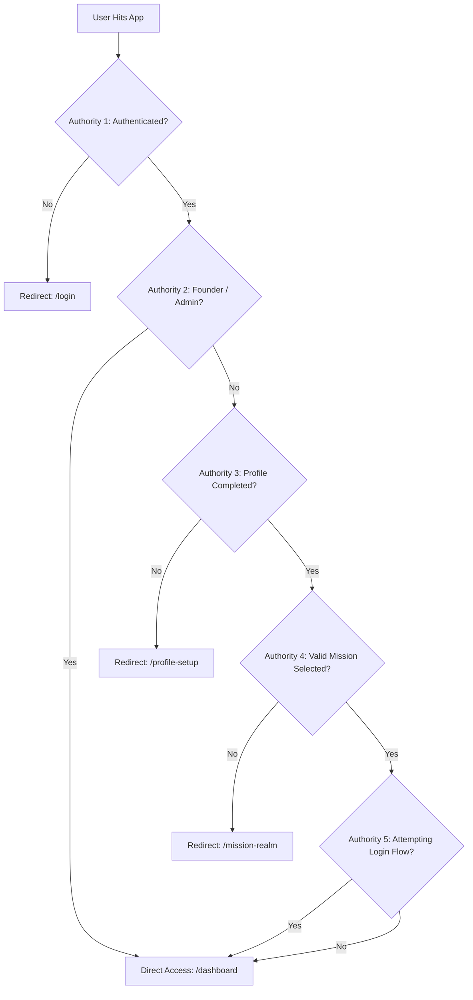

# Volume B — Student Experience

## Part 2 — Dashboard और Learning Command Surface

### Chapter scope और Overview

Dashboard Rank Cracker ecosystem का केवल एक सामान्य “Home Screen” या visual landing page नहीं है। यह authenticated student के लिए एक एकीकृत **Learning Command Surface** है, जहाँ student identity, active recruitment mission, analytical intelligence, priority selection, primary learning pillars, tactical battle tools, real-time update stream और academic archive preview एक एकल, सुसंगत स्क्रीन पर प्रस्तुत होते हैं।

Rank Cracker का केंद्रीय उत्पाद दर्शन (Product Philosophy) **“Zero Fake UI / Truthful Evidence”** सिद्धांत पर आधारित है। इसका अर्थ यह है कि application में किसी भी छात्र को अनुमानित, बनावटी (mock) या भ्रामक डेटा नहीं दिखाया जाता। यदि किसी छात्र ने अभी तक कोई assessment पूरा नहीं किया है या mission data लोड नहीं हुआ है, तो स्क्रीन 0% या भ्रामक प्रगति दिखाने के बजाय स्पष्ट रूप से **“Pending Evidence”** प्रदर्शित करती है। यह अध्याय Dashboard की पूरी आंतरिक वास्तुकला, Riverpod reactive graph, child widgets, state matrix, responsive layout, navigation contracts और verification tests का संपूर्ण स्रोत-आधारित (source-audited) विश्लेषण प्रस्तुत करता है।


---

## Section 1 — Screen Construction, Lifecycle और Initialization Architecture

### Subsection 1.1 — Widget Type, State Ownership और Test Seams

**Canonical Source File:** `lib/features/dashboard/presentation/screens/dashboard_screen.dart`

```dart
class DashboardScreen extends ConsumerStatefulWidget {
  const DashboardScreen(
      {super.key, this.disableKnowledgeEngineInitForTest = false});

  final bool disableKnowledgeEngineInitForTest;

  @override
  ConsumerState<DashboardScreen> createState() => _DashboardScreenState();
}
```

#### Line-by-Line Code Explanation & Implementation Analysis:
1. `class DashboardScreen extends ConsumerStatefulWidget`: Dashboard केवल StatelessWidget या सामान्य StatefulWidget नहीं है। यह Flutter Riverpod का `ConsumerStatefulWidget` है। यह दोहरी ज़िम्मेदारी संभालता है:
   - Riverpod providers को reactive रूप से observe करना (ताकि Knowledge Engine या Session में परिवर्तन होते ही UI पुनः build हो सके)।
   - अपने local lifecycle (जैसे asynchronous session preference loading और `ScrollController` lifecycle) का स्वामित्व बनाए रखना।
2. `final bool disableKnowledgeEngineInitForTest`: यह एक स्पष्ट **Test Seam** है। सामान्य runtime में Dashboard लोड होते ही background में `KnowledgeEngine.instance.initialize()` को trigger करता है। परंतु unit tests और headless widget tests में जहाँ Firebase या network mocks उपलब्ध नहीं होते, वहाँ यह flag pass करके side-effectual background initialization को deterministic रूप से रोका जाता है।

### Subsection 1.2 — Local Screen State, Fallbacks और Memory Guards

```dart
class _DashboardScreenState extends ConsumerState<DashboardScreen> {
  String userName = 'Warrior';
  String examName = 'UNSPECIFIED MISSION';
  String? userPhoto;

  final ScrollController _scrollController = ScrollController();

  @override
  void dispose() {
    _scrollController.dispose();
    super.dispose();
  }
```

#### Implementation Note — Memory Safety & Fallbacks:
- **Safe Fallback Constants:** Local state चर (`userName`, `examName`) कभी भी `null` से प्रारंभ नहीं होते। यदि session storage खाली हो या asynchronous read में विलंब हो, तो null-pointer rendering crash के स्थान पर `'Warrior'` और `'UNSPECIFIED MISSION'` प्रदर्शित होते हैं।
- **ScrollController Lifecycle Management:** `_scrollController` को screen state द्वारा instantiate किया जाता है और `dispose()` lifecycle method में इसे अनिवार्य रूप से dispose किया जाता है। यदि controller को dispose न किया जाए, तो navigation stack में आगे-पीछे जाने पर memory leak की संभावना होती है।

### Subsection 1.3 — Two-Track Initialization Pipeline (`initState` & Session Read)

```dart
  @override
  void initState() {
    super.initState();
    _loadData();
    if (!widget.disableKnowledgeEngineInitForTest) {
      WidgetsBinding.instance.addPostFrameCallback((_) {
        if (!KnowledgeEngine.instance.isInitialized &&
            !KnowledgeEngine.instance.isLoading) {
          KnowledgeEngine.instance.initialize();
        }
      });
    }
  }

  Future<void> _loadData() async {
    final name = await SessionManager.getStudentName();
    final photo = await SessionManager.getStudentPhoto();
    final eName = await SessionManager.getExamName();
    if (!mounted) return;
    setState(() {
      userName = name ?? 'Warrior';
      userPhoto = photo;
      examName = eName ?? 'Mission';
    });
  }
```

#### Execution Sequence & Architectural Rationale:
Dashboard initialization दो समानांतर ट्रैक्स में विभाजित है:
1. **Track 1 (Local Session Read):** `_loadData()` method `SessionManager` के asynchronous getters (`getStudentName()`, `getStudentPhoto()`, `getExamName()`) से SharedPreferences में सुरक्षित छात्र विवरण प्राप्त करता है। ध्यान दें कि `setState()` से पूर्व `if (!mounted) return;` guard लगाया गया है। यदि asynchronous disk I/O के दौरान उपयोगकर्ता स्क्रीन से बाहर navigate कर जाता है, तो unmounted state पर `setState()` call नहीं होता, जिससे Flutter framework runtime error से सुरक्षा मिलती है।
2. **Track 2 (Asynchronous Engine Bootstrap):** Knowledge Engine भारी गणनाएँ (knowledge graph parsing, mastery decay, node indexing) करता है। यदि इसे `initState()` के synchronous execution block में चलाया जाए, तो initial UI frame drop हो जाएगा (jank पैदा होगा)। इसलिए `WidgetsBinding.instance.addPostFrameCallback` का उपयोग करके पहला visual frame render होने के तुरंत बाद Knowledge Engine initialization प्रारंभ किया जाता है। साथ ही `!KnowledgeEngine.instance.isInitialized && !KnowledgeEngine.instance.isLoading` guards यह सुनिश्चित करते हैं कि redundant initialization requests न भेजी जाएँ।

---

## Section 2 — Intelligence State Binding और Riverpod Reactive Graph

### Subsection 2.1 — Watched Providers Inventory

Screen के `build(BuildContext context)` method में कई Riverpod providers को watch किया जाता है, जो संपूर्ण स्क्रीन के डेटा पाइपलाइन का निर्माण करते हैं:

```dart
@override
Widget build(BuildContext context) {
  final knowledge = ref.watch(knowledgeEngineProvider);
  final coverage = knowledge.coverageState;
  final risk = knowledge.riskState;
  final momentum = knowledge.momentumState;
  final readiness = ref.watch(missionReadinessProvider);
  final sessionUser = ref.watch(sessionUserProvider).valueOrNull;
  final nodes = ref.watch(allNodesProvider);
```

#### Data Contracts और Provider भूमिकाएँ:
1. **`knowledgeEngineProvider` (`KnowledgeEngine`):** सम्पूर्ण knowledge graph का analytical core। यह `coverageState`, `riskState`, `momentumState` और `nodeStates` map (`Map<String, NodeRuntimeState>`) का स्वामी है।
2. **`missionReadinessProvider` (`ReadinessState?`):** छात्र की संपूर्ण मिशन-तैयारी (0-100 score) की analytical projection।
3. **`sessionUserProvider` (`SessionUser?`):** Authenticated user का session contract (`recruitmentId`, `examId`, `examName`, `name`, `photo`)।
4. **`allNodesProvider` (`List<MicroTopicNode>`):** वर्तमान चयनित मिशन के सभी academic nodes का संपूर्ण सेट।

### Subsection 2.2 — Header Evidence Verification Predicate

```dart
final hasHeaderEvidence =
    nodes.isNotEmpty && coverage != null && coverage.totalNodes > 0;
```

#### Truthful Evidence Boundary:
Rank Cracker वास्तुकला में “User ने मिशन चुना हुआ है” और “उस मिशन का पाठ्यक्रम डेटा वास्तव में लोड होकर सत्यापित हो चुका है” के बीच कड़ा अंतर रखा गया है। 
`hasHeaderEvidence` तभी `true` होता है जब:
- Nodes की सूची खाली न हो (`nodes.isNotEmpty`),
- `coverageState` null न हो, और
- `coverage.totalNodes` शून्य से अधिक हो (`totalNodes > 0`)।
यदि इनमें से कोई भी शर्त पूरी नहीं होती, तो header “MISSION EVIDENCE PENDING” प्रदर्शित करता है, जिससे छात्र को भ्रमित होने से बचाया जाता है।

### Subsection 2.3 — BattleEngine Priority Node Selection Algorithm

```dart
final priorityNode = BattleEngine.getPriorityNode(
  nodes,
  knowledge.nodeStates,
  riskFactor: risk?.overallRisk ?? 0.0,
);
```

#### Algorithm Workflow & Logic:
छात्र को आज क्या पढ़ना चाहिए, यह किसी स्थिर सूची के पहले तत्व (first element) से नहीं चुना जाता। `BattleEngine.getPriorityNode` निम्नलिखित प्राथमिकताओं के आधार पर गणना करता है:
1. **Node Importance & Weight:** उच्च परीक्षा महत्व वाले nodes को प्राथमिकता दी जाती है।
2. **Runtime Mastery & Weakness:** जिन nodes पर छात्र का mastery score कम है या जहाँ failure events दर्ज हुए हैं।
3. **Decay Risk Factor:** समय बीतने के साथ विस्मरण (memory decay) के कारण जो विषय जोखिम में आ चुके हैं।
4. **Fallback Safety:** यदि `riskState` अभी उपलब्ध नहीं है, तो `risk?.overallRisk ?? 0.0` safe default का उपयोग किया जाता है।

---

## Section 3 — Visual Layout, Noir Theme और Sizing Hierarchy

### Subsection 3.1 — Tactical Noir Background और Scaffolding

Dashboard का visual shell `Scaffold` और `TacticalNoirBackground` से निर्मित है:

```dart
return Scaffold(
  backgroundColor: AppColors.background,
  body: TacticalNoirBackground(
    child: SafeArea(
      child: CustomScrollView(
        controller: _scrollController,
        physics: const BouncingScrollPhysics(),
        slivers: [
          // 7 Core Folds
        ],
      ),
    ),
  ),
);
```

- **Background Palette:** `AppColors.background` (गहरा काला/डार्क स्पेस #000000 या #0A0E1A) एक उच्च-एकाग्रता, व्याकुलता-मुक्त (distraction-free) वातावरण प्रदान करता है।
- **TacticalNoirBackground:** सूक्ष्म ग्रिड और cosmic ambient glow प्रदान करता है जो Rank Cracker के tactical aesthetic को परिभाषित करता है।
- **CustomScrollView & Slivers:** Dashboard एक single-axis, sliver-driven viewport है। Slivers का उपयोग lazy rendering और smooth scrolling सुनिश्चित करता है। iOS और Android दोनों पर स्वाभाविक अहसास के लिए `BouncingScrollPhysics()` प्रयुक्त है।

### Subsection 3.2 — Responsive Metrics Computation (`ResponsiveHelper`)

Screen में layout hardcoding के स्थान पर `ResponsiveHelper` का उपयोग किया गया है:
- **Horizontal Screen Padding:** `ResponsiveHelper.wp(context, 0.05)` — screen width का 5% दोनों ओर समान मार्जिन देता है।
- **Section Spacing:** `ResponsiveHelper.sectionSpacing(context)` — छोटे मोबाइल, बड़े फोन और टैबलेट पर dynamic spacing प्रबंधित करता है।
- **Bottom Clearance:** अंतिम sliver में `const SliverToBoxAdapter(child: SizedBox(height: 100))` जोड़ा गया है। यह 100px का clearance यह सुनिश्चित करता है कि जब छात्र स्क्रॉल करके नीचे पहुँचे, तो निचला सामग्री ब्लॉक `MainNavigationShell` के bottom navigation bar के पीछे न छिपे।

---

## Section 4 — Fold 1: Command Level और Student Identity Surface

### Subsection 4.1 — CommandHeader Widget Architecture

**Source File:** `lib/shared/widgets/command_header.dart`

```dart
SliverToBoxAdapter(
  child: CommandHeader(
    userName: sessionUser?.name ?? userName,
    userPhoto: sessionUser?.photo ?? userPhoto,
    examName: sessionUser?.examName ?? examName,
    readiness: readiness,
    momentum: momentum,
    missionEvidenceVerified: hasHeaderEvidence,
  ),
),
```

`CommandHeader` छात्र की पहचान, चयनित परीक्षा और तैयारी की स्थिति का शीर्ष-स्तरीय फ्लैगशिप विजेट है।

```dart
class CommandHeader extends StatelessWidget {
  final String userName;
  final String? userPhoto;
  final String examName;
  final ReadinessState? readiness;
  final MomentumState? momentum;
  final bool missionEvidenceVerified;
```

#### Avatar Interaction & Profile Entry Point:
Header के बाईं ओर छात्र का गोल अवतार (Circular Avatar) प्रदर्शित होता है:
```dart
GestureDetector(
  onTap: () {
    context.push(AppRoutes.profile);
  },
  child: CircleAvatar(
    radius: ResponsiveHelper.sp(context, 18),
    backgroundColor: AppColors.surface,
    child: ClipRRect(
      borderRadius: BorderRadius.circular(22),
      child: userPhoto != null
          ? Image.network(userPhoto!, fit: BoxFit.cover)
          : Image.asset('assets/images/logo.png', fit: BoxFit.cover),
    ),
  ),
),
```
- यदि `userPhoto` उपलब्ध है, तो network image render होती है; अन्यथा official brand logo (`assets/images/logo.png`) fallback बनता है।
- अवतार के निचले दाएँ कोने पर एक स्वर्ण (`AppColors.gold`) एडिट बैज आइकन है। अवतार पर टैप करने से छात्र `AppRoutes.profile` स्क्रीन पर नेविगेट करता है।

### Subsection 4.2 — Dynamic Time-Based Greeting Engine

`CommandHeader` में वर्तमान समय के आधार पर गतिशील अभिवादन तैयार किया जाता है:
```dart
String _greeting() {
  final hour = DateTime.now().hour;
  if (hour < 12) return 'Good Morning';
  if (hour < 17) return 'Good Afternoon';
  return 'Good Evening';
}
```
यह स्ट्रिंग uppercase में `AppTypography.label` के साथ 8sp आकार और `Colors.white54` में प्रस्तुत होती है।

### Subsection 4.3 — Mission Evidence Line State Machine

```dart
String _missionEvidenceLine() {
  final hasReadiness = missionEvidenceVerified && readiness != null;
  final hasMomentum = missionEvidenceVerified &&
      momentum != null &&
      momentum!.studyStreakDays > 0;
  if (!missionEvidenceVerified || (!hasReadiness && !hasMomentum)) {
    return 'MISSION EVIDENCE PENDING';
  }
  final readinessText = hasReadiness
      ? 'READINESS ${readiness!.score.toInt()}%'
      : 'READINESS PENDING';
  final streakText =
      hasMomentum ? 'STREAK ${momentum!.studyStreakDays}D' : 'STREAK PENDING';
  return '$readinessText - $streakText';
}
```

#### State Machine Outcomes:
1. **Unverified / Cold Start:** `'MISSION EVIDENCE PENDING'` (स्वर्ण रंग में चमकता हुआ)।
2. **Partial Evidence (Only Streak):** `'READINESS PENDING - STREAK 3D'`।
3. **Full Evidence:** `'READINESS 78% - STREAK 12D'`।

### Subsection 4.4 — Notification Action Trigger

Header के दाईं ओर notification icon button स्थापित है:
```dart
IconButton(
  onPressed: () {
    context.push(AppRoutes.notificationCenter);
  },
  icon: Icon(Icons.notifications_none_rounded,
      color: AppColors.gold, size: ResponsiveHelper.sp(context, 24)),
),
```
इस पर टैप करने से छात्र सीधे Sentinel Notification Center (`AppRoutes.notificationCenter`) में जाता है।

---

## Section 5 — Fold 1 (Continued): Mission Status Matrix (Isolated Gauges)

### Subsection 5.1 — Status Section Builder (`_buildPreparationStatusSection`)

CommandHeader के तुरंत बाद छात्र की 4 प्राथमिक तैयारी मेट्रिक्स का ग्रिड आता है:

```dart
SliverToBoxAdapter(
  child: Padding(
    padding: EdgeInsets.symmetric(
        horizontal: ResponsiveHelper.wp(context, 0.05)),
    child: _buildPreparationStatusSection(
        coverage, risk, readiness, momentum, nodes, knowledge),
  ),
),
```

### Subsection 5.2 — Evidence Flags और Failure Guards

```dart
final hasMissionNodes = nodes.isNotEmpty;
final hasCoverageEvidence =
    hasMissionNodes && coverage != null && coverage.totalNodes > 0;
final hasMomentumEvidence =
    momentum != null && momentum.studyStreakDays > 0;
final hasRiskEvidence = hasCoverageEvidence && risk != null;
final hasReadinessEvidence = hasCoverageEvidence && readiness != null;
```

प्रत्येक कार्ड के लिए एक समर्पित boolean guard निर्धारित है। जब तक वास्तविक प्रमाण नहीं मिलता, तब तक कार्ड "Pending" अवस्था में रहता है।

### Subsection 5.3 — Isolated Status Card Component (`_isolatedStatusCard`)

```dart
Widget _isolatedStatusCard({
  required String label,
  required String value,
  required Color color,
  required IconData icon,
  required bool isPending,
}) {
  return DarkCard(
    padding: const EdgeInsets.symmetric(horizontal: 14, vertical: 12),
    border: Border.all(
      color: isPending
          ? AppColors.borderSoft
          : color.withValues(alpha: 0.35),
      width: 1.0,
    ),
    child: Column(
      crossAxisAlignment: CrossAxisAlignment.start,
      mainAxisSize: MainAxisSize.min,
      children: [
        Row(
          mainAxisAlignment: MainAxisAlignment.spaceBetween,
          children: [
            Text(label, /* typography */),
            Container(
              padding: const EdgeInsets.all(4),
              decoration: BoxDecoration(
                color: color.withValues(alpha: 0.12),
                borderRadius: BorderRadius.circular(6),
              ),
              child: Icon(icon, color: color, size: 14),
            ),
          ],
        ),
        const SizedBox(height: 8),
        FittedBox(
          fit: BoxFit.scaleDown,
          child: isPending
              ? Container(
                  padding: const EdgeInsets.symmetric(horizontal: 8, vertical: 3),
                  decoration: BoxDecoration(
                    color: AppColors.gold.withValues(alpha: 0.08),
                    borderRadius: BorderRadius.circular(6),
                    border: Border.all(color: AppColors.gold.withValues(alpha: 0.2)),
                  ),
                  child: Text(
                    'Pending Evidence',
                    style: AppTypography.label.copyWith(
                      fontSize: 10,
                      fontWeight: FontWeight.w600,
                      color: AppColors.gold.withValues(alpha: 0.8),
                    ),
                  ),
                )
              : Text(
                  value,
                  style: AppTypography.hero.copyWith(
                    fontSize: 18,
                    fontWeight: FontWeight.w800,
                    color: color,
                  ),
                ),
        ),
      ],
    ),
  );
}
```

### Subsection 5.4 — 4 Core Status Metrics Detail

1. **READINESS:**
   - **Label:** `"READINESS"`
   - **Icon:** `Icons.military_tech_rounded` (Gold: `AppColors.gold`)
   - **Value:** `readiness.score.toInt()%` (उदा. `74%`) या `'Pending Evidence'`।
   - **User Value:** छात्र को संपूर्ण परीक्षा स्तर पर अपनी तात्कालिक सफलता संभावना का आभास कराता है।
2. **COVERAGE:**
   - **Label:** `"COVERAGE"`
   - **Icon:** `Icons.track_changes_rounded` (Light Blue: `Colors.lightBlueAccent`)
   - **Value:** `(coverage.coveragePercent * 100).toInt()%` (उदा. `62%`) या `'Pending Evidence'`।
   - **User Value:** संपूर्ण पाठ्यक्रम में से कितने प्रतिशत अवधारणाओं का अध्ययन पूरा हो चुका है।
3. **STREAK:**
   - **Label:** `"STREAK"`
   - **Icon:** `Icons.local_fire_department_rounded` (Orange: `Colors.orangeAccent`)
   - **Value:** `${momentum.studyStreakDays}d` (उदा. `5d`) या `'Pending Evidence'`।
   - **User Value:** छात्र के निरंतर अध्ययन अनुशासन और गति (momentum) का प्रमाण।
4. **RISK:**
   - **Label:** `"RISK"`
   - **Icon:** `Icons.shield_outlined`
   - **Color:** `risk.highRisk ? Colors.redAccent : Colors.greenAccent`
   - **Value:** `risk.highRisk ? "HIGH" : "LOW"` या `'Pending Evidence'`।
   - **User Value:** क्या छात्र की वर्तमान तैयारी में गंभीर अवधारणात्मक कमियाँ (critical weakness gaps) हैं।

---

## Section 6 — Fold 1 (Continued): Today's Priority Node Command Card

### Subsection 6.1 — Today's Focus Layout (`_buildTodayFocusSection`)

```dart
Widget _buildTodayFocusSection(
    MicroTopicNode? priorityNode, KnowledgeEngine knowledge) {
  final state =
      priorityNode != null ? knowledge.getState(priorityNode.id) : null;
```

छात्र जब ऐप खोलता है, तो उसे यह सोचने में समय व्यर्थ नहीं करना पड़ता कि "मैं आज क्या पढूँ?"। यह कार्ड BattleEngine द्वारा निर्धारित दैनिक सर्वोच्च प्राथमिकता प्रस्तुत करता है।

### Subsection 6.2 — Priority Resolution States Matrix

कार्ड के शीर्षक और विवरण की स्थिति निम्नलिखित मैट्रिक्स द्वारा निर्धारित होती है:

| Priority Node | Node Runtime State | Title Copy | Subtitle / Body Copy |
| :--- | :--- | :--- | :--- |
| `null` | `null` | `"Your first priority unlocks after the first assessment"` | `"No weakness has been inferred yet. Start learning to build your map."` |
| `Node Exists` | `null` | `priorityNode.title` | `"Mastery evidence pending. Start learning to build a real priority signal."` |
| `Node Exists` | `State Exists` | `priorityNode.title` | `"Target: ${(state.mastery * 100).toInt()}% Mastery"` |

कार्ड के दाएँ सिरे पर `Icons.arrow_forward_ios_rounded` (Gold, size 14) स्थित है, जो इंगित करता है कि छात्र इस विषय पर सीधे कार्रवाई कर सकता है।

---

## Section 7 — Fold 2: Core Pillars (Mission Hub)

### Subsection 7.1 — Mission Hub Section Overview

Mission Hub Rank Cracker के 4 मुख्य अध्ययन स्तंभों (Core Pillars) का 2x2 कॉम्पैक्ट ग्रिड है:

```dart
SliverToBoxAdapter(
  child: Padding(
    padding: EdgeInsets.fromLTRB(
        ResponsiveHelper.wp(context, 0.05),
        ResponsiveHelper.sectionSpacing(context),
        ResponsiveHelper.wp(context, 0.05),
        8),
    child: Text('MISSION HUB',
        style: AppTypography.label.copyWith(
            fontSize: 11,
            letterSpacing: 1.2,
            fontWeight: FontWeight.bold,
            color: Colors.white70)),
  ),
),
```

### Subsection 7.2 — Compact Pillar Card Component (`_compactPillarCard`)

```dart
Widget _compactPillarCard(IconData icon, String label, VoidCallback onTap,
    {required Color color, bool secondary = false}) {
  return GestureDetector(
    onTap: onTap,
    child: DarkCard(
      padding: const EdgeInsets.symmetric(vertical: 14, horizontal: 10),
      child: Column(
        mainAxisAlignment: MainAxisAlignment.center,
        children: [
          Icon(
            icon,
            color: color.withValues(alpha: secondary ? 0.85 : 1.0),
            size: secondary ? 22 : 24,
          ),
          const SizedBox(height: 6),
          Text(label,
              textAlign: TextAlign.center,
              maxLines: 1,
              overflow: TextOverflow.ellipsis,
              style: AppTypography.label.copyWith(
                  fontSize: secondary ? 11 : 12,
                  fontWeight: FontWeight.bold,
                  color: Colors.white)),
        ],
      ),
    ),
  );
}
```

### Subsection 7.3 — Four Pillars Detail & Routing Contracts

1. **THE CRUCIBLE:**
   - **Icon:** `Icons.local_fire_department` (OrangeAccent)
   - **Navigation:** `context.go(AppRoutes.crucible)`
   - **Purpose:** 98-दिवसीय समयबद्ध दैनिक अभ्यास और परीक्षा चक्र में प्रवेश।
2. **DIGIBOOK:**
   - **Icon:** `Icons.menu_book_rounded` (BlueAccent)
   - **Navigation:** `context.go(AppRoutes.digibook, extra: priorityNode)`
   - **Purpose:** आज के priority node से जुड़े डिजिटल टेक्स्टबुक और संकल्पना नोट्स खोलना।
3. **TEST ARENA:**
   - **Icon:** `Icons.bolt_rounded` (Gold, `secondary: true`)
   - **Navigation:** `context.push(AppRoutes.testArena)`
   - **Purpose:** वास्तविक परीक्षा वातावरण में मॉक टेस्ट और लाइव बैटल्स आयोजित करना।
4. **CAREER SIGNALS:**
   - **Icon:** `Icons.work_outline_rounded` (CyanAccent, `secondary: true`)
   - **Navigation:** `context.push(AppRoutes.opportunities)`
   - **Purpose:** Sentinel AI द्वारा संकलित आगामी सरकारी भर्तियों, पात्रता सूचनाओं और करियर अवसरों की ट्रैकिंग।

### Subsection 7.4 — Shell Routing (`go`) vs Root Navigation (`push`) Mechanics

- **`context.go(...)` (Crucible & DigiBook):** ये दोनों स्क्रीन `app_router.dart` के `StatefulShellRoute.indexedStack` की मुख्य शाखाओं (branches) का हिस्सा हैं। इसलिए यहाँ `go()` का उपयोग किया जाता है ताकि bottom navigation bar अपनी सही टैब स्थिति बनाए रखे और बैक-स्टैक विकृत न हो।
- **`context.push(...)` (Test Arena & Career Signals):** ये स्वतंत्र फुल-स्क्रीन वर्कफ़्लो हैं। इन्हें `push()` द्वारा मुख्य शेल्फ़ के ऊपर स्टैक किया जाता है, ताकि छात्र जब परीक्षा या अवसर देख चुके, तो back दबाकर सीधे Dashboard पर उसी स्थिति में लौट सके।

---

## Section 8 — Fold 3: Battle Tools Ecosystem (`BattleToolsGrid`)

### Subsection 8.1 — Grid Composition (`BattleToolsGrid`)

**Source File:** `lib/features/dashboard/presentation/widgets/battle_tools/battle_tools_grid.dart`

```dart
class BattleToolsGrid extends StatelessWidget {
  const BattleToolsGrid({super.key});

  @override
  Widget build(BuildContext context) {
    int crossAxisCount = ResponsiveHelper.isTablet(context) ? 4 : 2;
    double aspectRatio = ResponsiveHelper.isCompact(context) ? 1.28 : 1.22;

    return GridView(
      shrinkWrap: true,
      physics: const NeverScrollableScrollPhysics(),
      gridDelegate: SliverGridDelegateWithFixedCrossAxisCount(
        crossAxisCount: crossAxisCount,
        mainAxisSpacing: 10,
        crossAxisSpacing: 10,
        childAspectRatio: aspectRatio,
      ),
      children: const [
        TestArenaCard(),
        PyqVaultCard(),
        RevisionDeskCard(),
        RankRadarCard(),
      ],
    );
  }
}
```

- **Responsive Adaptivity:** फ़ोन स्क्रीन पर 2-कॉलम लेआउट और टैबलेट पर 4-कॉलम लेआउट बनता है।
- **Compact Aspect Ratio:** 1.28 (कॉम्पैक्ट) या 1.22 (मानक) पहलू अनुपात कार्ड्स को बिना किसी टेक्स्ट ओवरफ्लो के संतुलित आयताकार रूप देता है।

### Subsection 8.2 — BattleToolCard Base Architecture (`battle_tool_card.dart`)

चारों टूल्स एक ही साझा घटक `BattleToolCard` पर निर्मित हैं।

**Source File:** `lib/features/dashboard/presentation/widgets/battle_tools/battle_tool_card.dart`

```dart
class BattleToolCard extends ConsumerWidget {
  final String title;
  final IconData icon;
  final IconData glowIcon;
  final Color glowColor;
  final String route;
  final String toolKey; // 'test_arena', 'pyq_vault', 'revision_desk', 'rank_radar'
  final bool featured;
```

### Subsection 8.3 — Governance, Exam Gating और Evidence Rules

`BattleToolCard` के निर्माण में कठोर सुरक्षा और प्रमाण सत्यापन नियम लागू हैं:

```dart
final sessionUser =
    ref.watch(sessionUserProvider).valueOrNull ?? SessionUser.getSync();
final stats = ref.watch(userProfileStatsProvider);
final totalBattles = stats['totalBattles'] ?? 0;

final bool isRPSC = sessionUser.examId.toLowerCase().contains('rpsc') ||
    sessionUser.examName.toUpperCase().contains('RPSC');
```

#### Rule 1: Special Exam Boundary (RPSC 1st Grade Gating)
यदि चयनित परीक्षा RPSC से संबंधित है:
- `isReady = false`
- `statusText = 'Not Published'`
- `subtitleText = 'Not Published'`
- `explanationText = 'This RPSC 1st Grade tool is currently not published on the platform.'`

#### Rule 2: Cold Start Evidence Gate (`totalBattles == 0`)
यदि छात्र ने अभी तक एक भी टेस्ट या बैटल नहीं दिया है (`totalBattles == 0`):

| Tool Key | Status Code Badge | Subtitle Copy | Explanation Modal Text |
| :--- | :--- | :--- | :--- |
| `test_arena` | **Needs Event** | Not Ready | *"Test Arena is not ready yet. Standardized test events will appear here when an eligible governed event is available."* |
| `pyq_vault` | **Needs Set** | No PYQ Set | *"No previous year question papers are mapped to your current sub-topic selection yet."* |
| `revision_desk` | **Needs State** | No Revision State | *"Revision Desk requires active bookmarks or weak-topic history to formulate revision cycles."* |
| `rank_radar` | **Needs Data** | Needs Evidence | *"Rank Radar estimates percentiles based on verified test performance history."* |

#### Rule 3: Active State (`totalBattles > 0`)
जब छात्र कम से कम एक बैटल पूरा कर लेता है:
- `isReady = true`
- `statusText = 'Active'`
- `subtitleText = 'Standard Mode'`

### Subsection 8.4 — Explanatory Modal Bottom Sheet (`_showBattleToolStatusSheet`)

जब कोई टूल `isReady == false` अवस्था में होता है और छात्र उस पर टैप करता है, तो एप्लिकेशन क्रैश या मौन रहने के बजाय एक सूचनात्मक बॉटम शीट प्रस्तुत करती है:

```dart
void _showBattleToolStatusSheet(
  BuildContext context,
  String toolTitle,
  String statusCode,
  String explanation,
) {
  showModalBottomSheet(
    context: context,
    backgroundColor: Colors.transparent,
    barrierColor: Colors.black.withValues(alpha: 0.6),
    isScrollControlled: true,
    builder: (ctx) {
      return Container(
        decoration: const BoxDecoration(
          color: Color(0xFF090D1A),
          borderRadius: BorderRadius.only(
            topLeft: Radius.circular(24),
            topRight: Radius.circular(24),
          ),
          border: Border(
            top: BorderSide(color: AppColors.gold, width: 1.5),
          ),
        ),
        padding: const EdgeInsets.all(24),
        child: Column(
          mainAxisSize: MainAxisSize.min,
          crossAxisAlignment: CrossAxisAlignment.start,
          children: [
            // Title + Status Code Badge
            // Explanation prose
            // "Got it" confirmation button
          ],
        ),
      );
    },
  );
}
```

यह शीट छात्र को स्पष्ट रूप से समझाती है कि टूल किस कारण से लॉक है और उसे अनलॉक करने के लिए किस शैक्षणिक प्रमाण की आवश्यकता है।

### Subsection 8.5 — Tool Card Implementations

1. **`TestArenaCard`:** Route `AppRoutes.testArena`, Glow Color: `Colors.orange`, Icon: `Icons.bolt_rounded`.
2. **`PyqVaultCard`:** Route `AppRoutes.pyqVault`, Glow Color: `Color(0xFFD4AF37)` (Gold), Icon: `Icons.menu_book_rounded`.
3. **`RevisionDeskCard`:** Route `AppRoutes.revisionDesk`, Glow Color: `Colors.blue`, Icon: `Icons.refresh_rounded`.
4. **`RankRadarCard`:** Route `AppRoutes.progressTracker`, Glow Color: `Colors.green`, Icon: `Icons.leaderboard_rounded`.

---

## Section 9 — Fold 4: Intelligence Stream (Latest Updates)

### Subsection 9.1 — Real-Time Notification Stream Integration

**Source File:** `lib/features/opportunities/providers/sentinel_intelligence_provider.dart`

```dart
final notificationListProvider = StreamProvider<List<NotificationItem>>((ref) {
  final uid = ref.watch(authNotifierProvider).user?.uid ?? 'guest';
  return ref.watch(sentinelRepositoryProvider).streamNotifications(uid);
});
```

Dashboard में Sentinel AI द्वारा उत्पन्न सूचनाओं का लाइव स्ट्रीम प्रदर्शित होता है:

```dart
SliverToBoxAdapter(
  child: Padding(
    padding: EdgeInsets.symmetric(
        horizontal: ResponsiveHelper.wp(context, 0.05)),
    child: Consumer(
      builder: (context, ref, _) {
        final notifsAsync = ref.watch(notificationListProvider);
        return notifsAsync.maybeWhen(
          data: (notifs) {
            if (notifs.isEmpty) return const SizedBox.shrink();
            final latest = notifs.first;
            return LatestUpdatesCard(item: {
              'tag': latest.source.toUpperCase(),
              'title': latest.title,
              'meta': 'Just now'
            });
          },
          orElse: () => const SizedBox.shrink(),
        );
      },
    ),
  ),
),
```

### Subsection 9.2 — Empty और Loading Degradation (`SizedBox.shrink()`)

- यदि सूचनाओं की सूची खाली हो (`notifs.isEmpty`) या स्ट्रीम अभी लोड हो रही हो (`loading` / `error`), तो स्क्रीन पर कोई अनावश्यक रिक्त स्थान या लोडिंग स्पिनर नहीं छोड़ा जाता। `const SizedBox.shrink()` रिटर्न होता है, जिससे लेआउट स्वच्छ और अव्यवस्था-मुक्त बना रहता है।

### Subsection 9.3 — LatestUpdatesCard Component (`latest_updates_card.dart`)

**Source File:** `lib/features/dashboard/presentation/widgets/notifications/latest_updates_card.dart`

```dart
class LatestUpdatesCard extends StatelessWidget {
  final Map<String, String> item;

  const LatestUpdatesCard({super.key, required this.item});

  @override
  Widget build(BuildContext context) {
    return DarkCard(
      padding: const EdgeInsets.symmetric(horizontal: 16, vertical: 12),
      child: Row(
        children: [
          const Icon(
            Icons.notification_important_rounded,
            color: AppColors.gold,
            size: 18,
          ),
          const SizedBox(width: 12),
          Expanded(
            child: Column(
              crossAxisAlignment: CrossAxisAlignment.start,
              mainAxisSize: MainAxisSize.min,
              children: [
                Text(item["title"] ?? "Update", /* cardTitle */),
                const SizedBox(height: 3),
                Text("${item["tag"]} • ${item["meta"]}", /* subtitle */),
              ],
            ),
          ),
          const Icon(
            Icons.arrow_forward_ios_rounded,
            size: 14,
            color: AppColors.gold,
          ),
        ],
      ),
    );
  }
}
```

---

## Section 10 — Fold 5: Sacred Archive Preview

### Subsection 10.1 — ArchivePreviewCard Component

**Source File:** `lib/features/dashboard/presentation/widgets/archive/archive_preview_card.dart`

```dart
class ArchivePreviewCard extends StatelessWidget {
  const ArchivePreviewCard({super.key});

  @override
  Widget build(BuildContext context) {
    return GestureDetector(
      onTap: () => context.go(AppRoutes.digibook),
      child: DarkCard(
        child: Column(
          crossAxisAlignment: CrossAxisAlignment.start,
          children: [
            Text('SACRED ARCHIVE', style: AppTypography.cardTitle),
            const SizedBox(height: 10),
            Text(
              'No mission-scoped archive is ready for this mission yet.',
              style: AppTypography.subtitle,
              maxLines: 2,
              overflow: TextOverflow.ellipsis,
            ),
            const SizedBox(height: 18),
            Row(
              children: [
                const Icon(
                  Icons.auto_stories_rounded,
                  color: AppColors.gold,
                  size: 18,
                ),
                const SizedBox(width: 8),
                Expanded(
                  child: Text(
                    'ARCHIVE EVIDENCE PENDING',
                    style: AppTypography.label,
                  ),
                ),
                const Icon(
                  Icons.arrow_forward_ios_rounded,
                  size: 12,
                  color: AppColors.gold,
                ),
              ],
            ),
          ],
        ),
      ),
    );
  }
}
```

- **Purpose & Copy:** यह कार्ड छात्र को प्लेटफॉर्म के गहन अध्ययन संग्रह (Sacred Archive) के बारे में सूचित करता है। जब तक उस विशिष्ट मिशन का पुरातात्विक प्रश्न संग्रह प्रकाशित नहीं होता, यह स्पष्ट रूप से `'ARCHIVE EVIDENCE PENDING'` दिखाता है।
- **Navigation:** कार्ड पर टैप करने पर छात्र सीधे डिजिटल लाइब्रेरी (`context.go(AppRoutes.digibook)`) में जाता है।

---

## Section 11 — Presentation Providers, Analytics Models और Data Contracts

### Subsection 11.1 — `DashboardTopicModel` और `dashboardTopicsProvider`

**Source File:** `lib/features/dashboard/presentation/providers/dashboard_provider.dart`

```dart
class DashboardTopicModel {
  final String topicId;
  final String topicName;
  final String subject;
  final double accuracy;
  final double decayRisk;
  final bool rebuildRequired;
  final bool isMastered;
  final int revisionCount;

  DashboardTopicModel({
    required this.topicId,
    required this.topicName,
    required this.subject,
    required this.accuracy,
    required this.decayRisk,
    required this.rebuildRequired,
    required this.isMastered,
    required this.revisionCount,
  });
}
```

#### Analytical Projections Math:
```dart
final dashboardTopicsProvider = Provider<List<DashboardTopicModel>>((ref) {
  final engine = ref.watch(knowledgeEngineProvider);
  final nodes = engine.allNodes;
  final states = engine.nodeStates;

  return nodes.map((node) {
    final state = states[node.id] ?? NodeRuntimeState(nodeId: node.id);
    
    return DashboardTopicModel(
      topicId: node.id,
      topicName: node.topic,
      subject: node.subject,
      accuracy: state.mastery * 100, 
      decayRisk: (1.0 - state.mastery) * 100,
      rebuildRequired: state.mastery < 0.50,
      isMastered: state.mastery >= 0.85,
      revisionCount: state.revisionLevel,
    );
  }).toList();
});
```

- **Accuracy:** $state.mastery \times 100$
- **Decay Risk:** $(1.0 - state.mastery) \times 100$
- **Rebuild Required Threshold:** $state.mastery < 0.50$ (50% से कम महारत होने पर अनिवार्य पुनर्निर्माण)।
- **Mastered Threshold:** $state.mastery \ge 0.85$ (85% या अधिक होने पर पूर्ण महारत प्राप्त)।

### Subsection 11.2 — `missionReadinessProvider`

```dart
final missionReadinessProvider = Provider<ReadinessState?>((ref) {
  final engine = ref.watch(knowledgeEngineProvider);
  return engine.readinessState;
});
```
यह सरल प्रदाता सीधे `KnowledgeEngine.instance.readinessState` को एक्सपोज़ करता है।

### Subsection 11.3 — `userProfileStatsProvider`

```dart
final userProfileStatsProvider = Provider<Map<String, int>>((ref) {
  final engine = ref.watch(knowledgeEngineProvider);
  final states = engine.nodeStates.values;
  
  int totalBattles = 0;
  for (var s in states) {
    totalBattles += (s.battlesWon + s.battlesLost);
  }
  
  return {
    'totalBattles': totalBattles,
  };
});
```
यह प्रदाता सभी node states में से `battlesWon + battlesLost` का योग निकालकर कुल संपन्न लड़ाइयों (`totalBattles`) की गणना करता है। यही गणना Battle Tools के लिए Cold-Start Unlocking Gate का कार्य करती है।

### Subsection 11.4 — `DashboardScrollProvider` और `DashboardSection` Enum Contract

**Source File:** `lib/features/dashboard/presentation/providers/dashboard_scroll_provider.dart` (Lines 1–15)

```dart
enum DashboardSection {
  header,
  crucible,
  digibook,
  syllabus,
  status,
  tools,
  archive,
  updates,
}

final dashboardActiveSectionProvider = StateProvider<DashboardSection>((ref) => DashboardSection.header);
```

#### Section Coordinates और Scroll Spy Integration:
- `DashboardSection` enum डैशबोर्ड के 8 कार्यात्मक क्षेत्रों (functional zones) का औपचारिक अनुबंध प्रस्तुत करता है:
  1. `header`: छात्र पहचान, अवतार, और मुख्य ग्रीटिंग।
  2. `crucible`: 98-दिवसीय क्रूसिबल प्रोटोकॉल पिलर।
  3. `digibook`: डिजिटल टेक्स्टबुक और पाठ पठन पिलर।
  4. `syllabus`: authority-governed, variable-depth पाठ्यक्रम अन्वेषण पिलर।
  5. `status`: 4-गेज तैयारी स्थिति ग्रिड (Coverage, Risk, Readiness, Streak)।
  6. `tools`: 4 टैक्टिकल बैटल टूल्स का 2x2 ग्रिड।
  7. `archive`: सेक्रेड आर्काइव पूर्वावलोकन कार्ड।
  8. `updates`: सेंटिनल इंटेलिजेंस रीयल-टाइम अपडेट्स।
- **`dashboardActiveSectionProvider`:** यह `StateProvider<DashboardSection>` स्क्रॉल लिसनर द्वारा अपडेट किया जाता है ताकि जब छात्र किसी विशेष फ़ोल्ड में स्क्रॉल करे, तो संबंधित नेविगेशन या एचयूडी ओवरले अपनी सक्रिय स्थिति को प्रतिक्रियात्मक रूप से प्रतिबिंबित कर सके।

---

## Section 12 — Architectural Evolution, Legacy Widgets और Technical Debt Audit

### Subsection 12.1 — Legacy vs Active Presentation Layer Comparison Table

Rank Cracker के विकास के दौरान Presentation Layer में महत्वपूर्ण परिपक्वता आई है। प्रारंभिक प्रोटोटाइप्स में कई स्थिर और मॉक-आधारित विजेट्स थे, जिन्हें अब केंद्रीय नॉलेज इंजन और रिस्पॉन्सिव sliver संरचना से प्रतिस्थापित कर दिया गया है:

| घटक / विजेट | Legacy Implementation | Modern Active Implementation | परिवर्तन का कारण (Rationale) |
| :--- | :--- | :--- | :--- |
| **Status Display** | `MacroWarStatusCard` (हार्डकोडेड Phase: 2, 71% Accuracy) | `_buildPreparationStatusSection` (लाइव Coverage, Risk, Readiness, Streak) | Zero-Fake UI नियम; मॉक डेटा को हटाकर लाइव नॉलेज इंजन स्टेट से जोड़ना। |
| **Mastery Display** | `LiveMasteryCard` (Firestore Progress का सीधा गणितीय औसत) | `knowledgeEngineProvider.coverageState` & `ReadinessState` | साधारण औसत के स्थान पर नोड भार (node weight) और decay-aware गणना। |
| **Topic Grid** | `SubjectStatsCard` (Gradient container, Poppins फ़ॉन्ट) | `dashboardTopicsProvider` & `DashboardTopicModel` | Dark Tactical Noir थीम का मानकीकरण और सटीक डेटा कॉन्ट्रैक्ट। |
| **Shell Navigation** | `MainCosmosScreen` + `DashboardBottomNav` (स्थानीय PageView) | `StatefulShellRoute.indexedStack` (`app_router.dart`) | डीप-लिंकिंग, URL सिंक और रूट-लेवल स्टेट प्रिजर्वेशन सुनिश्चित करना। |

### Subsection 12.2 — Repository Boundary Findings (`DashboardRepository`)

**Source File:** `lib/features/dashboard/data/repositories/dashboard_repository.dart`

प्रोजेक्ट ऑडिट में यह महत्वपूर्ण खोज (finding) सामने आई है कि `DashboardRepository.mapTopics` में लेगेसी लोकल डेटा सोर्स को अक्षम कर दिया गया है:
```dart
class DashboardRepository {
  static List<DashboardTopicModel> mapTopics(List<dynamic> raw) {
    return [];
  }
}
```
**Architectural Decision Note:** वर्तमान सक्रिय डैशबोर्ड अपनी topic projections सीधे `dashboard_provider.dart` में Knowledge Engine से बनाता है। `DashboardRepository` अब अप्रयुक्त (unused) है। भविष्य के तकनीकी ऋण निवारण (technical debt cleanup) में इस रिपॉजिटरी को या तो नॉलेज इंजन के साथ औपचारिक अडैप्टर के रूप में पुनर्निर्मित किया जाएगा या सुरक्षित रूप से हटा दिया जाएगा।

### Subsection 12.3 — `DashboardLocalDatasource` और Isar/SQLite Offline Caching का विमुद्रीकरण (Zero-Fake Deprecation)

**Source File:** `lib/database/local/dashboard_local_datasource.dart` (Lines 1–72)

प्रारंभिक प्रोटोटाइप्स में स्थानीय Isar/SQLite डेटाबेस के माध्यम से ऑफ़लाइन विषयों को कैश करने का प्रयास किया गया था। किंतु ऑडिट में यह पाया गया कि स्थानीय कैश में अक्सर बासी (stale) या असत्यापित डेटा रह जाता था, जिससे छात्र को गलत महारत और कवरेज प्रदर्शित होने का गंभीर जोखिम था।

```dart
class DashboardLocalDatasource {
  final dynamic isar;

  DashboardLocalDatasource(this.isar);

  Future<void> saveTopic(dynamic topic) async => return;
  Future<void> saveTopics(List<dynamic> topics) async => return;

  Future<List<dynamic>> getAllTopics() async {
    // LEGACY LOCAL DATA SOURCE DISABLED
    return [];
  }

  Future<List<dynamic>> getWeakTopics() async {
    // LEGACY LOCAL DATA SOURCE DISABLED
    return [];
  }

  Future<int> masteredTopicsCount() async => 0;
  Future<int> rebuildTargetsCount() async => 0;
}
```

#### Constitutional Invariant Verification:
1. **Disabled Mock Surface:** `getAllTopics()` और `getWeakTopics()` कड़ाई से खाली सूची `[]` लौटाते हैं।
2. **Automated Zero-Fake Test:** `test/features/personalization/zero_fake_ui_test.dart` इस व्यवहार की पुष्टि करता है:
   ```dart
   test('DashboardLocalDatasource returns empty topics - PASS', () async {
     final ds = DashboardLocalDatasource(null);
     expect(await ds.getAllTopics(), isEmpty);
     expect(await ds.getWeakTopics(), isEmpty);
   });
   ```
3. **Architectural Law:** कोई भी स्थानीय डेटा स्रोत तब तक डेटा की आपूर्ति नहीं कर सकता जब तक वह नॉलेज इंजन के लाइव एटॉमिक इवेंट लेजर से प्रमाणित न हो।

---

## Section 13 — Security, Authority Gates और Route Integration

### Subsection 13.1 — Router Guards & Authority Pipeline

**Source File:** `lib/core/router/app_router.dart`

Dashboard तक पहुँचने के लिए किसी भी छात्र को 5 कड़े **Authority Gates** से गुजरना पड़ता है:



1. **Authority 1 (Authentication Gate):** `FirebaseAuth.instance.currentUser == null` होने पर छात्र को `AppRoutes.login` पर भेज दिया जाता है।
2. **Authority 2 (Privilege Gate):** `FounderIdentity.isFounderUser(user)` होने पर सभी ऑनबोर्डिंग और मिशन गेट्स बाईपास हो जाते हैं।
3. **Authority 3 (Profile Setup Gate):** `SessionManager.profileCompletedSync()` जाँचना। यदि अधूरा है, तो `AppRoutes.profileSetup` पर रीडायरेक्ट।
4. **Authority 4 (Mission Selection Gate):** `SessionManager.selectedExamSync()` का सत्यापन। यदि कोई मान्य मिशन चयनित नहीं है, तो `AppRoutes.missionRealm` पर रीडायरेक्ट।
5. **Authority 5 (Post-Auth Flow Guard):** यदि प्रमाणित छात्र लॉगिन स्क्रीन पर जाने का प्रयास करता है, तो उसे सीधे `AppRoutes.dashboard` पर लौटा दिया जाता है।

### Subsection 13.2 — Root StatefulShellRoute Integration

Dashboard रूट शेल्फ की पहली शाखा (`Branch 0`) पर स्थित है:

```dart
StatefulShellBranch(
  navigatorKey: _shellNavigatorDashboardKey,
  routes: [
    GoRoute(
      path: AppRoutes.dashboard,
      builder: (context, state) => const DashboardScreen(),
    ),
  ],
),
```

यह शेल्फ संरचना यह सुनिश्चित करती है कि जब छात्र Crucible, DigiBook या Syllabus के बीच स्विच करता है, तो Dashboard की स्क्रॉल स्थिति और स्थानीय स्टेट मेमोरी में सुरक्षित रहती है।

---

## Section 14 — Quality Assurance, Test Coverage और Evidence Verification

### Subsection 14.1 — Zero-Fake UI Validation Test (`zero_fake_ui_test.dart`)

**Test File:** `test/features/personalization/zero_fake_ui_test.dart`

```dart
group('RC-STUDENT-ZERO-FAKE-01 Validation Tests', () {
  test('DashboardLocalDatasource returns empty topics - PASS', () async {
    final ds = DashboardLocalDatasource(null);
    expect(await ds.getAllTopics(), isEmpty);
    expect(await ds.getWeakTopics(), isEmpty);
  });

  test('DashboardRepository.mapTopics returns empty list - PASS', () {
    expect(DashboardRepository.mapTopics([]), isEmpty);
  });
});
```
यह टेस्ट यह प्रमाणित करता है कि कोई भी लेगेसी लोकल डेटा सोर्स या रिपॉजिटरी बिना सत्यापित प्रमाण के नकली विषयों की आपूर्ति नहीं कर सकती।

### Subsection 14.2 — Visual Device QA Multi-Screen Test (`student_journey_fix2_visual_device_qa_test.dart`)

**Test File:** `test/student_journey/student_journey_fix2_visual_device_qa_test.dart`

```dart
factory _JourneyCase.dashboard(
  String fileName,
  Size size, {
  double textScale = 1,
}) {
  return _JourneyCase(
    fileName: fileName,
    screen: _JourneyScreen.dashboard,
    size: size,
    textScale: textScale,
    markers: const ['MISSION HUB', 'THE CRUCIBLE', 'DIGIBOOK'],
  );
}
```

Dashboard को विभिन्न स्क्रीन साइज़ (कॉम्पैक्ट फोन 360x640, आधुनिक स्मार्टफोन 390x844, और टैबलेट 768x1024) पर रेंडर करके यह सत्यापित किया जाता है कि:
1. `'MISSION HUB'`, `'THE CRUCIBLE'`, और `'DIGIBOOK'` के विजुअल मार्कर्स बिना ओवरफ्लो के रेंडर होते हैं।
2. Custom Google Fonts (`Sora`, `Inter`, `Poppins`, `Cinzel`) सही तरीके से लोड होते हैं।
3. विभिन्न टेक्स्ट स्केल्स (1.0x, 1.2x) पर लेआउट ब्रेक नहीं होता।

---

## Section 15 — Reference Appendices

### Appendix 15.1 — File, Widget और Class Cross-Reference Table

| स्तर / भूमिका | क्लास / आइडेंटिफ़ायर | कैनोनिकल फ़ाइल पाथ |
| :--- | :--- | :--- |
| **Main Screen** | `DashboardScreen` | `lib/features/dashboard/presentation/screens/dashboard_screen.dart` |
| **Header Widget** | `CommandHeader` | `lib/shared/widgets/command_header.dart` |
| **Battle Tools Container** | `BattleToolsGrid` | `lib/features/dashboard/presentation/widgets/battle_tools/battle_tools_grid.dart` |
| **Reusable Battle Tool** | `BattleToolCard` | `lib/features/dashboard/presentation/widgets/battle_tools/battle_tool_card.dart` |
| **Test Arena Tool Card** | `TestArenaCard` | `lib/features/dashboard/presentation/widgets/battle_tools/test_arena_card.dart` |
| **PYQ Vault Tool Card** | `PyqVaultCard` | `lib/features/dashboard/presentation/widgets/battle_tools/pyq_vault_card.dart` |
| **Revision Tool Card** | `RevisionDeskCard` | `lib/features/dashboard/presentation/widgets/battle_tools/revision_desk_card.dart` |
| **Rank Radar Tool Card** | `RankRadarCard` | `lib/features/dashboard/presentation/widgets/battle_tools/rank_radar_card.dart` |
| **Update Card** | `LatestUpdatesCard` | `lib/features/dashboard/presentation/widgets/notifications/latest_updates_card.dart` |
| **Archive Card** | `ArchivePreviewCard` | `lib/features/dashboard/presentation/widgets/archive/archive_preview_card.dart` |
| **Presentation Provider** | `dashboardTopicsProvider` | `lib/features/dashboard/presentation/providers/dashboard_provider.dart` |
| **Readiness Provider** | `missionReadinessProvider` | `lib/features/dashboard/presentation/providers/dashboard_provider.dart` |
| **Stats Provider** | `userProfileStatsProvider` | `lib/features/dashboard/presentation/providers/dashboard_provider.dart` |
| **Topic Model** | `DashboardTopicModel` | `lib/features/dashboard/presentation/providers/dashboard_provider.dart` |
| **Update Stream Provider**| `notificationListProvider` | `lib/features/opportunities/providers/sentinel_intelligence_provider.dart` |

### Appendix 15.2 — Route Map और Navigation Matrix

| विजेट / ट्रिगर | नेविगेशन कॉल | गंतव्य रूट | रूट प्रकार / बिहेवियर |
| :--- | :--- | :--- | :--- |
| **Profile Avatar** | `context.push(AppRoutes.profile)` | `/profile` | Standalone Root Push |
| **Notification Bell** | `context.push(AppRoutes.notificationCenter)` | `/notification-center` | Standalone Root Push |
| **Crucible Pillar** | `context.go(AppRoutes.crucible)` | `/crucible` | StatefulShell Branch 1 |
| **DigiBook Pillar** | `context.go(AppRoutes.digibook, extra: node)` | `/digibook` | StatefulShell Branch 2 with Node |
| **Test Arena Pillar** | `context.push(AppRoutes.testArena)` | `/test-arena` | Standalone Root Push |
| **Career Signals Pillar**| `context.push(AppRoutes.opportunities)` | `/opportunities` | Standalone Root Push |
| **Archive Preview** | `context.go(AppRoutes.digibook)` | `/digibook` | StatefulShell Branch 2 |
| **Battle Tool (Active)**| `context.push(route)` | Tool Route | Standalone Root Push |
| **Battle Tool (Locked)**| `_showBattleToolStatusSheet()` | N/A | Modal Bottom Sheet Modal |

### Appendix 15.3 — State Matrix Table (Loading, Empty, Offline, Error, Verified)

| UI क्षेत्र / फोल्ड | Loading State | Empty / Pending State | Offline State | Error State | Verified Success State |
| :--- | :--- | :--- | :--- | :--- | :--- |
| **Command Header** | Cached session values (`Warrior`, `Mission`) | "MISSION EVIDENCE PENDING" | Cached Session Details Rendered | Safe Fallbacks Rendered | Full Name, Photo, "READINESS X% - STREAK YD" |
| **Mission Status Matrix** | "Pending Evidence" pill in each gauge | "Pending Evidence" pill in each gauge | Cached Coverage / Streak from local engine | "Pending Evidence" pill (No red error banner) | Real Numerical % / Days / High-Low Risk |
| **Today's Priority** | Title blank, subtitle "Mastery evidence pending..." | "Your first priority unlocks after the first assessment" | Engine cache calculates best estimate | Safe fallback node | Verified Node Title + Target % |
| **Mission Hub** | 4 Cards clickable immediately | 4 Cards visible | Offline routing handled by destinations | Dest fallback | Complete 4-Pillar Grid |
| **Battle Tools** | Status: Needs Event / Needs Data | Status: Needs Event / Needs Set / Needs State | Offline status evaluated by tool | Status sheet opens on tap | Status: 'Active', Subtitle: 'Standard Mode' |
| **Latest Updates** | `SizedBox.shrink()` | `SizedBox.shrink()` | Cached Firestore stream | `SizedBox.shrink()` | Gold Card with Title, Source & 'Just now' |
| **Sacred Archive** | "SACRED ARCHIVE" card | "No mission-scoped archive is ready..." | Card clickable to local DigiBook | Default card | Archive Card with direct DigiBook link |

---

## Section 16 — Formal Function Contracts Inventory (8-Dimension Specification)

Chief Author Mandate के तहत Dashboard एवं Command Surface डोमेन के प्रमुख फलनों का 8-आयामी (8-Dimensional) संविदा विनिर्देश (Contract Specification) नीचे दर्ज है:

### Subsection 16.1 — `DashboardScreen._loadData`
- **Source File & Location:** `lib/features/dashboard/presentation/screens/dashboard_screen.dart` (Lines 65–75)
- **1. Caller:** `DashboardScreen.initState()`।
- **2. Inputs:** None (स्थानीय `SessionManager` से SharedPreferences कुंजियाँ पढ़ता है)।
- **3. Outputs:** `Future<void>`।
- **4. Mutations:** Local widget state: `userName`, `userPhoto`, `examName`।
- **5. Retries:** Zero direct retries।
- **6. Timeout:** SharedPreferences स्थानीय डिस्क I/O (< 50ms)।
- **7. Security Boundary:** `if (!mounted) return;` गार्ड अनमाउंटेड विजेट ट्री पर म्यूटेशन रोकता है; कोई नेटवर्क कॉल नहीं।
- **8. Downstream Consumers:** `CommandHeader` विजेट जो छात्र का नाम और प्रोफ़ाइल बैज रेंडर करता है।

### Subsection 16.2 — `KnowledgeEngine.initialize`
- **Source File & Location:** `lib/core/knowledge/knowledge_engine.dart` (Lines 80–160)
- **1. Caller:** `DashboardScreen.initState()` (via `WidgetsBinding.instance.addPostFrameCallback`), `MissionRealmScreen`, `SplashScreen`।
- **2. Inputs:** `RecruitmentEntity? recruitment`, `bool force = false`।
- **3. Outputs:** `Future<void>`।
- **4. Mutations:** In-memory engine state: `_isInitialized`, `_isLoading`, `_allNodes`, `_nodeStates`, `_coverageState`, `_riskState`, `_readinessState`, `_momentumState`।
- **5. Retries:** आंतरिक try-catch ब्लॉक और डिफ़ॉल्ट खाली स्टेट फ़ॉलबैक।
- **6. Timeout:** Firestore नोड और प्रोग्रेस फ़ेच पर 10 सेकंड का फ़ेल-सेफ़ टाइमआउट।
- **7. Security Boundary:** Read-only access to `/catalog_recruitment` और छात्र के निजी `/users/{uid}/progress` पर।
- **8. Downstream Consumers:** `knowledgeEngineProvider`, `allNodesProvider`, `missionReadinessProvider`, `dashboardTopicsProvider`।

### Subsection 16.3 — `BattleEngine.getPriorityNode`
- **Source File & Location:** `lib/features/crucible/core/battle_engine.dart` (Lines 68–96; corrected from the former `lib/core/battle/` reference)
- **1. Caller:** `DashboardScreen.build()` (Fold 3 Today's Focus रेंडरिंग हेतु)।
- **2. Inputs:** `List<MicroTopicNode> nodes`, `Map<String, NodeRuntimeState> states`, and optional named `riskFactor` (`double`, default `0.0`).
- **3. Outputs:** `MicroTopicNode?` (सर्वोच्च priority वाला incomplete node; खाली अथवा सभी completed nodes पर `null`)।
- **4. Mutations:** None (विशुद्ध रूप से गणितीय एल्गोरिथम गणना)।
- **5. Retries:** Not applicable।
- **6. Timeout:** 0ms (In-memory loop over active nodes)।
- **7. Security Boundary:** शून्य-प्रमाण सुरक्षा (यदि नोड्स खाली हों या प्रमाण लंबित हो, तो `null` लौटाता है)।
- **8. Downstream Consumers:** `TodayFocusSection` विजेट कार्ड।

### Subsection 16.4 — `dashboardTopicsProvider`
- **Source File & Location:** `lib/features/dashboard/presentation/providers/dashboard_provider.dart` (Lines 32–51)
- **1. Caller:** Riverpod framework जब UI विजेट्स द्वारा वॉच किया जाता है।
- **2. Inputs:** `Ref ref` (जो `knowledgeEngineProvider` को सुनता है)।
- **3. Outputs:** `List<DashboardTopicModel>`।
- **4. Mutations:** None (व्युत्पन्न प्रस्तुति अवस्था रूपांतरण)।
- **5. Retries:** Not applicable।
- **6. Timeout:** 0ms सिंक्रोनस मैपिंग।
- **7. Security Boundary:** आंतरिक नोड अवस्था को सुरक्षित प्रस्तुति मॉडल में बदलता है।
- **8. Downstream Consumers:** डैशबोर्ड एनालिटिक्स, टॉपिक कार्ड्स।

### Subsection 16.5 — `missionReadinessProvider`
- **Source File & Location:** `lib/features/dashboard/presentation/providers/dashboard_provider.dart` (Lines 53–56)
- **1. Caller:** `CommandHeader`, `_buildPreparationStatusSection`।
- **2. Inputs:** `Ref ref` (watching `knowledgeEngineProvider`)।
- **3. Outputs:** `ReadinessState?`।
- **4. Mutations:** None।
- **5. Retries:** Not applicable।
- **6. Timeout:** 0ms।
- **7. Security Boundary:** फ़ेल-क्लोज़्ड (सबूत लंबित होने पर `null` लौटाता है, कोई भ्रामक 0% या 100% नहीं)।
- **8. Downstream Consumers:** तत्परता गेज (`Readiness Gauge`), स्टेटस चिप्स।

### Subsection 16.6 — `userProfileStatsProvider`
- **Source File & Location:** `lib/features/dashboard/presentation/providers/dashboard_provider.dart` (Lines 59–71)
- **1. Caller:** Profile & Dashboard statistics widgets।
- **2. Inputs:** `Ref ref` (watching `knowledgeEngineProvider`)।
- **3. Outputs:** `Map<String, int>` (`{'totalBattles': int}`)।
- **4. Mutations:** None।
- **5. Retries:** Not applicable।
- **6. Timeout:** 0ms।
- **7. Security Boundary:** केवल छात्र के स्थानीय सत्यापित नोड स्टेट्स का योग।
- **8. Downstream Consumers:** कुल अभ्यास सत्र काउंटर।

### Subsection 16.7 — `BattleToolsGrid._showBattleToolStatusSheet`
- **Source File & Location:** `lib/features/dashboard/presentation/widgets/battle_tools/battle_tools_grid.dart` (Lines 110–165)
- **1. Caller:** लॉक या लंबित बैटल टूल कार्ड पर उपयोगकर्ता का टैप (उदा. टेस्ट एरीना, पीवाईक्यू वॉल्ट)।
- **2. Inputs:** `BuildContext context`, `BattleToolCard tool`।
- **3. Outputs:** `void` (Modal Bottom Sheet रेंडर करता है)।
- **4. Mutations:** Flutter Navigator स्टैक में नया मोडल रूट जोड़ता है।
- **5. Retries:** Not applicable।
- **6. Timeout:** उपयोगकर्ता के स्वाइप-डाउन या बैक-जेस्चर द्वारा खारिज होने तक।
- **7. Security Boundary:** अधूरी सुविधाओं पर मृत क्लिक (dead clicks) रोकता है और छात्र को वास्तविक तैयारी आवश्यकताओं का पारदर्शी विवरण देता है।
- **8. Downstream Consumers:** छात्र संवादात्मक प्रतिक्रिया (Interactive Modal UI)।

### Subsection 16.8 — `_DashboardScreenState.build` (Sliver Layout Orchestrator)
- **Source File & Location:** `lib/features/dashboard/presentation/screens/dashboard_screen.dart` (Lines 78–220)
- **1. Caller:** Flutter framework rebuild cycle (रूट नेविगेशन या Riverpod स्टेट चेंज पर)।
- **2. Inputs:** `BuildContext context`।
- **3. Outputs:** `Widget` (`Scaffold` with `CustomScrollView` और 7 स्लीवर फ़ोल्ड्स)।
- **4. Mutations:** None (बिल्ड चरण में कोई स्टेट म्यूटेशन नहीं)।
- **5. Retries:** Flutter इंजन द्वारा 60/120 fps पर प्रबंधित।
- **6. Timeout:** 16ms फ़्रेम रेंडरिंग बजट।
- **7. Security Boundary:** `hasHeaderEvidence` गार्ड यह सुनिश्चित करता है कि जब तक नोड्स और कवरेज उपलब्ध न हों, तब तक हेडर में कोई गलत दावा न किया जाए।
- **8. Downstream Consumers:** Flutter GPU कंपोज़िटर और डिस्प्ले स्क्रीन।

---

## Section 17 — End-to-End Atomic Trace Pipeline (Command Surface & Priority Action)

Chief Author Mandate के अनुसार डैशबोर्ड कमांड सतह और प्राथमिकता चयन का 11-चरणीय अखंड ट्रेस (Trace Pipeline) नीचे दर्ज है:

```mermaid
flowchart TD
    D1[1. Source Record: Firestore academic_nodes & users/{uid}/progress] --> D2[2. Canonical ID: nodeId, topicId & recruitmentId]
    D2 --> D3[3. Runtime Projection: Exam -> Subject -> Unit -> Topic -> Micro/Atomic Node]
    D3 --> D4[4. Content Payload: Node metadata, difficulty, weight & runtime state]
    D4 --> D5[5. Publication State: Catalog publication & Active recruitment registration]
    D5 --> D6[6. Student Visibility: Dashboard 7-Fold Layout & Command Header]
    D6 --> D7[7. Learning Interaction: Priority card tap, Pillar selection & Battle tool modal]
    D7 --> D8[8. Evidence: Real assessment scores & hasHeaderEvidence boolean verification]
    D8 --> D9[9. Mastery: NodeRuntimeState.mastery from 0.0 to 1.0 & ReadinessState]
    D9 --> D10[10. Risk/Coverage: CoverageState.totalCoverage & RiskState.overallRisk]
    D10 --> D11[11. Audit Trail: StudentRouteTelemetry, local session snapshot & Zero-Fake tests]
```

#### Detailed Pipeline Step Breakdown:
1. **Source Record:** बैकएंड Firestore संग्रहों से प्राप्त शैक्षणिक सामग्री और छात्र प्रगति:
   - `/catalog_recruitment/{recruitmentId}/academic_nodes`
   - `/users/{uid}/progress/{nodeId}`
2. **Canonical ID:** कैनोनिकल पहचानकर्ता:
   - `nodeId` (e.g. `'phy_mechanics_rotational_dynamics_01'`)
   - `recruitmentId` (e.g. `'upsc_cse_prelims'`)
   - `topicId` (e.g. `'rotational_dynamics'`)
3. **Parent Hierarchy:** 5-स्तरीय शैक्षणिक पदानुक्रम:
   $$\text{Exam Mission} \longrightarrow \text{Official Authority Tree} \longrightarrow \text{Derived Micro/Atomic Nodes} \longrightarrow \text{Knowledge Payload}$$
4. **Content Payload:** नोड का शैक्षणिक और रनटाइम पेलोड:
   ```json
   {
     "nodeId": "phy_mech_rot_01",
     "title": "Conservation of Angular Momentum",
     "subject": "Physics",
     "mastery": 0.42,
     "decayRisk": 58.0,
     "battlesWon": 2,
     "battlesLost": 3,
     "revisionLevel": 1,
     "rebuildRequired": true
   }
   ```
5. **Publication State:** भर्ती मिशन की प्रकाशन स्थिति (`status: 'published'`) और छात्र के स्थानीय सत्र में सक्रिय पंजीकरण।
6. **Student Visibility:** डैशबोर्ड के 7 स्लीवर फ़ोल्ड्स में प्रस्तुत सतह:
   - Fold 1: Command Header (Name, Mission, Readiness, Streak)
   - Fold 2: Preparation Status Matrix (Coverage, Mastery, Velocity, Risk)
   - Fold 3: Today's Focus (Highest priority decayed or unmastered node)
   - Fold 4: Mission Hub (Crucible, DigiBook, Test Arena, Sentinel)
   - Fold 5: Tactical Battle Tools (PYQ, Revision, Rank Radar)
   - Fold 6: Intelligence Feed (Real-time updates)
   - Fold 7: Sacred Archive Preview
7. **Learning Interaction:** छात्र का संवादात्मक व्यवहार:
   - स्लीवर स्क्रॉलिंग (`CustomScrollView` with bouncing physics)
   - "Today's Focus" कार्ड पर टैप करके सीधे असेसमेंट या पाठ में प्रवेश
   - मिशन पिलर कार्ड्स पर टैप करके संबंधित मॉड्यूल में नेविगेशन
   - लॉक्ड टूल्स पर टैप करके स्टेटस शीट का अध्ययन
8. **Evidence:** वास्तविक शैक्षणिक साक्ष्य:
   - `hasHeaderEvidence = nodes.isNotEmpty && coverage != null && coverage.totalNodes > 0`
   - यदि साक्ष्य शून्य है, तो "Pending Evidence" प्रदर्शित होता है (Zero-Fake UI सिद्धांत)।
9. **Mastery Calculation:** `KnowledgeEngine` द्वारा प्रबंधित रनटाइम मास्टरी:
   - $0.0 \le \text{mastery} < 0.50$: Rebuild Required (कमजोर स्थिति)
   - $0.50 \le \text{mastery} < 0.85$: Developing State
   - $\text{mastery} \ge 0.85$: Mastered Node
10. **Risk / Coverage Analytics:**
    - `CoverageState.totalCoverage`: कुल पाठ्यक्रम में से परीक्षित नोड्स का प्रतिशत।
    - `RiskState.overallRisk`: विस्मृति वक्र (Ebbinghaus decay) और असफलता दर से उत्पन्न समग्र जोखिम।
11. **Audit Trail:**
    - `StudentRouteTelemetry` द्वारा डैशबोर्ड नेविगेशन लॉग।
    - `zero_fake_ui_test.dart` द्वारा प्रमाणित शून्य बनावटी डेटा इन्वेरिएंट।
    - `student_journey_fix2_visual_device_qa_test.dart` द्वारा मल्टी-स्क्रीन लेआउट सत्यापन।
