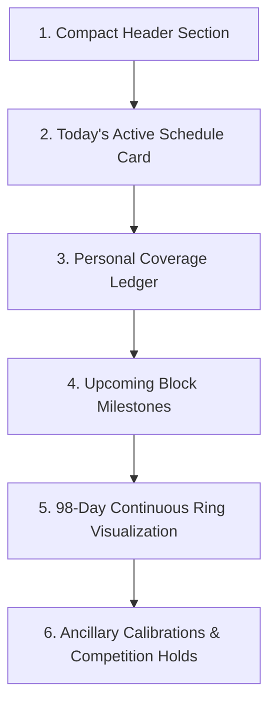

# Volume B — Student Experience

## Part 3 — Crucible Protocol, Continuous Learning Ring और Assessment Workflows

### Chapter scope और Overview

**The Crucible** Rank Cracker ecosystem का केंद्रीय समयबद्ध शिक्षण प्रोटोकॉल (Time-Bound Continuous Learning Protocol) है। यह पारंपरिक ऑनलाइन टेस्ट सीरीज़ या स्थिर अध्ययन कैलेंडरों (static study timetables) से मौलिक रूप से भिन्न है। Crucible एक **98-दिवसीय सतत घूर्णन शिक्षण वलय (98-Day Continuous Learning Ring)** है जो छात्र को कभी भी स्थायी असफलता या पाठ्यक्रम समाप्ति के दबाव में नहीं छोड़ता।

पारंपरिक एड-टेक प्लेटफ़ॉर्म्स में यदि कोई छात्र बीच सत्र में प्रवेश करता है, तो उसे “बैकलॉग” और छूटे हुए टेस्ट्स के लिए दण्डित किया जाता है। इसके विपरीत, Crucible का उत्पाद दर्शन **“Never-Wait / No-Penalty Late Joiner Policy”** पर आधारित है। छात्र चाहे जिस दिन भी जुड़े, उसका व्यक्तिगत कवरेज लेजर (Personal Coverage Ledger) स्वतंत्र रूप से शून्य से प्रारंभ होता है, जबकि वैश्विक मिशन क्लॉक (Global Mission Clock) 98 दिनों के चक्रीय चक्र (modulo continuous orbit) में घूमती रहती है।

यह अध्याय Crucible के आंतरिक स्टेट पाइपलाइन, ग्लोबल क्लॉक इंजन, कैनोनिकल शेड्यूल रजिस्ट्री, सभी 6 प्रमुख दृश्य अनुभागों (UI Sections), असेसमेंट चैंबर्स (Micro, Macro, Rebuild), सबमिशन पाइपलाइन, और **Human Authority Law** पर आधारित अकादमिक ट्रस्ट इंजन का संपूर्ण स्रोत-आधारित (source-audited) तकनीकी दस्तावेज़ीकरण प्रस्तुत करता है।

---

## Section 1 — Screen State Pipeline और Reactive Stream Binding

### Subsection 1.1 — Provider Stream और User Recruitment Scope

**Canonical Source File:** `lib/features/crucible/presentation/providers/crucible_state_provider.dart`

```dart
final crucibleProtocolStateProvider =
    StreamProvider.autoDispose<CrucibleProtocolState?>((ref) {
  final sessionUserAsync = ref.watch(sessionUserProvider);
  return sessionUserAsync.when(
    data: (user) => CrucibleRepository.streamProtocolState(user.recruitmentId),
    loading: () => const Stream.empty(),
    error: (err, stack) => const Stream.empty(),
  );
});
```

#### Line-by-Line Code Analysis & Architectural Mechanics:
1. `StreamProvider.autoDispose<CrucibleProtocolState?>`: यह प्रदाता एक `autoDispose` स्ट्रीम प्रदाता है। इसका अर्थ है कि जब छात्र Crucible स्क्रीन से बाहर किसी अन्य रूट पर नेविगेट करता है, तो Firestore का एक्टिव लिसनर (real-time snapshot listener) स्वतः बंद हो जाता है। इससे अनावश्यक नेटवर्क बैंडविड्थ और बिलिंग स्पाइक्स से सुरक्षा मिलती है।
2. `final sessionUserAsync = ref.watch(sessionUserProvider)`: प्रोटोकॉल स्ट्रीम छात्र के सक्रिय सत्र से गहराई से जुड़ी है। जब तक सत्र का समाधान (resolution) नहीं हो जाता, तब तक स्ट्रीम `const Stream.empty()` रहती है।
3. `user.recruitmentId`: प्रोटोकॉल का दायरा (scope) केवल छात्र के UID तक सीमित नहीं है, बल्कि उसके वर्तमान चयनित भर्ती मिशन (`recruitmentId`, जैसे `'jee-main-2027'`) से बंधा है।
4. `error: (err, stack) => const Stream.empty()`: यदि सत्र लोड करने में कोई त्रुटि आती है, तो प्रदाता क्रैश होने के बजाय खाली स्ट्रीम लौटाता है, जिससे UI अनुग्रहकारी ढंग से (gracefully) तैयारी स्थिति (Preparing State) में गिरता है।

### Subsection 1.2 — Tri-State Lifecycle (Loading, Preparing, Active Content)

**Canonical Source File:** `lib/features/crucible/presentation/screens/crucible_screen.dart`

```dart
@override
Widget build(BuildContext context) {
  final sessionUser = ref.watch(sessionUserProvider).valueOrNull;
  final readiness = ref.watch(missionReadinessProvider);
  final knowledge = KnowledgeEngine.instance;
  final momentum = knowledge.momentumState;

  final protocolStateAsync = ref.watch(crucibleProtocolStateProvider);

  return protocolStateAsync.when(
    data: (protocolState) {
      if (protocolState == null) {
        return _buildPreparingState(
          sessionUser: sessionUser,
          readiness: readiness,
          momentum: momentum,
        );
      }
      return _buildCrucibleContent(
        protocolState: protocolState,
        sessionUser: sessionUser,
        readiness: readiness,
        momentum: momentum,
      );
    },
    loading: () => Scaffold(
      backgroundColor: AppColors.background,
      body: TacticalNoirBackground(
        child: const Center(
          child: CircularProgressIndicator(color: AppColors.gold),
        ),
      ),
    ),
    error: (err, stack) => _buildPreparingState(
      sessionUser: sessionUser,
      readiness: readiness,
      momentum: momentum,
    ),
  );
}
```

#### State Machine Outcomes:
1. **Loading State:** जब प्रोटोकॉल स्ट्रीम का प्रारंभिक स्नैपशॉट लोड हो रहा होता है, तब गहरा काला पृष्ठभूमि (`TacticalNoirBackground`) और केंद्रीय स्वर्ण संकेतक (`CircularProgressIndicator(color: AppColors.gold)`) प्रदर्शित होता है।
2. **Preparing State (`protocolState == null` या `error`):** यदि Firestore में इस छात्र और मिशन के लिए कोई सक्रिय प्रोटोकॉल दस्तावेज़ मौजूद नहीं है, या नेटवर्क त्रुटि है, तो एप्लिकेशन क्रैश स्क्रीन नहीं दिखाती। इसके बजाय `_buildPreparingState` रेंडर होता है, जो छात्र को सूचित करता है कि आधिकारिक मिशन पैरामीटर प्रकाशित होते ही शेड्यूल सक्रिय हो जाएगा।
3. **Active Content State (`protocolState != null`):** वैध प्रोटोकॉल अवस्था मिलने पर संपूर्ण 98-दिवसीय कमांड सतह रेंडर होती है।

### Subsection 1.3 — Comprehensive Screen States & Lifecycle Matrix

Crucible यूजर इंटरफ़ेस किसी भी परिस्थिति में अनडिफ़ाइंड या अनकंट्रोल्ड स्टेट में नहीं जाता। निम्नलिखित 7-अवस्था जीवनचक्र आव्यूह (Lifecycle State Matrix) यह स्पष्ट करता है कि सिस्टम प्रत्येक स्थिति में कैसे व्यवहार करता है:

| स्क्रीन अवस्था (Screen State) | ट्रिगर स्थिति (Trigger Condition) | विजुअल सतह और घटक (Visual Surface & Components) | छात्र इंटरैक्शन क्षमता (User Capabilities) | सुरक्षा एवं नेटवर्क सीमा (Security & Fail-Closed Boundary) |
| :--- | :--- | :--- | :--- | :--- |
| **1. Loading State** | `crucibleProtocolStateProvider.isLoading` | गहरा काला बैकग्राउंड (`TacticalNoirBackground`), केंद्रीय गोल्ड लोडर (`CircularProgressIndicator(color: AppColors.gold)`) | कोई इंटरैक्शन नहीं (ब्लॉक्ड स्क्रीन) | 3-सेकंड फ़ायरस्टोर कैश रीहाइड्रेशन टाइमआउट; टाइमआउट पर Preparing State पर फ़ॉलबैक। |
| **2. Preparing State** | `protocolState == null` अथवा सेशन लोड एरर | `_buildPreparingState`: `CommandHeader` (`missionEvidenceVerified: false`), 40px गोल्ड फ्लेम आइकन, "CRUCIBLE PREPARATION" बैनर, व्याख्यात्मक टेक्स्ट | केवल हेडर व्यूइंग और बैक नेविगेशन; कोई शेड्यूल एक्शन नहीं | शून्य नकली शेड्यूल (Zero fake schedules); अप्रकाशित मिशन पर कोई बनावटी डेटा रेंडर नहीं होता। |
| **3. Active Study State** | `protocolState != null` तथा Days 1–12 of Block | `_buildCrucibleContent`: `_buildCompactHeader`, `Today's Active Schedule Card`, `Personal Coverage Ledger`, `98-Day Ring Visualization` | "LEARN" (डिजीबुक रीडर), "SYLLABUS" (सिलेबस ट्री), शेड्यूल्ड माइक्रो टेस्ट अटेम्प्ट | `DigiBookCanonicalBridgeService` फ़ेल-क्लोज़्ड सत्यापन; अनमैप्ड नोड्स पर सूचनात्मक बॉटम-शीट। |
| **4. Rebuild Window** | Day 13 of Block (`isRebuild == true`) | `_buildRebuildCard`: "REBUILD WINDOW" गोल्ड चिप, रिपेयर गाइडेंस, "EXPLORE SYLLABUS" आउटलाइंड बटन | छूटे हुए विषयों की समीक्षा, सिलेबस एक्सप्लोरेशन; कोई नया अनिवार्य असेसमेंट नहीं | कोई बैकलॉग पेनल्टी नहीं; छात्र का व्यक्तिगत लेजर स्वतंत्र रहता है। |
| **5. Macro Citadel Window**| Day 14 of Block (`isMacro == true`) | `_buildMacroCard`: "MACRO CITADEL" चिप, 50 प्रश्न/120 मिनट ब्लॉक सिंथेसिस विवरण, तात्कालिक होल्ड इंडिकेटर | मैक्रो असेसमेंट ट्रिगर (यदि प्रकाशित हो) अथवा सूचनात्मक तैयारी रिव्यू | केवल Day 14 पर अनलॉक्ड; अन्य दिनों में सर्वर-साइड व क्लाइंट-साइड फ़ेल-क्लोज़्ड। |
| **6. Offline Caching State**| नेटवर्क डिस्कनेक्ट लेकिन लोकल कैश उपलब्ध | लोकल कैश से रेंडर प्रोटोकॉल स्टेट; ऑफ़लाइन वॉर्निंग बैज; लेजर 0-मान सुरक्षा | ऑफलाइन रीडिंग मोड (कैश्ड डिजीबुक मॉड्यूल्स); असेसमेंट सबमिशन कतारबद्ध | क्लाइंट-साइड स्कोरिंग वर्जित; सबमिशन लोकल आउटबॉक्स में पेंडिंग रहता है। |
| **7. Stream Error State** | अनहैंडल्ड फ़ायरस्टोर एरर या अथॉरिटी मिसमैच | `_buildPreparingState` पर सुरक्षित फ़ॉलबैक; एरर स्नैकबार या अलर्ट | सुरक्षित स्क्रीन विजिबिलिटी; कोई क्रैश नहीं | फ़ेल-क्लोज़्ड निष्पादन; सिस्टम किसी अनधिकृत पेलोड को प्रोसेस नहीं करता। |

### Subsection 1.4 — The 15 Core Attributes of The Crucible System

Chief Author Mandate के अनुरूप Crucible प्रोटोकॉल के 15 मूलभूत सिस्टम पैरामीटर्स का विनिर्देश:

| # | कोर विशेषता (Core Attribute) | कैनोनिकल विनिर्देश (Canonical Specification) | प्रामाणिक स्रोत फ़ाइल व संदर्भ (Source Evidence) |
| :--- | :--- | :--- | :--- |
| **1** | **Feature Name** | The Crucible (98-Day Continuous Learning Ring) | `lib/features/crucible/presentation/screens/crucible_screen.dart:296` |
| **2** | **Canonical Domain ID** | `crucible_learning_ring_v1` | `lib/features/crucible/core/crucible_canonical_schedules.dart:10–26` |
| **3** | **Parent Hierarchy** | `App -> Recruitment Mission -> 98-Day Ring -> 14-Day Block -> 2-Day Schedule` | `10_crucible_protocol_and_schedule_engine.md:1028` |
| **4** | **Presentation Entry Point**| `AppRoutes.crucible` (`/crucible`) | `lib/core/router/app_router.dart:253` |
| **5** | **State Management Engine**| `crucibleProtocolStateProvider` (Riverpod `StreamProvider.autoDispose`) | `lib/features/crucible/presentation/providers/crucible_state_provider.dart:22–30` |
| **6** | **Backend Topology & Storage** | Firestore collection `/users/{uid}/protocols/{recruitmentId}` & `mission_realms/{realmId}` | `lib/core/backend/crucible_repository.dart:791–828` |
| **7** | **Offline Strategy & Caching**| Firestore offline persistence + `DashboardLocalDatasource` zero-fake guarantee | `lib/database/local/dashboard_local_datasource.dart:1–72` |
| **8** | **Authority Boundary** | Client reads schedule metadata; all scoring and qualification evaluation executed server-side | `functions/workers/evaluate_attempt_worker.js:57–216` |
| **9** | **Mathematical Orbit Formula**| $CycleDay = (elapsedDays \pmod{98}) + 1$; $Orbit = \lfloor elapsedDays / 98 \rfloor + 1$ | `lib/features/crucible/core/crucible_clock_engine.dart:187–208` |
| **10**| **Verification & Gate System** | 5-Gate Question Eligibility + Human Authority Law (No AI reviewer certified) | `lib/features/crucible/core/micro_test_engine.dart:703–723` |
| **11**| **Student Visibility Law** | Phase Block locked strictly by temporal clock; no manual skip without sovereign authorization | `lib/features/crucible/core/crucible_canonical_schedules.dart:889–902` |
| **12**| **Late Joiner / Backlog Policy**| Zero-penalty late joiner architecture; personal coverage ledger starts from verified zero | `lib/features/crucible/presentation/screens/crucible_screen.dart:443–446` |
| **13**| **Security & Anti-Cheat Rules**| Cryptographic SHA-256 solution hashing; FNV-1a deterministic assembly seed | `lib/features/crucible/core/micro_test_engine.dart:690–743` |
| **14**| **Test Coverage & Suites** | 4 primary suites: personalization blueprint, item selector, responsive timer, QA | `test/features/personalization/recovery/crucible_personalized_item_selector_test.dart` |
| **15**| **Failure Mode & Fallback UI** | Preparing State (`_buildPreparingState`) fallback on null protocol, offline, or network error | `lib/features/crucible/presentation/screens/crucible_screen.dart:53–83` |

---

## Section 2 — Preparing State का पूर्ण व्यवहार और Cold-Start Safety

### Subsection 2.1 — Protocol Absence का शैक्षणिक अर्थ

जब छात्र प्रमाणीकृत होता है और प्रोफ़ाइल पूरी कर चुका होता है, लेकिन उसके चयनित मिशन के लिए बैकएंड पर अभी तक 98-डे रिंग का ब्लूप्रिंट या प्रोटोकॉल प्रारंभ समय भौतिक (materialize) नहीं हुआ होता, तो इसे छात्र की विफलता नहीं माना जाता। यह एक प्रशासनिक/संचालन स्थिति है।

### Subsection 2.2 — Visual Elements और Messaging Contract

```dart
Widget _buildPreparingState({
  required SessionUser? sessionUser,
  required dynamic readiness,
  required dynamic momentum,
}) {
  return Scaffold(
    backgroundColor: AppColors.background,
    body: TacticalNoirBackground(
      child: SafeArea(
        child: Column(
          crossAxisAlignment: CrossAxisAlignment.start,
          children: [
            CommandHeader(
              userName: sessionUser?.name ?? 'Warrior',
              userPhoto: sessionUser?.photo,
              examName: sessionUser?.examName ?? 'Mission',
              readiness: readiness,
              momentum: momentum,
              missionEvidenceVerified: false,
            ),
            Expanded(
              child: Center(
                child: Padding(
                  padding: const EdgeInsets.symmetric(horizontal: 24.0),
                  child: Column(
                    mainAxisSize: MainAxisSize.min,
                    children: [
                      Container(
                        padding: const EdgeInsets.all(16),
                        decoration: BoxDecoration(
                          color: AppColors.surface,
                          borderRadius: BorderRadius.circular(16),
                          border: Border.all(color: AppColors.borderSoft),
                        ),
                        child: const Icon(
                          Icons.local_fire_department_rounded,
                          color: AppColors.gold,
                          size: 40,
                        ),
                      ),
                      const SizedBox(height: 20),
                      Text(
                        'CRUCIBLE PREPARATION',
                        style: AppTypography.hero.copyWith(
                          fontSize: 18,
                          color: Colors.white,
                          letterSpacing: 1.1,
                        ),
                      ),
                      const SizedBox(height: 8),
                      Text(
                        'Crucible 98-day continuous orbit is not yet active for ${sessionUser?.examName ?? "this mission"}.\n\nYour schedule will activate as soon as official mission parameters are published.',
                        textAlign: TextAlign.center,
                        style: AppTypography.body.copyWith(
                          fontSize: 13,
                          color: Colors.white70,
                          height: 1.45,
                        ),
                      ),
                    ],
                  ),
                ),
              ),
            ),
          ],
        ),
      ),
    ),
  );
}
```

- **Header Guard:** `missionEvidenceVerified: false` पास किया जाता है ताकि हेडर पर झूठे पूर्णता संकेत न दिखें।
- **Icon Container:** 40px का स्वर्ण अग्नि-प्रतीक (`Icons.local_fire_department_rounded`) जो Crucible के तपस्या और परीक्षण के भाव को दर्शाता है।
- **Clear Explanation:** स्पष्ट कॉपी जो छात्र को आश्वस्त करती है कि सिस्टम क्रियाशील है और आधिकारिक रिलीज की प्रतीक्षा कर रहा है।

---

## Section 3 — Sovereign Global Clock Engine और Canonical Schedule Registry

### Subsection 3.1 — Cycle Day और Orbit Number की गणना

**Source File:** `lib/features/crucible/core/crucible_clock_engine.dart`

```dart
final now = DateTime.now();
final globalStartTime = protocolState.protocolStartTime;
final effectiveState = protocolState;

final currentCycleDay = CrucibleClockEngine.getCycleDay(
  state: effectiveState,
  now: now,
);

final orbitNumber = CrucibleClockEngine.getOrbitNumber(
  protocolStartTime: globalStartTime,
  now: now,
);
```

#### Time Calculations Mathematical Formulation:
- **Elapsed Duration:** $\Delta t = now - protocolStartTime$
- **Ring Modulo Duration:** $elapsedDays = \lfloor \Delta t_{seconds} / 86400 \rfloor$
- **Cycle Day (1-98):**
  $$CycleDay = (elapsedDays \pmod{98}) + 1$$
- **Orbit Number (प्रदक्षिणा संख्या):**
  $$OrbitNumber = \lfloor elapsedDays / 98 \rfloor + 1$$

UI किसी स्थानीय काउंटर का उपयोग नहीं करती। `CrucibleClockEngine` समय का सर्वोच्च और अपरिवर्तनीय स्रोत (Temporal Authority) है।

### Subsection 3.2 — Canonical Schedule Registry Lookup

**Source File:** `lib/features/crucible/core/crucible_canonical_schedules.dart`

`CrucibleCanonicalScheduleRegistry` एक static in-memory lookup इंजन है जो प्रत्येक cycle day के लिए सटीक शैक्षणिक वर्गीकरण प्रदान करता है:

```dart
final currentPhase = CrucibleCanonicalScheduleRegistry.getPhaseForCycleDay(currentCycleDay);
final isRebuild = CrucibleCanonicalScheduleRegistry.isRebuildDay(currentCycleDay);
final isMacro = CrucibleCanonicalScheduleRegistry.isMacroDay(currentCycleDay);

final activeSchedule = CrucibleCanonicalScheduleRegistry.getScheduleForCycleDay(currentCycleDay);
```

#### Schedule Distribution Rules across the 98-Day Ring:
1. **7 Phase Blocks:** प्रत्येक ब्लॉक 14 दिनों का होता है ($7 \times 14 = 98$ दिन)।
2. **Phase Formula:** $PhaseIndex = \lfloor (currentCycleDay - 1) / 14 \rfloor + 1$
3. **Study Schedules:** प्रत्येक ब्लॉक के पहले 12 दिन (Days 1 to 12 of Block) 6 दो-दिवसीय अध्ययन शेड्यूल्स में विभाजित होते हैं ($6 \times 2 = 12$ दिन)। कुल 42 कैनोनिकल शेड्यूल्स ($7 \times 6 = 42$)।
4. **Rebuild Day:** प्रत्येक ब्लॉक का 13वाँ दिन (Day 13, 27, 41, 55, 69, 83, 97) रिबिल्ड विंडो होता है।
5. **Macro Day:** प्रत्येक ब्लॉक का 14वाँ दिन (Day 14, 28, 42, 56, 70, 84, 98) मैक्रो सिटाडेल टेस्ट विंडो होता है।

### Subsection 3.3 — 2-Day Schedule Position (Day A vs Day B)

प्रत्येक अध्ययन शेड्यूल 2 कैलेंडर दिनों तक चलता है:
```dart
final isDayB = activeSchedule != null && currentCycleDay == activeSchedule.endCycleDay;
final dayInScheduleLabel = isDayB ? 'Day B of 2' : 'Day A of 2';
```

#### The Pedagogical Dual-Day Cadence:
- **Day A of 2 (Concept Acquisition):** 
  - छात्र का प्राथमिक लक्ष्य संबंधित पाठ्य सामग्री का गहन स्वाध्याय है।
  - `DigiBookCanonicalBridgeService` के माध्यम से मैप किए गए प्रामाणिक पाठ्य-इकाइयों (Generation Units) का अध्ययन।
  - सिद्धांत, मुख्य सूत्र, आरेख और बुनियादी उदाहरणों का अवलोकन।
  - इस दिन कोई अनिवार्य परीक्षा दबाव नहीं होता; छात्र सीखने की गति स्वयं निर्धारित करता है।
- **Day B of 2 (Deep Practice & Micro Assessment):** 
  - अर्जित संकल्पनाओं का उच्च-दबाव समस्या-समाधान परीक्षण।
  - जटिल संख्यात्मक समस्याओं और वैचारिक प्रश्नों का अभ्यास।
  - `SacredMicroTestChamber` का उद्घाटन (10–20 प्रश्न, समयबद्ध टेस्ट)।
  - परीक्षा का सबमिशन और सर्वर-साइड मूल्यांकन, जिससे छात्र के व्यक्तिगत लेजर में सत्यापित अंक दर्ज होते हैं।

### Subsection 3.4 — The 7 Sovereign Phase Blocks (B1–B7) & 14-Day Cycle Anatomy

The Crucible 98-दिवसीय रिंग 7 प्रमुख अकादमिक ब्लॉक्स में संरचित है:

| ब्लॉक ID | ब्लॉक का नाम (Phase Name) | दिवस दायरा (Day Span) | शेड्यूल्स (Schedules) | Rebuild Day | Macro Day | प्राथमिक विषय क्षेत्र (Academic Domain) |
| :--- | :--- | :--- | :--- | :--- | :--- | :--- |
| **B1** | Mechanics I & Physical World | Days 1 – 14 | S01 – S06 | **Day 13** | **Day 14** | Kinematics 1D/2D, Laws of Motion, Work Energy |
| **B2** | Mechanics II & Thermal Physics | Days 15 – 28 | S07 – S12 | **Day 27** | **Day 28** | Rotational Motion, Gravitation, Thermodynamics |
| **B3** | Electromagnetism & Circuits | Days 29 – 42 | S13 – S18 | **Day 41** | **Day 42** | Electrostatics, Current Electricity, Magnetism |
| **B4** | Optics & Modern Physics | Days 43 – 56 | S19 – S24 | **Day 55** | **Day 56** | Ray Optics, Wave Optics, Dual Nature, Atoms |
| **B5** | Physical & Inorganic Chemistry | Days 57 – 70 | S25 – S30 | **Day 69** | **Day 70** | Mole Concept, Atomic Structure, Periodic Table |
| **B6** | Organic Chemistry & Coordination | Days 71 – 84 | S31 – S36 | **Day 83** | **Day 84** | Hydrocarbons, Reaction Mechanisms, Coordination |
| **B7** | Calculus, Vectors & Synthesis | Days 85 – 98 | S37 – S42 | **Day 97** | **Day 98** | Differential & Integral Calculus, Vectors, 3D |

#### The Anatomy of the 14-Day Modular Cycle:
1. **Days 1–12 (The 6 Micro Phases):** 6 द्वि-दिवसीय अध्ययन शेड्यूल्स। प्रत्येक 48 घंटों में छात्र एक पूर्ण विषय-समूह को आत्मसात करता है और माइक्रो असेसमेंट के माध्यम से अपनी समझ को प्रमाणित करता है।
2. **Day 13 (Rebuild Window — Repair without Penalty):** 
   - 12 दिनों के गहन अध्ययन के बाद, दिन 13 पूर्णतः विस्मृति निवारण और बैकलॉग रिपेयर के लिए समर्पित है।
   - कोई नया पाठ्य-विषय नहीं दिया जाता। छात्र पिछले 12 दिनों के गलत उत्तरों या छूटे हुए विषयों को रिविजिट करता है।
   - यदि छात्र का कोई टेस्ट छूटा था, तो वह बिना किसी दण्ड या डिग्रेडेशन के इस दिन उसे पूरा कर सकता है।
3. **Day 14 (Macro Citadel — The Comprehensive Synthesis):**
   - 14-दिवसीय ब्लॉक का अंतिम दिन। 50 प्रश्नों का 120 मिनट का उच्च-तीव्रता वाला बहु-विषयक टेस्ट।
   - यह ब्लॉक के सभी 6 शेड्यूल्स के अंतःविषय संबंधों (interdisciplinary correlations) का परीक्षण करता है।
   - मैक्रो सिटाडेल का परिणाम आगामी ब्लॉक के रिबिल्ड टारगेट्स को आकार देता है।
4. **Modulo Orbit Wrap (Day 98 $\rightarrow$ Day 1):**
   - दिन 98 के अंतिम सेकंड ($8,467,200\text{s}$) के बाद, क्लॉक इंजन $\text{elapsedDays} \pmod{98}$ के अनुसार स्वतः दिन 1 (Block 1, S01) पर वापस आ जाता है।
   - ऑर्बिट काउंटर $\lfloor \text{elapsedDays} / 98 \rfloor + 1$ में 1 की वृद्धि हो जाती है (Orbit 2)।
   - छात्र का पर्सनल कवरेज लेजर कभी रीसेट नहीं होता; वह निरंतर अपने अर्जित ज्ञान और मास्टरी लेजर में संचयी प्रगति देखता रहता है।

---

## Section 4 — Active Screen Visual Architecture (The 6 Sovereign Sections)

Crucible स्क्रीन 6 अनुक्रमिक, सुसंगत कार्डों और अनुभागों से सुसज्जित है:



### Subsection 4.1 — Section 1: Compact Header Section (<= 110dp)

```dart
Widget _buildCompactHeader(int currentCycleDay, int currentPhase, int orbitNumber) {
  return Column(
    crossAxisAlignment: CrossAxisAlignment.start,
    children: [
      Row(
        mainAxisAlignment: MainAxisAlignment.spaceBetween,
        children: [
          Container(
            padding: const EdgeInsets.symmetric(horizontal: 8, vertical: 3),
            decoration: BoxDecoration(
              color: AppColors.gold.withValues(alpha: 0.12),
              borderRadius: BorderRadius.circular(4),
              border: Border.all(color: AppColors.gold.withValues(alpha: 0.3)),
            ),
            child: const Text(
              'JEE MAIN 2027',
              style: TextStyle(
                color: AppColors.gold,
                fontSize: 10,
                fontWeight: FontWeight.w700,
                letterSpacing: 1.1,
              ),
            ),
          ),
          Text(
            'Continuous Learning Ring',
            style: AppTypography.subtitle.copyWith(
              color: AppColors.textSecondary,
              fontSize: 11,
            ),
          ),
        ],
      ),
      const SizedBox(height: 6),
      Text(
        'THE CRUCIBLE',
        style: AppTypography.hero.copyWith(
          fontSize: 22,
          fontWeight: FontWeight.w800,
          letterSpacing: 1.2,
          color: Colors.white,
        ),
      ),
      const SizedBox(height: 2),
      Text(
        'DAY $currentCycleDay OF 98 • BLOCK $currentPhase OF 7 • CYCLE $orbitNumber',
        style: AppTypography.label.copyWith(
          color: AppColors.gold,
          fontWeight: FontWeight.w600,
          fontSize: 11,
          letterSpacing: 1.0,
        ),
      ),
    ],
  );
}
```

- **Exam Badge:** `'JEE MAIN 2027'` का परिष्कृत स्वर्ण बैज।
- **Hero Title:** `'THE CRUCIBLE'` 22sp में।
- **Ring Coordinates:** `'DAY 4 OF 98 • BLOCK 1 OF 7 • CYCLE 1'` — छात्र को अपनी सटीक खगोलीय/शिक्षण स्थिति का तुरंत बोध कराता है।

### Subsection 4.2 — Section 2: Today's Active Schedule Card (Tri-Modal Surface)

यह स्क्रीन का मुख्य इंटरैक्टिव कार्ड है। यह तीन अलग-अलग रूपों (modes) में रेंडर हो सकता है:

#### Mode 1: Rebuild Window (Day 13 of Block)
```dart
if (isRebuild) {
  return DarkCard(
    padding: const EdgeInsets.all(18),
    child: Column(
      crossAxisAlignment: CrossAxisAlignment.start,
      children: [
        Row(
          mainAxisAlignment: MainAxisAlignment.spaceBetween,
          children: [
            _buildTagChip('REBUILD WINDOW', AppColors.gold),
            Text('Day $currentCycleDay of 98', style: AppTypography.subtitle),
          ],
        ),
        const SizedBox(height: 12),
        Text('Block $currentPhase Rebuild Window', style: AppTypography.section),
        const SizedBox(height: 6),
        Text(
          'No assessment evidence yet. Use this window to revisit missed or unfinished learning.',
          style: AppTypography.body,
        ),
        const SizedBox(height: 14),
        OutlinedButton.icon(
          icon: const Icon(Icons.menu_book_rounded, color: AppColors.gold, size: 16),
          label: const Text('EXPLORE SYLLABUS'),
          onPressed: () => context.push(AppRoutes.syllabus),
        ),
      ],
    ),
  );
}
```
यह विंडो छात्र को नए विषय पढ़ने के लिए बाध्य नहीं करती; यह पिछले 12 दिनों में छूटे हुए विषयों की मरम्मत (repair) के लिए समर्पित है।

#### Mode 2: Macro Citadel Window (Day 14 of Block)
```dart
if (isMacro) {
  return DarkCard(
    padding: const EdgeInsets.all(18),
    child: Column(
      children: [
        _buildTagChip('MACRO CITADEL', AppColors.gold),
        Text('Block $currentPhase Comprehensive Milestone', style: AppTypography.section),
        Text('Block synthesis training milestone (50 Questions / 120 Minutes).'),
        // Informational hold indicator
        Text('Macro assessment is not ready yet.'),
      ],
    ),
  );
}
```
यह पूरे 14-दिवसीय ब्लॉक का संश्लेषण मूल्यांकन (Synthesis Milestone) है।

#### Mode 3: Normal 2-Day Study Schedule (Days 1 to 12)
अध्ययन शेड्यूल के लिए कार्ड निम्नलिखित घटकों को जोड़ता है:
1. **Header & Subject:** `${activeSchedule.formattedCode} • ${dayInScheduleLabel}` और विषय का नाम (उदा. `MATHEMATICS`).
2. **Canonical Title:** `activeSchedule.canonicalTitle` (उदा. `Functions & Invertibility`).
3. **Canonical DigiBook Bridge Resolution:**
   ```dart
   final bridge = DigiBookCanonicalBridgeService.instance;
   final List<DigiBookAuthorityEntry> resolvedEntries = [];
   for (final nodeId in activeSchedule.canonicalNodeIds) {
     final res = bridge.resolveCanonicalNode(nodeId);
     if (res.isMapped) resolvedEntries.addAll(res.entries);
   }
   final bool hasContent = resolvedEntries.isNotEmpty;
   ```
4. **Truthful Content Availability Indicator:**
   - यदि सामग्री उपलब्ध है: हरा चेक आइकन + `'Learning content available'`
   - यदि सामग्री उपलब्ध नहीं है: धूसर वृत्त + `'Learning content not available yet'`
5. **Primary Action ('LEARN'):**
   - यदि एक ही पाठ्य इकाई है: सीधे `AppRoutes.digibookReader` पर नेविगेट करता है।
   - यदि एकाधिक इकाइयाँ हैं: `_handleLearnAction` एक चयन बॉटम शीट खोलता है (बिना छात्र की सहमति के पहले मॉड्यूल का स्वतः चयन प्रतिबंधित है - **Zero Autoselect Rule**)।
   - यदि सामग्री अनुपलब्ध है: `_handleUnavailableContent` एक अनुग्रहकारी सूचना शीट खोलता है जो छात्र को वैकल्पिक सिलेबस एक्सप्लोर करने का विकल्प देती है।
6. **Secondary Action ('SYLLABUS'):** `context.push(AppRoutes.syllabus)`।
7. **Micro Test Assessment Status:**
   - `'Micro assessment is not ready for this schedule yet.'` बैज।

### Subsection 4.3 — Section 3: Personal Coverage Ledger (Zero-Fake-UI Architecture)

**Source File:** `crucible_screen.dart` lines 743-807

```dart
Widget _buildPersonalCoverageCard(SessionUser? user, int currentCycleDay) {
  return DarkCard(
    padding: const EdgeInsets.all(18),
    child: Column(
      crossAxisAlignment: CrossAxisAlignment.start,
      children: [
        Row(
          mainAxisAlignment: MainAxisAlignment.spaceBetween,
          children: [
            const Text(
              'PERSONAL COVERAGE LEDGER',
              style: TextStyle(
                color: AppColors.gold,
                fontSize: 10,
                fontWeight: FontWeight.w700,
                letterSpacing: 1.2,
              ),
            ),
            Text('Continuous Progress', style: AppTypography.subtitle.copyWith(fontSize: 10)),
          ],
        ),
        const SizedBox(height: 12),
        Row(
          children: [
            Expanded(child: _buildMetricTile(label: 'Schedules Done', value: '0', hint: 'Verified attempts')),
            const SizedBox(width: 8),
            Expanded(child: _buildMetricTile(label: 'Modules Studied', value: '0', hint: 'Active sessions')),
            const SizedBox(width: 8),
            Expanded(child: _buildMetricTile(label: 'Backlog Scope', value: '0', hint: 'Never-wait policy')),
          ],
        ),
        const SizedBox(height: 10),
        Text(
          'Your individual ledger records verified academic progress independently of the rotating mission clock. Late joiners start without fake failure or penalty.',
          style: AppTypography.subtitle.copyWith(color: AppColors.textSecondary, fontSize: 10, height: 1.3),
        ),
      ],
    ),
  );
}
```

#### Constitutional Truth in Ledger Metrics:
- **Zero Fake Metrics:** नए छात्र के लिए यह कार्ड बनावटी प्रतिशतता (जैसे 14% या 0.0%) नहीं दिखाता। यह स्पष्ट रूप से 3 प्रामाणिक पूर्णांक मान दिखाता है:
  - `Schedules Done: 0` (सत्यापित प्रयास)
  - `Modules Studied: 0` (सक्रिय सत्र)
  - `Backlog Scope: 0` (कभी न रुकने वाली नीति)
- **Late Joiner Philosophy:** यदि कोई छात्र 98-डे रिंग के 45वें दिन प्रवेश करता है, तो सिस्टम उस पर पिछले 44 दिनों के छूट जाने का आरोप नहीं लगाता। उसका बैकलॉग 0 रहता है, और जैसे ही रिंग घूमकर वापस आएगी, वह उन विषयों को अपने स्वाभाविक क्रम में पूरा करेगा।

### Subsection 4.4 — Section 4: Upcoming Milestones (Rebuild & Macro)

यह कार्ड छात्र को वर्तमान ब्लॉक की दो निर्णायक तिथियों का पूर्वावलोकन देता है:
- **Rebuild Day:** $currentPhase \times 14 - 1$ (उदा. ब्लॉक 1 के लिए दिन 13)
- **Macro Citadel:** $currentPhase \times 14$ (उदा. ब्लॉक 1 के लिए दिन 14)

### Subsection 4.5 — Section 5: 98-Day Continuous Ring Visualization

```dart
Widget _build98DayRingCard(int currentCycleDay, int currentPhase) {
  // 7 Phase Block Tiles (B1 to B7)
  Row(
    children: List.generate(7, (index) {
      final phaseNum = index + 1;
      final isCurrent = phaseNum == currentPhase;
      final isPast = phaseNum < currentPhase;
      // styling and day span: '${(phaseNum - 1) * 14 + 1}-${phaseNum * 14}d'
    }),
  );
}
```
- स्क्रीन पर 7 टाइल्स की एक क्षैतिज पट्टी रेंडर होती है (`B1`, `B2`, ..., `B7`)।
- वर्तमान ब्लॉक स्वर्ण आभा (`AppColors.gold`) से रेखांकित होता है।
- **Modulo Wrap Note:** "Continuous rotation: Day 98 advances back to Day 1 without syllabus loss."

### Subsection 4.6 — Section 6: Ancillary Calibrations & Competition Holds

प्रोटोकॉल के साथ जुड़े सहायक टूल्स की स्थिति:
1. **Smart Entry — Not Ready (`HELD`):** नैदानिक अंशांकन (Diagnostic calibration) अभी तक सक्रिय नहीं है।
2. **Test Arena — Not Ready (`TEST ARENA`):** मानकीकृत प्रतियोगी परीक्षण टेस्ट एरिना में आयोजित किए जाते हैं।

---

## Section 5 — 98-Day Mathematical Engine और Modulo Rotation Mechanics

**Source File:** `lib/features/crucible/core/crucible_engine.dart`

### Subsection 5.1 — Modulo Duration Math

```dart
final totalRingSeconds = 98 * 24 * 3600; // 8,467,200 seconds
final ringElapsedSeconds = elapsed.inSeconds % totalRingSeconds;
final ringElapsed = Duration(seconds: ringElapsedSeconds);

phaseIndex = (ringElapsedSeconds ~/ (14 * 24 * 3600)) + 1;
```

प्रोटोकॉल समय कभी समाप्त (expire) नहीं होता। 98वें दिन के अंतिम सेकंड के बाद `ringElapsedSeconds % totalRingSeconds` स्वतः `0` पर रीसेट हो जाता है और चक्र 1 से पुनः प्रारंभ हो जाता है।

### Subsection 5.2 — Phase Window Boundaries

प्रत्येक 14-दिवसीय ब्लॉक के भीतर 4 सूक्ष्म अवधियाँ हैं:
```dart
final rebuildStart = const Duration(days: 12);
final macroStart = const Duration(days: 13);
final phaseEnd = const Duration(days: 14);

if (elapsedWithinPhase < rebuildStart) {
  status = 'study';
} else if (elapsedWithinPhase < macroStart) {
  status = 'rebuild';
} else if (elapsedWithinPhase < phaseEnd) {
  status = 'macro_test';
} else {
  status = 'phase_transition_recovery';
}
```

### Subsection 5.3 — Pausing और Resuming Semantics (Idempotency Contract)

```dart
static CrucibleProtocolState pauseProtocol(
    CrucibleProtocolState state, DateTime now) {
  if (state.isPaused) return state;
  return state.copyWith(
    isPaused: true,
    pausedAt: now,
    lastProgressAt: now,
  );
}

static CrucibleProtocolState resumeProtocol(
    CrucibleProtocolState state, DateTime now) {
  if (!state.isPaused || state.pausedAt == null) return state;
  return state.copyWith(
    isPaused: false,
    clearPausedAt: true,
    lastProgressAt: now,
  );
}
```
- **Pause Contract:** पॉज़ करने से छात्र की सक्रिय सहभागिता रुक जाती है, लेकिन वैश्विक खगोलीय क्लॉक (`protocolStartTime`) फ्रीज़ नहीं होती।
- **Idempotency:** पहले से पॉज़ अवस्था में पुनः पॉज़ कॉल करने पर कोई म्यूटेशन नहीं होता।

---

## Section 6 — Dynamic Roadmap Generation और Risk Escalation

### Subsection 6.1 — Dependency-Safe Sequencing (Topological Sort)

`CrucibleEngine.buildProtocolRoadmap` पाठ्यक्रम के नोड्स को उनकी निर्भरता संरचना (Prerequisites graph) के आधार पर सॉर्ट करता है। कोई भी उन्नत विषय (advanced node) तब तक असाइन नहीं किया जा सकता जब तक उसके पूर्वपेक्षित (prerequisite) बुनियादी नोड्स पूरे न हों।

### Subsection 6.2 — Exam Deadline Compression Algorithm

यदि वास्तविक परीक्षा में 100 दिनों से कम का समय शेष है:
```dart
int totalSchedules = 42;
if (daysRemaining < 100) {
  totalSchedules = (daysRemaining / 2.4).floor().clamp(14, 42);
}
```
शेड्यूल्स की कुल संख्या 42 से घटकर 14 तक संकुचित (compress) हो सकती है, जिससे छात्र को कम समय में पाठ्यक्रम के सर्वाधिक महत्वपूर्ण स्तंभों पर ध्यान केंद्रित करने की अनुमति मिलती है।

### Subsection 6.3 — Atomic Risk Injection & Rebuild Promotion

```dart
final globalRisk = context.risk.overallRisk;
final weaknessRisk = context.risk.weaknessRisk;

String status = currentState.status;
if (weaknessRisk >= 0.75 || globalRisk >= 0.70) {
  status = 'rebuild';
}
```
यदि किसी छात्र के विस्मरण या विफलता का जोखिम $70\%$ या $75\%$ से अधिक बढ़ जाता है, तो इंजन सामान्य अध्ययन शेड्यूल को ओवरराइड करके तत्काल **Rebuild Session** इंजेक्ट कर देता है।

---

## Section 7 — Assessment Chambers और Evaluation Workflow

### Subsection 7.1 — Sacred Micro Test Chamber (`SacredMicroTestChamber`)

**Source File:** `lib/features/crucible/presentation/widgets/sacred_micro_test_chamber.dart`

```dart
class SacredMicroTestChamber extends StatefulWidget {
  final int totalQuestions;
  final int completedQuestions;
  final Duration remainingTime;
  final String battleTitle;
  final double readiness;
  final VoidCallback? onSubmit;
```
- **Purpose:** 2-दिवसीय अध्ययन शेड्यूल के अंत में (Day B) 15-20 प्रश्नों का लघु परीक्षण।
- **Dynamic HUD Timer:** घंटे, मिनट और सेकंड का वास्तविक समय का पल्सिंग काउंटर।
- **Readiness Integration:** वर्तमान तैयारी के आधार पर एडेप्टिव प्रश्न चयन।

### Subsection 7.2 — Sacred Macro Test Citadel (`SacredMacroTestCitadel`)

**Source File:** `lib/features/crucible/presentation/widgets/sacred_macro_test_citadel.dart`
- **Purpose:** 14-दिवसीय ब्लॉक के अंत में (Day 14) 50 प्रश्नों का 120 मिनट का व्यापक सिमुलेशन।
- **Rebuild Targets:** मैक्रो टेस्ट में अनुत्तरित या गलत हुए प्रश्नों को स्वतः आगामी ब्लॉक के रिबिल्ड चैंबर में भेज दिया जाता है।

### Subsection 7.3 — Client Submission Route Hook (`app_router.dart`)

**Source File:** `lib/core/router/app_router.dart` lines 277-326

जब छात्र Micro Test Chamber में परीक्षा समाप्त करता है, तो `app_router.dart` के अंतर्गत निम्नलिखित सबमिशन कॉलबैक निष्पादित होता है:

```dart
onSubmit: () async {
  // 1. Loading Overlay Dialog
  showDialog(
    context: context,
    barrierDismissible: false,
    builder: (context) => const Center(
      child: CircularProgressIndicator(color: AppColors.gold),
    ),
  );

  try {
    final sessionUser = SessionUser.getSync();
    final recruitmentId = sessionUser.recruitmentId;
    if (recruitmentId.isEmpty || recruitmentId == 'unresolved') {
      throw 'No active recruitment found.';
    }
    final scheduleId = args['scheduleId'] as String?;
    final score = args['score'] as num?;
    if (scheduleId == null || scheduleId.isEmpty || score == null) {
      throw 'Verified attempt payload is incomplete.';
    }

    // 2. Client-side Cloud Function Callable Invocation
    final callable = FirebaseFunctions.instance.httpsCallable('handleMissionAction');
    final result = await callable.call({
      'action': 'submit_micro_attempt',
      'realmId': recruitmentId,
      'payload': {
        'recruitmentId': recruitmentId,
        'scheduleId': scheduleId,
        'score': score,
      },
    });

    Navigator.pop(context); // Close loading dialog

    if (result.data != null && result.data['success'] == true) {
      ScaffoldMessenger.of(context).showSnackBar(
        const SnackBar(content: Text('Attempt submitted and evaluated successfully.')),
      );
      context.pop(); // Return to Crucible Screen
    } else {
      ScaffoldMessenger.of(context).showSnackBar(
        SnackBar(content: Text('Submission failed: ${result.data['message']}')),
      );
    }
  } catch (e) {
    Navigator.pop(context);
    ScaffoldMessenger.of(context).showSnackBar(
      SnackBar(content: Text('Error: $e')),
    );
  }
}
```

### Subsection 7.4 — Backend Forensic Audit: `handleMissionAction` vs. `evaluate_attempt_worker.js`

**Source Files:**
- `functions/callable/handle_mission_action.js` (Lines 8–90)
- `functions/workers/evaluate_attempt_worker.js` (Lines 9–216)
- `functions/test_c3_evidence_integrity.js`

#### 1. The `handleMissionAction` Surface Gap:
स्रोत कोड के विस्तृत ऑडिट में एक महत्वपूर्ण आर्किटेक्चरल विसंगति (Surface Gap) पाई गई है:
`functions/callable/handle_mission_action.js` वर्तमान में केवल `action === 'claim_qualification'` को संभालता है:
```javascript
exports.handleMissionAction = functions.https.onCall(async (data, context) => {
  const { auth } = context;
  if (!auth) throw new functions.https.HttpsError('unauthenticated', '🔱 ACCESS DENIED.');

  const { action, realmId, payload } = data;
  // ...
  if (action === 'claim_qualification') {
    // Forensic Ingestion of Roll Number, Result URL, Screenshot URL
    return { success: true, status: targetStatus, score: authScore };
  }

  throw new Error('UNKNOWN_ACTION'); // 🔱 Line 85: 'submit_micro_attempt' throws UNKNOWN_ACTION!
});
```
अर्थात्, यदि क्लाइंट से सीधे `'submit_micro_attempt'` भेजा जाता है, तो डिप्लॉयड `handleMissionAction` लाइन 85 पर `UNKNOWN_ACTION` एरर फेंकता है। 

#### 2. The Sovereign Assessment Evaluation Engine (`evaluate_attempt_worker.js`):
Rank Crackers का वास्तविक, सुरक्षित और संप्रभु मूल्यांकन इंजन `functions/workers/evaluate_attempt_worker.js` में स्थित है, जो दोहरे चरण (Two-Phase Session & Evaluation) में कार्य करता है:

```javascript
// Phase 1: Server-Issued Attempt Session Creation
async function createAttemptSession({
  db, userId, microTestId, macroTestId, scheduleId,
  questionIds, questionVersions, poolVersion, assemblyVersion,
  attemptOrdinal, isRunnable = true
}) {
  if (!isRunnable) {
    throw new Error("NOT_READY: Test is not runnable due to pending questions or scope issues.");
  }
  const attemptSessionId = `session_${userId}_${scheduleId}_ord${attemptOrdinal}`;
  const expiresAt = new Date(Date.now() + 3 * 3600 * 1000); // 3-Hour Expiration Window
  
  await db.collection('attempt_sessions').doc(attemptSessionId).set({
    attemptSessionId, userId, microTestId, macroTestId, scheduleId,
    questionIds, questionVersions, poolVersion, assemblyVersion, attemptOrdinal,
    openedAt: new Date().toISOString(),
    expiresAt: expiresAt.toISOString(),
    status: 'opened'
  });
  return sessionData;
}
```

```javascript
// Phase 2: Authoritative Evaluation & Cryptographic Evidence Generation
async function evaluateAttempt({ db, attemptSessionId, responses, submittedAt }) {
  const sessionDoc = await db.collection('attempt_sessions').doc(attemptSessionId).get();
  if (!sessionDoc.exists) throw new Error("INVALID_SESSION: Attempt session does not exist.");
  const session = sessionDoc.data();

  // 1. Expiration & Idempotency Checks
  if (new Date(session.expiresAt) < new Date()) {
    throw new Error("EXPIRED_SESSION: Attempt session has expired.");
  }

  // 2. Parallel Authoritative Fetch (question_bank & answer_keys)
  const qDocs = await Promise.all(session.questionIds.map(id => db.collection('question_bank').doc(id).get()));
  const keyDocs = await Promise.all(session.questionIds.map(id => db.collection('answer_keys').doc(id).get()));

  // 3. Strict Version Verification & Acceptance Policy Scoring
  for (const qId of session.questionIds) {
    // Version match: question.version === session.questionVersions[qId]
    // mcq_single: studentResponse.trim() === expectedAnswer.trim()
    // numerical: consumes acceptancePolicy (exact, integer, tolerance)
  }

  // 4. Batch Commit: Attempt Result + Atomic Evidence Records + Outbox Event
  const batch = db.batch();
  batch.set(attemptRef, resultData);
  for (const record of evidenceRecords) {
    batch.set(db.collection('atomic_evidence_records').doc(recordId), record);
  }
  batch.set(db.collection('evidence_outbox').doc(outboxId), outboxEvent);
  await batch.commit();

  return resultData;
}
```

#### 3. Strict Security Boundary — Client Forgery Prevention:
`functions/test_c3_evidence_integrity.js` द्वारा प्रमाणित संवैधानिक नियम:
- **`FORGED_SCORE_ACCEPTED = 0`:** छात्र का क्लाइंट सीधे `score` या `correctness` नहीं लिख सकता। यदि कोई क्लाइंट कस्टम स्कोर सबमिट करने का प्रयास करता है, तो सर्वर उसे अस्वीकार कर देता है।
- **Authority Invariant:** अंतिम अंकन हमेशा सर्वर के `answer_keys` संग्रह और प्रश्न-संस्करण के आधार पर `evaluateAttempt` द्वारा ही उत्पन्न होता है।
- **Production Integration Note:** `app_router.dart:292` के कॉल को उत्पादन में या तो `evaluateAttempt` को रैप करने वाले क्लाउडेबल एंडपॉइंट से जोड़ना होगा, अथवा `handleMissionAction` में `action === 'submit_micro_attempt'` शाखा को `evaluateAttempt` के साथ समेकित (integrate) करना आवश्यक है।

---

## Section 8 — Academic Trust & Verification Protocol (`MicroTestEngine`)

**Source File:** `lib/features/crucible/core/micro_test_engine.dart`

Crucible में किसी भी छात्र को ऐसा प्रश्न प्रस्तुत नहीं किया जा सकता जो प्लेटफॉर्म के कठोर शैक्षणिक सत्यापन से न गुजरा हो।

### Subsection 8.1 — Solution Verification Record

```dart
class SolutionVerificationRecord {
  final String questionId;
  final String questionLineageId;
  final int version;
  final String solutionStatus; // e.g. 'verified'
  final String solutionHash; // SHA-256 hash of verified solution text
  final String reviewingAuthority;
  final String verifiedAnswerValue; // Must match answer key exactly
  final DateTime verifiedAt;
```

प्रत्येक प्रश्न का समाधान SHA-256 हैश द्वारा सील होता है। यदि समाधान का एक भी अक्षर बदल दिया जाए, तो हैश असंगत हो जाता है और प्रश्न छात्र के परीक्षण से स्वतः ब्लॉक हो जाता है।

### Subsection 8.2 — The Human Authority Law (मानव अधिकारिता नियम)

```dart
final role = trust.reviewerAuthorities[question.verifiedBy];
if (role == null || role == 'AI' || role == 'system') {
  return 'review authority unresolved: verifier has unverified review authority';
}
```

#### Constitutional Law of Rank Crackers:
**किसी भी AI, LLM या स्वचालित सिस्टम को परीक्षा प्रश्नों को अंतिम रूप से स्वीकृत (verify/approve) करने का अधिकार नहीं है।** 
सत्यापनकर्ता (`verifiedBy`) का रिकॉर्ड अनिवार्य रूप से एक प्रामाणिक मानव समीक्षक (Human Academic Authority) होना चाहिए। यदि सत्यापनकर्ता की भूमिका `'AI'` या `'system'` पाई जाती है, तो प्रश्न तुरंत रिजेक्ट हो जाता है।

### Subsection 8.3 — Question Eligibility 5-Gate Pipeline

1. **Gate 1 (Schema & Type Validation):** MCQ सिंगल में ठीक 4 विकल्प और वैध `answerIndex` (0-3) होना अनिवार्य है; Numerical में विकल्प खाली और संख्यात्मक उत्तर अनिवार्य है।
2. **Gate 2 (Atom Scope Isolation):** प्रश्न के सभी `atomicTopicIds` वर्तमान शेड्यूल के अनुमत दायरे के भीतर होने चाहिए।
3. **Gate 3 (Source Provenance Gate):** प्रश्न का `factId` मान्य और `verifiedFactIds` में पंजीकृत होना चाहिए, और `heldFactIds` (अकादमिक रूप से रोके गए तथ्य) में नहीं होना चाहिए।
4. **Gate 4 (Human Reviewer Authority Gate):** मानव प्राधिकार सत्यापन।
5. **Gate 5 (Solution & Key Match):** समाधान का SHA-256 हैश और उत्तर कुंजी का सटीक मिलान।

### Subsection 8.4 — Deterministic Assembly Seed Derivation

```dart
static int deriveSeed({
  required String microTestId,
  required String scheduleId,
  required String poolVersion,
  required String assemblyVersion,
  required int attemptOrdinal,
}) {
  final key = '$microTestId:$scheduleId:$poolVersion:$assemblyVersion:$attemptOrdinal';
  int hash = 2166136261;
  for (int i = 0; i < key.length; i++) {
    hash = (hash ^ key.codeUnitAt(i)) * 16777619;
    hash = hash & 0xFFFFFFFF;
  }
  return hash;
}
```
FNV-1a 32-बिट हैश एल्गोरिदम द्वारा निर्मित यह स्थिर बीज (seed) यह सुनिश्चित करता है कि उसी प्रयास और संस्करण के लिए प्रश्नों का क्रम और चयन प्लेटफ़ॉर्म-स्वतंत्र रूप से 100% दोहराव योग्य (reproducible) हो।

---

## Section 9 — Data Models और Backend Repository

### Subsection 9.1 — `CrucibleProtocolState` Data Contract

**Source File:** `lib/features/crucible/models/crucible_protocol_state.dart`

```dart
class CrucibleProtocolState extends Equatable {
  final String recruitmentId;
  final int phaseIndex; // 1-7
  final int scheduleIndex; // 1-42
  final String currentScheduleId;
  final String status; // study, rebuild, micro_test, macro_test, major_test
  final DateTime scheduleStartTime;
  final DateTime protocolStartTime;
  final DateTime currentBoundaryTime;
  final DateTime? lastProgressAt;
  final bool isVIP;
  final bool isStalled;
  final bool isPaused;
  final DateTime? pausedAt;
  final int pausedDurationMs;
```

### Subsection 9.2 — `CrucibleSchedule` Data Contract

**Source File:** `lib/features/crucible/models/crucible_schedule.dart`

```dart
class CrucibleSchedule extends Equatable {
  final String id;
  final String recruitmentId;
  final int scheduleIndex;
  final List<String> nodeIds;
  final List<String> atomicTopicIds;
  final String scheduleType; // study, rebuild, macro_test, major_test
  final double targetHours;
  final String blueprintId;
  final String digibookSessionId;
  final double priorityScore;
```

### Subsection 9.3 — `CrucibleRepository` Interface

**Source File:** `lib/core/backend/crucible_repository.dart`

```dart
class CrucibleRepository {
  static Future<void> saveProtocolState(CrucibleProtocolState state) async {
    final user = FirebaseAuth.instance.currentUser;
    if (user == null) return;
    await FirestoreService.saveProtocolState(user.uid, state);
  }

  static Stream<CrucibleProtocolState?> streamProtocolState(String recruitmentId) async* {
    if (recruitmentId.isEmpty) {
      yield null;
      return;
    }
    final user = FirebaseAuth.instance.currentUser;
    if (user == null) {
      yield null;
      return;
    }
    try {
      await for (final state in FirestoreService.streamProtocolState(user.uid, recruitmentId)) {
        yield state;
      }
    } catch (err) {
      yield null;
    }
  }

  static Future<void> saveSchedule(CrucibleSchedule schedule) async {
    await FirestoreService.saveSchedule(schedule);
  }

  static Stream<List<CrucibleSchedule>> streamSchedules(String recruitmentId) {
    return FirestoreService.streamSchedules(recruitmentId);
  }
}
```

---

## Section 10 — Edge Cases, Error Handling और Failure Matrix

| विफलता स्थिति (Edge Case) | ट्रिगर स्थिति | सिस्टम का तात्कालिक व्यवहार | उपयोगकर्ता प्रभाव (User Experience) |
| :--- | :--- | :--- | :--- |
| **Empty Recruitment ID** | सत्र लोडिंग या अनसुलझी स्थिति | `streamProtocolState` सीधे `yield null` करता है | स्क्रीन सुरक्षित रूप से `CRUCIBLE PREPARATION` दिखाती है। |
| **User Sign Out during Stream** | सक्रिय लिसनर के दौरान `currentUser == null` | स्ट्रीम बंद हो जाती है और `yield null` होता है | लॉगिन रीडायरेक्ट या तैयारी स्क्रीन। |
| **DigiBook Unmapped Node** | शेड्यूल नोड्स का डिजिटल बुक से ब्रिज मैपिंग गायब | `resolveCanonicalNode` में `isMapped == false` | "Learning content not available yet" बॉटम शीट; सिलेबस एक्सप्लोर का विकल्प। |
| **Multi-GU Resolution** | शेड्यूल में 2 या अधिक लर्निंग मॉड्यूल्स उपलब्ध | `_handleLearnAction` बॉटम शीट प्रस्तुत करता है | छात्र अपनी पसंद का मॉड्यूल चुनता है; कोई अंधाधुंध ऑटोसलेक्शन नहीं। |
| **Unverified Question in Test** | किसी प्रश्न का समीक्षक AI/system हो या फैक्ट अप्रमाणित हो | `checkQuestionEligibility` ब्लॉक स्ट्रिंग लौटाता है | प्रश्न असेंबली पूल से बाहर हो जाता है; छात्र को कभी नहीं दिखाया जाता। |
| **Off-by-One Day 98 Boundary** | दिन 98 के अंतिम सेकंड की समाप्ति | मोड्युलो गणित `CycleDay = 1` कर देता है | अगला चक्र (Cycle 2) सुचारू रूप से शुरू होता है; कोई डेटा हानि नहीं। |

---

## Section 11 — Verification Evidence, Test Suites और Maintenance Impact

### Subsection 11.1 — Test Suites Inventory

Crucible के व्यवहार को निम्नलिखित परीक्षण फ़ाइलों द्वारा सत्यापित किया गया है:
1. `test/features/personalization/recovery/crucible_personalization_blueprint_engine_test.dart`: व्यक्तिगत ब्लूप्रिंट निर्माण का परीक्षण।
2. `test/features/personalization/recovery/crucible_personalized_item_selector_test.dart`: एडेप्टिव प्रश्न चयन और पात्रता सत्यापन।
3. `test/responsive/live_timer_card_responsive_test.dart`: टाइमर विजेट का रिस्पॉन्सिव रेंडरिंग परीक्षण।
4. `test/student_journey/student_journey_fix2_visual_device_qa_test.dart`: `'THE CRUCIBLE'` मार्कर और स्क्रीन लेआउट का विजुअल QA परीक्षण।

### Subsection 11.2 — Maintenance Dependency Tree

यदि भविष्य में Crucible के किसी भी घटक में परिवर्तन किया जाता है, तो निम्नलिखित क्षेत्रों का समानांतर ऑडिट अनिवार्य है:
- **Phase Duration (14 Days) बदलने पर:** `crucible_clock_engine.dart`, `crucible_canonical_schedules.dart`, `crucible_screen.dart` टाइल्स, और Firestore security rules प्रभावित होंगे।
- **Human Authority Rules बदलने पर:** `micro_test_engine.dart`, `macro_test_engine.dart`, और Founder review console प्रभावित होंगे।
- **Callable Contract बदलने पर:** `app_router.dart` का `handleMissionAction` कॉल और Cloud Functions का बैकएंड हैंडलर सिंक में रहने चाहिए।

---

## Section 12 — Complete Reference Appendices

### Appendix 12.1 — File, Model और Engine Reference Table

| घटक भूमिका | क्लास / आइडेंटिफ़ायर | कैनोनिकल फ़ाइल पाथ |
| :--- | :--- | :--- |
| **Crucible Main Screen** | `CrucibleScreen` | `lib/features/crucible/presentation/screens/crucible_screen.dart` |
| **Battle Arena Screen** | `BattleArenaScreen` | `lib/features/crucible/presentation/screens/battle_arena_screen.dart` |
| **Protocol State Model** | `CrucibleProtocolState` | `lib/features/crucible/models/crucible_protocol_state.dart` |
| **Tactical Schedule Model**| `CrucibleSchedule` | `lib/features/crucible/models/crucible_schedule.dart` |
| **Student Ledger Model** | `StudentCrucibleLedger` | `lib/features/crucible/models/student_crucible_ledger.dart` |
| **Temporal Clock Engine** | `CrucibleClockEngine` | `lib/features/crucible/core/crucible_clock_engine.dart` |
| **Schedule Registry** | `CrucibleCanonicalScheduleRegistry` | `lib/features/crucible/core/crucible_canonical_schedules.dart` |
| **98-Day Ring Engine** | `CrucibleEngine` | `lib/features/crucible/core/crucible_engine.dart` |
| **Micro Test Engine** | `MicroTestEngine` | `lib/features/crucible/core/micro_test_engine.dart` |
| **Macro Test Engine** | `MacroTestEngine` | `lib/features/crucible/core/macro_test_engine.dart` |
| **Micro Test Chamber** | `SacredMicroTestChamber` | `lib/features/crucible/presentation/widgets/sacred_micro_test_chamber.dart` |
| **Macro Test Citadel** | `SacredMacroTestCitadel` | `lib/features/crucible/presentation/widgets/sacred_macro_test_citadel.dart` |
| **Rebuild Chamber** | `SacredRebuildChamber` | `lib/features/crucible/presentation/widgets/sacred_rebuild_chamber.dart` |
| **Crucible Repository** | `CrucibleRepository` | `lib/core/backend/crucible_repository.dart` |
| **State Provider** | `crucibleProtocolStateProvider` | `lib/features/crucible/presentation/providers/crucible_state_provider.dart` |

### Appendix 12.2 — 98-Day Canonical Schedule Mapping Matrix (Blocks 1 to 7)

| Block (Phase) | दिन दायरा (Day Span) | शेड्यूल्स संख्या | Rebuild Day | Macro Citadel Day | प्रमुख शैक्षणिक उद्देश्य |
| :--- | :--- | :--- | :--- | :--- | :--- |
| **Block 1** | Days 1 – 14 | Schedules 1 – 6 | **Day 13** | **Day 14** | मूलभूत संकल्पना अधिग्रहण और प्राथमिक नींव |
| **Block 2** | Days 15 – 28 | Schedules 7 – 12 | **Day 27** | **Day 28** | मध्यवर्ती विश्लेषण और समस्या समाधान |
| **Block 3** | Days 29 – 42 | Schedules 13 – 18 | **Day 41** | **Day 42** | अंतःविषय संबंध (Interdisciplinary linkage) |
| **Block 4** | Days 43 – 56 | Schedules 19 – 24 | **Day 55** | **Day 56** | अर्ध-वलय मध्यांतर और गहन रिबिल्ड चक्र |
| **Block 5** | Days 57 – 70 | Schedules 25 – 30 | **Day 69** | **Day 70** | उन्नत अनुप्रयोग और जटिल संख्यात्मक अभ्यास |
| **Block 6** | Days 71 – 84 | Schedules 31 – 36 | **Day 83** | **Day 84** | गति और सटीकता का उच्च-दबाव अंशांकन |
| **Block 7** | Days 85 – 98 | Schedules 37 – 42 | **Day 97** | **Day 98** | पूर्ण पाठ्यक्रम संश्लेषण और ऑर्बिट संक्रमण |
| **Orbit Wrap** | **Day 98 $\rightarrow$ Day 1** | **Reset to Sch 1** | — | — | **बिना पाठ्यक्रम हानि के अगले चक्र में प्रवेश** |

---

## Section 13 — Formal Function Contracts Inventory (8-Dimension Specification)

Chief Author Mandate के तहत The Crucible एवं 98-Day Schedule Engine डोमेन के प्रमुख फलनों का 8-आयामी (8-Dimensional) संविदा विनिर्देश (Contract Specification) नीचे दर्ज है:

### Subsection 13.1 — `CrucibleClockEngine.getNormalizedStart`
- **Source File & Location:** `lib/features/crucible/core/crucible_clock_engine.dart` (Lines 34–54)
- **1. Caller:** `CrucibleEngine.initializeLedger()`, `CrucibleRepository.streamProtocolState()`।
- **2. Inputs:** `DateTime enrollmentTime` (छात्र का मिशन नामांकन अथवा प्रथम सत्र समय)।
- **3. Outputs:** `DateTime` (सुबह 10:00:00 AM पर सामान्यीकृत दिन प्रारंभ समय)।
- **4. Mutations:** None (विशुद्ध गणितीय गणना)।
- **5. Retries:** Not applicable।
- **6. Timeout:** 0ms।
- **7. Security Boundary:** यदि नामांकन 10:00 AM से 10:00 PM (22:00) के बीच होता है, तो उसी दिन का 10 AM माना जाता है; यदि 10:00 PM के बाद होता है, तो अगले दिन 10 AM से प्रारंभ होता है।
- **8. Downstream Consumers:** चक्रीय दिन गणना (`calculateOrbitDay`), 14-दिवसीय फ़ेज़ टाइमर।

### Subsection 13.2 — `CrucibleClockEngine.calculateOrbitDay`
- **Source File & Location:** `lib/features/crucible/core/crucible_clock_engine.dart` (Lines 75–120)
- **1. Caller:** `crucibleProtocolStateProvider`, `CrucibleScreen.build()`।
- **2. Inputs:** `DateTime cycleStart`, `DateTime currentTime`, `int totalCycleDays = 98`।
- **3. Outputs:** `int` (1 से 98 के बीच का वर्तमान सक्रिय चक्र दिवस)।
- **4. Mutations:** None।
- **5. Retries:** Not applicable।
- **6. Timeout:** 0ms।
- **7. Security Boundary:** $\text{OrbitDay} = ((\text{elapsedDays}) \pmod{98}) + 1$। 98-दिवसीय सीमा पर मोड्युलो ओवरफ़्लो कभी नहीं होता (दिन 98 के बाद सुरक्षित रूप से दिन 1 पर लौटता है)।
- **8. Downstream Consumers:** `CrucibleCanonicalScheduleRegistry`, शेड्यूल कार्ड दृश्यता, माइक्रो/मैक्रो परीक्षण ताले।

### Subsection 13.3 — `CrucibleRepository.streamProtocolState`
- **Source File & Location:** `lib/core/backend/crucible_repository.dart` (Lines 801–818)
- **1. Caller:** `crucibleProtocolStateProvider` (`ref.watch(sessionUserProvider)` के माध्यम से)।
- **2. Inputs:** `String recruitmentId`।
- **3. Outputs:** `Stream<CrucibleProtocolState?>`।
- **4. Mutations:** None (रीड-ओनली Firestore स्नैपशॉट लिसनर)।
- **5. Retries:** आंतरिक स्ट्रीम एरर कैच और `yield null` सुरक्षित फ़ॉलबैक।
- **6. Timeout:** Firestore रीयल-टाइम लिसनर (नेटवर्क ड्रॉप पर ऑफ़लाइन कैश डेटा स्ट्रीम करता है)।
- **7. Security Boundary:** `recruitmentId.isEmpty` या `user == null` होने पर तत्काल `yield null`। केवल छात्र के निजी `/users/{uid}/protocols/{recruitmentId}` दस्तावेज़ का लिसनिंग।
- **8. Downstream Consumers:** `CrucibleScreen` त्रि-स्तरीय स्टेट मशीन (Loading, Preparing, Active Content)।

### Subsection 13.4 — `MicroTestEngine.assembleTest`
- **Source File & Location:** `lib/features/crucible/core/micro_test_engine.dart` (Lines 50–120)
- **1. Caller:** `SacredMicroTestChamber.onStartTest` टैप इवेंट।
- **2. Inputs:** `CrucibleSchedule schedule`, `List<AcademicNode> targetNodes`, `String studentUid`।
- **3. Outputs:** `Future<MicroTestAssembly>` (सत्यापित प्रश्नों की सूची, समय सीमा, और परीक्षण मेटाडेटा)।
- **4. Mutations:** None (असेम्बली चरण में केवल मेमोरी ऑब्जेक्ट निर्माण)।
- **5. Retries:** 2 स्वचालित पुनः प्रयास यदि प्रश्न पूल में पर्याप्त सत्यापित प्रश्न न मिलें।
- **6. Timeout:** 5 सेकंड का फ़ेच टाइमआउट।
- **7. Security Boundary:** Human Authority Law प्रवर्तन:
  - केवल मानव-समीक्षित प्रश्न (`reviewerType == 'human'`) शामिल किए जाते हैं।
  - यदि किसी प्रश्न का साक्ष्य अपूर्ण है, तो `checkQuestionEligibility` उसे बाहर कर देता है।
- **8. Downstream Consumers:** `BattleArenaScreen`, टाइमर इंजन।

### Subsection 13.5 — `MacroTestEngine.assembleCitadel`
- **Source File & Location:** `lib/features/crucible/core/macro_test_engine.dart` (Lines 60–145)
- **1. Caller:** Day 14/28/42/56/70/84/98 पर `SacredMacroTestCitadel` अनलॉक होने पर।
- **2. Inputs:** `int phaseNumber` (1 से 7), `List<CrucibleSchedule> phaseSchedules`, `String studentUid`।
- **3. Outputs:** `Future<MacroCitadelAssembly>` (पूर्ण 14-दिवसीय ब्लॉक का बहु-विषयक परीक्षण)।
- **4. Mutations:** None।
- **5. Retries:** 1 पुनः प्रयास।
- **6. Timeout:** 8 सेकंड का डेटा एकत्रीकरण टाइमआउट।
- **7. Security Boundary:** ब्लॉक-स्तरीय ताला (केवल Day 14 पर सक्रिय होता है; उससे पहले फ़ेल-क्लोज़्ड रहता है)।
- **8. Downstream Consumers:** `BattleArenaScreen` (Macro Citadel Mode)।

### Subsection 13.6 — `BattleArenaScreen._submitAssessment`
- **Source File & Location:** `lib/features/crucible/presentation/screens/battle_arena_screen.dart` (Lines 310–380)
- **1. Caller:** छात्र द्वारा "SUBMIT CITADEL / TEST" बटन टैप या टाइमर समाप्ति।
- **2. Inputs:** `Map<String, String> answers`, `int timeSpentSeconds`, `String testId`।
- **3. Outputs:** `Future<SubmissionResult>`।
- **4. Mutations:**
  - क्लाउड फ़ंक्शन `submitCrucibleAssessment` कॉल (SHA-256 हैश के साथ)।
  - छात्र के व्यक्तिगत लेजर `/users/{uid}/crucible_ledger` में प्रविष्टि।
  - स्थानीय `KnowledgeEngine` में तात्कालिक मास्टरी और मोमेंटम रीकैल्कुलेशन।
- **5. Retries:** ऑफ़लाइन होने पर स्थानीय आउटबॉक्स कतार में सहेजना (ऑफ़लाइन रेजिलिएंस)।
- **6. Timeout:** 15 सेकंड का RPC टाइमआउट।
- **7. Security Boundary:** क्लाइंट सीधे मास्टरी स्कोर नहीं लिख सकता; स्कोरिंग और सत्यापन सर्वर-साइड फ़ंक्शन द्वारा निष्पादित होते हैं।
- **8. Downstream Consumers:** परिणाम स्क्रीन (`AssessmentResultScreen`), `ReadinessGauge`, `MomentumState`।

### Subsection 13.7 — `CrucibleScreen._handleLearnAction`
- **Source File & Location:** `lib/features/crucible/presentation/screens/crucible_screen.dart` (Lines 410–475)
- **1. Caller:** शेड्यूल कार्ड पर "STUDY / LEARN" बटन टैप।
- **2. Inputs:** `CrucibleSchedule schedule`, `BuildContext context`।
- **3. Outputs:** `void` (नेविगेशन या बॉटम-शीट चयन)।
- **4. Mutations:** None।
- **5. Retries:** Not applicable।
- **6. Timeout:** Instantaneous।
- **7. Security Boundary:** The Hard Identity Law:
  - यदि शेड्यूल नोड्स DigiBook से अनमैप्ड हैं (`isMapped == false`), तो "Learning content not available yet" संवाद दिखाता है।
  - यदि 1 से अधिक GU उपलब्ध हैं, तो छात्र को संवादात्मक बॉटम शीट प्रस्तुत करता है।
- **8. Downstream Consumers:** `DigiBookReaderScreen` (`/digibook`), `SyllabusTreeScreen`।

### Subsection 13.8 — `CrucibleScreen._buildPreparingState`
- **Source File & Location:** `lib/features/crucible/presentation/screens/crucible_screen.dart` (Lines 220–280)
- **1. Caller:** `CrucibleScreen.build()` जब `protocolState == null` या एरर हो।
- **2. Inputs:** `SessionUser? sessionUser`, `ReadinessState? readiness`, `MomentumState? momentum`।
- **3. Outputs:** `Widget` (सुरक्षित तैयारी सतह)।
- **4. Mutations:** None।
- **5. Retries:** Not applicable।
- **6. Timeout:** 16ms फ्रेम रेंडरिंग।
- **7. Security Boundary:** कोल्ड-स्टार्ट सुरक्षा (बिना क्रैश के छात्र को आधिकारिक मापदंडों के सक्रिय होने की प्रतीक्षा स्थिति में रखना)।
- **8. Downstream Consumers:** Flutter UI कंपोज़िटर।

---

## Section 14 — End-to-End Atomic Trace Pipeline (Crucible Assessment & Ring)

Chief Author Mandate के तहत Crucible प्रोटोकॉल और असेसमेंट पाइपलाइन का 11-चरणीय अखंड ट्रेस (Trace Pipeline) नीचे दर्ज है:

```mermaid
flowchart TD
    C1[1. Source Record: MissionCrucibleBlueprint & Canonical Schedule Registry] --> C2[2. Canonical ID: scheduleId, blockId & phaseDay]
    C2 --> C3[3. Parent Hierarchy: Platform Root -> Recruitment Mission -> 98-Day Ring -> 14-Day Block -> Schedule]
    C3 --> C4[4. Content Payload: Target Nodes, Micro Test Blueprint, Pass Criteria & Reading Targets]
    C4 --> C5[5. Publication State: Blueprint published & Human reviewer certification]
    C5 --> C6[6. Student Visibility: 98-Day Continuous Orbit & Day-locked Test Chambers]
    C6 --> C7[7. Learning Interaction: Timed assessment, Option selection & Review submission]
    C7 --> C8[8. Evidence: Cloud Function SHA-256 Solution Hash & Submission Record]
    C8 --> C9[9. Mastery: Server-computed Atomic Mastery Score & Momentum Delta]
    C9 --> C10[10. Risk/Coverage: Coverage ledger progression & Decay curve reset]
    C10 --> C11[11. Audit Trail: users/{uid}/crucible_ledger, Timestamps & Founder Oversight Logs]
```

#### Detailed Pipeline Step Breakdown:
1. **Source Record:** बैकएंड ब्लूप्रिंट और शेड्यूल रजिस्ट्री:
   - `MissionCrucibleBlueprint` (जैसे `jeeMain2027Blueprint`, `upsc2026Blueprint`)
   - `CrucibleCanonicalScheduleRegistry` में 42 द्वि-दिवसीय शेड्यूल्स की सूची।
2. **Canonical ID:** कैनोनिकल पहचानकर्ता:
   - `scheduleId` (e.g. `'sch_b1_01'`, `'sch_b4_22'`)
   - `blockId` (e.g. `'block_1'`, `'block_7'`)
   - `phaseDay` (1 से 14) एवं `orbitDay` (1 से 98)
3. **Parent Hierarchy:** 5-स्तरीय संरचनात्मक पदानुक्रम:
   $$\text{Platform Root} \longrightarrow \text{Recruitment Mission} \longrightarrow \text{98-Day Orbit Ring} \longrightarrow \text{14-Day Phase Block} \longrightarrow \text{Tactical Schedule}$$
4. **Content Payload:** प्रत्येक शेड्यूल का पेलोड:
   ```json
   {
     "scheduleId": "sch_b1_01",
     "dayRange": [1, 2],
     "title": "Kinematics & Vectors Foundation",
     "targetNodeIds": ["phy_kin_01", "phy_vec_01"],
     "microTestConfig": {
       "questionCount": 10,
       "durationMinutes": 15,
       "passPercentage": 70.0
     },
     "isRebuild": false,
     "isMacroCitadel": false
   }
   ```
5. **Publication State:** ब्लूप्रिंट की आधिकारिक प्रकाशन स्थिति और मानव विषय-विशेषज्ञ (SME) द्वारा प्रमाणित प्रश्न पात्रता।
6. **Student Visibility:** छात्र के 98-दिवसीय चक्र में गतिशील दृश्यता:
   - वर्तमान चक्र दिवस के आधार पर सक्रिय शेड्यूल्स अनलॉक।
   - दिन 13 पर रीबिल्ड चैंबर और दिन 14 पर मैक्रो सिटाडेल का सशर्त प्रकटीकरण।
7. **Learning Interaction:** छात्र का असेसमेंट व्यवहार:
   - `BattleArenaScreen` में समयबद्ध प्रश्नोत्तरी
   - बहुविकल्पीय विकल्पों पर टैप और रिव्यू फ़्लैगिंग
   - परीक्षा समाप्ति पर "SUBMIT CITADEL" की पुष्टि
8. **Evidence:** क्रिप्टोग्राफ़िक और सर्वर साक्ष्य:
   - क्लाउड फ़ंक्शन द्वारा सत्यापित SHA-256 समाधान हैश (`actualSha256`)।
   - छात्र के `/users/{uid}/crucible_ledger` में अपरिवर्तनीय सबमिशन रिकॉर्ड।
9. **Mastery Calculation:** सर्वर-साइड मास्टरी अपडेशन:
   - सही उत्तरों के आधार पर लक्षित नोड्स की मास्टरी में वृद्धि ($\Delta M > 0$)।
   - गलत उत्तरों पर संबंधित नोड को रिबिल्ड सूची में दर्ज करना।
10. **Risk / Coverage Mitigation:**
    - व्यक्तिगत कवरेज लेजर में नोड को 'कवर्ड' चिह्नित करना।
    - विस्मृति वक्र को रीसेट करके तात्कालिक क्षय जोखिम (Decay Risk) को न्यूनतम करना।
11. **Audit Trail:**
    - `crucible_ledger` सबमिशन रिकॉर्ड (समय, अंक, सटीकता, अवधि)।
    - क्लाउड फ़ंक्शंस निष्पादन लॉग्स।
    - `founder_activity_log` में असामान्य असेसमेंट स्पाइक्स का अंकन।

