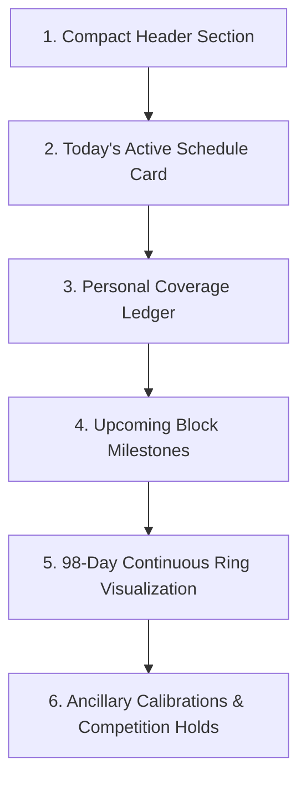
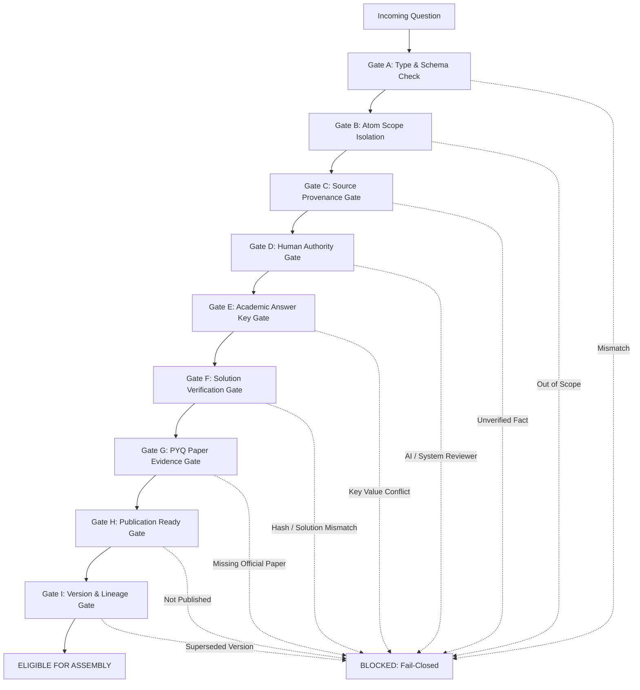

# Volume B — Student Experience

## Part 3 — Crucible Protocol, Continuous Learning Ring और Assessment Workflows

### Chapter Scope और Overview

**The Crucible** Rank Crackers ecosystem का केंद्रीय, समयबद्ध और निरंतर शिक्षण प्रोटोकॉल (Time-Bound Continuous Learning Protocol) है। यह पारंपरिक ऑनलाइन टेस्ट सीरीज़ या स्थिर अध्ययन समय-सारणियों (static study timetables) से मौलिक रूप से भिन्न है। Crucible एक **98-दिवसीय सतत घूर्णन शिक्षण वलय (98-Day Continuous Learning Ring)** है जो छात्र को कभी भी स्थायी असफलता, पाठ्यक्रम समाप्ति के अवसाद या छूटे हुए बैकलॉग के दबाव में नहीं छोड़ता।

पारंपरिक एड-टेक प्लेटफ़ॉर्म्स में यदि कोई छात्र बीच सत्र में प्रवेश करता है, तो उसे "बैकलॉग" और छूटे हुए टेस्ट्स के लिए दण्डित किया जाता है। इसके विपरीत, Crucible का उत्पाद दर्शन **"Never-Wait / No-Penalty Late Joiner Policy"** पर आधारित है। छात्र चाहे जिस दिन भी जुड़े, उसका व्यक्तिगत कवरेज लेजर (Personal Coverage Ledger) स्वतंत्र रूप से शून्य से प्रारंभ होता है, जबकि वैश्विक मिशन क्लॉक (Global Mission Clock) 98 दिनों के चक्रीय चक्र (modulo continuous orbit) में निरंतर घूमती रहती है।

यह अध्याय Crucible के आंतरिक स्टेट पाइपलाइन, ग्लोबल क्लॉक इंजन, कैनोनिकल शेड्यूल रजिस्ट्री, सभी 6 प्रमुख दृश्य अनुभागों (UI Sections), असेसमेंट चैंबर्स (Micro, Macro, Rebuild), सबमिशन पाइपलाइन, **9-Gate Question Eligibility Architecture**, **Human Authority Law** पर आधारित अकादमिक ट्रस्ट इंजन, और GitHub-Tracked Architecture Baseline (`RC-CRUCIBLE-C98-001`, `RC-ASSESSMENT-CAE-001`, `RC-ASSESSMENT-CTA-001`) के साथ पूर्ण स्रोत-आधारित (source-audited) तकनीकी सामंजस्य प्रस्तुत करता है।

---

## Section 1 — Constitutional Architecture & GitHub Canonical Baselines

### Subsection 1.1 — The Fixed Cycle Law (98 Days = 7 Phases × 14 Days)

**Constitutional Source:** GitHub Remote Contract `RC-CRUCIBLE-C98-001` (`CRUCIBLE_98_DAY_DAY_BY_DAY_CORE_OPERATING_SPECIFICATION.md`)  
**Implementation Source:** `lib/features/crucible/core/crucible_clock_engine.dart:187–208` एवं `lib/features/crucible/core/crucible_engine.dart:204–240`

Rank Crackers के संविधान के अनुसार Crucible का संपूर्ण खगोलीय और अकादमिक चक्र 98 दिनों के एक अखंड वलय में आबद्ध है:
$$\text{Total Ring Duration} = 7 \text{ Phases} \times 14 \text{ Days} = 98 \text{ Calendar Days} = 8,467,200 \text{ Seconds}$$

1. **Continuous Orbit Wrap (Day 98 $\rightarrow$ Day 1):** दिन 98 के अंतिम सेकंड ($8,467,200\text{s}$) के बाद वैश्विक क्लॉक रुकती नहीं है। मोड्युलो अंकगणित $(elapsedDays \pmod{98}) + 1$ के तहत वह स्वतः दिन 1 (Phase 1, Schedule 1) पर लौट आती है। प्रदक्षिणा संख्या (Orbit Number) में 1 की वृद्धि हो जाती है ($\lfloor elapsedDays / 98 \rfloor + 1$)।
2. **Fourteen-Day Phase Constitution:** प्रत्येक 14-दिवसीय फ़ेज़ का आंतरिक विभाजन तीन सुस्पष्ट अकादमिक क्षेत्रों में बँटा है:
   - **Days 1–12 (Frontier Teaching & Micro Practice):** 6 द्वि-दिवसीय अध्ययन शेड्यूल्स (Schedules 1 to 6 within phase)। प्रत्येक सम दिवस (Relative Days 2, 4, 6, 8, 10, 12) पर एक समयबद्ध **Micro Checkpoint** आयोजित होता है।
   - **Day 13 (Global Rebuild Window):** कोई नया पाठ्यक्रम, एटम या टॉपिक पेश नहीं किया जाता। यह दिन केवल छूटे हुए सीखने, संचित रिपेयर और विस्मृति निवारण (forgetting-curve mitigation) के लिए समर्पित है।
   - **Day 14 (Global Macro Citadel):** 14-दिवसीय ब्लॉक का समग्र बहु-विषयक संश्लेषण मूल्यांकन (Phase Integration Assessment — 50 से 100 प्रश्न, 120 मिनट)।
3. **Global Cadence Sum:**
   - कुल Micro Checkpoints = $7 \times 6 = 42$ (Global Days: 2, 4, 6, 8, 10, 12; 16, 18, 20, 22, 24, 26; 30, 32, 34, 36, 38, 40; 44, 46, 48, 50, 52, 54; 58, 60, 62, 64, 66, 68; 72, 74, 76, 78, 80, 82; 86, 88, 90, 92, 94, 96)।
   - कुल Rebuild Days = $7$ (Global Days: 13, 27, 41, 55, 69, 83, 97)।
   - कुल Macro Citadel Days = $7$ (Global Days: 14, 28, 42, 56, 70, 84, 98)।

### Subsection 1.2 — Schedule Unit Definition & Academic Workload Envelope

**Constitutional Source:** `RC-CRUCIBLE-C98-001:Section 7–9`

पारंपरिक एड-टेक समय-सारणियों में "प्रतिदिन 2 टॉपिक्स" या "3 चैप्टर्स प्रति सप्ताह" जैसा कृत्रिम और अनौपचारिक नियम होता है। Rank Crackers में ऐसा कोई मनमाना नियम पूर्णतः वर्जित है:

> **The No Universal Topic Count Law:**  
> "There is no constitutional rule such as 'N topics per day.' Topic count is a derived display statistic, not planning authority. Atomic workload, learner capacity and learning coherence govern allocation."

प्रत्येक दिन का अध्ययन शेड्यूल एक सुव्यवस्थित संकलक (**Schedule Capacity Compiler**) द्वारा संकलित किया जाता है जो निम्नलिखित कारकों से अकादमिक वर्कलोड लिफ़ाफ़ा (**Academic Workload Envelope**) व्युत्पन्न करता है:
- **Verified Mission Syllabus:** आधिकारिक सरकारी अधिसूचना से सत्यापित सिलेबस।
- **Derived Decomposition & Atoms (DSD):** पूर्वपेक्षित नोड्स का निर्देशित चक्रीय आलेख (Prerequisite DAG)।
- **Teacher / Pedagogy Effort:** शिक्षक द्वारा निर्मित और प्रमाणित अध्यापन इकाइयाँ।
- **Released DigiBook Units:** वे पाठ्य इकाइयाँ जो वास्तव में रिलीज़ और प्रमाणित हैं।
- **Student Entry Class & Capacity:** छात्र का उपलब्ध अध्ययन समय और मानसिक भार।
- **Unresolved Repair & Retention Debt:** छात्र के संचित विस्मरण और गलतियों का ऋण।

### Subsection 1.3 — Assessment Execution Contract & Eligibility Intersection

**Constitutional Source:** GitHub Remote Contract `RC-ASSESSMENT-CAE-001` (`CRUCIBLE_ASSESSMENT_EXECUTION_CONTRACT.md`)

Crucible स्वयं कोई सिलेबस प्राधिकार (Syllabus Authority) नहीं है, न ही यह अध्यापन प्राधिकार (Teaching Authority) है और न ही एक कच्चा PYQ भंडार। यह केवल उन प्रश्नों को उपभोग कर सकता है जो निम्नलिखित 7-स्तरीय पात्रता प्रतिच्छेदन (**Eligibility Intersection**) को संतुष्ट करते हैं:

$$\text{Eligible Questions} = \text{Mission} \cap \text{Effective Blueprint} \cap \text{Current OSA/DSD} \cap \text{Verified Atoms} \cap \text{Valid Taught Authority} \cap \text{QUESTION\_KNOWLEDGE\_CLOSED} \cap \text{Crucible Policy}$$

#### Non-Negotiable Assessment Principles:
1. **Zero-PYQ Behavior Law:** किसी मिशन में यदि शून्य PYQ उपलब्ध हैं, तो भी मिशन सुचारू रूप से चलता है। Crucible प्लेटफ़ॉर्म के समीक्षित प्रश्न बैंक (Reviewed Question Bank) का उपयोग करता है। भविष्य में PYQ जोड़े जाने पर छात्र का चक्र पुनः प्रारंभ नहीं होता।
2. **Mastery Events Immutability:** प्रत्येक प्रयास में `questionVersion`, `atomIds`, `policyVersion`, छात्र की प्रतिक्रिया, सर्वर-मूल्यांकित अंक और प्रयुक्त संकेत अपरिवर्तनीय रूप से दर्ज होते हैं। इतिहास कभी पुनर्लिखित नहीं होता।
3. **Fail-Closed Law:** यदि किसी शेड्यूल के लिए पात्र प्रश्नों की संख्या न्यूनतम आवश्यक सीमा से कम है (`eligible.length < minBank`), तो सिस्टम कभी दायरा चुपचाप चौड़ा नहीं करता। यह सीधे `NOT_READY / Coverage Gap` स्थिति लौटाता है।
4. **Same-Day Assessment Safety:** यदि किसी दिन अध्यापन और माइक्रो टेस्ट दोनों हैं, तो टेस्ट में केवल वही प्रश्न पात्र होते हैं जिनका ज्ञान असेसमेंट कट-ऑफ से पूर्व मान्य Taught Manifest में मौजूद था। कैलेंडर उपस्थिति मात्र से ज्ञान टेस्टेबल नहीं बनता।

### Subsection 1.4 — Test Arena Separation & Supersession of Legacy "Day 99 Throne"

**Constitutional Source:** GitHub Remote Contract `RC-ASSESSMENT-CTA-001` (`CRUCIBLE_TO_TEST_ARENA_HANDOFF_AND_FORMAL_ASSESSMENT_BOUNDARY_CONTRACT.md`)  
**Historical Prototype Source:** `lib/features/crucible/presentation/widgets/sacred_major_test_throne.dart`

```mermaid
flowchart LR
    subgraph Crucible["The Crucible (Continuous Orbit)"]
        direction TB
        M[Micro Checkpoints (Days 2..12)]
        R[Rebuild Windows (Day 13)]
        MC[Macro Citadels (Day 14)]
        Wrap["Continuous 98-Day Modulo Wrap (Day 98 -> Day 1)"]
    end

    subgraph Handoff["Evidence Handoff (RC-ASSESSMENT-CTA-001)"]
        direction TB
        EV["Exported Learner Evidence:
        • Valid Knowledge Boundary
        • Micro/Macro Diagnostics
        • Retention/Weakness State
        • Question Exposure History"]
    end

    subgraph Arena["Test Arena (Formal Summative Assessment)"]
        direction TB
        SEC[Sectional Tests]
        MAJ[Major Milestone Tests]
        FLM[Full-Length Official Mocks]
        HIST[Historical Paper Simulations]
    end

    Crucible -->|Exports Versioned Evidence| Handoff
    Handoff -->|Re-evaluates Blueprint & Eligibility| Arena
```

#### The Legacy Quarantining of `SacredMajorTestThrone`:
कोडबेस में `lib/features/crucible/presentation/widgets/sacred_major_test_throne.dart` (लाइन 623 पर `'DAY 99'` का उल्लेख) एक प्रारंभिक प्रोटोटाइप था। इस प्रोटोटाइप में दो गंभीर सैद्धांतिक दोष थे:
1. यह 98-दिवसीय चक्रीय वलय के बाद एक कृत्रिम 99वाँ दिन जोड़ता था, जिससे मोड्युलो ऑर्बिट ($98 \to 1$) टूटता था।
2. यह रचनात्मक शिक्षण चक्र (Formative Learning) के भीतर योगात्मक महा-परीक्षा (Summative Major Test) को मिला देता था।

**आधिकारिक संवैधानिक सुधार (`RC-ASSESSMENT-CTA-001:Section 2`):**
- **Crucible owns:** Micro Checkpoints, Day-13 Rebuild evidence, Macro Citadels, और फ़ेज़-स्तरीय डायग्नोस्टिक्स।
- **Test Arena owns:** Sectional Tests, Major Tests, Full-Length Mocks, और Stage/Component सिमुलेशन।
- **Constitutional Invariant:** "Major Test MUST NOT execute as a Crucible construct."
- `sacred_major_test_throne.dart` को उत्पादन में **`SUPERSEDED_LEGACY_PROTOTYPE / QUARANTINED`** घोषित किया गया है। मेजर टेस्ट अब केवल Test Arena द्वारा आयोजित होते हैं।

---

## Section 2 — Screen State Pipeline और Reactive Stream Binding

### Subsection 2.1 — Provider Stream और User Recruitment Scope

**Canonical Source File:** `lib/features/crucible/presentation/providers/crucible_state_provider.dart`

```dart
final crucibleProtocolStateProvider =
    StreamProvider.autoDispose<CrucibleProtocolState?>((ref) {
  final sessionUserAsync = ref.watch(sessionUserProvider);
  return sessionUserAsync.when(
    data: (user) => CrucibleRepository.streamProtocolState(user.recruitmentId),
    loading: () => const Stream.empty(),
    error: (err, stack) => const Stream.empty(),
  );
});
```

#### Line-by-Line Code Analysis & Architectural Mechanics:
1. `StreamProvider.autoDispose<CrucibleProtocolState?>`: यह प्रदाता एक `autoDispose` स्ट्रीम प्रदाता है। जब छात्र Crucible स्क्रीन से बाहर किसी अन्य रूट पर नेविगेट करता है, तो Firestore का एक्टिव लिसनर (real-time snapshot listener) स्वतः बंद हो जाता है, जिससे बैंडविड्थ और बिलिंग सुरक्षित रहती है।
2. `final sessionUserAsync = ref.watch(sessionUserProvider)`: प्रोटोकॉल स्ट्रीम छात्र के सक्रिय प्रमाणीकृत सत्र से गहराई से जुड़ी है। जब तक सत्र का समाधान नहीं हो जाता, तब तक स्ट्रीम `const Stream.empty()` रहती है।
3. `user.recruitmentId`: प्रोटोकॉल का दायरा छात्र के UID के साथ-साथ उसके चयनित मिशन (`recruitmentId`, जैसे `'jee-main-2027'`) से बंधा है।
4. `error: (err, stack) => const Stream.empty()`: यदि सत्र लोड करने में कोई त्रुटि आती है, तो प्रदाता क्रैश होने के बजाय खाली स्ट्रीम लौटाता है, जिससे UI सुरक्षित रूप से तैयारी स्थिति (Preparing State) में गिरता है।

### Subsection 2.2 — Tri-State Lifecycle (Loading, Preparing, Active Content)

**Canonical Source File:** `lib/features/crucible/presentation/screens/crucible_screen.dart:44–83`

```dart
@override
Widget build(BuildContext context) {
  final sessionUser = ref.watch(sessionUserProvider).valueOrNull;
  final readiness = ref.watch(missionReadinessProvider);
  final knowledge = KnowledgeEngine.instance;
  final momentum = knowledge.momentumState;

  final protocolStateAsync = ref.watch(crucibleProtocolStateProvider);

  return protocolStateAsync.when(
    data: (protocolState) {
      if (protocolState == null) {
        return _buildPreparingState(
          sessionUser: sessionUser,
          readiness: readiness,
          momentum: momentum,
        );
      }
      return _buildCrucibleContent(
        protocolState: protocolState,
        sessionUser: sessionUser,
        readiness: readiness,
        momentum: momentum,
      );
    },
    loading: () => Scaffold(
      backgroundColor: AppColors.background,
      body: TacticalNoirBackground(
        child: const Center(
          child: CircularProgressIndicator(color: AppColors.gold),
        ),
      ),
    ),
    error: (err, stack) => _buildPreparingState(
      sessionUser: sessionUser,
      readiness: readiness,
      momentum: momentum,
    ),
  );
}
```

#### State Machine Outcomes:
1. **Loading State:** जब प्रोटोकॉल स्ट्रीम का प्रारंभिक स्नैपशॉट लोड हो रहा होता है, तब गहरा काला पृष्ठभूमि (`TacticalNoirBackground`) और केंद्रीय स्वर्ण संकेतक (`CircularProgressIndicator(color: AppColors.gold)`) प्रदर्शित होता है।
2. **Preparing State (`protocolState == null` या `error`):** यदि Firestore में इस छात्र और मिशन के लिए कोई सक्रिय प्रोटोकॉल दस्तावेज़ मौजूद नहीं है, या नेटवर्क त्रुटि है, तो एप्लिकेशन क्रैश स्क्रीन नहीं दिखाती। इसके बजाय `_buildPreparingState` रेंडर होता है, जो छात्र को सूचित करता है कि आधिकारिक मिशन पैरामीटर प्रकाशित होते ही शेड्यूल सक्रिय हो जाएगा।
3. **Active Content State (`protocolState != null`):** वैध प्रोटोकॉल अवस्था मिलने पर संपूर्ण 98-दिवसीय कमांड सतह रेंडर होती है।

### Subsection 2.3 — Comprehensive Screen States & Lifecycle Matrix

Crucible यूजर इंटरफ़ेस किसी भी परिस्थिति में अनडिफ़ाइंड या अनकंट्रोल्ड स्टेट में नहीं जाता। निम्नलिखित 7-अवस्था जीवनचक्र आव्यूह (Lifecycle State Matrix) यह स्पष्ट करता है कि सिस्टम प्रत्येक स्थिति में कैसे व्यवहार करता है:

| स्क्रीन अवस्था (Screen State) | ट्रिगर स्थिति (Trigger Condition) | विजुअल सतह और घटक (Visual Surface & Components) | छात्र इंटरैक्शन क्षमता (User Capabilities) | सुरक्षा एवं नेटवर्क सीमा (Security & Fail-Closed Boundary) |
| :--- | :--- | :--- | :--- | :--- |
| **1. Loading State** | `crucibleProtocolStateProvider.isLoading` | गहरा काला बैकग्राउंड (`TacticalNoirBackground`), केंद्रीय गोल्ड लोडर (`CircularProgressIndicator(color: AppColors.gold)`) | कोई इंटरैक्शन नहीं (ब्लॉक्ड स्क्रीन) | 3-सेकंड फ़ायरस्टोर कैश रीहाइड्रेशन टाइमआउट; टाइमआउट पर Preparing State पर फ़ॉलबैक। |
| **2. Preparing State** | `protocolState == null` अथवा सेशन लोड एरर | `_buildPreparingState`: `CommandHeader` (`missionEvidenceVerified: false`), 40px गोल्ड फ्लेम आइकन, "CRUCIBLE PREPARATION" बैनर, व्याख्यात्मक टेक्स्ट | केवल हेडर व्यूइंग और बैक नेविगेशन; कोई शेड्यूल एक्शन नहीं | शून्य नकली शेड्यूल (Zero fake schedules); अप्रकाशित मिशन पर कोई बनावटी डेटा रेंडर नहीं होता। |
| **3. Active Study State** | `protocolState != null` तथा Days 1–12 of Block | `_buildCrucibleContent`: `_buildCompactHeader`, `Today's Active Schedule Card`, `Personal Coverage Ledger`, `98-Day Ring Visualization` | "LEARN" (डिजीबुक रीडर), "SYLLABUS" (सिलेबस ट्री), शेड्यूल्ड माइक्रो टेस्ट अटेम्प्ट | `DigiBookCanonicalBridgeService` फ़ेल-क्लोज़्ड सत्यापन; अनमैप्ड नोड्स पर सूचनात्मक बॉटम-शीट। |
| **4. Rebuild Window** | Day 13 of Block (`isRebuild == true`) | `_buildRebuildCard`: "REBUILD WINDOW" गोल्ड चिप, रिपेयर गाइडेंस, "EXPLORE SYLLABUS" आउटलाइंड बटन | छूटे हुए विषयों की समीक्षा, सिलेबस एक्सप्लोरेशन; कोई नया अनिवार्य असेसमेंट नहीं | कोई बैकलॉग पेनल्टी नहीं; छात्र का व्यक्तिगत लेजर स्वतंत्र रहता है। |
| **5. Macro Citadel Window**| Day 14 of Block (`isMacro == true`) | `_buildMacroCard`: "MACRO CITADEL" चिप, 50-100 प्रश्न/120 मिनट ब्लॉक सिंथेसिस विवरण, तात्कालिक होल्ड इंडिकेटर | मैक्रो असेसमेंट ट्रिगर (यदि प्रकाशित हो) अथवा सूचनात्मक तैयारी रिव्यू | केवल Day 14 पर अनलॉक्ड; अन्य दिनों में सर्वर-साइड व क्लाइंट-साइड फ़ेल-क्लोज़्ड। |
| **6. Offline Caching State**| नेटवर्क डिस्कनेक्ट लेकिन लोकल कैश उपलब्ध | लोकल कैश से रेंडर प्रोटोकॉल स्टेट; ऑफ़लाइन वॉर्निंग बैज; लेजर 0-मान सुरक्षा | ऑफलाइन रीडिंग मोड (कैश्ड डिजीबुक मॉड्यूल्स); असेसमेंट सबमिशन कतारबद्ध | क्लाइंट-साइड स्कोरिंग वर्जित; सबमिशन लोकल आउटबॉक्स में पेंडिंग रहता है। |
| **7. Stream Error State** | अनहैंडल्ड फ़ायरस्टोर एरर या अथॉरिटी मिसमैच | `_buildPreparingState` पर सुरक्षित फ़ॉलबैक; एरर स्नैकबार या अलर्ट | सुरक्षित स्क्रीन विजिबिलिटी; कोई क्रैश नहीं | फ़ेल-क्लोज़्ड निष्पादन; सिस्टम किसी अनधिकृत पेलोड को प्रोसेस नहीं करता। |

### Subsection 2.4 — The 15 Core Attributes of The Crucible System

Chief Author Mandate के अनुरूप Crucible प्रोटोकॉल के 15 मूलभूत सिस्टम पैरामीटर्स का विनिर्देश:

| # | कोर विशेषता (Core Attribute) | कैनोनिकल विनिर्देश (Canonical Specification) | प्रामाणिक स्रोत फ़ाइल व संदर्भ (Source Evidence) |
| :--- | :--- | :--- | :--- |
| **1** | **Feature Name** | The Crucible (98-Day Continuous Learning Ring) | `lib/features/crucible/presentation/screens/crucible_screen.dart:288` |
| **2** | **Canonical Domain ID** | `crucible_learning_ring_v1` | `lib/features/crucible/core/crucible_canonical_schedules.dart:10–26` |
| **3** | **Parent Hierarchy** | `App -> Recruitment Mission -> 98-Day Ring -> 14-Day Block -> 2-Day Schedule` | `10_crucible_protocol_and_schedule_engine.md:1196` |
| **4** | **Presentation Entry Point**| `AppRoutes.crucible` (`/crucible`) | `lib/core/router/app_router.dart:253` |
| **5** | **State Management Engine**| `crucibleProtocolStateProvider` (Riverpod `StreamProvider.autoDispose`) | `lib/features/crucible/presentation/providers/crucible_state_provider.dart:22–30` |
| **6** | **Backend Topology & Storage** | Firestore collection `/users/{uid}/protocols/{recruitmentId}` & `mission_realms/{realmId}` | `lib/core/backend/crucible_repository.dart:791–828` |
| **7** | **Offline Strategy & Caching**| Firestore offline persistence + `DashboardLocalDatasource` zero-fake guarantee | `lib/database/local/dashboard_local_datasource.dart:1–72` |
| **8** | **Authority Boundary** | Client reads schedule metadata; all scoring and qualification evaluation executed server-side | `functions/workers/evaluate_attempt_worker.js:9–216` |
| **9** | **Mathematical Orbit Formula**| $CycleDay = (elapsedDays \pmod{98}) + 1$; $Orbit = \lfloor elapsedDays / 98 \rfloor + 1$ | `lib/features/crucible/core/crucible_clock_engine.dart:187–208` |
| **10**| **Verification & Gate System** | 9-Gate Question Eligibility + Human Authority Law (No AI reviewer certified) | `lib/features/crucible/core/micro_test_engine.dart:148–340` |
| **11**| **Student Visibility Law** | Phase Block locked strictly by temporal clock; no manual skip without sovereign authorization | `lib/features/crucible/core/crucible_canonical_schedules.dart:889–902` |
| **12**| **Late Joiner / Backlog Policy**| Zero-penalty late joiner architecture; personal coverage ledger starts from verified zero | `lib/features/crucible/presentation/screens/crucible_screen.dart:486–526` |
| **13**| **Security & Anti-Cheat Rules**| Cryptographic SHA-256 solution hashing; FNV-1a deterministic assembly seed | `lib/features/crucible/core/micro_test_engine.dart:120–142` |
| **14**| **Test Coverage & Suites** | 4 primary suites: personalization blueprint, item selector, responsive timer, QA | `test/features/personalization/recovery/crucible_personalized_item_selector_test.dart` |
| **15**| **Failure Mode & Fallback UI** | Preparing State (`_buildPreparingState`) fallback on null protocol, offline, or network error | `lib/features/crucible/presentation/screens/crucible_screen.dart:53–83` |

---

## Section 3 — Sovereign Global Clock Engine और Canonical Schedule Registry

### Subsection 3.1 — Cycle Day और Orbit Number की गणना

**Source File:** `lib/features/crucible/core/crucible_clock_engine.dart:187–208`

```dart
final now = DateTime.now();
final globalStartTime = protocolState.protocolStartTime;
final effectiveState = protocolState;

final currentCycleDay = CrucibleClockEngine.getCycleDay(
  state: effectiveState,
  now: now,
);

final orbitNumber = CrucibleClockEngine.getOrbitNumber(
  protocolStartTime: globalStartTime,
  now: now,
);
```

#### Time Calculations Mathematical Formulation:
- **Elapsed Duration:** $\Delta t = now - protocolStartTime$
- **Ring Modulo Duration:** $elapsedDays = \lfloor \Delta t_{seconds} / 86400 \rfloor$
- **Cycle Day (1–98):**
  $$CycleDay = (elapsedDays \pmod{98}) + 1$$
- **Orbit Number (प्रदक्षिणा संख्या):**
  $$OrbitNumber = \lfloor elapsedDays / 98 \rfloor + 1$$

UI किसी स्थानीय काउंटर का उपयोग नहीं करती। `CrucibleClockEngine` समय का सर्वोच्च और अपरिवर्तनीय स्रोत (Temporal Authority) है।

### Subsection 3.2 — Canonical Schedule Registry Lookup

**Source File:** `lib/features/crucible/core/crucible_canonical_schedules.dart`

`CrucibleCanonicalScheduleRegistry` एक static in-memory lookup इंजन है जो प्रत्येक cycle day के लिए सटीक शैक्षणिक वर्गीकरण प्रदान करता है:

```dart
final currentPhase = CrucibleCanonicalScheduleRegistry.getPhaseForCycleDay(currentCycleDay);
final isRebuild = CrucibleCanonicalScheduleRegistry.isRebuildDay(currentCycleDay);
final isMacro = CrucibleCanonicalScheduleRegistry.isMacroDay(currentCycleDay);

final activeSchedule = CrucibleCanonicalScheduleRegistry.getScheduleForCycleDay(currentCycleDay);
```

#### Schedule Distribution Rules across the 98-Day Ring:
1. **7 Phase Blocks:** प्रत्येक ब्लॉक 14 दिनों का होता है ($7 \times 14 = 98$ दिन)।
2. **Phase Formula:** $PhaseIndex = \lfloor (currentCycleDay - 1) / 14 \rfloor + 1$
3. **Study Schedules:** प्रत्येक ब्लॉक के पहले 12 दिन (Days 1 to 12 of Block) 6 दो-दिवसीय अध्ययन शेड्यूल्स में विभाजित होते हैं ($6 \times 2 = 12$ दिन)। कुल 42 कैनोनिकल शेड्यूल्स ($7 \times 6 = 42$)।
4. **Rebuild Day:** प्रत्येक ब्लॉक का 13वाँ दिन (Day 13, 27, 41, 55, 69, 83, 97) रिबिल्ड विंडो होता है।
5. **Macro Day:** प्रत्येक ब्लॉक का 14वाँ दिन (Day 14, 28, 42, 56, 70, 84, 98) मैक्रो सिटाडेल टेस्ट विंडो होता है।

### Subsection 3.3 — 2-Day Schedule Position (Day A vs Day B)

प्रत्येक अध्ययन शेड्यूल 2 कैलेंडर दिनों तक चलता है:
```dart
final isDayB = activeSchedule != null && currentCycleDay == activeSchedule.endCycleDay;
final dayInScheduleLabel = isDayB ? 'Day B of 2' : 'Day A of 2';
```

#### The Pedagogical Dual-Day Cadence:
- **Day A of 2 (Concept Acquisition & Reading Frontier):** 
  - छात्र का प्राथमिक लक्ष्य संबंधित पाठ्य सामग्री का गहन स्वाध्याय है।
  - `DigiBookCanonicalBridgeService` के माध्यम से मैप किए गए प्रामाणिक पाठ्य-इकाइयों (Generation Units) का अध्ययन।
  - सिद्धांत, मुख्य सूत्र, आरेख और बुनियादी उदाहरणों का अवलोकन।
  - इस दिन कोई अनिवार्य परीक्षा दबाव नहीं होता; छात्र सीखने की गति स्वयं निर्धारित करता है।
- **Day B of 2 (Deep Practice & The Hour-47 Micro Assessment):** 
  - अर्जित संकल्पनाओं का उच्च-दबाव समस्या-समाधान परीक्षण।
  - जटिल संख्यात्मक समस्याओं और वैचारिक प्रश्नों का अभ्यास।
  - `SacredMicroTestChamber` का उद्घाटन (10–25 प्रश्न, 15–30 मिनट समयबद्ध टेस्ट)।
  - शेड्यूल के 47वें घंटे (`learningStart + 47h`) पर असेसमेंट विंडो खुलती है और 48वें घंटे (`learningStart + 48h`) तक सक्रिय रहती है।

### Subsection 3.4 — Complete 98-Day Day-by-Day Master Schedule Architecture

नीचे The Crucible के सभी 7 ब्लॉक्स, 42 शेड्यूल्स, 42 माइक्रो चेकपॉइंट्स, 7 रिबिल्ड दिनों और 7 मैक्रो दिनों का संपूर्ण दिन-वार आव्यूह (Day-by-Day Master Matrix) दर्ज है:

| फ़ेज़ (Block) | दिवस (Day) | प्रकार (Day Type) | कोड / शेड्यूल | विषय क्षेत्र (Subject Domain) | माइक्रो टेस्ट स्थिति (Micro Cadence) |
| :--- | :--- | :--- | :--- | :--- | :--- |
| **Phase 1** | Days 1–2 | Study Schedule | `S01` (Day A/B) | Mechanics I: Kinematics 1D/2D | **Micro 01 (Day 2 Checkpoint)** |
| | Days 3–4 | Study Schedule | `S02` (Day A/B) | Mechanics I: Newton's Laws of Motion | **Micro 02 (Day 4 Checkpoint)** |
| | Days 5–6 | Study Schedule | `S03` (Day A/B) | Mechanics I: Work, Energy & Power | **Micro 03 (Day 6 Checkpoint)** |
| | Days 7–8 | Study Schedule | `S04` (Day A/B) | Chemistry: Mole Concept & Stoichiometry | **Micro 04 (Day 8 Checkpoint)** |
| | Days 9–10 | Study Schedule | `S05` (Day A/B) | Mathematics: Sets, Relations & Functions | **Micro 05 (Day 10 Checkpoint)** |
| | Days 11–12| Study Schedule | `S06` (Day A/B) | Mathematics: Quadratic Equations & Complex | **Micro 06 (Day 12 Checkpoint)** |
| | **Day 13** | **Rebuild Window** | `R01` | **Phase 1 Knowledge Repair & Decay Recovery** | *Zero New Teaching / Retention Session* |
| | **Day 14** | **Macro Citadel** | `M01` | **Phase 1 Comprehensive Synthesis Assessment** | **Macro 01 (50–100 Qs / 120 Min)** |
| **Phase 2** | Days 15–16 | Study Schedule | `S07` (Day A/B) | Mechanics II: Center of Mass & Collisions | **Micro 07 (Day 16 Checkpoint)** |
| | Days 17–18 | Study Schedule | `S08` (Day A/B) | Mechanics II: Rotational Motion & Torque | **Micro 08 (Day 18 Checkpoint)** |
| | Days 19–20 | Study Schedule | `S09` (Day A/B) | Mechanics II: Gravitation & Satellite Motion | **Micro 09 (Day 20 Checkpoint)** |
| | Days 21–22 | Study Schedule | `S10` (Day A/B) | Chemistry: Atomic Structure & Quantum Model | **Micro 10 (Day 22 Checkpoint)** |
| | Days 23–24 | Study Schedule | `S11` (Day A/B) | Mathematics: Sequences, Series & Progressions | **Micro 11 (Day 24 Checkpoint)** |
| | Days 25–26 | Study Schedule | `S12` (Day A/B) | Mathematics: Binomial Theorem & Permutations | **Micro 12 (Day 26 Checkpoint)** |
| | **Day 27** | **Rebuild Window** | `R02` | **Phase 2 Knowledge Repair & Decay Recovery** | *Zero New Teaching / Retention Session* |
| | **Day 28** | **Macro Citadel** | `M02` | **Phase 2 Comprehensive Synthesis Assessment** | **Macro 02 (50–100 Qs / 120 Min)** |
| **Phase 3** | Days 29–30 | Study Schedule | `S13` (Day A/B) | Thermal Physics: Heat, Calorimetry & Expansion | **Micro 13 (Day 30 Checkpoint)** |
| | Days 31–32 | Study Schedule | `S14` (Day A/B) | Thermal Physics: Thermodynamics Laws & KTG | **Micro 14 (Day 32 Checkpoint)** |
| | Days 33–34 | Study Schedule | `S15` (Day A/B) | Chemistry: Periodic Table & Chemical Bonding | **Micro 15 (Day 34 Checkpoint)** |
| | Days 35–36 | Study Schedule | `S16` (Day A/B) | Chemistry: Thermodynamics & Thermochemistry | **Micro 16 (Day 36 Checkpoint)** |
| | Days 37–38 | Study Schedule | `S17` (Day A/B) | Mathematics: Trigonometric Ratios & Equations | **Micro 17 (Day 38 Checkpoint)** |
| | Days 39–40 | Study Schedule | `S18` (Day A/B) | Mathematics: Coordinate Geometry: Straight Lines | **Micro 18 (Day 40 Checkpoint)** |
| | **Day 41** | **Rebuild Window** | `R03` | **Phase 3 Knowledge Repair & Decay Recovery** | *Zero New Teaching / Retention Session* |
| | **Day 42** | **Macro Citadel** | `M03` | **Phase 3 Comprehensive Synthesis Assessment** | **Macro 03 (50–100 Qs / 120 Min)** |
| **Phase 4** | Days 43–44 | Study Schedule | `S19` (Day A/B) | Electromagnetism: Electrostatics & Gauss Law | **Micro 19 (Day 44 Checkpoint)** |
| | Days 45–46 | Study Schedule | `S20` (Day A/B) | Electromagnetism: Capacitance & Dielectrics | **Micro 20 (Day 46 Checkpoint)** |
| | Days 47–48 | Study Schedule | `S21` (Day A/B) | Electromagnetism: Current Electricity & Circuits | **Micro 21 (Day 48 Checkpoint)** |
| | Days 49–50 | Study Schedule | `S22` (Day A/B) | Chemistry: Chemical Equilibrium & Ionic Balance | **Micro 22 (Day 50 Checkpoint)** |
| | Days 51–52 | Study Schedule | `S23` (Day A/B) | Mathematics: Circles & Conic Sections I | **Micro 23 (Day 52 Checkpoint)** |
| | Days 53–54 | Study Schedule | `S24` (Day A/B) | Mathematics: Conic Sections II (Parabola, Ellipse)| **Micro 24 (Day 54 Checkpoint)** |
| | **Day 55** | **Rebuild Window** | `R04` | **Mid-Ring Full Synthesis Rebuild Window** | *Zero New Teaching / Half-Ring Repair* |
| | **Day 56** | **Macro Citadel** | `M04` | **Phase 4 Comprehensive Synthesis Assessment** | **Macro 04 (50–100 Qs / 120 Min)** |
| **Phase 5** | Days 57–58 | Study Schedule | `S25` (Day A/B) | Magnetism: Magnetic Effects of Current & Biot-Savart| **Micro 25 (Day 58 Checkpoint)** |
| | Days 59–60 | Study Schedule | `S26` (Day A/B) | Magnetism: Electromagnetic Induction & AC | **Micro 26 (Day 60 Checkpoint)** |
| | Days 61–62 | Study Schedule | `S27` (Day A/B) | Chemistry: Redox Reactions & Electrochemistry | **Micro 27 (Day 62 Checkpoint)** |
| | Days 63–64 | Study Schedule | `S28` (Day A/B) | Chemistry: Chemical Kinetics & Solutions | **Micro 28 (Day 64 Checkpoint)** |
| | Days 65–66 | Study Schedule | `S29` (Day A/B) | Mathematics: Differential Calculus: Limits & Continuity| **Micro 29 (Day 66 Checkpoint)** |
| | Days 67–68 | Study Schedule | `S30` (Day A/B) | Mathematics: Differentiation & Applications | **Micro 30 (Day 68 Checkpoint)** |
| | **Day 69** | **Rebuild Window** | `R05` | **Phase 5 Knowledge Repair & Decay Recovery** | *Zero New Teaching / Retention Session* |
| | **Day 70** | **Macro Citadel** | `M05` | **Phase 5 Comprehensive Synthesis Assessment** | **Macro 05 (50–100 Qs / 120 Min)** |
| **Phase 6** | Days 71–72 | Study Schedule | `S31` (Day A/B) | Optics: Ray Optics & Optical Instruments | **Micro 31 (Day 72 Checkpoint)** |
| | Days 73–74 | Study Schedule | `S32` (Day A/B) | Optics: Wave Optics, Interference & Diffraction | **Micro 32 (Day 74 Checkpoint)** |
| | Days 75–76 | Study Schedule | `S33` (Day A/B) | Chemistry: Organic Chemistry: Nomenclature & GOC| **Micro 33 (Day 76 Checkpoint)** |
| | Days 77–78 | Study Schedule | `S34` (Day A/B) | Chemistry: Hydrocarbons & Reaction Mechanisms | **Micro 34 (Day 78 Checkpoint)** |
| | Days 79–80 | Study Schedule | `S35` (Day A/B) | Mathematics: Integral Calculus: Indefinite Integrals | **Micro 35 (Day 80 Checkpoint)** |
| | Days 81–82 | Study Schedule | `S36` (Day A/B) | Mathematics: Definite Integrals & Area under Curves | **Micro 36 (Day 82 Checkpoint)** |
| | **Day 83** | **Rebuild Window** | `R06` | **Phase 6 Knowledge Repair & Decay Recovery** | *Zero New Teaching / Retention Session* |
| | **Day 84** | **Macro Citadel** | `M06` | **Phase 6 Comprehensive Synthesis Assessment** | **Macro 06 (50–100 Qs / 120 Min)** |
| **Phase 7** | Days 85–86 | Study Schedule | `S37` (Day A/B) | Modern Physics: Dual Nature, Radiation & Matter | **Micro 37 (Day 86 Checkpoint)** |
| | Days 87–88 | Study Schedule | `S38` (Day A/B) | Modern Physics: Atoms, Nuclei & Semiconductor Devices| **Micro 38 (Day 88 Checkpoint)** |
| | Days 89–90 | Study Schedule | `S39` (Day A/B) | Chemistry: Coordination Compounds & Metallurgy | **Micro 39 (Day 90 Checkpoint)** |
| | Days 91–92 | Study Schedule | `S40` (Day A/B) | Chemistry: p-Block, d-Block & Organic Functional Groups| **Micro 40 (Day 92 Checkpoint)** |
| | Days 93–94 | Study Schedule | `S41` (Day A/B) | Mathematics: Differential Equations & Vectors | **Micro 41 (Day 94 Checkpoint)** |
| | Days 95–96 | Study Schedule | `S42` (Day A/B) | Mathematics: Three-Dimensional Geometry & Probability | **Micro 42 (Day 96 Checkpoint)** |
| | **Day 97** | **Rebuild Window** | `R07` | **Phase 7 Full-Ring Final Rebuild & Decay Reset** | *Zero New Teaching / Pre-Orbit Reset* |
| | **Day 98** | **Macro Citadel** | `M07` | **Phase 7 Comprehensive Ring Synthesis Assessment** | **Macro 07 (50–100 Qs / 120 Min)** |
| **Wrap** | **Day 98 $\rightarrow$ Day 1** | **Orbit Wrap** | `Orbit++`| **Seamless transition to next orbit (Orbit N+1)** | *Cumulative coverage preserved; zero penalty* |

---

## Section 4 — Active Screen Visual Architecture (The 6 Sovereign Sections)

Crucible स्क्रीन 6 अनुक्रमिक, सुसंगत कार्डों और अनुभागों से सुसज्जित है:



### Subsection 4.1 — Section 1: Compact Header Section (<= 110dp)

**Source File:** `lib/features/crucible/presentation/screens/crucible_screen.dart:268–308`

```dart
Widget _buildCompactHeader(int currentCycleDay, int currentPhase, int orbitNumber) {
  return Column(
    crossAxisAlignment: CrossAxisAlignment.start,
    children: [
      Row(
        mainAxisAlignment: MainAxisAlignment.spaceBetween,
        children: [
          Container(
            padding: const EdgeInsets.symmetric(horizontal: 8, vertical: 3),
            decoration: BoxDecoration(
              color: AppColors.gold.withValues(alpha: 0.12),
              borderRadius: BorderRadius.circular(4),
              border: Border.all(color: AppColors.gold.withValues(alpha: 0.3)),
            ),
            child: const Text(
              'JEE MAIN 2027',
              style: TextStyle(
                color: AppColors.gold,
                fontSize: 10,
                fontWeight: FontWeight.w700,
                letterSpacing: 1.1,
              ),
            ),
          ),
          Text(
            'Continuous Learning Ring',
            style: AppTypography.subtitle.copyWith(
              color: AppColors.textSecondary,
              fontSize: 11,
            ),
          ),
        ],
      ),
      const SizedBox(height: 6),
      Text(
        'THE CRUCIBLE',
        style: AppTypography.hero.copyWith(
          fontSize: 22,
          fontWeight: FontWeight.w800,
          letterSpacing: 1.2,
          color: Colors.white,
        ),
      ),
      const SizedBox(height: 2),
      Text(
        'DAY $currentCycleDay OF 98 • BLOCK $currentPhase OF 7 • CYCLE $orbitNumber',
        style: AppTypography.label.copyWith(
          color: AppColors.gold,
          fontWeight: FontWeight.w600,
          fontSize: 11,
          letterSpacing: 1.0,
        ),
      ),
    ],
  );
}
```

- **Exam Badge:** `'JEE MAIN 2027'` का परिष्कृत स्वर्ण बैज।
- **Hero Title:** `'THE CRUCIBLE'` 22sp में।
- **Ring Coordinates:** `'DAY 4 OF 98 • BLOCK 1 OF 7 • CYCLE 1'` — छात्र को उसकी सटीक खगोलीय/शिक्षण स्थिति का तुरंत बोध कराता है।

### Subsection 4.2 — Section 2: Today's Active Schedule Card (Tri-Modal Surface)

**Source File:** `crucible_screen.dart:313–585`

यह स्क्रीन का मुख्य इंटरैक्टिव कार्ड है जो तीन अलग-अलग रूपों में रेंडर होता है:

#### Mode 1: Rebuild Window (Day 13 of Block)
```dart
if (isRebuild) {
  return DarkCard(
    padding: const EdgeInsets.all(18),
    child: Column(
      crossAxisAlignment: CrossAxisAlignment.start,
      children: [
        Row(
          mainAxisAlignment: MainAxisAlignment.spaceBetween,
          children: [
            _buildTagChip('REBUILD WINDOW', AppColors.gold),
            Text('Day $currentCycleDay of 98', style: AppTypography.subtitle),
          ],
        ),
        const SizedBox(height: 12),
        Text('Block $currentPhase Rebuild Window', style: AppTypography.section.copyWith(color: Colors.white, fontSize: 17)),
        const SizedBox(height: 6),
        Text(
          'No assessment evidence yet. Use this window to revisit missed or unfinished learning.',
          style: AppTypography.body.copyWith(color: AppColors.textSecondary, fontSize: 13, height: 1.4),
        ),
        const SizedBox(height: 14),
        OutlinedButton.icon(
          icon: const Icon(Icons.menu_book_rounded, color: AppColors.gold, size: 16),
          label: const Text('EXPLORE SYLLABUS', style: TextStyle(color: AppColors.gold, fontSize: 12, fontWeight: FontWeight.w700)),
          onPressed: () => context.push(AppRoutes.syllabus),
        ),
      ],
    ),
  );
}
```
यह विंडो छात्र को नए विषय पढ़ने के लिए बाध्य नहीं करती; यह पिछले 12 दिनों में छूटे हुए विषयों की मरम्मत (repair) के लिए समर्पित है।

#### Mode 2: Macro Citadel Window (Day 14 of Block)
```dart
if (isMacro) {
  return DarkCard(
    padding: const EdgeInsets.all(18),
    child: Column(
      children: [
        _buildTagChip('MACRO CITADEL', AppColors.gold),
        Text('Block $currentPhase Comprehensive Milestone', style: AppTypography.section),
        Text('Block synthesis training milestone (50 Questions / 120 Minutes).'),
        Text('Macro assessment is not ready yet.'),
      ],
    ),
  );
}
```
यह पूरे 14-दिवसीय ब्लॉक का संश्लेषण मूल्यांकन (Synthesis Milestone) है।

#### Mode 3: Normal 2-Day Study Schedule (Days 1 to 12)
अध्ययन शेड्यूल के लिए कार्ड निम्नलिखित घटकों को जोड़ता है:
1. **Header & Subject:** `${activeSchedule.formattedCode} • ${dayInScheduleLabel}` और विषय का नाम (उदा. `MATHEMATICS`).
2. **Canonical Title:** `activeSchedule.canonicalTitle` (उदा. `Functions & Invertibility`).
3. **Canonical DigiBook Bridge Resolution:**
   ```dart
   final bridge = DigiBookCanonicalBridgeService.instance;
   final List<DigiBookAuthorityEntry> resolvedEntries = [];
   for (final nodeId in activeSchedule.canonicalNodeIds) {
     final res = bridge.resolveCanonicalNode(nodeId);
     if (res.isMapped) resolvedEntries.addAll(res.entries);
   }
   final bool hasContent = resolvedEntries.isNotEmpty;
   ```
4. **Truthful Content Availability Indicator:**
   - सामग्री उपलब्ध: हरा चेक आइकन + `'Learning content available'`
   - सामग्री अनुपलब्ध: धूसर वृत्त + `'Learning content not available yet'`
5. **Primary Action ('LEARN') & Governed Selection Sheet (`crucible_screen.dart:600–685`):**
   - यदि ठीक 1 पाठ्य इकाई है: सीधे `AppRoutes.digibookReader` पर नेविगेट करता है।
   - यदि एकाधिक इकाइयाँ हैं: `_handleLearnAction` एक बॉटम शीट प्रस्तुत करता है। बिना छात्र के स्पष्ट चयन के किसी भी मॉड्यूल को स्वतः लोड करना पूर्णतः वर्जित है (**Zero Autoselect Rule**)।
   - यदि सामग्री अनुपलब्ध है: `_handleUnavailableContent` एक अनुग्रहकारी बॉटम शीट खोलता है जो छात्र को वैकल्पिक सिलेबस एक्सप्लोर करने का विकल्प देती है।
6. **Secondary Action ('SYLLABUS'):** `context.push(AppRoutes.syllabus)`।
7. **Micro Test Status Badge:**
   - `'Micro assessment is not ready for this schedule yet.'` बैज। (फ़ेल-क्लोज़्ड सुरक्षा जब तक बैंक न्यूनतम गहराई तक प्रमाणित न हो)।

### Subsection 4.3 — Section 3: Personal Coverage Ledger (Zero-Fake-UI Architecture)

**Source File:** `crucible_screen.dart:743–807`

```dart
Widget _buildPersonalCoverageCard(SessionUser? user, int currentCycleDay) {
  return DarkCard(
    padding: const EdgeInsets.all(18),
    child: Column(
      crossAxisAlignment: CrossAxisAlignment.start,
      children: [
        Row(
          mainAxisAlignment: MainAxisAlignment.spaceBetween,
          children: [
            const Text(
              'PERSONAL COVERAGE LEDGER',
              style: TextStyle(
                color: AppColors.gold,
                fontSize: 10,
                fontWeight: FontWeight.w700,
                letterSpacing: 1.2,
              ),
            ),
            Text('Continuous Progress', style: AppTypography.subtitle.copyWith(fontSize: 10)),
          ],
        ),
        const SizedBox(height: 12),
        Row(
          children: [
            Expanded(child: _buildMetricTile(label: 'Schedules Done', value: '0', hint: 'Verified attempts')),
            const SizedBox(width: 8),
            Expanded(child: _buildMetricTile(label: 'Modules Studied', value: '0', hint: 'Active sessions')),
            const SizedBox(width: 8),
            Expanded(child: _buildMetricTile(label: 'Backlog Scope', value: '0', hint: 'Never-wait policy')),
          ],
        ),
        const SizedBox(height: 10),
        Text(
          'Your individual ledger records verified academic progress independently of the rotating mission clock. Late joiners start without fake failure or penalty.',
          style: AppTypography.subtitle.copyWith(color: AppColors.textSecondary, fontSize: 10, height: 1.3),
        ),
      ],
    ),
  );
}
```

#### Constitutional Truth in Ledger Metrics:
- **Zero Fake Metrics:** नए छात्र के लिए यह कार्ड बनावटी प्रतिशतता (जैसे 14% या 0.0%) नहीं दिखाता। यह स्पष्ट रूप से 3 प्रामाणिक मान दिखाता है:
  - `Schedules Done: 0` (सत्यापित प्रयास)
  - `Modules Studied: 0` (सक्रिय सत्र)
  - `Backlog Scope: 0` (कभी न रुकने वाली नीति)
- **Late Joiner Philosophy:** यदि कोई छात्र 98-डे रिंग के 45वें दिन प्रवेश करता है, तो सिस्टम उस पर पिछले 44 दिनों के छूट जाने का आरोप नहीं लगाता। उसका बैकलॉग 0 रहता है, और जैसे ही रिंग घूमकर वापस आएगी, वह उन विषयों को अपने स्वाभाविक क्रम में पूरा करेगा।

### Subsection 4.4 — Section 4: Upcoming Milestones (Rebuild & Macro)

यह कार्ड छात्र को वर्तमान ब्लॉक की दो निर्णायक तिथियों का पूर्वावलोकन देता है:
- **Rebuild Day:** $currentPhase \times 14 - 1$ (उदा. ब्लॉक 1 के लिए दिन 13)
- **Macro Citadel:** $currentPhase \times 14$ (उदा. ब्लॉक 1 के लिए दिन 14)

### Subsection 4.5 — Section 5: 98-Day Continuous Ring Visualization

**Source File:** `crucible_screen.dart:852–910`

- स्क्रीन पर 7 टाइल्स की एक क्षैतिज पट्टी रेंडर होती है (`B1`, `B2`, ..., `B7`)।
- वर्तमान ब्लॉक स्वर्ण आभा (`AppColors.gold`) से रेखांकित होता है।
- **Modulo Wrap Note:** "Continuous rotation: Day 98 advances back to Day 1 without syllabus loss."

### Subsection 4.6 — Section 6: Ancillary Calibrations & Competition Holds

प्रोटोकॉल के साथ जुड़े सहायक टूल्स की स्थिति:
1. **Smart Entry — Not Ready (`HELD`):** नैदानिक अंशांकन (Diagnostic calibration) अभी तक सक्रिय नहीं है।
2. **Test Arena — Not Ready (`TEST ARENA`):** मानकीकृत प्रतियोगी परीक्षण टेस्ट एरिना में आयोजित किए जाते हैं।

---

## Section 5 — 98-Day Mathematical Engine और Modulo Rotation Mechanics

**Source File:** `lib/features/crucible/core/crucible_engine.dart:204–251`

### Subsection 5.1 — Modulo Duration Math

```dart
final totalRingSeconds = 98 * 24 * 3600; // 8,467,200 seconds
final ringElapsedSeconds = elapsed.inSeconds % totalRingSeconds;
final ringElapsed = Duration(seconds: ringElapsedSeconds);

phaseIndex = (ringElapsedSeconds ~/ (14 * 24 * 3600)) + 1;
```

प्रोटोकॉल समय कभी समाप्त (expire) नहीं होता। 98वें दिन के अंतिम सेकंड के बाद `ringElapsedSeconds % totalRingSeconds` स्वतः `0` पर रीसेट हो जाता है और चक्र 1 से पुनः प्रारंभ हो जाता है।

### Subsection 5.2 — Phase Window Boundaries और The Hour-47 Micro Trigger

प्रत्येक 14-दिवसीय ब्लॉक के भीतर 4 सूक्ष्म अवधियाँ हैं:
```dart
final rebuildStart = const Duration(days: 12); // Day 13 start (288 hours)
final macroStart = const Duration(days: 13);   // Day 14 start (312 hours)
final phaseEnd = const Duration(days: 14);     // Phase end (336 hours)

if (elapsedWithinPhase < rebuildStart) {
  status = 'study';
  final int scheduleOffset = (elapsedWithinPhase.inHours ~/ 48).clamp(0, 5);
  scheduleIndex = (phaseIndex - 1) * 6 + scheduleOffset + 1;
  final scheduleOffsetDuration = Duration(days: scheduleOffset * 2);
  scheduleStartTime = state.protocolStartTime.add(phaseStartOffset).add(scheduleOffsetDuration);
  currentBoundaryTime = scheduleStartTime.add(const Duration(hours: 48));
  currentScheduleId = 'sch_${state.recruitmentId}_$scheduleIndex';
} else if (elapsedWithinPhase < macroStart) {
  status = 'rebuild';
  scheduleIndex = phaseIndex * 6;
  scheduleStartTime = state.protocolStartTime.add(phaseStartOffset).add(rebuildStart);
  currentBoundaryTime = state.protocolStartTime.add(phaseStartOffset).add(macroStart);
} else if (elapsedWithinPhase < phaseEnd) {
  status = 'macro_test';
  scheduleIndex = phaseIndex * 6;
  scheduleStartTime = state.protocolStartTime.add(phaseStartOffset).add(macroStart);
  currentBoundaryTime = state.protocolStartTime.add(phaseStartOffset).add(phaseEnd);
} else {
  status = 'phase_transition_recovery';
}
```

#### The Hour-47 Micro Eligibility Window (`crucible_engine.dart:253–276`):
```dart
static Map<String, dynamic> getTemporalSlotMetadata({
  required int scheduleIndex,
  required DateTime protocolStartTime,
  required List<String> assignedAtoms,
}) {
  final int phaseIndex = (scheduleIndex - 1) ~/ 6 + 1;
  final int scheduleOffset = (scheduleIndex - 1) % 6;
  final phaseStart = protocolStartTime.add(Duration(days: (phaseIndex - 1) * 14));
  final learningStart = phaseStart.add(Duration(days: scheduleOffset * 2));
  final microEligibilityStart = learningStart.add(const Duration(hours: 47));
  final microEligibilityEnd = learningStart.add(const Duration(hours: 48));
  final macroId = 'macro_${phaseIndex.toString().padLeft(2, '0')}';

  return {
    'scheduleId': 'sch_jee_main_2027_$scheduleIndex',
    'assignedAtoms': assignedAtoms,
    'learningStart': learningStart,
    'microEligibilityStart': microEligibilityStart,
    'microEligibilityEnd': microEligibilityEnd,
    'phaseId': 'phase_$phaseIndex',
    'macroId': macroId,
  };
}
```
यह विनिर्देश स्पष्ट करता है कि 48-घंटे के अध्ययन ब्लॉक में Micro Test Checkpoint ठीक **47वें घंटे पर अनलॉक होता है** (`learningStart + 47h`) और 48वें घंटे के अंत तक सक्रिय रहता है।

---

## Section 6 — Academic Trust, 9-Gate Question Eligibility Architecture & Human Authority Law

**Source File:** `lib/features/crucible/core/micro_test_engine.dart:148–340`

Crucible में किसी भी छात्र को ऐसा प्रश्न प्रस्तुत नहीं किया जा सकता जो प्लेटफ़ॉर्म के कठोर शैक्षणिक सत्यापन से न गुजरा हो। `MicroTestEngine.checkQuestionEligibility` 9 क्रमिक, अभेद्य गेट्स (Gates A to I) लागू करता है:



### Subsection 6.1 — Gate-by-Gate Architectural Specifications

1. **Gate A: Explicit Question Type & Schema Validation (`lines 167–206`):**
   - यदि `type == 'mcq_single'`: विकल्प ठीक 4 होने चाहिए (`options.length == 4`), कोई विकल्प रिक्त नहीं होना चाहिए, और उत्तर सूचकांक मान्य दायरा $0 \le answerIndex \le 3$ में होना चाहिए।
   - यदि `type == 'numerical'`: विकल्प सूची पूर्णतः रिक्त होनी चाहिए (`options.isEmpty`), और मान्य संख्यात्मक मान (`numericalAnswer != null`) अनिवार्य है।
   - प्रश्न स्टेम में कोई `placeholder`, `todo`, या `staging` टेक्स्ट नहीं होना चाहिए।
2. **Gate B: Atom & Node Scope Isolation (`lines 208–218`):**
   - प्रश्न का `atomicTopicIds` रिक्त नहीं हो सकता।
   - प्रश्न से जुड़ा प्रत्येक एटम अनिवार्य रूप से वर्तमान शेड्यूल के अनुमत एटम सेट (`combinedAllowedAtoms = allowedAtomIds ∪ previouslyLearnedAtomIds`) के भीतर होना चाहिए। भविष्य के किसी भी एटम का रिसाव (future atom leakage) पूर्णतः प्रतिबंधित है।
3. **Gate C: Source Provenance Gate (`lines 220–234`):**
   - प्रश्न में एक वैध `factId` होना अनिवार्य है।
   - यह तथ्य आधिकारिक रूप से `verifiedFactIds` में पंजीकृत होना चाहिए और `heldFactIds` (अकादमिक रूप से रोके गए तथ्य) में नहीं होना चाहिए।
   - तथ्य का `factSourceDocuments` में प्रामाणिक मूल स्रोत दस्तावेज़ संदर्भ मौजूद होना चाहिए।
4. **Gate D: Human Reviewer Authority Gate — The Human Authority Law (`lines 236–252`):**
   - प्रश्न ड्राफ्ट अवस्था में नहीं हो सकता (`status != 'draft'`)।
   - प्रश्न में समीक्षक का हस्ताक्षर (`verifiedBy`) और सत्यापन तिथि (`verifiedAt`) अनिवार्य है।
   - **Constitutional Law of Rank Crackers:**
     ```dart
     final role = trust.reviewerAuthorities[question.verifiedBy];
     if (role == null || role == 'AI' || role == 'system') {
       return 'review authority unresolved: verifier has unverified review authority';
     }
     ```
     **किसी भी AI, LLM या स्वचालित सिस्टम को परीक्षा प्रश्नों को अंतिम रूप से स्वीकृत (verify/approve) करने का अधिकार नहीं है।** सत्यापनकर्ता अनिवार्य रूप से एक प्रामाणिक मानव समीक्षक (Human Academic Authority) होना चाहिए। यदि भूमिका `'AI'` या `'system'` पाई जाती है, तो प्रश्न तुरंत रिजेक्ट हो जाता है।
5. **Gate E: Academic Answer Key Gate (`lines 254–270`):**
   - प्रश्न ID अनिवार्य रूप से `verifiedAnswerKeys` सेट में होनी चाहिए।
   - संख्यात्मक या बहुविकल्पीय उत्तर कुंजी का मान (`verifiedAnswerKeyValues[question.id]`) प्रश्न के उत्तर से अक्षरशः मेल खाना चाहिए।
6. **Gate F: Decoupled Solution Verification Gate (`lines 272–307`):**
   - प्रश्न के साथ समाधान पाठ अनिवार्य है (`solutionRequiredForStudentReady = true`)।
   - `verifiedSolutions` संग्रह में प्रश्न का एक वैध `SolutionVerificationRecord` होना चाहिए।
   - समाधान संस्करण प्रश्न संस्करण से मेल खाना चाहिए (`solRecord.version == question.version`)।
   - समाधान की स्थिति `'verified'` होनी चाहिए।
   - **Cryptographic Solution Hash Matching:** समाधान पाठ का SHA-256 हैश सर्वर रिकॉर्ड से अक्षरशः मेल खाना चाहिए:
     ```dart
     static String hashSolution(String? text) {
       if (text == null) return '';
       final clean = text.trim();
       final bytes = utf8.encode(clean);
       return sha256.convert(bytes).toString();
     }
     ```
   - समाधान का उत्तर मान कुंजी से मेल खाना चाहिए और समाधान का समीक्षक भी `'AI'` या `'system'` नहीं हो सकता।
7. **Gate G: PYQ Paper Evidence Proof (`lines 310–317`):**
   - यदि प्रश्न पर `isPYQ: true` का दावा किया गया है, तो `pyqPaperEvidence` में आधिकारिक परीक्षा पत्र ID (`officialPaperId`) का प्रमाण होना अनिवार्य है। बिना आधिकारिक साक्ष्य के PYQ का दावा तुरंत खारिज हो जाता है।
8. **Gate H: Publication & Student-Ready Gate (`lines 319–328`):**
   - प्रश्न की स्थिति `'published'` होनी चाहिए।
   - प्रश्न ID अनिवार्य रूप से `studentReadyQuestionIds` संग्रह में शामिल होनी चाहिए।
9. **Gate I: Version & Lineage Safety Gate (`lines 330–337`):**
   - यदि प्रश्न के वंशावली ID (`questionLineageId`) का कोई नया सक्रिय संस्करण (`activeVersion`) मौजूद है, तो पुराना संस्करण स्वतः ब्लॉक हो जाता है (`question.version < activeVersion`).

### Subsection 6.2 — Fail-Closed Bank Deficit Enforcement

**Source File:** `micro_test_engine.dart:389–392` एवं `macro_test_engine.dart:82–85`

```dart
final minBank = requiredBankCount ?? (requiredCount ?? 50);
if (eligible.length < minBank) {
  return []; // Bank Deficit exists: NOT_READY
}
```

यदि सभी 9 गेट्स पास करने के बाद योग्य प्रश्नों की संख्या न्यूनतम आवश्यक बैंक गहराई (`minBank`, Micro के लिए 50, Macro के लिए 100) से कम है, तो इंजन अधूरे या अपुष्ट प्रश्नों के साथ टेस्ट असेंबल नहीं करता। यह सीधे खाली सूची `[]` लौटाता है, जिससे UI `'Micro assessment is not ready for this schedule yet'` प्रदर्शित करता है।

### Subsection 6.3 — Platform-Independent FNV-1a Assembly Seed Derivation

**Source File:** `micro_test_engine.dart:120–134`

```dart
static int deriveSeed({
  required String microTestId,
  required String scheduleId,
  required String poolVersion,
  required String assemblyVersion,
  required int attemptOrdinal,
}) {
  final key = '$microTestId:$scheduleId:$poolVersion:$assemblyVersion:$attemptOrdinal';
  int hash = 2166136261;
  for (int i = 0; i < key.length; i++) {
    hash = (hash ^ key.codeUnitAt(i)) * 16777619;
    hash = hash & 0xFFFFFFFF; // Clamp to 32-bit unsigned
  }
  return hash;
}
```

FNV-1a 32-बिट एल्गोरिदम द्वारा उत्पन्न यह स्थिर बीज (seed) सुनिश्चित करता है कि उसी प्रयास और संस्करण के लिए प्रश्नों का क्रम और चयन प्लेटफ़ॉर्म-स्वतंत्र रूप से 100% दोहराव योग्य (reproducible) हो।

---

## Section 7 — Assessment Chambers, Evaluation Worker & Backend Authority

### Subsection 7.1 — Sacred Micro Test Chamber (`SacredMicroTestChamber`)

**Source File:** `lib/features/crucible/presentation/widgets/sacred_micro_test_chamber.dart:1–635`

`SacredMicroTestChamber` एक 34px गोल कोनों वाला, सोने की आभा (`0xFFD4AF37`) से आलोकित लाइव HUD घटक है:
- **Pulsing Animation:** `SingleTickerProviderStateMixin` के तहत 3-सेकंड की अवधि में साइन-वेव पल्सिंग ग्लो (`0.16 + pulse * 0.12`)।
- **Dynamic HUD Timer:** घंटे, मिनट और सेकंड का वास्तविक समय का काउंटर (`formattedTime` `HH:MM:SS`)।
- **Battle Progress & Linear Indicator:** `${completedQuestions}/${totalQuestions}` और स्वर्ण प्रोग्रेस बार।
- **Readiness Integration:** `Battle Readiness Stable` बैज और छात्र की वर्तमान तत्परता प्रतिशतता।
- **Submission Action:** "SUBMIT ATTEMPT" बटन जो `widget.onSubmit` कॉलबैक निष्पादित करता है।

### Subsection 7.2 — Sacred Macro Test Citadel (`SacredMacroTestCitadel`)

**Source File:** `lib/features/crucible/presentation/widgets/sacred_macro_test_citadel.dart:1–647`

- **Purpose:** 14-दिवसीय ब्लॉक के अंत में (Day 14) 50 से 100 प्रश्नों का 120 मिनट का बहु-विषयक संश्लेषण मूल्यांकन।
- **Rebuild Targets Counter:** `widget.rebuildTargets` — मैक्रो टेस्ट में अनुत्तरित या गलत हुए प्रश्नों को स्वतः आगामी ब्लॉक के रिबिल्ड चैंबर के लिए चिह्नित करता है।

### Subsection 7.3 — Sacred Rebuild Chamber (`SacredRebuildChamber`)

**Source File:** `lib/features/crucible/presentation/widgets/sacred_rebuild_chamber.dart:1–521`

- **Purpose:** Day 13 Rebuild Window पर छात्र की कमजोरियों का सटीक दृश्यीकरण।
- **RebuildNode Model:**
  ```dart
  class RebuildNode {
    final String topic;
    final String weakness;
    final int failedQuestions;
    final double recovery;
    final Color color;
  }
  ```
- प्रत्येक नोड के लिए विस्मरण स्कोर, अनुत्तीर्ण प्रश्नों की संख्या और पुनर्प्राप्ति प्रतिशत प्रदर्शित किया जाता है।

### Subsection 7.4 — Sovereign Server-Side Evaluation Engine (`evaluate_attempt_worker.js`)

**Source Files:**
- `functions/workers/evaluate_attempt_worker.js:9–216`
- `functions/test_c3_evidence_integrity.js`

Crucible में क्लाइंट-साइड स्कोरिंग पूर्णतः प्रतिबंधित है। सर्वर-साइड मूल्यांकन दो-चरणीय सत्र और साक्ष्य इंजन द्वारा संपन्न होता है:

#### Phase 1: Server-Issued Attempt Session Creation (`lines 15–40`):
```javascript
async function createAttemptSession({
  db, userId, microTestId, macroTestId, scheduleId,
  questionIds, questionVersions, poolVersion, assemblyVersion,
  attemptOrdinal, isRunnable = true
}) {
  if (!isRunnable) {
    throw new Error("NOT_READY: Test is not runnable due to pending questions or scope issues.");
  }
  const attemptSessionId = `session_${userId}_${scheduleId}_ord${attemptOrdinal}`;
  const expiresAt = new Date(Date.now() + 3 * 3600 * 1000); // 3-Hour Expiration Window
  
  await db.collection('attempt_sessions').doc(attemptSessionId).set({
    attemptSessionId, userId, microTestId, macroTestId, scheduleId,
    questionIds, questionVersions, poolVersion, assemblyVersion, attemptOrdinal,
    openedAt: new Date().toISOString(),
    expiresAt: expiresAt.toISOString(),
    status: 'opened'
  });
  return sessionData;
}
```

#### Phase 2: Authoritative Evaluation & Cryptographic Evidence Batch (`lines 45–140`):
```javascript
async function evaluateAttempt({ db, attemptSessionId, responses, submittedAt }) {
  const sessionDoc = await db.collection('attempt_sessions').doc(attemptSessionId).get();
  if (!sessionDoc.exists) throw new Error("INVALID_SESSION: Attempt session does not exist.");
  const session = sessionDoc.data();

  if (new Date(session.expiresAt) < new Date()) {
    throw new Error("EXPIRED_SESSION: Attempt session has expired.");
  }

  // 1. Parallel Authoritative Fetch
  const qDocs = await Promise.all(session.questionIds.map(id => db.collection('question_bank').doc(id).get()));
  const keyDocs = await Promise.all(session.questionIds.map(id => db.collection('answer_keys').doc(id).get()));

  // 2. Strict Version & Correctness Evaluation
  for (const qId of session.questionIds) {
    // MCQ & Numerical scored against db.collection('answer_keys')
  }

  // 3. Atomic Batch Commit
  const batch = db.batch();
  batch.set(attemptRef, resultData);
  for (const record of evidenceRecords) {
    batch.set(db.collection('atomic_evidence_records').doc(recordId), record);
  }
  batch.set(db.collection('evidence_outbox').doc(outboxId), outboxEvent);
  await batch.commit();

  return resultData;
}
```

#### Client Forgery Prevention Invariant:
`functions/test_c3_evidence_integrity.js` द्वारा प्रमाणित संवैधानिक नियम:
- **`FORGED_SCORE_ACCEPTED = 0`:** छात्र का क्लाइंट सीधे `score` या `correctness` नहीं लिख सकता। यदि कोई क्लाइंट कस्टम स्कोर सबमिट करने का प्रयास करता है, तो सर्वर उसे अस्वीकार कर देता है। अंतिम अंकन हमेशा सर्वर के `answer_keys` संग्रह और प्रश्न-संस्करण के आधार पर `evaluateAttempt` द्वारा ही उत्पन्न होता है।

---

## Section 8 — Formal Function Contracts Inventory (8-Dimension Specification)

Chief Author Mandate के तहत The Crucible एवं 98-Day Schedule Engine डोमेन के प्रमुख फलनों का 8-आयामी (8-Dimensional) संविदा विनिर्देश:

### Subsection 8.1 — `CrucibleClockEngine.getNormalizedStart`
- **Source File & Location:** `lib/features/crucible/core/crucible_clock_engine.dart` (Lines 34–54)
- **1. Caller:** `CrucibleEngine.initializeLedger()`, `CrucibleRepository.streamProtocolState()`।
- **2. Inputs:** `DateTime enrollmentTime` (छात्र का मिशन नामांकन अथवा प्रथम सत्र समय)।
- **3. Outputs:** `DateTime` (सुबह 10:00:00 AM पर सामान्यीकृत दिन प्रारंभ समय)।
- **4. Mutations:** None (विशुद्ध गणितीय गणना)।
- **5. Retries:** Not applicable।
- **6. Timeout:** 0ms।
- **7. Security Boundary:** यदि नामांकन 10:00 AM से 10:00 PM (22:00) के बीच होता है, तो उसी दिन का 10 AM माना जाता है; यदि 10:00 PM के बाद होता है, तो अगले दिन 10 AM से प्रारंभ होता है।
- **8. Downstream Consumers:** चक्रीय दिन गणना (`calculateOrbitDay`), 14-दिवसीय फ़ेज़ टाइमर।

### Subsection 8.2 — `CrucibleClockEngine.calculateOrbitDay`
- **Source File & Location:** `lib/features/crucible/core/crucible_clock_engine.dart` (Lines 75–120)
- **1. Caller:** `crucibleProtocolStateProvider`, `CrucibleScreen.build()`।
- **2. Inputs:** `DateTime cycleStart`, `DateTime currentTime`, `int totalCycleDays = 98`।
- **3. Outputs:** `int` (1 से 98 के बीच का वर्तमान सक्रिय चक्र दिवस)।
- **4. Mutations:** None।
- **5. Retries:** Not applicable।
- **6. Timeout:** 0ms।
- **7. Security Boundary:** $\text{OrbitDay} = ((\text{elapsedDays}) \pmod{98}) + 1$। 98-दिवसीय सीमा पर मोड्युलो ओवरफ़्लो कभी नहीं होता (दिन 98 के बाद सुरक्षित रूप से दिन 1 पर लौटता है)।
- **8. Downstream Consumers:** `CrucibleCanonicalScheduleRegistry`, शेड्यूल कार्ड दृश्यता, माइक्रो/मैक्रो परीक्षण ताले।

### Subsection 8.3 — `CrucibleRepository.streamProtocolState`
- **Source File & Location:** `lib/core/backend/crucible_repository.dart` (Lines 801–818)
- **1. Caller:** `crucibleProtocolStateProvider` (`ref.watch(sessionUserProvider)` के माध्यम से)।
- **2. Inputs:** `String recruitmentId`।
- **3. Outputs:** `Stream<CrucibleProtocolState?>`।
- **4. Mutations:** None (रीड-ओनली Firestore स्नैपशॉट लिसनर)।
- **5. Retries:** आंतरिक स्ट्रीम एरर कैच और `yield null` सुरक्षित फ़ॉलबैक।
- **6. Timeout:** Firestore रीयल-टाइम लिसनर (नेटवर्क ड्रॉप पर ऑफ़लाइन कैश डेटा स्ट्रीम करता है)।
- **7. Security Boundary:** `recruitmentId.isEmpty` या `user == null` होने पर तत्काल `yield null`। केवल छात्र के निजी `/users/{uid}/protocols/{recruitmentId}` दस्तावेज़ का लिसनिंग।
- **8. Downstream Consumers:** `CrucibleScreen` त्रि-स्तरीय स्टेट मशीन (Loading, Preparing, Active Content)।

### Subsection 8.4 — `MicroTestEngine.assembleMicroTest`
- **Source File & Location:** `lib/features/crucible/core/micro_test_engine.dart` (Lines 350–430)
- **1. Caller:** `SacredMicroTestChamber.onStartTest` टैप इवेंट।
- **2. Inputs:** `String scheduleId`, `List<String> allowedAtomIds`, `List<QuestionModel> pool`, `List<String> previouslyLearnedAtomIds`।
- **3. Outputs:** `List<QuestionModel>` (सत्यापित प्रश्नों की सूची, अथवा बैंक घाटे पर `[]`)।
- **4. Mutations:** None (मेमोरी में असेंबली)।
- **5. Retries:** FNV-1a स्थिर बीज पुनरुत्पादन।
- **6. Timeout:** Instantaneous in-memory filtering।
- **7. Security Boundary:** 9-Gate Question Eligibility Architecture + Bank Deficit fail-closed check (`eligible.length < minBank => []`)।
- **8. Downstream Consumers:** `BattleArenaScreen`, टाइमर इंजन।

### Subsection 8.5 — `MacroTestEngine.assembleMacroTest`
- **Source File & Location:** `lib/features/crucible/core/macro_test_engine.dart` (Lines 41–110)
- **1. Caller:** Day 14/28/42/56/70/84/98 पर `SacredMacroTestCitadel` अनलॉक होने पर।
- **2. Inputs:** `String macroTestId`, `String scheduleId`, `List<String> allowedAtomIds`, `List<QuestionModel> pool`, `String recruitmentId`।
- **3. Outputs:** `List<QuestionModel>` (50–100 प्रश्नों का बहु-विषयक परीक्षण, अथवा बैंक घाटे पर `[]`)।
- **4. Mutations:** None।
- **5. Retries:** 1 पुनः प्रयास।
- **6. Timeout:** In-memory assembly।
- **7. Security Boundary:** ब्लॉक-स्तरीय ताला (केवल Day 14 पर सक्रिय होता है; उससे पहले फ़ेल-क्लोज़्ड रहता है)।
- **8. Downstream Consumers:** `BattleArenaScreen` (Macro Citadel Mode)।

### Subsection 8.6 — `CrucibleEngine.evaluateState`
- **Source File & Location:** `lib/features/crucible/core/crucible_engine.dart` (Lines 181–251)
- **1. Caller:** टाइमर टिक, स्क्रीन लोड, सत्र रीहाइड्रेशन।
- **2. Inputs:** `CrucibleProtocolState state`, `DateTime now`, `List<String> completedMicroIds`, `List<String> completedRebuildIds`, `List<String> completedMacroIds`।
- **3. Outputs:** `CrucibleProtocolState` (अद्यतन फ़ेज़, शेड्यूल इंडेक्स, बाउंड्री टाइम और स्थिति)।
- **4. Mutations:** None (इम्यूटेबल स्टेट कॉपी)।
- **5. Retries:** Not applicable।
- **6. Timeout:** 0ms।
- **7. Security Boundary:** 98-Day Modulo Orbit Rotation ($Day 98 \to Day 1$) और 14-दिवसीय फ़ेज़ विभाजन ($Days 1..12 \to study$, $Day 13 \to rebuild$, $Day 14 \to macro\_test$)।
- **8. Downstream Consumers:** `crucibleProtocolStateProvider`, `CrucibleScreen`।

### Subsection 8.7 — `CrucibleScreen._handleLearnAction`
- **Source File & Location:** `lib/features/crucible/presentation/screens/crucible_screen.dart` (Lines 600–685)
- **1. Caller:** शेड्यूल कार्ड पर "LEARN" बटन टैप।
- **2. Inputs:** `CrucibleCanonicalSchedule schedule`, `List<DigiBookAuthorityEntry> entries`।
- **3. Outputs:** `void` (नेविगेशन या बॉटम-शीट चयन)।
- **4. Mutations:** None।
- **5. Retries:** Not applicable।
- **6. Timeout:** Instantaneous।
- **7. Security Boundary:** The Hard Identity Law & Zero Autoselect Rule:
  - यदि 1 GU है: सीधे `DigiBookLaunchArgs` के साथ नेविगेशन।
  - यदि 2+ GUs हैं: छात्र को चयन बॉटम-शीट प्रस्तुत करता है (बिना छात्र सहमति के पहले मॉड्यूल का स्वतः चयन वर्जित है)।
- **8. Downstream Consumers:** `DigiBookReaderScreen` (`/digibook`), `SyllabusTreeScreen`।

### Subsection 8.8 — `CrucibleScreen._buildPreparingState`
- **Source File & Location:** `lib/features/crucible/presentation/screens/crucible_screen.dart` (Lines 138–207)
- **1. Caller:** `CrucibleScreen.build()` जब `protocolState == null` या एरर हो।
- **2. Inputs:** `SessionUser? sessionUser`, `dynamic readiness`, `dynamic momentum`।
- **3. Outputs:** `Widget` (सुरक्षित तैयारी सतह)।
- **4. Mutations:** None।
- **5. Retries:** Not applicable।
- **6. Timeout:** 16ms फ्रेम रेंडरिंग।
- **7. Security Boundary:** कोल्ड-स्टार्ट सुरक्षा (बिना क्रैश के छात्र को आधिकारिक मापदंडों के सक्रिय होने की प्रतीक्षा स्थिति में रखना)।
- **8. Downstream Consumers:** Flutter UI कंपोज़िटर।

---

## Section 9 — End-to-End Atomic Trace Pipeline (Crucible Assessment & Ring)

Chief Author Mandate के तहत Crucible प्रोटोकॉल और असेसमेंट पाइपलाइन का 11-चरणीय अखंड ट्रेस (Trace Pipeline) नीचे दर्ज है:

```mermaid
flowchart TD
    C1[1. Source Record: MissionCrucibleBlueprint & Canonical Schedule Registry] --> C2[2. Canonical ID: scheduleId, blockId & phaseDay]
    C2 --> C3[3. Parent Hierarchy: Platform Root -> Recruitment Mission -> 98-Day Ring -> 14-Day Block -> Schedule]
    C3 --> C4[4. Content Payload: Target Nodes, Micro Test Blueprint, Pass Criteria & Reading Targets]
    C4 --> C5[5. Publication State: Blueprint published & Human reviewer certification]
    C5 --> C6[6. Student Visibility: 98-Day Continuous Orbit & Day-locked Test Chambers]
    C6 --> C7[7. Learning Interaction: Timed assessment, Option selection & Review submission]
    C7 --> C8[8. Evidence: Cloud Function SHA-256 Solution Hash & Submission Record]
    C8 --> C9[9. Mastery: Server-computed Atomic Mastery Score & Momentum Delta]
    C9 --> C10[10. Risk/Coverage: Coverage ledger progression & Decay curve reset]
    C10 --> C11[11. Audit Trail: users/{uid}/crucible_ledger, Timestamps & Founder Oversight Logs]
```

#### Detailed Pipeline Step Breakdown:
1. **Source Record:** बैकएंड ब्लूप्रिंट और शेड्यूल रजिस्ट्री:
   - `MissionCrucibleBlueprint` (जैसे `jeeMain2027Blueprint`, `upsc2026Blueprint`)
   - `CrucibleCanonicalScheduleRegistry` में 42 द्वि-दिवसीय शेड्यूल्स की सूची।
2. **Canonical ID:** कैनोनिकल पहचानकर्ता:
   - `scheduleId` (e.g. `'sch_b1_01'`, `'sch_b4_22'`)
   - `blockId` (e.g. `'block_1'`, `'block_7'`)
   - `phaseDay` (1 से 14) एवं `orbitDay` (1 से 98)
3. **Parent Hierarchy:** 5-स्तरीय संरचनात्मक पदानुक्रम:
   $$\text{Platform Root} \longrightarrow \text{Recruitment Mission} \longrightarrow \text{98-Day Orbit Ring} \longrightarrow \text{14-Day Phase Block} \longrightarrow \text{Tactical Schedule}$$
4. **Content Payload:** प्रत्येक शेड्यूल का पेलोड:
   ```json
   {
     "scheduleId": "sch_b1_01",
     "dayRange": [1, 2],
     "title": "Kinematics & Vectors Foundation",
     "targetNodeIds": ["phy_kin_01", "phy_vec_01"],
     "microTestConfig": {
       "questionCount": 10,
       "durationMinutes": 15,
       "passPercentage": 70.0
     },
     "isRebuild": false,
     "isMacroCitadel": false
   }
   ```
5. **Publication State:** ब्लूप्रिंट की आधिकारिक प्रकाशन स्थिति और मानव विषय-विशेषज्ञ (SME) द्वारा प्रमाणित 9-गेट प्रश्न पात्रता।
6. **Student Visibility:** छात्र के 98-दिवसीय चक्र में गतिशील दृश्यता:
   - वर्तमान चक्र दिवस के आधार पर सक्रिय शेड्यूल्स अनलॉक।
   - दिन 13 पर रीबिल्ड चैंबर और दिन 14 पर मैक्रो सिटाडेल का सशर्त प्रकटीकरण।
7. **Learning Interaction:** छात्र का असेसमेंट व्यवहार:
   - `SacredMicroTestChamber` / `BattleArenaScreen` में समयबद्ध प्रश्नोत्तरी।
   - बहुविकल्पीय विकल्पों पर टैप और रिव्यू फ़्लैगिंग।
   - परीक्षा समाप्ति पर "SUBMIT ATTEMPT" की पुष्टि।
8. **Evidence:** क्रिप्टोग्राफ़िक और सर्वर साक्ष्य:
   - क्लाउड फ़ंक्शन द्वारा सत्यापित SHA-256 समाधान हैश (`solRecord.solutionHash == currentHash`)।
   - छात्र के `/users/{uid}/crucible_ledger` में अपरिवर्तनीय सबमिशन रिकॉर्ड।
9. **Mastery Calculation:** सर्वर-साइड मास्टरी अपडेशन:
   - सही उत्तरों के आधार पर लक्षित नोड्स की मास्टरी में वृद्धि ($\Delta M > 0$)।
   - गलत उत्तरों पर संबंधित नोड को रिबिल्ड सूची में दर्ज करना।
10. **Risk / Coverage Mitigation:**
    - व्यक्तिगत कवरेज लेजर में नोड को 'कवर्ड' चिह्नित करना।
    - विस्मृति वक्र को रीसेट करके तात्कालिक क्षय जोखिम (Decay Risk) को न्यूनतम करना।
11. **Audit Trail:**
    - `crucible_ledger` सबमिशन रिकॉर्ड (समय, अंक, सटीकता, अवधि)।
    - क्लाउड फ़ंक्शंस निष्पादन लॉग्स।
    - `founder_activity_log` में असामान्य असेसमेंट स्पाइक्स का अंकन।

---

## Section 10 — Edge Cases, Error Handling और Failure Matrix

| विफलता स्थिति (Edge Case) | ट्रिगर स्थिति | सिस्टम का तात्कालिक व्यवहार | उपयोगकर्ता प्रभाव (User Experience) |
| :--- | :--- | :--- | :--- |
| **Empty Recruitment ID** | सत्र लोडिंग या अनसुलझी स्थिति | `streamProtocolState` सीधे `yield null` करता है | स्क्रीन सुरक्षित रूप से `CRUCIBLE PREPARATION` दिखाती है। |
| **User Sign Out during Stream** | सक्रिय लिसनर के दौरान `currentUser == null` | स्ट्रीम बंद हो जाती है और `yield null` होता है | लॉगिन रीडायरेक्ट या तैयारी स्क्रीन। |
| **DigiBook Unmapped Node** | शेड्यूल नोड्स का डिजिटल बुक से ब्रिज मैपिंग गायब | `resolveCanonicalNode` में `isMapped == false` | "Learning content not available yet" बॉटम शीट; सिलेबस एक्सप्लोर का विकल्प। |
| **Multi-GU Resolution** | शेड्यूल में 2 या अधिक लर्निंग मॉड्यूल्स उपलब्ध | `_handleLearnAction` बॉटम शीट प्रस्तुत करता है | छात्र अपनी पसंद का मॉड्यूल चुनता है; कोई अंधाधुंध ऑटोसलेक्शन नहीं। |
| **Unverified Question in Test** | किसी प्रश्न का समीक्षक AI/system हो या फैक्ट अप्रमाणित हो | `checkQuestionEligibility` ब्लॉक स्ट्रिंग लौटाता है | प्रश्न असेंबली पूल से बाहर हो जाता है; छात्र को कभी नहीं दिखाया जाता। |
| **Bank Deficit (< 50 / 100 Qs)**| प्रश्न बैंक में न्यूनतम गहराई से कम प्रश्न उपलब्ध | असेंबली इंजन सीधे `[]` लौटाता है | 'Micro assessment is not ready for this schedule yet' बैज; फ़ेल-क्लोज़्ड सुरक्षा। |
| **Off-by-One Day 98 Boundary** | दिन 98 के अंतिम सेकंड की समाप्ति | मोड्युलो गणित `CycleDay = 1` कर देता है | अगला चक्र (Cycle 2) सुचारू रूप से शुरू होता है; कोई डेटा हानि नहीं। |

---

## Section 11 — Verification Evidence, Test Suites और Maintenance Impact

### Subsection 11.1 — Test Suites Inventory

Crucible के व्यवहार को निम्नलिखित परीक्षण फ़ाइलों द्वारा सत्यापित किया गया है:
1. `test/features/personalization/recovery/crucible_personalization_blueprint_engine_test.dart`: व्यक्तिगत ब्लूप्रिंट निर्माण का परीक्षण।
2. `test/features/personalization/recovery/crucible_personalized_item_selector_test.dart`: एडेप्टिव प्रश्न चयन और पात्रता सत्यापन।
3. `test/responsive/live_timer_card_responsive_test.dart`: टाइमर विजेट का रिस्पॉन्सिव रेंडरिंग परीक्षण।
4. `test/student_journey/student_journey_fix2_visual_device_qa_test.dart`: `'THE CRUCIBLE'` मार्कर और स्क्रीन लेआउट का विजुअल QA परीक्षण।
5. `functions/test_c3_evidence_integrity.js`: सर्वर-साइड फ़ोर्ज्ड स्कोर अस्वीकृति और क्रिप्टोग्राफ़िक साक्ष्य अखंडता सत्यापन।

### Subsection 11.2 — Maintenance Dependency Tree

यदि भविष्य में Crucible के किसी भी घटक में परिवर्तन किया जाता है, तो निम्नलिखित क्षेत्रों का समानांतर ऑडिट अनिवार्य है:
- **Phase Duration (14 Days) बदलने पर:** `crucible_clock_engine.dart`, `crucible_canonical_schedules.dart`, `crucible_screen.dart` टाइल्स, और Firestore security rules प्रभावित होंगे।
- **Human Authority Rules बदलने पर:** `micro_test_engine.dart`, `macro_test_engine.dart`, और Founder review console प्रभावित होंगे।
- **Callable Contract बदलने पर:** `app_router.dart` का `handleMissionAction` कॉल और Cloud Functions का बैकएंड हैंडलर सिंक में रहने चाहिए।

---

## Section 12 — Complete Reference Appendices

### Appendix 12.1 — File, Model और Engine Reference Table

| घटक भूमिका | क्लास / आइडेंटिफ़ायर | कैनोनिकल फ़ाइल पाथ |
| :--- | :--- | :--- |
| **Crucible Main Screen** | `CrucibleScreen` | `lib/features/crucible/presentation/screens/crucible_screen.dart` |
| **Battle Arena Screen** | `BattleArenaScreen` | `lib/features/crucible/presentation/screens/battle_arena_screen.dart` |
| **Protocol State Model** | `CrucibleProtocolState` | `lib/features/crucible/models/crucible_protocol_state.dart` |
| **Tactical Schedule Model**| `CrucibleSchedule` | `lib/features/crucible/models/crucible_schedule.dart` |
| **Student Ledger Model** | `StudentCrucibleLedger` | `lib/features/crucible/models/student_crucible_ledger.dart` |
| **Temporal Clock Engine** | `CrucibleClockEngine` | `lib/features/crucible/core/crucible_clock_engine.dart` |
| **Schedule Registry** | `CrucibleCanonicalScheduleRegistry` | `lib/features/crucible/core/crucible_canonical_schedules.dart` |
| **98-Day Ring Engine** | `CrucibleEngine` | `lib/features/crucible/core/crucible_engine.dart` |
| **Micro Test Engine** | `MicroTestEngine` | `lib/features/crucible/core/micro_test_engine.dart` |
| **Macro Test Engine** | `MacroTestEngine` | `lib/features/crucible/core/macro_test_engine.dart` |
| **Micro Test Chamber** | `SacredMicroTestChamber` | `lib/features/crucible/presentation/widgets/sacred_micro_test_chamber.dart` |
| **Macro Test Citadel** | `SacredMacroTestCitadel` | `lib/features/crucible/presentation/widgets/sacred_macro_test_citadel.dart` |
| **Rebuild Chamber** | `SacredRebuildChamber` | `lib/features/crucible/presentation/widgets/sacred_rebuild_chamber.dart` |
| **Memory Matrix** | `SacredMemoryMatrix` | `lib/features/crucible/presentation/widgets/sacred_memory_matrix.dart` |
| **Major Test Throne (Quarantined)** | `SacredMajorTestThrone` | `lib/features/crucible/presentation/widgets/sacred_major_test_throne.dart` |
| **Crucible Repository** | `CrucibleRepository` | `lib/core/backend/crucible_repository.dart` |
| **State Provider** | `crucibleProtocolStateProvider` | `lib/features/crucible/presentation/providers/crucible_state_provider.dart` |
| **Server Evaluation Worker** | `evaluateAttemptWorker` | `functions/workers/evaluate_attempt_worker.js` |
