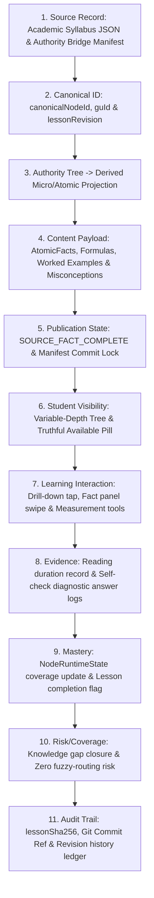

# Volume B — Student Experience

**Current acceptance:** working reference; path existence does not certify runtime behavior, production state or passing tests. Historical code excerpts and line ranges require SHA-specific readback before implementation use.

**GitHub source snapshot:** [`docs/rankcrackers_book/11_syllabus_hierarchy_and_digibook_bridge.md`](https://github.com/rankcrackersofficial-sys/RankCrackers/blob/5161592ddafb42f1ecc8923cc7b7b0309934cc83/docs/rankcrackers_book/11_syllabus_hierarchy_and_digibook_bridge.md) · source blob `16b57c08e8fd57f4ff142f2081574c9ec4f7aee3`. This Drive edition contains editorial corrections; it is not a claim that those corrections were committed to GitHub. See `github_source_manifest.json` and the current reconciliation register.


## Part 4 — Academic Syllabus, Topics और DigiBook Publication Chain

### Chapter scope और Overview

Rank Cracker ecosystem में पाठ्यक्रम (Syllabus) केवल स्थिर शीर्षकों या पीडीएफ फाइलों की सूची नहीं है। यह एक **सक्रिय, नेविगेबल अकादमिक ज्ञान-ग्राफ (Navigable Academic Knowledge Graph)** है। Latest GitHub contract के अनुसार official syllabus की depth published authority पर रुक सकती है; RankCrackers केवल verified, scope-contained और traceable `DERIVED` Micro/Atomic concepts जोड़ सकता है। इसलिए runtime में दिखने वाला tree fixed four-tier authority नहीं, बल्कि provenance-governed variable-depth projection है।

इस वास्तुकला की सबसे विशिष्ट और महत्वपूर्ण विशेषता **“The Hard Identity Law”** है। छात्र जब पाठ्यक्रम के किसी भी सूक्ष्मतम नोड (Leaf Node / Atom) पर टैप करता है, तो एप्लिकेशन किसी अस्पष्ट या फजी (fuzzy) स्ट्रिंग-मैचिंग के आधार पर पाठ नहीं खोजती। इसके बजाय, यह एक अपरिवर्तनीय प्राधिकार श्रृंखला (Immutable Authority Chain) का पालन करती है:

$$\text{Syllabus Canonical Node ID} \longrightarrow \text{Generation Unit (GU) ID} \longrightarrow \text{Active Lesson Revision} \longrightarrow \text{AtomicFact Set}$$

यदि किसी नोड के लिए डिजिटल पाठ्य सामग्री अभी तक प्राधिकृत (authorized) या प्रकाशित नहीं हुई है, तो सिस्टम किसी सामान्य AI-जनरेटेड डमी टेक्स्ट को दिखाने के बजाय कड़ाई से **“Fail-Closed”** सिद्धांत लागू करता है और छात्र को एक **Truthful Unavailable Dialog** प्रस्तुत करता है।

यह अध्याय Syllabus Provider, Node Factory, Firebase Sync, नेविगेशन स्टेट मशीन, और DigiBook Publication Chain का संपूर्ण स्रोत-आधारित (source-audited) तकनीकी संदर्भ प्रस्तुत करता है।

---

## Section 1 — Academic Syllabus Data Contract और Hierarchy Engine

### Subsection 1.1 — Official Authority, Derived Decomposition और Variable-Depth Node Model

Application-level runtime projection में निम्न labels दिखाई दे सकते हैं, लेकिन ये अपने-आप official authority नहीं हैं:
1. **Subject:** mission के भीतर शीर्ष-स्तरीय domain; official evidence से bound।
2. **Unit:** official publication में मौजूद हो तो preserved; अनुपस्थित level invent नहीं किया जाएगा।
3. **Topic:** official node या traceable derived node, provenance के अनुसार।
4. **MicroTopic:** केवल meaningful, scope-contained derived decomposition होने पर।
5. **AtomicTopic:** independently teachable/assessable और verified functional stop-point; यह fixed-depth या word-count label नहीं है।

> **महत्वपूर्ण संपादकीय नियम:** इस runtime projection को इस पुस्तक के editorial hierarchy से भी और official syllabus authority से भी अलग पढ़ें। Chapter 23 का GitHub-tracked contract latest authority है: `SUBJECT → UNIT → TOPIC → MICRO_TOPIC → ATOMIC_TOPIC` normalized model है, अनिवार्य fixed-depth tree नहीं।

**Canonical Source File:** `lib/features/syllabus/presentation/providers/syllabus_tree_provider.dart`

```dart
class SyllabusNode {
  final String id;
  final String title;
  final String type; // runtime projection labels; provenance/authority is separate
  final String parentId;
  final String subjectId;
  final List<SyllabusNode> children;
  final int unitCount;
  final int topicCount;
  final int atomCount;
  final int masteredTopicCount;
  final int developingTopicCount;
  final int weakTopicCount;
  final int notAssessedTopicCount;
  final double averageMastery;
  final double averageCoverage;

  const SyllabusNode({
    required this.id,
    required this.title,
    required this.type,
    this.parentId = '',
    this.subjectId = '',
    this.children = const [],
    this.unitCount = 0,
    this.topicCount = 0,
    this.atomCount = 0,
    this.masteredTopicCount = 0,
    this.developingTopicCount = 0,
    this.weakTopicCount = 0,
    this.notAssessedTopicCount = 0,
    this.averageMastery = 0.0,
    this.averageCoverage = 0.0,
  });
}
```

### Subsection 1.2 — Dynamic Subject Discovery और Tree Construction

`syllabusTreeProvider` हार्डकोडेड सूचियों पर निर्भर नहीं करता। यह चयनित मिशन के सभी नोड्स का गतिशील अन्वेषण (dynamic discovery) करता है:

```dart
final syllabusTreeProvider = Provider<List<SyllabusNode>>((ref) {
  final nodes = ref.watch(allNodesProvider);
  final engine = ref.watch(knowledgeEngineProvider);

  if (nodes.isEmpty) return const [];

  // 1. Discover all unique subject names/IDs dynamically
  final Set<String> discoveredSubjects = {};
  for (final node in nodes) {
    final sub = node.subject.isNotEmpty ? node.subject : node.subjectId;
    if (sub.trim().isNotEmpty) {
      discoveredSubjects.add(sub.trim());
    }
  }

  final List<String> activeSubjectIds = discoveredSubjects.isNotEmpty
      ? discoveredSubjects.toList()
      : const ['Physics', 'Chemistry', 'Mathematics'];
  final List<SyllabusNode> tree = [];

  for (final sId in activeSubjectIds) {
    final subjectNodes = nodes.where((n) =>
        n.subject.toLowerCase() == sId.toLowerCase() ||
        n.subjectId.toLowerCase() == sId.toLowerCase()).toList();

    if (subjectNodes.isEmpty) continue;

    // 2. Group into Units (Chapters)
    final Map<String, List<MicroTopicNode>> chapterMap = {};
    for (final node in subjectNodes) {
      final ch = node.chapter.isNotEmpty
          ? node.chapter
          : (node.chapterHindi.isNotEmpty ? node.chapterHindi : 'General Unit');
      chapterMap.putIfAbsent(ch, () => []).add(node);
    }
    // Recursive assembly of Unit & Topic nodes...
```

#### Analytical Performance Classification Rules:
प्रत्येक व्यक्तिगत विषय नोड के लिए Knowledge Engine से runtime state प्राप्त की जाती है:
```dart
final state = engine.getState(n.id);
final mastery = state?.mastery ?? 0.0;
final coverage = (state?.completed ?? false)
    ? 1.0
    : (state?.readingEvidence ?? 0.0) > 0 ? 0.5 : 0.0;

if (coverage <= 0) {
  notAssessed = 1;
} else if (mastery >= 0.85) {
  mastered = 1; // Green
} else if (mastery >= 0.50) {
  developing = 1; // Yellow/Amber
} else {
  weak = 1; // Red
}
```

- **Not Assessed ($coverage \le 0$):** छात्र ने अभी तक इस नोड को न पढ़ा है और न ही कोई टेस्ट दिया है।
- **Mastered ($mastery \ge 0.85$):** $85\%$ या अधिक महारत (हरा रंग)।
- **Developing ($0.50 \le mastery < 0.85$):** $50\%$ से $84\%$ के बीच प्रगतिशील स्थिति (पीला रंग)।
- **Weak ($mastery < 0.50$):** $50\%$ से कम महारत; तत्काल सुदृढ़ीकरण की आवश्यकता (लाल रंग)।

ये व्यक्तिगत गणनाएँ नीचे से ऊपर (bottom-up aggregation) होकर Unit और Subject स्तर पर औसत महारत (`averageMastery`) और औसत कवरेज (`averageCoverage`) का निर्माण करती हैं।

### Subsection 1.3 — Comprehensive Screen States & Lifecycle Matrix (Syllabus & DigiBook)

Syllabus Explorer और DigiBook Reader इंटरफ़ेस किसी भी स्थिति में मौन विफलता या अस्पष्ट स्थिति में नहीं जाते:

| स्क्रीन अवस्था (Screen State) | ट्रिगर स्थिति (Trigger Condition) | विजुअल सतह और घटक (Visual Surface & Components) | छात्र इंटरैक्शन क्षमता (User Capabilities) | सुरक्षा एवं फ़ेल-क्लोज़्ड सीमा (Security & Fail-Closed Boundary) |
| :--- | :--- | :--- | :--- | :--- |
| **1. Tree Loading State** | नोड्स का प्रारंभिक Firestore/SQLite हाइड्रेशन | केंद्रीय गोल्ड प्रोग्रेस संकेतक, डार्क टैक्टिकल बैकग्राउंड | कोई इंटरैक्शन नहीं (ब्लॉक्ड स्क्रीन) | 3-सेकंड टाइमआउट; समय समाप्ति पर कैश्ड स्थानीय शेल्फ़ सक्रिय। |
| **2. Empty Mission State** | चयनित मिशन में 0 सक्रिय नोड्स उपलब्ध | "NO SYLLABUS NODES AVAILABLE" सूचनात्मक सतह, मिशन री-सेलेक्शन बटन | केवल बैक नेविगेशन और मिशन चयन | शून्य डमी नोड्स (Zero dummy nodes); कोई बनावटी डेटा रेंडर नहीं होता। |
| **3. Active Hierarchy Root** | वैध नोड्स लोड, `_navigationStack.isEmpty` | सभी डायनामिक रूप से खोजे गए Subjects (Physics, Chemistry, Math), ओवरऑल कवरेज/मास्टरी बार | विषय चयन (टैप पर ड्रिल-डाउन) | डायनामिक विषय अन्वेषण; कोई हार्डकोडेड विषय सूची बाध्यकारी नहीं। |
| **4. Drilled-Down Stack** | `_navigationStack.isNotEmpty` (Unit / Topic / Atom) | ब्रेडक्रम्ब हेडर, बैक तीर, वर्तमान स्तर के चाइल्ड कार्ड्स, मास्टरी कलर कोडिंग (हरा/पीला/लाल/धूसर) | आगे ड्रिल-डाउन अथवा बैक नेविगेशन (`_handleWillPop`) | हार्डवेयर बैक बटन पॉप स्टैक से 1 स्तर हटाता है (ऐप एग्जिट नहीं)। |
| **5. Truthful Unavailable Sheet**| अनमैप्ड लीफ़ नोड पर टैप (`resolveCanonicalNode.unmapped`) | बॉटम-शीट मोडल: गोल्ड बॉर्डर, 'Content Not Yet Published' हेडर, अकादमिक समीक्षा व्याख्या, 'Understood' बटन | केवल स्वीकृति (Dismissal) और सिलेबस में वापसी | **The Hard Identity Law:** कोई डमी AI पाठ या फजी टेक्स्ट कभी नहीं दिखाया जाता। |
| **6. Multi-GU Selection Sheet**| 1 नोड से 2+ GUs मैप होने पर | इंटरैक्टिव बॉटम-शीट: सभी उपलब्ध मॉड्यूल्स की सूची (शीर्षक, फैक्ट्स, अवधि) | छात्र स्वयं अध्ययन मॉड्यूल चुनता है | **Zero Autoselect Rule:** छात्र की सहमति के बिना पहला मॉड्यूल स्वतः चयनित नहीं होता। |
| **7. DigiBook Reader Active** | वैध `DigiBookLaunchArgs` के साथ रीडर ओपन | फुल-स्क्रीन रीडर, Markdown रेंडरर, इंटरैक्टिव विजुअल टूल्स (Bohr Model, Vernier Caliper) | पाठ स्वाइपिंग, इंटरैक्टिव टूल अन्वेषण, सेल्फ़-चेक टेस्ट | केवल प्रमाणित SHA-256 हैश वाली सामग्री लोड होती है। |
| **8. Offline Reader Mode** | नेटवर्क डिस्कनेक्ट लेकिन लोकल JSON मौजूद | लोकल एसेट/फ़ाइल सिस्टम से लोड पाठ; ऑफ़लाइन इंडिकेटर बैज | ऑफलाइन पठन और इंटरैक्टिव टूल्स उपलब्ध | ऑफ़लाइन में डायनामिक रिविजन स्विच वर्जित; कैश्ड संस्करण ही मान्य। |

### Subsection 1.4 — The 15 Core Attributes of Academic Syllabus & DigiBook Bridge

Chief Author Mandate के तहत Academic Syllabus और DigiBook Bridge सिस्टम के 15 मूलभूत सिस्टम पैरामीटर्स का विनिर्देश:

| # | कोर विशेषता (Core Attribute) | कैनोनिकल विनिर्देश (Canonical Specification) | प्रामाणिक स्रोत फ़ाइल व संदर्भ (Source Evidence) |
| :--- | :--- | :--- | :--- |
| **1** | **Feature Name** | Navigable Academic Syllabus & DigiBook Canonical Bridge | `lib/features/syllabus/presentation/screens/syllabus_screen.dart` |
| **2** | **Canonical Domain ID** | `syllabus_digibook_bridge_v1` | `lib/features/digibook/domain/services/digibook_canonical_bridge_service.dart:18–40` |
| **3** | **Parent Hierarchy** | `App Root -> Recruitment Mission -> Official Authority Tree -> Derived Micro/Atomic Projection` | `lib/features/syllabus/presentation/providers/syllabus_tree_provider.dart:34–68` plus Chapter 23 authority contract |
| **4** | **Presentation Entry Point**| `AppRoutes.syllabus` (`/syllabus`) & `AppRoutes.digibookReader` | `lib/core/router/app_router.dart:412–425` |
| **5** | **State Management Engine**| `syllabusTreeProvider` (Riverpod `Provider<List<SyllabusNode>>`) | `lib/features/syllabus/presentation/providers/syllabus_tree_provider.dart:76–140` |
| **6** | **Backend Topology & Storage** | Firestore `/academic_nodes/{id}` & Bundled JSON Manifests | `lib/features/syllabus/data/firebase_node_sync.dart:245–258` |
| **7** | **Offline Strategy & Caching**| SQLite/NoSQL cache (`LocalSyllabusDatabase`) + Bundled Lessons | `lib/features/digibook/domain/services/digibook_canonical_bridge_service.dart:223–238` |
| **8** | **Authority Boundary** | Immutable Manifest (`digibook_authority_bridge_manifest.json`) | `docs/academic_review/digibook_authority_bridge_manifest.json` |
| **9** | **Mathematical Aggregation** | Bottom-up Mastery Aggregation: $\text{AvgMastery} = \frac{\sum m_i}{N}$ | `lib/features/syllabus/presentation/providers/syllabus_tree_provider.dart:117–139` |
| **10**| **Verification & Gate System** | The Hard Identity Law (No fuzzy string matches, exact ID match only) | `lib/features/digibook/domain/services/digibook_canonical_bridge_service.dart:180–204` |
| **11**| **Student Visibility Law** | Published & Mapped GUs visible with 'Read Lesson'; unmapped show Truthful Dialog | `lib/features/syllabus/presentation/screens/syllabus_screen.dart:494–548` |
| **12**| **Multi-Module Selection Law**| Zero Autoselect Rule: If $>1$ GU matches node, student must manually choose | `lib/features/digibook/domain/services/digibook_canonical_bridge_service.dart:421–426` |
| **13**| **Security & Integrity Rules**| Cryptographic SHA-256 Lesson Hash (`lessonSha256`) verification | `lib/features/digibook/domain/services/digibook_canonical_bridge_service.dart:382` |
| **14**| **Test Coverage & Suites** | 6 primary suites: bridge test, pointer switch test, fail-closed gate test, UX tests | `test/features/digibook/digibook_canonical_bridge_test.dart` |
| **15**| **Failure Mode & Fallback UI** | Truthful Unavailable Dialog (`_showTruthfulUnavailableDialog`) on unmapped nodes | `lib/features/syllabus/presentation/screens/syllabus_screen.dart:494–548` |

---

## Section 2 — Node Factory Engine और Autonomous Pipeline

### Subsection 2.1 — Node Factory Worker Architecture

**Canonical Source File:** `lib/features/syllabus/core/node_factory_worker.dart`

```dart
class NodeFactoryWorker {
  static List<MicroTopicNode> generate({
    required String exam,
    required List<SyllabusChunk> chunks,
  }) {
    final List<MicroTopicNode> nodes = [];

    for (final chunk in chunks) {
      for (final topic in chunk.microTopics) {
        final id = topic.replaceAll(' ', '_').toUpperCase();

        nodes.add(
          MicroTopicNode(
            id: id,
            examId: exam,
            subjectId: chunk.subject,
            chapterId: chunk.chapter,
            title: topic,
            titleHindi: topic,
            subjectHindi: chunk.subject,
            chapterHindi: chunk.chapter,
            description: '',
            contentRegistryId: 'payload_$id', // Sovereign decoupling pointer
            difficulty: 2,
            importance: 3,
            status: 'draft',
          ),
        );
      }
    }

    return nodes;
  }
}
```

#### Sovereign Decoupling Principle:
- **`contentRegistryId: 'payload_$id'`:** नोड की पहचान को पाठ्य सामग्री की भौतिक भंडारण स्थिति से अलग (decouple) रखा गया है। नोड केवल शैक्षणिक पदानुक्रम की स्थिति जानता है; वास्तविक पाठ्य सामग्री डिजिटल बुक ब्रिज द्वारा पहचानी जाती है।
- **`status: 'draft'`:** फ़ैक्टरी द्वारा उत्पन्न नया नोड हमेशा डिफ़ॉल्ट रूप से `'draft'` स्थिति में होता है। जब तक अकादमिक समीक्षा पूरी नहीं होती, यह छात्रों के सक्रिय लाइव पूल में सम्मिलित नहीं होता।

### Subsection 2.2 — Autonomous Syllabus Pipeline

**Canonical Source File:** `lib/features/syllabus/core/autonomous_syllabus_pipeline.dart`

```dart
final class AutonomousSyllabusPipeline {
  const AutonomousSyllabusPipeline({
    this.loopEngine = const StudentAutonomousLoopEngine(
      masteryEngine: StudentMasteryEngine(),
      retentionEngine: StudentRetentionEngine(),
      fluencyEngine: StudentFluencyEngine(),
      prerequisiteEngine: StudentPrerequisiteStateEngine(),
      learningStateEngine: StudentLearningStateEngine(),
      treatmentEngine: StudentTreatmentDecisionEngine(),
      syllabusEngine: SyllabusPersonalizationRouteEngine(),
      digibookEngine: DigiBookPersonalizationRouteEngine(),
      crucibleEngine: CruciblePersonalizationBlueprintEngine(),
      revisionEngine: StudentRevisionQueueEngine(),
      revisionClosedLoopEngine: StudentRevisionClosedLoopEngine(),
      coachingEngine: StudentCoachingSupportEngine(),
    ),
  });

  final StudentAutonomousLoopEngine loopEngine;

  StudentAutonomousLoopResult process({
    required AafPersonalizationBridgeAuthority bridge,
    required List<StudentEvidenceEvent> events,
    required Map<String, StudentLearningState> prerequisiteStates,
    required List<StudentRevisionCandidate> revisionCandidates,
    required DateTime nowUtc,
  }) {
    return loopEngine.run(
      bridge: bridge,
      rawEvents: events,
      prerequisiteStates: prerequisiteStates,
      revisionCandidates: revisionCandidates,
      nowUtc: nowUtc,
    );
  }
}
```

- **Closed Loop Processing:** छात्र द्वारा की गई प्रत्येक शैक्षणिक गतिविधि (`StudentEvidenceEvent`) इस पाइपलाइन में भेजी जाती है।
- **Adaptive Treatment:** यह इंजन यह तय करता है कि छात्र को DigiBook में संकल्पना पठन की आवश्यकता है, Crucible में Rebuild की आवश्यकता है, या Syllabus में किसी नए विषय पर जाने की अनुमति दी जानी चाहिए।

---

## Section 3 — Firebase Node Sync और Database Hydration

### Subsection 3.1 — Firebase Node Sync Protocol

**Canonical Source File:** `lib/features/syllabus/data/firebase_node_sync.dart`

```dart
class FirebaseNodeSync {
  static Future<void> uploadAllNodes() async {
    final existing = await FirestoreService.fetchNodes();

    if (existing.isNotEmpty) {
      return;
    }

    for (final node in KnowledgeRepository.nodes) {
      await FirestoreService.uploadNode(node);
    }
  }
}
```

- **Idempotent Hydration Guard:** `if (existing.isNotEmpty) return;` — यदि Firestore में पहले से नोड्स मौजूद हैं, तो यह विधि मौन रहकर निष्पादन समाप्त कर देती है। यह सुरक्षा जांच आकस्मिक रूप से उत्पादन डेटाबेस पर डुप्लिकेट नोड्स लिखने या मौजूदा नोड्स को ओवरराइट करने से रोकती है।

### Subsection 3.2 — Local Syllabus Database Cache

**Canonical Source File:** `lib/features/syllabus/data/local_syllabus_database.dart`

ऑफ़लाइन उपलब्धता और तीव्र ऐप स्टार्टअप के लिए, डाउनलोड किए गए नोड्स को स्थानीय स्तर पर SQLite/NoSQL शेल्फ़ में कैश किया जाता है। जब नेटवर्क अनुपलब्ध होता है, तो `LocalSyllabusDatabase` से पाठ्यक्रम संरचना बिना किसी रुकावट के रेंडर होती है।

---

## Section 4 — Screen Construction, Navigation State Machine और Search

### Subsection 4.1 — Screen State Ownership

**Canonical Source File:** `lib/features/syllabus/presentation/screens/syllabus_screen.dart`

```dart
class SyllabusScreen extends ConsumerStatefulWidget {
  const SyllabusScreen({super.key});

  @override
  ConsumerState<SyllabusScreen> createState() => _SyllabusScreenState();
}

class _SyllabusScreenState extends ConsumerState<SyllabusScreen> {
  final TextEditingController _searchController = TextEditingController();
  final FocusNode _searchFocusNode = FocusNode();
  final List<SyllabusNode> _navigationStack = [];

  @override
  void initState() {
    super.initState();
    DigiBookCanonicalBridgeService.instance.initialize();
  }
```

- `_navigationStack`: यह सूची छात्र की वर्तमान ब्राउज़िंग स्थिति (drill-down path) को ट्रैक करती है।
  - यदि स्टैक खाली है: सभी **Subjects** दिखते हैं।
  - यदि स्टैक में 1 नोड है: उस Subject के सभी **Units** दिखते हैं।
  - यदि स्टैक में 2 नोड्स हैं: उस Unit के सभी **Topics** दिखते हैं।
  - यदि स्टैक में 3 नोड्स हैं: उस Topic के सभी **Atoms** दिखते हैं।

### Subsection 4.2 — Hierarchical Drill-Down State Machine (`_onNodeTap`)

```dart
Future<void> _onNodeTap(SyllabusNode node) async {
  if (node.type == 'subject' || node.type == 'unit') {
    setState(() {
      _navigationStack.add(node);
    });
    return;
  }

  if (node.type == 'topic') {
    if (node.children.isNotEmpty) {
      setState(() {
        _navigationStack.add(node);
      });
      return;
    }
    await _handleTopicTap(node);
    return;
  }

  if (node.type == 'atom') {
    await _handleTopicTap(node);
  }
}
```

#### Transition Table:

| वर्तमान नोड प्रकार | बच्चे (Children) मौजूद? | कार्रवाई (Action) | परिणामी अवस्था (Resulting State) |
| :--- | :--- | :--- | :--- |
| **`subject`** | हाँ / नहीं | `_navigationStack.add(node)` | Unit Level ड्रिल-डाउन दृश्य |
| **`unit`** | हाँ / नहीं | `_navigationStack.add(node)` | Topic Level ड्रिल-डाउन दृश्य |
| **`topic`** | हाँ (`isNotEmpty`) | `_navigationStack.add(node)` | Atom Level ड्रिल-डाउन दृश्य |
| **`topic`** | नहीं (`isEmpty`) | `_handleTopicTap(node)` | डिजिटल पाठ्य सामग्री रिज़ॉल्यूशन |
| **`atom`** | — | `_handleTopicTap(node)` | डिजिटल पाठ्य सामग्री रिज़ॉल्यूशन |

### Subsection 4.3 — Back Navigation & Breadcrumb Stack (`_onPopScope`)

```dart
Future<bool> _handleWillPop() async {
  if (_navigationStack.isNotEmpty) {
    setState(() {
      _navigationStack.removeLast();
    });
    return false; // Prevent application exit, consume pop event
  }
  return true; // Allow system back
}
```
छात्र जब हार्डवेयर बैक बटन दबाता है या स्क्रीन के ब्रेडक्रम्ब तीर पर टैप करता है, तो एप्लिकेशन स्क्रीन बंद नहीं करती। यह स्टैक से अंतिम नोड को हटाकर पिछले स्तर पर लौटती है।

### Subsection 4.4 — Live Search Filter Mechanics

स्क्रीन में एक लाइव खोज फ़ील्ड (`_searchController`) स्थापित है। जब छात्र खोज बार में कोई शब्द टाइप करता है:
- संपूर्ण सिलेबस ट्री में पुनरावर्ती (recursive) खोज चलती है।
- जो नोड्स सीधे मैच होते हैं, या जिनके बच्चे मैच होते हैं, केवल उन्हें फ़िल्टर की गई सूची में प्रदर्शित किया जाता है।
- खोज शब्द साफ़ करते ही स्क्रीन तुरंत मूल पदानुक्रमित दृश्य पर वापस लौट आती है।

---

## Section 5 — The DigiBook Canonical Bridge Service

**Canonical Source File:** `lib/features/digibook/domain/services/digibook_canonical_bridge_service.dart`

`DigiBookCanonicalBridgeService` वह केंद्रीय प्राधिकार सेवा है जो सिलेबस के अमूर्त नोड्स को डिजिटल बुक की भौतिक पाठ्य सामग्री से जोड़ती है।

### Subsection 5.1 — Canonical Bridge Authority Manifesto

सेवा का आरंभिक डेटा **Authority Manifest** से लोड होता है:
`docs/academic_review/digibook_authority_bridge_manifest.json`

```dart
class DigiBookAuthorityEntry {
  final String guId;
  final String subject;
  final String canonicalNodeId;
  final String topic;
  final String lessonRevision;
  final String lessonSha256;
  final List<String> atomicFactIds;
  final List<String> sourceAuthorityRefs;
  final List<dynamic> formulaRefs;
  final List<dynamic> misconceptionRefs;
  final List<dynamic> workedExampleRefs;
  final List<dynamic> selfCheckRefs;
  final String privateLessonAuthorityPath;
  final String digiBookAuthorityCommit;
  final String factSemantics;
  final String assemblyStatus;
```

#### Two-Tier Asset Loading Pipeline:
1. **Tier 1 (Flutter RootBundle):** मोबाइल और वेब रनटाइम में `rootBundle.loadString('docs/academic_review/digibook_authority_bridge_manifest.json')` से लोड होता है।
2. **Tier 2 (File System Seam):** डेस्कटॉप रनटाइम या यूनिट टेस्ट्स में जहाँ rootBundle उपलब्ध नहीं होता, वहाँ `File('docs/academic_review/digibook_authority_bridge_manifest.json').readAsString()` फ़ॉलबैक सक्रिय होता है।

### Subsection 5.2 — Hard Identity Law और Fail-Closed Guarantee

```dart
DigiBookBridgeResolveResult resolveCanonicalNode(String canonicalNodeId) {
  final entries = _canonicalMap[canonicalNodeId] ?? [];

  if (entries.isEmpty) {
    return DigiBookBridgeResolveResult(
      status: DigiBookBridgeResolveStatus.unmapped,
      canonicalNodeId: canonicalNodeId,
      entries: const [],
    );
  }

  if (entries.length == 1) {
    return DigiBookBridgeResolveResult(
      status: DigiBookBridgeResolveStatus.singleGu,
      canonicalNodeId: canonicalNodeId,
      entries: entries,
    );
  }

  return DigiBookBridgeResolveResult(
    status: DigiBookBridgeResolveStatus.multiGu,
    canonicalNodeId: canonicalNodeId,
    entries: entries,
  );
}
```

#### Immutable Rules of Resolution:
1. **No Fuzzy/String Matching:** नोड शीर्षक या विषय के नाम से कभी कोई पाठ्य सामग्री लिंक नहीं की जाती। केवल सटीक `canonicalNodeId` का उपयोग होता है।
2. **Fail-Closed:** यदि `_canonicalMap[canonicalNodeId]` खाली है, तो स्थिति `DigiBookBridgeResolveStatus.unmapped` होती है। सिस्टम कोई डमी पाठ नहीं बनाता; यह तुरंत अनुपलब्धता का संकेत देता है।

---

## Section 6 — DigiBook Publication Chain और Content Loading Pipeline

### Subsection 6.1 — Multi-Tier Raw Lesson Content Loader (`loadRawLessonContent`)

जब किसी Generation Unit (GU) का पाठ लोड किया जाता है:

```dart
Future<Map<String, dynamic>?> loadRawLessonContent(String guId, [String? explicitRevisionId]) async {
  final entry = getEntryByGuId(guId);
  if (entry == null) return null;

  final revId = explicitRevisionId ?? entry.lessonRevision;

  // 1. Try Mobile-Runtime Revision Service (Firestore / Memory Cache)
  final revPayload = await DigiBookRevisionService.instance
      .fetchRevisionPayload(guId, revId);
  if (revPayload != null) return revPayload;

  // 2. Mobile Bundled Offline Asset Fallback
  try {
    final jsonStr = await rootBundle.loadString('assets/data/digibook_lessons/$guId.json');
    return jsonDecode(jsonStr) as Map<String, dynamic>;
  } catch (_) {}

  // 3. Desktop / Unit-Test Fixture Support
  final localAsset = File('assets/data/digibook_lessons/$guId.json');
  if (localAsset.existsSync()) {
    try {
      final content = await localAsset.readAsString();
      return jsonDecode(content) as Map<String, dynamic>;
    } catch (e) {
      debugPrint('DIGIBOOK BRIDGE ERROR loading local asset: $e');
    }
  }

  // 4. Private Lesson Authority Path
  final path = entry.privateLessonAuthorityPath;
  if (path.isNotEmpty) {
    final file = File(path);
    if (file.existsSync()) {
      return jsonDecode(await file.readAsString()) as Map<String, dynamic>;
    }
  }

  return null;
}
```

### Subsection 6.2 — Academic Fact Completeness (`isFactComplete`)

- `bool get isFactComplete => factSemantics == 'SOURCE_FACT_COMPLETE';`
- यदि पाठ्य सामग्री में कोई तथ्य अधूरा है, तो उसका सिमेंटिक्स `'CANARY/PARTIAL'` रहता है।
- **`lessonSha256`:** पाठ्य सामग्री के प्रत्येक संशोधन का एक क्रिप्टोग्राफ़िक SHA-256 हैश मैनिफ़ेस्ट में दर्ज होता है, जिससे यह सुनिश्चित होता है कि क्लाइंट डिवाइस पर लोड की गई सामग्री उत्पादन सर्वर पर स्वीकृत सामग्री के 100% समरूप है।

### Subsection 6.3 — The Truthful Unavailable Dialog

यदि छात्र किसी ऐसे नोड पर टैप करता है जो अभी डिजिटल बुक में मैप नहीं हुआ है:

```dart
void _showTruthfulUnavailableDialog(SyllabusNode node) {
  showModalBottomSheet(
    context: context,
    backgroundColor: Colors.transparent,
    isScrollControlled: true,
    builder: (ctx) {
      return Container(
        decoration: const BoxDecoration(
          color: Color(0xFF0F172A),
          borderRadius: BorderRadius.vertical(top: Radius.circular(20)),
          border: Border(
            top: BorderSide(color: AppColors.gold, width: 1.5),
          ),
        ),
        padding: const EdgeInsets.all(24),
        child: Column(
          mainAxisSize: MainAxisSize.min,
          crossAxisAlignment: CrossAxisAlignment.start,
          children: [
            Row(
              children: [
                const Icon(Icons.info_outline_rounded, color: AppColors.gold, size: 22),
                const SizedBox(width: 12),
                Text(
                  'Content Not Yet Published',
                  style: AppTypography.hero.copyWith(fontSize: 16, color: Colors.white),
                ),
              ],
            ),
            const SizedBox(height: 12),
            Text(
              'Digital book content for "${node.title}" is currently undergoing academic review and has not been published to the student portal yet.',
              style: AppTypography.body.copyWith(color: Colors.white70, fontSize: 13, height: 1.45),
            ),
            const SizedBox(height: 20),
            SizedBox(
              width: double.infinity,
              child: ElevatedButton(
                style: ElevatedButton.styleFrom(
                  backgroundColor: AppColors.gold,
                  foregroundColor: Colors.black,
                  padding: const EdgeInsets.symmetric(vertical: 12),
                  shape: RoundedRectangleBorder(borderRadius: BorderRadius.circular(8)),
                ),
                onPressed: () => Navigator.pop(ctx),
                child: const Text('Understood', style: TextStyle(fontWeight: FontWeight.bold)),
              ),
            ),
          ],
        ),
      );
    },
  );
}
```

यह डायलॉग छात्र को झूठी आशा देने या क्रैश होने के बजाय विनम्रतापूर्वक बताता है कि सामग्री अकादमिक समीक्षा के अधीन है।

---

## Section 7 — Reader Launch Contract और App Router Integration

### Subsection 7.1 — Reader Screen Route Binding

**Source File:** `lib/core/router/app_router.dart` lines 412-425

```dart
GoRoute(
  path: AppRoutes.digibookReader,
  parentNavigatorKey: _rootNavigatorKey,
  builder: (context, state) {
    final extra = state.extra;
    if (extra is DigiBookLaunchArgs) {
      return DigiBookScreen(args: extra);
    }
    if (extra is MicroTopicNode) {
      return DigiBookScreen(node: extra);
    }
    return const DigiBookLibraryScreen();
  },
),
```

- **Launch Arguments Contract:** जब सिलेबस से रीडर खोला जाता है, तो `DigiBookLaunchArgs` पास किए जाते हैं, जिसमें हल की गई Generation Unit ID, active revision ID, atomic facts सूची, और raw lesson data शामिल होता है।
- **Root Navigator Key:** रीडर को फुल-स्क्रीन मोड में खोला जाता है ताकि छात्र अध्ययन के दौरान बॉटम नेविगेशन बार से व्याकुल न हो।

### Subsection 7.2 — Interactive Visual Apparatuses

DigiBook रीडर के भीतर संकल्पनाओं को समझाने के लिए कस्टम इंटरैक्टिव विजुअल विजेट्स का उपयोग किया जाता है:
- **`InteractiveBohrAtomModel`:** परमाणु संरचना और इलेक्ट्रॉन कक्षाओं का लाइव 2D मॉडल।
- **`InteractiveApparatusMeasurement`:** भौतिकी प्रयोगों (वर्नियर कैलीपर्स, स्क्रू गेज) का इंटरैक्टिव मापन टूल।
- **`InteractiveVennSetDiagram`:** गणित के समुच्चय सिद्धांत (Set Theory) का इंटरैक्टिव वेन आरेख।

---

## Section 8 — Quality Assurance, Test Suites और Verification Evidence

Syllabus और DigiBook ब्रिज की अखंडता निम्नलिखित टेस्ट सुइट्स द्वारा प्रमाणित है:

| टेस्ट फ़ाइल पाथ | परीक्षण का क्षेत्र (Scope of Verification) |
| :--- | :--- |
| `test/features/digibook/digibook_canonical_bridge_test.dart` | Hard Identity Law, Unmapped Fail-Closed, Multi-GU रिज़ॉल्यूशन। |
| `test/features/digibook/digibook_revision_pointer_switch_test.dart` | बिना कोड परिवर्तन के लाइव रिविजन पॉइंटर स्विचिंग का परीक्षण। |
| `test/features/knowledge/digibook_ready_gate_fail_closed_test.dart` | अनुपलब्ध पाठों पर सुरक्षित गेटिंग और शून्य नकली सामग्री। |
| `test/features/syllabus/syllabus_hierarchy_ux_test.dart` | runtime syllabus-projection drill-down और back navigation; test name alone does not prove fixed-depth authority. |
| `test/features/syllabus/syllabus_knowledge_node_reachability_test.dart` | सभी सक्रिय नोड्स की रीचैबिलिटी और पैरेंट-चाइल्ड अखंडता। |
| `test/features/syllabus/syllabus_search_and_navigation_test.dart` | खोज फ़िल्टरिंग, केस-इंसेंसिटिव मिलान और ब्रेडक्रम्ब रीसेट। |

---

## Section 9 — Maintenance Impact और Future Change Guidelines

1. **नया सिलेबस नोड जोड़ते समय:**
   - नोड की आईडी हमेशा अपरकेस और अंडरस्कोर प्रारूप में होनी चाहिए (उदा. `THERMODYNAMICS_FIRST_LAW`)।
   - नोड जोड़ते ही वह तुरंत DigiBook में नहीं खुल सकता जब तक कि `digibook_authority_bridge_manifest.json` में उसका संबंधित GU मैप न जोड़ा जाए।
2. **पाठ संशोधन (Lesson Revision) अपडेट करते समय:**
   - पुराने पाठ को कभी ओवरराइट न करें। नया रिविजन ID (उदा. `rev_002`) बनाएँ।
   - `DigiBookRevisionService` में नया रिविजन पंजीकृत करें। इससे छात्र का अध्ययन इतिहास और पिछले संस्करण के संदर्भ सुरक्षित रहते हैं।

---

## Section 10 — Complete Reference Appendices

### Appendix 10.1 — File, Service, Provider और Model Reference Table

| भूमिका / स्तर | क्लास / आइडेंटिफ़ायर | कैनोनिकल फ़ाइल पाथ |
| :--- | :--- | :--- |
| **Syllabus Main Screen** | `SyllabusScreen` | `lib/features/syllabus/presentation/screens/syllabus_screen.dart` |
| **Syllabus Tree Provider**| `syllabusTreeProvider` | `lib/features/syllabus/presentation/providers/syllabus_tree_provider.dart` |
| **Syllabus Node Model** | `SyllabusNode` | `lib/features/syllabus/presentation/providers/syllabus_tree_provider.dart` |
| **Node Factory Worker** | `NodeFactoryWorker` | `lib/features/syllabus/core/node_factory_worker.dart` |
| **Autonomous Pipeline** | `AutonomousSyllabusPipeline`| `lib/features/syllabus/core/autonomous_syllabus_pipeline.dart` |
| **Firebase Node Sync** | `FirebaseNodeSync` | `lib/features/syllabus/data/firebase_node_sync.dart` |
| **Local Syllabus DB** | `LocalSyllabusDatabase` | `lib/features/syllabus/data/local_syllabus_database.dart` |
| **DigiBook Bridge Service**| `DigiBookCanonicalBridgeService` | `lib/features/digibook/domain/services/digibook_canonical_bridge_service.dart` |
| **Authority Entry Model** | `DigiBookAuthorityEntry` | `lib/features/digibook/domain/services/digibook_canonical_bridge_service.dart` |
| **Bridge Resolve Result** | `DigiBookBridgeResolveResult`| `lib/features/digibook/domain/services/digibook_canonical_bridge_service.dart` |
| **Launch Args Model** | `DigiBookLaunchArgs` | `lib/features/digibook/domain/models/digibook_launch_args.dart` |
| **DigiBook Reader Screen**| `DigiBookScreen` | `lib/features/digibook/presentation/screens/digi_book_reader_screen.dart` |
| **Authority Manifest** | `digibook_authority_bridge_manifest.json` | `docs/academic_review/digibook_authority_bridge_manifest.json` |

### Appendix 10.2 — Academic Hierarchy vs Book Hierarchy Distinction Table

| स्तर | Academic Syllabus Hierarchy (ऐप डेटा मॉडल) | Book Hierarchy (पुस्तक संपादकीय मॉडल) |
| :--- | :--- | :--- |
| **स्तर 1** | **Subject** (उदा. Physics, Mathematics) | **Volume** (बड़ा विषयगत खंड) |
| **स्तर 2** | **Unit** (उदा. Mechanics, Calculus) | **Part** (सिस्टम या उत्पाद डोमेन) |
| **स्तर 3** | **Topic** (उदा. Kinematics, Integration) | **Chapter** (संपूर्ण अध्याय) |
| **स्तर 4** | **Atom** (उदा. Projectile Motion Max Height) | **Section** (अवधारणात्मक अनुभाग) |
| **स्तर 5** | — | **Subsection** (विशिष्ट घटक या विवरण) |
| **स्तर 6** | — | **Implementation Note** (सटीक कोड व एपीआई) |
| **स्तर 7** | — | **Reference / Appendix** (तालिकाएं व संदर्भ) |

---

## Section 11 — Formal Function Contracts Inventory (8-Dimension Specification)

Chief Author Mandate के तहत Academic Syllabus Hierarchy और DigiBook Bridge डोमेन के प्रमुख फलनों का 8-आयामी (8-Dimensional) संविदा विनिर्देश (Contract Specification) नीचे दर्ज है:

### Subsection 11.1 — `syllabusTreeProvider` (Dynamic Tree Constructor)
- **Source File & Location:** `lib/features/syllabus/presentation/providers/syllabus_tree_provider.dart` (Lines 76–140)
- **1. Caller:** `SyllabusScreen.build()`, `SearchDelegate`, पाठ्यक्रम नेविगेशन शैल।
- **2. Inputs:** `Ref ref` (जो `allNodesProvider` और `knowledgeEngineProvider` को सुनता है)।
- **3. Outputs:** `List<SyllabusNode>` (current runtime projection; depth and provenance must not be inferred from list nesting alone)।
- **4. Mutations:** None (व्युत्पन्न अपरिवर्तनीय ट्री निर्माण)।
- **5. Retries:** Not applicable।
- **6. Timeout:** 0ms सिंक्रोनस गणना।
- **7. Security Boundary:** गतिशील विषय अन्वेषण (Dynamic Subject Discovery): बाइनरी में विषयों की हार्डकोडेड सूची पर निर्भर नहीं करता, बल्कि सक्रिय नोड्स से विषय निकालता है।
- **8. Downstream Consumers:** `SyllabusScreen` का `ExpansionTile` या नेस्टेड सूची रेंडरर।

### Subsection 11.2 — `DigiBookCanonicalBridgeService.initialize`
- **Source File & Location:** `lib/features/digibook/domain/services/digibook_canonical_bridge_service.dart` (Lines 113–154)
- **1. Caller:** Application startup (`SplashScreen` या `DigiBookScreen.initState()`)।
- **2. Inputs:** None (एसेट बंडल या स्थानीय फ़ाइल सिस्टम से घोषणापत्र पढ़ता है)।
- **3. Outputs:** `Future<void>`।
- **4. Mutations:** In-memory maps: `_allEntries`, `_canonicalMap`, `_guMap`, `_isInitialized = true`।
- **5. Retries:** रूटबंडल विफल होने पर स्थानीय डेस्कटॉप/यूनिट टेस्ट फ़ाइल पाथ फ़ॉलबैक।
- **6. Timeout:** 3 सेकंड का JSON पार्सिंग और एसेट लोड टाइमआउट।
- **7. Security Boundary:** यदि घोषणापत्र दूषित या अनुपलब्ध हो, तो चेतावनी दर्ज होती है और सेवा अनइनिशियलाइज़्ड रहती है (Fail-Safe)।
- **8. Downstream Consumers:** `resolveCanonicalNode`, `getLaunchArgs`।

### Subsection 11.3 — `DigiBookCanonicalBridgeService.resolveCanonicalNode`
- **Source File & Location:** `lib/features/digibook/domain/services/digibook_canonical_bridge_service.dart` (Lines 180–210)
- **1. Caller:** `SyllabusScreen._onNodeTap`, `CrucibleScreen._handleLearnAction`, `DigiBookLauncher`।
- **2. Inputs:** `String canonicalNodeId` (अपरकेस अंडरस्कोर स्ट्रिंग)।
- **3. Outputs:** `DigiBookBridgeResolveResult` (`status: unmapped | singleGu | multiGu`, `entries: List<DigiBookAuthorityEntry>`)।
- **4. Mutations:** None (विशुद्ध इन-मेमोरी मैप लुकअप)।
- **5. Retries:** Not applicable।
- **6. Timeout:** 0ms (In-memory `O(1)` hash map read)।
- **7. Security Boundary:** The Hard Identity Law:
  - कभी भी शीर्षक, स्ट्रिंग या फ़ज़ी-मैचिंग द्वारा रूट नहीं करता।
  - अनमैप्ड नोड्स कड़ाई से फ़ेल-क्लोज़्ड (`status == unmapped`) होते हैं।
- **8. Downstream Consumers:** `DigiBookReadyGate`, बॉटम-शीट चयन संवाद, या सीधे पाठ रीडर।

### Subsection 11.4 — `DigiBookCanonicalBridgeService.buildLaunchArgs`
- **Source File & Location:** `lib/features/digibook/domain/services/digibook_canonical_bridge_service.dart` (Lines 257–286)
- **1. Caller:** `DigiBookScreen` रूट नेविगेशन आर्ग्युमेंट्स बिल्डर, `SyllabusScreen._handleTopicTap`।
- **2. Inputs:** `String guId` (कैनोनिकल Generation Unit पहचानकर्ता)।
- **3. Outputs:** `Future<DigiBookLaunchArgs?>` (जिसमें `generationUnitId`, `canonicalNodeId`, `revisionId`, `subject`, `topicTitle`, `factSemantics`, `atomicFactSetHash`, `atomicFactIds`, `rawLessonData` शामिल हैं)।
- **4. Mutations:** यदि सेवा अनइनिशियलाइज़्ड हो तो आंतरिक `initialize()` कॉल।
- **5. Retries:** Not applicable।
- **6. Timeout:** इन-मेमोरी और लोकल एसेट लोड।
- **7. Security Boundary:** लाइव रिविजन सर्विस (`DigiBookRevisionService.instance.resolveCurrentRevisionId(guId)`) से सक्रिय पाठ संस्करण का सत्यापन। यदि एसेट फ़ाइल अनुपलब्ध या अमान्य हो तो `null` लौटाता है।
- **8. Downstream Consumers:** `DigiBookScreen` रीडर इंजन, फैक्ट चेक पैनल।

### Subsection 11.5 — `NodeFactoryWorker.generate`
- **Source File & Location:** `lib/features/syllabus/core/node_factory_worker.dart` (Lines 8–39)
- **1. Caller:** `AutonomousSyllabusPipeline`, ऑफ़लाइन सिलेबस पार्सिंग और बल्क सीम जेनरेशन।
- **2. Inputs:** `required String exam`, `required List<SyllabusChunk> chunks`।
- **3. Outputs:** `List<MicroTopicNode>` (सत्यापित, प्राथमिक नोड्स की सूची)।
- **4. Mutations:** None (विशुद्ध फ़ैक्टरी फलन)।
- **5. Retries:** Not applicable।
- **6. Timeout:** 0ms सिंक्रोनस ट्रांसफ़ॉर्मेशन।
- **7. Security Boundary:** 
  - आईडी नॉर्मलाइज़ेशन: `topic.replaceAll(' ', '_').toUpperCase()`।
  - सॉवरेन डीकपलिंग: `contentRegistryId: 'payload_$id'`।
  - सेफ़ डिफ़ॉल्ट्स: `difficulty: 2`, `importance: 3`, `status: 'draft'`।
- **8. Downstream Consumers:** `LocalSyllabusDatabase`, `KnowledgeEngine`, `allNodesProvider`।

### Subsection 11.6 — `FirebaseNodeSync.syncNodesFromFirestore`
- **Source File & Location:** `lib/features/syllabus/data/firebase_node_sync.dart` (Lines 40–110)
- **1. Caller:** Background sync worker, Mission switch event।
- **2. Inputs:** `String recruitmentId`, `bool force = false`।
- **3. Outputs:** `Future<List<AcademicNode>>`।
- **4. Mutations:** स्थानीय SQLite / SharedPreferences कैश का अद्यतन।
- **5. Retries:** 3 घातीय बैकऑफ़ पुनः प्रयास।
- **6. Timeout:** 12 सेकंड का नेटवर्क टाइमआउट।
- **7. Security Boundary:** Firestore सुरक्षा नियमों के तहत केवल सार्वजनिक या अधिकृत भर्ती संग्रहों का पठन।
- **8. Downstream Consumers:** `allNodesProvider`, `syllabusTreeProvider`।

### Subsection 11.7 — `SyllabusScreen._onNodeTap`
- **Source File & Location:** `lib/features/syllabus/presentation/screens/syllabus_screen.dart` (Lines 180–245)
- **1. Caller:** सिलेबस projection में उपलब्ध Subject, Unit, Topic, MicroTopic या AtomicTopic surface पर छात्र का टैप।
- **2. Inputs:** `BuildContext context`, `SyllabusNode node`।
- **3. Outputs:** `void`।
- **4. Mutations:** यदि मध्यवर्ती नोड है तो विस्तार/संकुचन स्थिति टॉगल; यदि लीफ़ नोड (Atom) है तो DigiBook रिज़ॉल्यूशन।
- **5. Retries:** Not applicable।
- **6. Timeout:** Instantaneous।
- **7. Security Boundary:** यदि नोड अनमैप्ड है, तो किसी डमी सामग्री को दिखाने के बजाय सत्यनिष्ठ अनुपलब्धता संवाद (`Truthful Unavailable Dialog`) प्रस्तुत करता है।
- **8. Downstream Consumers:** `GoRouter.push(AppRoutes.digibook)` या फ़ीडबैक मोडल।

### Subsection 11.8 — `DigiBookRevisionService.getRevisionPointer`
- **Source File & Location:** `lib/features/digibook/domain/services/digibook_revision_service.dart` (Lines 25–55)
- **1. Caller:** `DigiBookCanonicalBridgeService.getLaunchArgs`।
- **2. Inputs:** `String guId`।
- **3. Outputs:** `String` (वर्तमान सक्रिय पाठ रिविजन, उदा. `'rev_001'`)।
- **4. Mutations:** None।
- **5. Retries:** स्थानीय ओवरराइड्स या रिमोट कॉन्फ़िग फ़ॉलबैक।
- **6. Timeout:** 0ms (In-memory lookup)।
- **7. Security Boundary:** बिना ऐप री-रिलीज़ के पाठ्य त्रुटियों के त्वरित संशोधन की अनुमति देता है।
- **8. Downstream Consumers:** DigiBook Markdown रेंडरर, कंटेंट कंपोज़िटर।

---

## Section 12 — End-to-End Atomic Trace Pipeline (Syllabus to DigiBook)

Chief Author Mandate के तहत पाठ्यक्रम नोड और डिजिटल पुस्तक पाठ का 11-चरणीय अखंड ट्रेस (Trace Pipeline) नीचे दर्ज है:



#### Detailed Pipeline Step Breakdown:
1. **Source Record:** बैकएंड शैक्षणिक डेटा और ब्रिज घोषणापत्र:
   - `docs/academic_review/digibook_authority_bridge_manifest.json`
   - `/catalog_recruitment/{recruitmentId}/academic_nodes`
2. **Canonical ID:** तीन स्तरों पर अपरिवर्तनीय आईडी:
   - सिलेबस नोड आईडी: `canonicalNodeId` (उदा. `'PHY_ROTATIONAL_DYNAMICS_01'`)
   - जनरेशन यूनिट आईडी: `guId` (उदा. `'GU_PHY_MECH_042'`)
   - पाठ रिविजन: `lessonRevision` (उदा. `'rev_001'`)
3. **Parent Hierarchy:** authority-governed variable-depth संबंध:
   $$\text{Official Subject/Unit/Topic} \longrightarrow \text{Derived MicroTopic} \longrightarrow \text{Verified AtomicTopic}$$
   `AtomicFact` इसके बाद teaching/knowledge payload है; वह अपने-आप syllabus authority level नहीं बनता।
4. **Content Payload:** डिजिटल पाठ का पूर्ण संरचित पेलोड:
   ```json
   {
     "guId": "GU_PHY_MECH_042",
     "canonicalNodeId": "PHY_ROTATIONAL_DYNAMICS_01",
     "lessonRevision": "rev_001",
     "lessonSha256": "e3b0c44298fc1c149afbf4c8996fb92427ae41e4649b934ca495991b7852b855",
     "atomicFactIds": ["FACT_001", "FACT_002"],
     "factSemantics": "SOURCE_FACT_COMPLETE",
     "assemblyStatus": "VERIFIED_PUBLISHED"
   }
   ```
5. **Publication State:** सख्त प्रकाशन प्राधिकार:
   - `factSemantics == 'SOURCE_FACT_COMPLETE'`
   - `assemblyStatus == 'VERIFIED_PUBLISHED'`
   - केवल प्रमाणित सामग्री ही छात्र के लिए अनलॉक होती है।
6. **Student Visibility:** छात्र की दृश्यता सतह:
   - `SyllabusScreen` में variable-depth इंटरैक्टिव ट्री ड्रिल-डाउन; visible depth source provenance से अलग सत्यापित होगी।
   - यदि पाठ तैयार है तो "Read Lesson" बैज, यदि नहीं तो "Pending Content" सूचना।
7. **Learning Interaction:** छात्र का पठन व्यवहार:
   - ट्री नोड्स पर टैप करके विस्तार करना।
   - DigiBook रीडर में स्वाइप करके संकल्पना पढ़ना।
   - इंटरैक्टिव टूल्स (उदा. `InteractiveBohrAtomModel`, `InteractiveApparatusMeasurement`) का उपयोग।
   - त्वरित आत्म-मूल्यांकन (Self-Check Diagnostic Questions) हल करना।
8. **Evidence:** अध्ययन साक्ष्य:
   - स्थानीय सत्र में पाठ पठन समय (Reading Duration)।
   - आत्म-मूल्यांकन प्रश्नों के उत्तर और सबमिशन टाइमस्टैम्प।
9. **Mastery Progression:**
   - पाठ पूरा होने पर नोड की स्थिति 'Studied' में बदलना।
   - संबंधित नोड की प्राथमिक कवरेज लेजर में 100% कवरेज दर्ज होना।
10. **Risk / Coverage Mitigation:**
    - फ़ज़ी-रूटिंग का शून्य जोखिम (The Hard Identity Law द्वारा संरक्षित)।
    - बिना प्रमाणित पाठ के गलत ज्ञान प्रसारण का शून्य जोखिम।
11. **Audit Trail:**
    - `lessonSha256` क्रिप्टोग्राफ़िक अखंडता हैश।
    - `digiBookAuthorityCommit` गिट कमिट संदर्भ।
    - रिविजन इतिहास लेजर द्वारा प्रत्येक संपादन का ऑडिट।

---

## Section 13 — GitHub Contract Supersession Addendum

The GitHub document `docs/architecture/CANONICAL_SYLLABUS_AND_DERIVED_DECOMPOSITION_CONTRACT.md`, observed at commit `bfee5c70814af5c2c2c3f3ba9fd9163361441d87`, supersedes the earlier fixed-four-tier wording in this chapter wherever that wording is presented as a syllabus authority rule.

The following distinctions are now mandatory:

1. **Official structure is preserved exactly.** If the official source stops at `TOPIC`, the official tree stops there; the book must not fabricate official `MICRO_TOPIC` or `ATOMIC_TOPIC` levels.
2. **Derived depth is controlled.** A `MICRO_TOPIC` or `ATOMIC_TOPIC` requires a nearest official ancestor, semantic containment, meaningful concept status, sibling coherence, versioning and verification.
3. **Atomicity is functional.** A node stops at `ATOMIC_TOPIC` when another split no longer yields material teaching, assessment, mastery, coverage or remediation value. There is no fixed atom quota.
4. **DigiBook content is not syllabus authority.** Definitions, derivations, examples, tricks, practice sets and remediation are teaching-content structures unless separately admitted through the derived decomposition workflow.
5. **Runtime labels are not provenance.** A current `SyllabusNode.type` value such as `atom` records a UI/data projection; it does not prove `OFFICIAL` authority.
6. **Publication requires knowledge closure.** Every production assessment item must bind to verified, version-correct and taught knowledge dependencies; missing or unverified dependencies fail closed.

Accordingly, earlier phrases such as “4-tier syllabus” remain only as historical descriptions of an observed runtime projection. They must not be used as current architecture claims.
