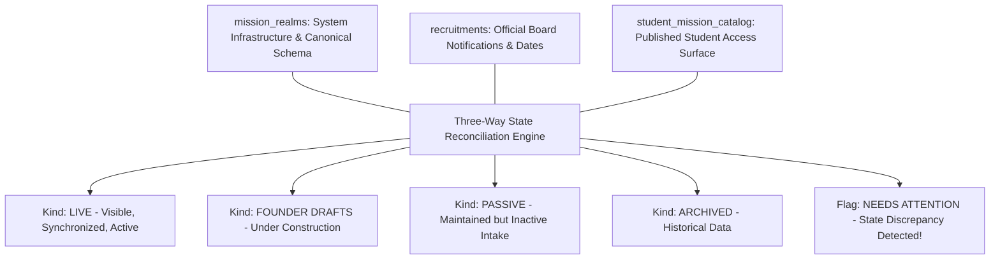
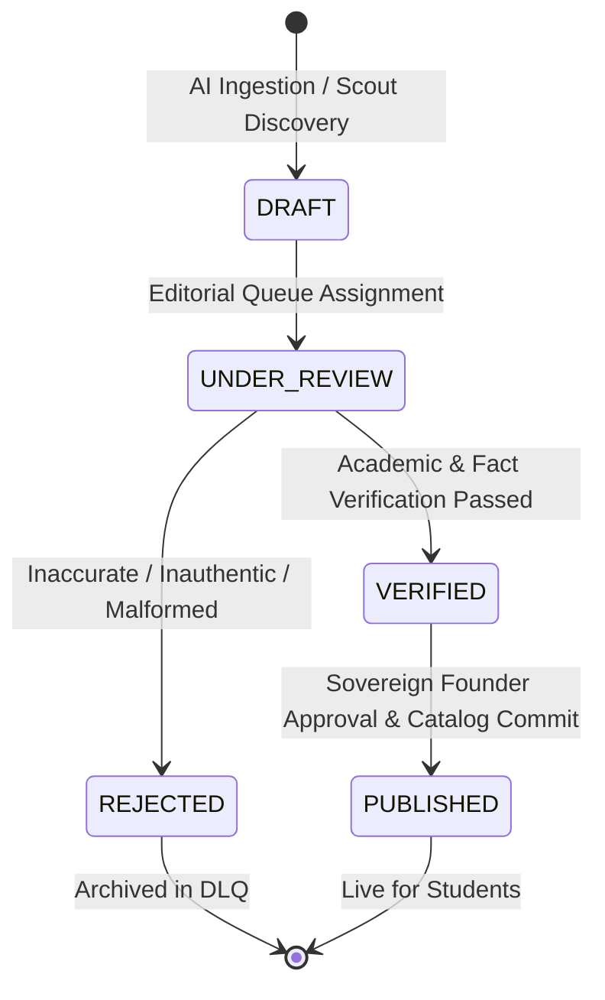
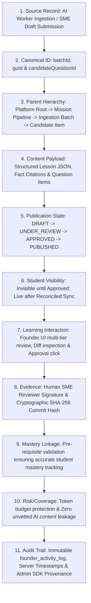

# Volume C — Founder Web Operations

**Current acceptance:** working reference; path existence does not certify runtime behavior, production state or passing tests. Historical code excerpts and line ranges require SHA-specific readback before implementation use.

**GitHub source snapshot:** [`docs/rankcrackers_book/13_founder_web_operations_and_mission_control.md`](https://github.com/rankcrackersofficial-sys/RankCrackers/blob/5161592ddafb42f1ecc8923cc7b7b0309934cc83/docs/rankcrackers_book/13_founder_web_operations_and_mission_control.md) · source blob `88a544e3caf7e8a87b4edb6707d3e270206d50bf`. This Drive edition contains editorial corrections; it is not a claim that those corrections were committed to GitHub. See `github_source_manifest.json` and the current reconciliation register.


## Part 1 — Administrative Command Surface, Mission Control & Sovereign Governance

### Chapter 13 — Founder Operational Architecture, Multi-Panel Control Grid, Ingestion Pipeline और System Health Telemetry

---

### Executive Overview & Operational Intent

RankCrackers ecosystem में Founder Web Operations केवल एक पारंपरिक administrative content management system (CMS) या database viewer नहीं है। यह एक उच्च-स्तरीय, sovereign और forensic-grade **Operational Command Grid** है। जबकि Student Mobile Shell का मुख्य लक्ष्य छात्रों को distraction-free, focused और personalized learning experience प्रदान करना है, Founder Web Panel का मुख्य उद्देश्य संपूर्ण platform की academic integrity, automated ingestion, autonomous AI scouting battalions, token budget consumption, और multi-tier quality assurance को authoritatively govern करना है।

Founder Operations के मूलभूत संवैधानिक सिद्धांत (Constitutional Principles) निम्नलिखित हैं:
1. **The Separation of Powers Law:** Mobile Client और Web Admin Console भौतिक और तार्किक रूप से पूरी तरह अलग हैं। Mobile binary के अंदर Founder/Admin routes (`/admin`) को जानबूझकर अक्षम (`Access Denied: Mobile Admin Console is disabled`) रखा गया है ताकि security attack surface minimize हो सके।
2. **The Non-Interference Law (Zero Direct Score Tampering):** Founder Console छात्र की सीखने की स्थिति का वास्तविक समय में निरीक्षण (observability) कर सकता है, लेकिन किसी भी परिस्थिति में Founder UI छात्र के निजी mastery scores, risk levels, coverage metrics या assessment attempts को मनमाने ढंग से संपादित (direct edit) नहीं कर सकता। छात्र की व्यक्तिगत शैक्षणिक प्रगति पूरी तरह अपरिवर्तनीय है।
3. **The Human Authority Law (No Automated AI Publishing):** Autonomous AI workers (जैसे Ingestion Refinery, Question Generator, DigiBook Drafter) सामग्री तैयार कर सकते हैं, लेकिन कोई भी नया पाठ्यक्रम, प्रश्न या परीक्षा मिशन तब तक छात्रों के लिए लाइव नहीं हो सकता जब तक एक अधिकृत मानव (Founder या verified Reviewer) उसे Multi-Tier Review Queue में स्पष्ट रूप से अनुमोदित (Approve) न कर दे।
4. **Three-Way State Reconciliation:** प्लेटफॉर्म पर उपलब्ध परीक्षाएं तीन स्वतंत्र डेटा संरचनाओं (`mission_realms`, `recruitments`, और `student_mission_catalog`) के वास्तविक समय समाधान (reconciliation) पर निर्भर करती हैं ताकि किसी भी अमान्य या असंगत डेटा का छात्रों तक पहुंचना असंभव हो।
5. **Immutable Forensic Auditing:** Founder Console पर निष्पादित प्रत्येक आदेश, भूमिका संशोधन, वर्कर टॉगल या डेटा पर्ज अपरिवर्तनीय `founder_activity_log` में टाइमस्टैम्प, यूज़र आईडी और मेटाडेटा के साथ दर्ज होता है।

---

### Section 1 — Operational Philosophy और The Separation of Powers Law

#### Subsection 1.1 — Web vs Mobile Partitioning

**File Path:** `lib/core/router/app_router.dart`
**Lines:** 188–200

RankCrackers की सुरक्षा रणनीति का पहला स्तंभ मोबाइल एप्लिकेशन और एडमिन कंसोल का सख्त विभाजन है। मोबाइल शैल के भीतर एडमिन कंसोल के निष्पादन को ब्लॉक किया गया है:

```dart
GoRoute(
  path: AppRoutes.admin,
  builder: (context, state) => const Scaffold(
    backgroundColor: AppColors.background,
    body: Center(
      child: Text(
        'Access Denied: Mobile Admin Console is disabled.',
        style: TextStyle(color: AppColors.textSecondary),
      ),
    ),
  ),
),
```

##### Architectural Rationale:
- **Attack Surface Minimization:** छात्र के डिवाइस पर वितरित किए जाने वाले Android APK या iOS IPA में एडमिनिस्ट्रेटिव कोड और डेटा म्यूटेशन लॉजिक शामिल नहीं होना चाहिए।
- **Accidental Operations Prevention:** मोबाइल स्क्रीन की कॉम्पैक्टनेस के कारण संवेदनशील परिचालन गलतियों (जैसे गलत बटन टैप से मिशन डीएक्टिवेशन) का जोखिम बढ़ जाता है।
- **Platform Integrity:** सम्पूर्ण एडमिनिस्ट्रेटिव ऑपरेशन वेब एनवायरनमेंट (`kIsWeb`) में डेस्कटॉप-क्लास मॉनिटरिंग और मल्टी-विंडो वर्कस्पेस के साथ संचालित होते हैं।

#### Subsection 1.2 — The Human Authority Law & Non-Interference with Private Mastery

**File Path:** `lib/web/founder/health/founder_student_health_web.dart`
**Lines:** 21–34

संस्थापक और छात्रों के बीच के अधिकार क्षेत्र को स्पष्ट रूप से परिभाषित किया गया है:

```dart
const Text(
  'STUDENT HEALTH / PANEL LINKAGE',
  style: TextStyle(
    color: Colors.white,
    fontSize: 28,
    fontWeight: FontWeight.w900,
    letterSpacing: 0.5,
  ),
),
const SizedBox(height: 8),
const Text(
  'Founder observability for Student Panel readiness without private score or mastery edits.',
  style: TextStyle(color: Colors.white54, fontSize: 14),
),
```

##### The Non-Interference Invariants:
1. **Read-Only Telemetry:** संस्थापक कंसोल छात्रों की रेडीनेस, सक्रिय सेशंस, और रूट टेलीमेट्री का निरीक्षण कर सकता है (`telemetry_nexus`)।
2. **Immutability of Mastery:** छात्र का नॉलेज इंजन गणितीय रूप से स्वायत्त है। कोई भी एडमिन किसी छात्र के एटॉमिक मास्टरी स्कोर को सीधे नहीं बदल सकता (`atomic_mastery` subcollection write permission केवल बैकएंड फंक्शन और लाइव असेसमेंट सबमिशन के लिए आरक्षित है)।
3. **Pure Governance:** संस्थापक का कार्य शैक्षणिक मानकों का निर्माण, सामग्री की प्रामाणिकता की पुष्टि, और सिस्टम की विश्वसनीयता बनाए रखना है।

#### Subsection 1.3 — Founder Identity, Custom Claims & Security Boundary Matrix

**File Path:** `lib/core/constants/founder_identity.dart` एवं `firestore.rules`

संस्थापक अधिकार दोहरी सुरक्षा (Dual-Security) मॉडल पर आधारित हैं:

```dart
class FounderIdentity {
  static const founderUid = '6TdzjpBr6Zdx1ag3LbMmjJ0DY312';
  static const founderEmails = {
    'founder.rcofficial@gmail.com',
  };

  static bool isFounderUser(User? user) {
    if (user == null) return false;
    if (user.uid == founderUid) return true;
    if (founderEmails.contains(user.email)) return true;
    return false;
  }
}
```

क्लाइंट-साइड पहचान के अतिरिक्त, बैकएंड पर Firestore Security Rules में `isFounder()` फंक्शन अनिवार्य सुरक्षा नियम लागू करता है:

```javascript
function isFounder() {
  return request.auth != null &&
         (('admin' in request.auth.token && request.auth.token.admin == true) ||
          ('founder' in request.auth.token && request.auth.token.founder == true));
}
```

##### Sovereign Security Matrix:
| Domain / Resource | Student Role | Reviewer / Manager | Administrator | Founder |
| :--- | :--- | :--- | :--- | :--- |
| Student Dashboard & Battles | Full Access | Full Access | Full Access | Full Bypass Access |
| Student Mastery / Progress Mutation | Automated Own | Denied | Denied | **Denied (Lawful)** |
| Ingestion Refinery Upload | Denied | Upload Only | Manage Queue | Full Control & Override |
| Content Approval & Publishing | Denied | Stage 1 Review | Stage 2 Approval | Final Sovereign Sign-off |
| Worker Governance & Token Limits | Denied | View Only | View / Restart | Full Budget & Configuration |
| Forensic Data Purge | Denied | Denied | Denied | Explicit Founder Confirmation |
| Custom Claims Authority Grant | Denied | Denied | Denied | Exclusive Founder Authority |

#### Subsection 1.4 — Comprehensive Screen States & Lifecycle Matrix (Founder Web Operations)

Founder Web Console का प्रत्येक विजुअल पैनल और वर्कफ़्लो सख्त स्टेट मशीन का पालन करता है:

| स्क्रीन अवस्था (Screen State) | ट्रिगर स्थिति (Trigger Condition) | विजुअल सतह और घटक (Visual Surface & Components) | एडमिन / फाउंडर क्षमता (User Capabilities) | सुरक्षा एवं फ़ेल-क्लोज़्ड सीमा (Security & Fail-Closed Boundary) |
| :--- | :--- | :--- | :--- | :--- |
| **1. Auth Gate Verification** | इनिशियलाइज़ेशन व कस्टम क्लेम रेज़ोल्यूशन | ब्लैक स्क्रीन, केंद्रीय गोल्ड लोडर, "VERIFYING SOVEREIGN CREDENTIALS" | कोई इंटरैक्शन नहीं (ब्लॉक्ड स्क्रीन) | केवल `kIsWeb == true` पर सक्रिय; मोबाइल क्लाइंट पर तत्काल "Access Denied" रूट। |
| **2. Access Denied State** | अनऑथराइज़्ड यूज़र अथवा गैर-फाउंडर क्रेडेंशियल | लाल रंग की चेतावनी स्क्रीन, "SOVEREIGN PRIVILEGES REQUIRED", साइन-आउट बटन | केवल लॉगआउट या होम रीडायरेक्ट | फ़ायरस्टोर सिक्योरिटी रूल्स द्वारा बैकएंड ब्लॉक; कोई डेटा लीक नहीं। |
| **3. Command Grid Dashboard** | वैध संस्थापक प्रमाणीकरण (`FounderIdentity`) | `FounderSovereignScaffold`, 2x2 पाइपलाइन ग्रिड (Uploads, Intel, Reviews, DLQ), 4-कॉलम क्विक कमांड्स | पूर्ण सिस्टम नेविगेशन, टैब स्विचिंग, विजुअल टेलीमेट्री निरीक्षण | रीड-ओनली टेलीमेट्री; छात्र के मास्टरी स्कोर को सीधे म्यूटेट करने का कोई विकल्प नहीं। |
| **4. Multi-Tier Review Workspace** | `ReviewQueue` टैब चयन | स्प्लिट-स्क्रीन डिफ व्यूअर, ओरिजिनल सोर्स उद्धरण, प्रपोज्ड AI ड्राफ्ट, रिजेक्शन नोट्स फील्ड | "APPROVE & PUBLISH", "REQUEST REVISION", "REJECT" | The Human Authority Law: बिना मानव हस्ताक्षर के कोई सामग्री पब्लिश नहीं हो सकती। |
| **5. Mission Reconcile Matrix**| `FounderMissionInventory` टैब | 3-वे सुलह मैट्रिक्स (mission_realms, recruitments, student_mission_catalog), स्थिति बैज | "FORCE RECONCILE", सिंक ट्रिगर, कैटलॉग विजिबिलिटी टॉगल | असंगत या अनसुलझे मिशन्स को छात्रों के पैनल में प्रदर्शित होने से रोकता है। |
| **6. Emergency Action Modal** | डेटा पर्ज या वर्कर किल-स्विच टैप | हाई-रिस्क रेड डायलॉग, कन्फर्मेशन प्राम्प्ट, इम्पैक्ट सारांश | स्पष्ट पुष्टि द्वारा क्रिटिकल एक्शन निष्पादन | `founder_activity_log` में अपरिवर्तनीय ऑडिट प्रविष्टि; बैकएंड क्लेम सत्यापन। |
| **7. System Vitals & Worker Hub**| `SystemVitals` व `FounderSettingsCenter` | रीयल-टाइम मेमोरी, एरर दरें, AI टोकन बजट गेज, ग्लोबल किल-स्विच | टोकन सीमा समायोजन, वर्कर ऑन/ऑफ टॉगल | मासिक बजट सीमा से अधिक होने पर AI टास्क निष्पादन स्वतः ब्लॉक। |

#### Subsection 1.5 — The 15 Core Attributes of Founder Web Operations & Mission Control

Chief Author Mandate के तहत Founder Web Operations & Mission Control सिस्टम के 15 मूलभूत सिस्टम पैरामीटर्स का विनिर्देश:

| # | कोर विशेषता (Core Attribute) | कैनोनिकल विनिर्देश (Canonical Specification) | प्रामाणिक स्रोत फ़ाइल व संदर्भ (Source Evidence) |
| :--- | :--- | :--- | :--- |
| **1** | **Feature Name** | Authoritative Sovereign Command Surface & Mission Control | `lib/web/shared/unified_command_console.dart` एवं `lib/web/founder/mission_control/mission_control_room.dart` |
| **2** | **Canonical Domain ID** | `founder_mission_control_v1` | `lib/web/founder/mission_control/founder_mission_inventory.dart:47–53` |
| **3** | **Parent Hierarchy** | `App -> Web Shell -> UnifiedCommandConsole -> 4 Sovereign Module Groups -> Operational Panels` | `lib/web/shared/unified_command_console.dart:200–289` |
| **4** | **Presentation Entry Point**| `AppRoutes.admin` / `WebShell` (Web exclusively; Mobile router blocks admin access) | `lib/main_web.dart:386–392`, `lib/core/router/app_router.dart:188–200` |
| **5** | **State Management Engine**| Multi-Stream Firestore Snapshots + Sovereign Unified Console Stateful Shell | `lib/web/shared/unified_command_console.dart:54–241` |
| **6** | **Backend Topology & Storage** | Firestore Collections: `mission_realms`, `recruitments`, `student_mission_catalog`, `system_config` | `functions/callable/handle_sentinel_action.js:164–222` |
| **7** | **Offline Strategy & Caching**| Web Online-First (No stale offline admin cache to prevent operational drift) | `lib/web/founder/mission_control/founder_mission_inventory.dart:153–182` |
| **8** | **Authority Boundary** | Exclusive Founder UID (`6TdzjpBr6Zdx1ag3LbMmjJ0DY312`) & Custom Claims | `lib/core/constants/founder_identity.dart:88–98` |
| **9** | **Reconciliation Logic** | 3-Way Snapshot In-Memory Intersection (`_reconcile`) | `lib/web/founder/mission_control/founder_mission_inventory.dart:153–182` |
| **10**| **Verification & Gate System** | Human Authority Law (Zero automated AI publishing to student surfaces) | `lib/features/admin/presentation/widgets/review_queue/outcome_verification_center.dart` |
| **11**| **Student Visibility Gate** | Catalog Visibility Matrix: Requires `cardVisible == true` && `userPanelVisible == true` | `lib/web/founder/mission_control/founder_mission_inventory.dart:364–431` |
| **12**| **Non-Interference Law** | Founder observability strictly prohibited from direct mastery score tampering | `lib/web/founder/health/founder_student_health_web.dart:21–34` |
| **13**| **Security & Audit Rules** | Immutable audit trail logged to `founder_activity_log` for all sovereign mutations | `functions/services/audit_service.js:8–18` |
| **14**| **Test Coverage & Suites** | 3 primary suites: mission lifecycle emulator, canonical reconciliation, worker proofs | `functions/src/test/realEmulatorE2EWorkerProof.test.ts:28–185` |
| **15**| **Failure Mode & Emergency UI**| Emergency Battalion Kill-Switch + Dead Letter Queue forensic monitor | `lib/features/admin/presentation/widgets/system_health/system_vitals.dart` |

---

### Section 2 — Authoritative Sovereign Command Surface: Unified Command Console & Modular Operations Hub

#### Subsection 2.1 — Dual Role Engine & Unified Command Surface Architecture

**File Path:** `lib/web/shared/unified_command_console.dart`
**Lines:** 29–76, 200–355

RankCrackers Web Operations का केंद्रीय लाइव परिचालन तंत्र `UnifiedCommandConsole` है। यह कंसोल दो विशिष्ट भूमिका श्रेणियों (`ConsoleRoleMode.founder` और `ConsoleRoleMode.admin`) के आधार पर गतिशील रूप से व्यवस्थित होता है:

1. **Founder Sovereign Mode:** संस्थापक को संपूर्ण पारिस्थितिकी तंत्र (इन्फ्रास्ट्रक्चर, सामग्री पाइपलाइन, छात्र वितरण स्वास्थ्य, और सिस्टम गवर्नेंस) पर पूर्ण प्रभुसत्ता प्रदान करता है।
2. **Admin Operational Mode:** प्रशासनिक प्रबंधकों और समीक्षकों के लिए कार्य-आधारित इंटरफ़ेस प्रदान करता है, जहाँ केवल अनुमत मॉड्यूल (`AdminPermissionResolver` द्वारा सत्यापित) प्रदर्शित होते हैं।

नीचे दिए गए आरेख में `UnifiedCommandConsole` की संपूर्ण नेविगेशन टोपोलॉजी और 4 संप्रभु मॉड्यूल समूहों का संरचनात्मक प्रवाह दर्शाया गया है:

```mermaid
flowchart TD
    WebShell[WebShell Entry: lib/web/web_shell.dart] --> UCC[UnifiedCommandConsole: lib/web/shared/unified_command_console.dart]

    UCC --> Identity[Identity Header: Online Pulse, User Name & Designation]

    UCC --> FounderMode[Mode: ConsoleRoleMode.founder]
    UCC --> AdminMode[Mode: ConsoleRoleMode.admin]

    FounderMode --> G1[Group 1: MISSION & DELIVERY]
    G1 --> G1_M1[Mission Control Room: MissionControlRoom]
    G1 --> G1_M2[Mission Delivery Preview: Verification & Visibility]

    FounderMode --> G2[Group 2: CONTENT PIPELINE]
    G2 --> G2_M1[Document Command Center: FDC]
    G2 --> G2_M2[Verification Center: Syllabus & PYQ Audit]
    G2 --> G2_M3[Factory Hub: UploadFactoryCenter Integration]
    G2 --> G2_M4[Publish Gate: MissionPublishReadinessPanel]

    FounderMode --> G3[Group 3: STUDENT & HEALTH]
    G3 --> G3_M1[Student Delivery Health: FounderStudentHealthWeb]

    FounderMode --> G4[Group 4: SYSTEM & GOVERNANCE]
    G4 --> G4_M1[Admin Governance: AccessSecurityWeb]
    G4 --> G4_M2[System Ops / Dev Mode: FounderSystemOperationsWeb]

    AdminMode --> A_Queue[My Work Queue: AdminTasksList]
    AdminMode --> A_MCR[Mission Control Room - Perm Gated]
    AdminMode --> A_SML[Study Master Library - Perm Gated]
    AdminMode --> A_DCC[Document Command Center - Perm Gated]
    AdminMode --> A_Intel[Intelligence Room - Perm Gated]
    AdminMode --> A_Log[Recent Activity Log - Perm Gated]
    AdminMode --> A_Access[My Access Panel]
```




#### Subsection 2.2 — The 4 Sovereign Module Groups in Founder Mode

संस्थापक मोड में `UnifiedCommandConsole` 4 सुव्यवस्थित परिचालन समूहों में विभाजित है:

##### 1. Group: MISSION & DELIVERY
- **Mission Control (`MissionControlRoom`):** परीक्षा साम्राज्यों (Exam Realms) का मुख्य प्रशासनिक कक्ष (`lib/web/founder/mission_control/mission_control_room.dart`)। यह `MissionControlCenter` को समाहित करता है, जिसमें नया मिशन निर्माण (`MissionCreationCenter`), अनलिंक्ड सत्यापित एसेट्स कतार, और लाइव पोर्टफोलियो सुलह (`FounderMissionInventory`) शामिल हैं। किसी मिशन का चयन करने पर यह सीधे `MissionDocumentsTab`, `UploadFactoryCenter`, `MissionPublishReadinessPanel` या `MissionVariableAuthorityPanel` में नेविगेट करने की सुविधा प्रदान करता है।
- **Mission Delivery Preview:** छात्र अनुभव और विजिबिलिटी डायग्नोस्टिक्स का लाइव सत्यापन पैनल (`widget.founderDeliveryPreviewBuilder`)।

##### 2. Group: CONTENT PIPELINE
- **Document Command Center (FDC):** आधिकारिक स्रोत दस्तावेज़ों का केंद्रीय भंडार (`lib/web/founder/fdc/document_command_center.dart`)। जब कोई मिशन चुना जाता है, तो यह कार्यक्षेत्र सीधे `MissionDocumentsTab` से जुड़ जाता है।
- **Verification Center:** अकादमिक डेटा सत्यापन हब। यह चयनित मिशन के सिलेबस सत्यापन और PYQ सत्यापन टैब्स (`targetDetailTab = 1`, `targetSubTab = 1` या `2`) को सीधे लोड करता है।
- **Factory Hub:** अंतर्ग्रहण फैक्ट्री का प्रवेश द्वार। यह `UploadFactoryCenter` (`targetDetailTab = 2`) में रूट करता है, जो वास्तविक समय में `ai_queue`, एक्टिव वर्कर्स, और रिव्यू स्ट्रीम्स को मॉनिटर करता है।
- **Publish Gate:** छात्र प्रकाशन से पूर्व अंतिम सुरक्षा द्वार (`targetDetailTab = 3`)। यह `MissionPublishReadinessPanel` को लोड करता है, जो 5 अनिवार्य साक्ष्यों की पुष्टि करता है।

##### 3. Group: STUDENT & HEALTH
- **Student Delivery Health (`FounderStudentHealthWeb`):** छात्रों के लाइव अध्ययन सत्रों, सक्रिय स्क्रीन, और रूट टेलीमेट्री का समग्र (aggregate) निरीक्षण। यह Non-Interference Law का कड़ाई से पालन करता है (छात्र के व्यक्तिगत मास्टरी स्कोर या प्रगति को संपादित करने का कोई विकल्प नहीं)।

##### 4. Group: SYSTEM & GOVERNANCE
- **Admin Governance (`AccessSecurityWeb`):** प्रशासनिक अनुमतियाँ, कस्टम क्लेम्स प्रतिनिधिमंडल, और भूमिका ऑडिट।
- **System Ops / Dev Mode (`FounderSystemOperationsWeb`):** सिस्टम विटल्स, AI टोकन उपभोग गेज, वर्कर किल-स्विचेस, और फोरेंसिक ऑडिट लॉग्स।

#### Subsection 2.3 — Historical Context: The `FounderDashboard` Prototype Canvas

**File Path:** `lib/features/admin/presentation/widgets/dashboard/founder_dashboard.dart`
**Status:** `SUPERSEDED_PROTOTYPE` (संरक्षित संदर्भ)

प्रारंभिक विकास चरण में `founder_dashboard.dart` ने बॉटम नेविगेशन (`FounderBottomNavigation`) और $2 \times 2$ पाइपलाइन ग्रिड (Uploads, Intel, Reviews, AI Failures) के साथ एक प्रायोगिक 5-टैब प्रोटोटाइप के रूप में कार्य किया था। उत्पादन परिवेश में डेस्कटॉप-क्लास मल्टी-विंडो ऑपरेशंस और सख्त भूमिका पृथक्करण की आवश्यकताओं के कारण इस प्रोटोटाइप को `UnifiedCommandConsole` द्वारा प्रतिस्थापित (superseded) कर दिया गया।

प्रोटोटाइप ग्रिड की मेट्रिक्स निम्नलिखित भौतिक स्ट्रीम्स से जुड़ी हुई थीं:
- **UPLOADS:** `FirebaseFirestore.instance.collection('ingestion_refinery').where('status', isEqualTo: 'pending')`
- **INTEL:** `FirebaseFirestore.instance.collection('sentinel_drafts').where('status', isEqualTo: 'draft')`
- **REVIEWS:** `system_metrics/content_summary` का एग्रीगेटेड स्नैपशॉट (`pendingDigibooks`, `pendingQuestions`, `pendingNodes`, `pendingSentinel`)।
- **AI FAILURES:** डेड-लेटर क्यू (DLQ) काउंट।

उत्पादन वातावरण में ये सभी मेट्रिक्स अब `UnifiedCommandConsole` के संबंधित मॉड्यूल समूहों (Factory Hub, Verification Center, System Ops) में वास्तविक समय में अंतर्निहित हैं।


#### Subsection 2.4 — The 9 Canonical Mission Pipeline Invariants (Patch Safety Contract)

**Source Reference:** `docs/patch_safety/rc_founder_web_canonical_backend_live_integration_20260831/`

लाइव बैकएंड एकीकरण और परिचालन अखंडता को बनाए रखने के लिए 9 अपरिवर्तनीय नियम (Canonical Invariants) कोडबेस और बैकएंड में लागू हैं:

1. **Create Mission Pipeline Invariant (`05_create_mission_pipeline.md`):**
   संस्थापक द्वारा नया मिशन निर्माण `MissionCreationCenter` से प्रारंभ होता है। यह **Quad Identity Validation** (`examMatch`, `orgMatch`, `yearMatch`, `categoryMatch`) अनिवार्य करता है। सत्यापन सफल होने पर यह क्लाउड फ़ंक्शन `handleSentinelAction` को `launch_exam_mission` एक्शन के साथ निष्पादित करता है। बैकएंड लेनदेन (transaction) `mission_realms`, `recruitments`, और `student_mission_catalog` तीनों संग्रहों में परमाणु (atomic) रूप से लिखता है (52-case integration lane द्वारा प्रमाणित)।

2. **Mission Variables Authority Invariant (`06_mission_variables.md`):**
   `MissionVariableAuthorityPanel` मिशन की आधिकारिक तकनीकी संरचना (रिक्तियां, पात्रता, परीक्षा पेपर, श्रेणियां, शुल्क, भाषा नीति) को नियंत्रित करता है। यह `handleSentinelAction` के `update_mission_variables` एक्शन का उपयोग करता है। इसके तहत संस्थापक प्राधिकरण, न्यूनतम 12 वर्णों का स्पष्ट परिवर्तन कारण (`_reason.text.trim().length >= 12`), अपेक्षित संस्करण संख्या (`expectedVersion`), और अपरिवर्तनीय ऑडिट अनिवार्य है। यदि किसी मिशन का `mission_realms` रिकॉर्ड अनुपस्थित है, तो म्यूटेशन पूरी तरह अवरुद्ध हो जाता है (`VARIABLE CHANGES LOCKED — Authority repair required`)।

3. **Lifecycle Wiring & Fail-Closed Guard (`07_lifecycle_wiring.md`):**
   मिशन रील्म की अवस्था परिवर्तन (`archive_realm`, `restore_realm`, `delete_realm_permanently`) केवल अधिकृत कॉलेबल क्रियाओं द्वारा ही संभव है। प्रत्येक क्रिया के लिए पुष्टिकरण, न्यूनतम 12-अक्षरीय कारण, विशिष्ट `requestId`, और नियतात्मक ऑडिट ट्रेल अनिवार्य है। कैनोनिकल पहचान बेमेल (Identity Mismatch) होने पर सिस्टम तुरंत फ़ेल-क्लोज़्ड (fail-closed) हो जाता है। लिगेसी रील्म-विहीन रिकॉर्ड्स को कभी भी लाइफसाइकिल म्यूटेशन नियंत्रण प्राप्त नहीं होता।

4. **Document Pipeline Integration (`08_document_pipeline.md`):**
   `DocumentCommandCenter` में किसी मिशन का चयन उसे सीधे `MissionDocumentsTab` से जोड़ देता है। आधिकारिक दस्तावेज़ अपलोड करने पर SHA-256 हैश जेनरेट होता है, और मेटाडेटा `mission_realms/{id}/official_documents` में तथा फाइल स्टोरेज पाथ `mission_realms/{id}/official_documents/{hash}.pdf` में सहेजी जाती है। यह प्रक्रिया स्वचालित रूप से `ingestion_refinery` और `ai_queue` में दर्ज होती है।

5. **Verification Center Direct Routing (`09_verification_center.md`):**
   वेरिफिकेशन सेंटर से किसी भी सत्यापन क्रिया (सिलेबस या PYQ) पर टैप करने पर यह चयनित मिशन के वास्तविक सिलेबस/PYQ सत्यापन कार्यक्षेत्र में रूट करता है। इसमें कोई अप्रमाणित या सिंथेटिक सफलता फ़ॉलबैक मौजूद नहीं है।

6. **Factory Hub Live Integration (`10_factory_hub.md`):**
   फैक्ट्री हब सीधे `UploadFactoryCenter` से जुड़ा हुआ है। इसके सभी काउंट्स और स्टेटस वास्तविक `ai_queue`, वर्कर रजिस्ट्री, रिव्यू क्यू, और सक्रिय मिशन स्ट्रीम्स से सीधे पढ़े जाते हैं।

7. **Publish Gate Readiness Enforcement (`11_publish_gate.md`):**
   `MissionPublishReadinessPanel` छात्रों के लिए किसी मिशन को लाइव करने से पूर्व 5 अनिवार्य साक्ष्यों की जांच करता है:
   - `canonicalVerified`: स्रोत स्लॉट्स में कैनोनिकल संस्करण सत्यापित है।
   - `sourceCurrent`: सक्रियण कालखंड (`activationEpoch > 0`) वर्तमान है।
   - `deltaApplied`: अकादमिक डेल्टा सफलतापूर्वक लागू किया गया है।
   - `downstreamComplete`: सभी डाउनस्ट्रीम आर्टिफ़ैक्ट्स पूरी तरह उत्पन्न हो चुके हैं।
   - `studentVisible`: कैटलॉग में `cardVisible == true` और `userPanelVisible == true` है।
   यदि कोई भी साक्ष्य अनुपस्थित है, तो गेट `NOT_READY / BLOCKED` स्थिति दर्शाता है। यह पैनल विशुद्ध रूप से पठनीय (read-only) है और अनधिकृत प्रकाशन को रोकता है।

8. **Mission Delivery Preview Diagnostics (`12_delivery_preview.md`):**
   सुलझाया गया इन्वेंटरी मॉडल दृश्यता और प्राधिकरण-विहीन डायग्नोस्टिक्स को उजागर करता है ताकि किसी भी अप्रमाणित डेटा का छात्रों तक पहुंचना असंभव हो।

9. **Student Delivery Health Invariant (`13_student_health.md`):**
   `FounderStudentHealthWeb` केवल समग्र डिलीवरी स्वास्थ्य की निगरानी करता है। संस्थापक के पास छात्र के व्यक्तिगत मास्टरी स्कोर, असेसमेंट प्रयासों, या शैक्षणिक उत्तरों को बदलने का शून्य अधिकार (Zero Write Authority) है।

---

### Section 3 — Mission Portfolio Control & Three-Way State Reconciliation (`FounderMissionInventory`)

#### Subsection 3.1 — The Three-Collection Reconciliation Algorithm

**File Path:** `lib/web/founder/mission_control/founder_mission_inventory.dart`
**Lines:** 21–48, 153–182

RankCrackers में परीक्षा मिशन की स्थिति केवल एक फ़्लैग पर निर्भर नहीं करती। `FounderMissionInventory` तीन अलग-अलग Firestore संग्रहों को वास्तविक समय में संयोजित और सुलझाता (reconcile) है:

```dart
List<_MissionInventoryRecord> _reconcile(
  List<QueryDocumentSnapshot<Map<String, dynamic>>> realms,
  List<QueryDocumentSnapshot<Map<String, dynamic>>> recruitments,
  List<QueryDocumentSnapshot<Map<String, dynamic>>> catalog,
) {
  final byId = <String, _MissionInventoryRecord>{};
  for (final doc in realms) {
    byId.putIfAbsent(doc.id, () => _MissionInventoryRecord(doc.id)).realm = doc.data();
  }
  for (final doc in recruitments) {
    byId.putIfAbsent(doc.id, () => _MissionInventoryRecord(doc.id)).recruitment = doc.data();
  }
  for (final doc in catalog) {
    byId.putIfAbsent(doc.id, () => _MissionInventoryRecord(doc.id)).catalog = doc.data();
  }
  final rows = byId.values.toList()
    ..sort((a, b) {
      if (a.studentVisible != b.studentVisible)
        return a.studentVisible ? -1 : 1;
      return a.displayName.toLowerCase().compareTo(b.displayName.toLowerCase());
    });
  return rows;
}
```

नीचे दिया गया वेन आरेख इस त्रिकोणीय सुलह संबंध को दर्शाता है:




#### Subsection 3.2 — Portfolio Categorization & Visibility Laws

`_MissionInventoryRecord` प्रत्येक रिकॉर्ड की स्थिति की गणना निम्न नियमों के आधार पर करता है:

1. **Student Visibility Law:**
   ```dart
   bool get studentVisible =>
       catalog?['cardVisible'] == true &&
       catalog?['userPanelVisible'] == true &&
       catalog?['archived'] != true;
   ```
   केवल तभी कोई मिशन छात्र की `MissionRealmScreen` में दिखाई दे सकता है जब कैटलॉग में `cardVisible == true`, `userPanelVisible == true`, और `archived != true` तीनों सत्य हों।

2. **Portfolio Kind Classification:**
   - **LIVE:** `studentVisible == true` और स्टेटस `'published'` या `'live'` है।
   - **FOUNDER DRAFTS:** मिशन अभी तैयार किया जा रहा है और कैटलॉग में अप्रकाशित है।
   - **PASSIVE:** भर्ती प्रक्रिया समाप्त हो चुकी है या भविष्य के बैच के लिए होल्ड पर है।
   - **ARCHIVED:** परीक्षा समाप्त हो चुकी है और अभिलेखागार में स्थानांतरित कर दी गई है।


#### Subsection 3.3 — Discrepancy Detection & "Needs Attention" Heuristics

**File Path:** `lib/web/founder/mission_control/founder_mission_inventory.dart`
**Lines:** 224–227

प्लेटफ़ॉर्म की स्थिरता और डेटा अखंडता सुनिश्चित करने के लिए, सिस्टम स्वचालित रूप से विसंगतियों का पता लगाता है। लाइव कोडबेस में `needsAttention` गुण तीन सख्त फोरेंसिक स्थितियों की जांच करता है:

```dart
bool get needsAttention =>
    realm == null ||
    (!sourceReady && !sourceCandidate) ||
    (!hasCanonicalVariables && !hasLegacyVariables);
```

##### Three Live Forensic Invariants:
1. **Discrepancy 1 — Missing Realm Authority (`realm == null`):** यदि कोई मिशन कैटलॉग या भर्ती तालिका में मौजूद है लेकिन उसका `mission_realms` दस्तावेज़ अनुपस्थित है, तो इसे तुरंत विसंगति माना जाता है। ऐसे लिगेसी रिकॉर्ड्स को `STUDENT_VISIBLE, REALM_MISSING, AUTHORITY_REPAIR_REQUIRED and LIFECYCLE_MUTATION_BLOCKED` स्थिति में रखा जाता है ताकि अनधिकृत या क्षतिग्रस्त डेटा में लाइफसाइकिल म्यूटेशन निष्पादित न हो सके।
2. **Discrepancy 2 — Missing Official Source (`!sourceReady && !sourceCandidate`):** मिशन के पास न तो कोई सत्यापित कैनोनिकल स्रोत संस्करण (`canonicalSourceVersionId != null` / `sourceAuthorityState == 'CANONICAL'`) है और न ही कोई उम्मीदवार स्रोत दस्तावेज़ (`sourceVersionId != null` / `sourceDocumentId != null`)।
3. **Discrepancy 3 — Missing Variable Structure (`!hasCanonicalVariables && !hasLegacyVariables`):** मिशन के पास न तो कैनोनिकल `missionVariables` मैप उपलब्ध है और न ही लिगेसी वेरिएबल्स सूची।

यदि किसी मिशन में इनमें से कोई भी स्थिति पाई जाती है, तो उसे तत्काल **"NEEDS ATTENTION"** फ़िल्टर में हाइलाइट किया जाता है, जिससे संस्थापक डेटा विसंगतियों को प्राथमिकता के साथ ठीक कर सके।


#### Subsection 3.4 — Dynamic Responsive Portfolio Grid, Summary Metrics & Governed Lifecycle Actions

`FounderMissionInventory` विभिन्न स्क्रीन आकारों के लिए डायनामिक रिस्पॉन्सिव ग्रिड रेंडर करता है:
- **Ultra-Wide ($\ge 1450\text{px}$):** 3-कॉलम लेआउट।
- **Desktop / Laptop ($1050\text{px} - 1449\text{px}$):** 2-कॉलम लेआउट।
- **Tablet / Split Screen ($< 1050\text{px}$):** 1-कॉलम लेआउट।

##### 1. The 5 Live Portfolio Summary Metrics (`_summary`):
- **LIVE (Green):** `rows.where((r) => r.kind == MissionPortfolioFilter.live).length` — सक्रिय रूप से छात्रों के लिए दृश्यमान मिशन्स।
- **FOUNDER DRAFTS (White70):** `rows.where((r) => r.kind == MissionPortfolioFilter.draft).length` — निर्माणाधीन या अप्रकाशित ड्राफ्ट्स।
- **PASSIVE (Orange):** `rows.where((r) => r.kind == MissionPortfolioFilter.passive).length` — निष्क्रिय या होल्ड पर रखे गए मिशन्स।
- **ARCHIVED (White38):** `rows.where((r) => r.kind == MissionPortfolioFilter.archived).length` — समाप्त हो चुकी परीक्षाएं।
- **NEEDS ATTENTION (Amber):** `rows.where((r) => r.needsAttention).length` — विसंगति या प्राधिकरण-विहीन मिशन्स।

##### 2. Mission Portfolio Card Diagnostics & Truth Badges:
प्रत्येक `_MissionPortfolioCard` में निम्नलिखित 4 कैनोनिकल सत्यापन सत्य (Truth Badges) प्रदर्शित होते हैं:
- **MISSION AUTHORITY:** `AUTHORITY CONNECTED` (यदि `realm != null`) अथवा `AUTHORITY REPAIR REQUIRED` (यदि `realm == null`)।
- **SOURCE DOCUMENT:** `SOURCE CANONICAL` (सत्यापित स्रोत), `SOURCE CANDIDATE` (प्रस्तावित स्रोत), अथवा `NO OFFICIAL SOURCE`।
- **VARIABLES / STRUCTURE:** `VARIABLES READY`, `VARIABLE REVIEW REQUIRED`, अथवा `STRUCTURE UNKNOWN`।
- **PIPELINE / DELIVERY:** `PIPELINE CONNECTED` (यदि कंटेंट लॉक्स सक्रिय हैं) अथवा `PIPELINE NOT READY`।

##### 3. Governed Card Lifecycle Actions & Permanent Deletion Preflight:
- **Open Mission:** सीधे `MissionControlRoom` के संबंधित मिशन विवरण कार्यक्षेत्र को सक्रिय करता है।
- **Archive / Restore:** क्लाउड फ़ंक्शन `handleSentinelAction` को `archive_realm` या `restore_realm` एक्शन के साथ निष्पादित करता है।
- **Permanent Delete Preflight:** आकस्मिक डेटा हानि को रोकने के लिए एक बहु-स्तरीय सुरक्षा संवाद (`AlertDialog`):
  - यह नियम लागू करता है: *"Deletion is allowed only when Student history, sources, academic content, publication history and active jobs are absent."*
  - संस्थापक को पुष्टि के लिए सटीक मिशन आईडी टाइप करना अनिवार्य है (`identity.text.trim() == row.id`)।
  - संस्थापक को न्यूनतम 12 अक्षरों का ठोस कारण दर्ज करना अनिवार्य है (`reason.text.trim().length >= 12`)।
  - पुष्टि के बाद यह `delete_realm_permanently` एक्शन को कॉल करता है जिसमें अद्वितीय `requestId` और टाइमस्टैम्प शामिल होता है।


---

### Section 4 — Ingestion Refinery & The 7-Channel Mission Factory (`MissionFactory` / `UploadCenter`)

#### Subsection 4.1 — The Ingestion Refinery Paradigm

**File Path:** `lib/features/admin/presentation/widgets/upload_center/upload_center.dart` एवं `upload_factory_center.dart`

पारंपरिक शिक्षा ऐप्स में सामग्री मैन्युअल रूप से टाइप की जाती है। RankCrackers 2.0 में **Ingestion Refinery Architecture** का उपयोग किया जाता है। कच्ची सामग्री (पीडीएफ, आधिकारिक गजट, पिछले वर्षों के प्रश्नपत्र, सिलेबस शीट्स) को एक संरचित शोधन पाइपलाइन (Refinery Pipeline) से गुजारा जाता है:
1. **Raw Ingestion:** दस्तावेज़ अपलोड और SHA-256 हैशिंग।
2. **Text & Structure Extraction:** OCR और लेआउट विश्लेषण।
3. **Canonical Normalization:** पहले official syllabus authority और provenance capture; उसके बाद scope-contained `DERIVED` Micro/Atomic decomposition। यह चरण fixed-depth या automatic scope expansion नहीं करता।
4. **Human Review & Fact-Checking:** संपादकीय सत्यापन।
5. **Idempotent Atomic Publishing:** डिजिटल लाइब्रेरी और क्वेश्चन बैंक में कमिट।


#### Subsection 4.2 — Channel 1 & 2: Recruitment Intelligence & Registry Operations

- **Channel 1: Recruitment Intelligence (`RecruitmentIntelligenceCenter`):** स्वायत्त स्काउट्स द्वारा खींची गई आधिकारिक अधिसूचनाओं का विश्लेषण।
- **Channel 2: Mission Registry (`RecruitmentCenter`):** नए परीक्षा मिशनों की आधिकारिक प्रविष्टि, आवेदन तिथियां, आयु सीमा, और परीक्षा पैटर्न का विन्यास।


#### Subsection 4.3 — Channel 3 & 4: Official Notification & Syllabus Upload Pipeline

- **Channel 3: Notification Upload (`NotificationUploadCenter`):** परीक्षा बोर्डों द्वारा जारी आधिकारिक पीडीएफ विज्ञापनों का अपलोड।
- **Channel 4: Syllabus Upload (`SyllabusUploadCenter`):** पाठ्यक्रम दस्तावेज़ का अपलोड। यहां `NodeFactoryWorker` और ऑटोनॉमस पार्सर काम करते हैं, जो पीडीएफ को सीधे `SyllabusNode` ट्री में रूपांतरित करते हैं।


#### Subsection 4.4 — Channel 5 & 6: PYQ Extraction & Knowledge/DigiBook Study Material Upload

- **Channel 5: PYQ Upload (`PyqUploadCenter`):** विगत वर्षों के प्रश्नपत्रों का अंतर्ग्रहण। प्रत्येक प्रश्न को विषय, टॉपिक, वर्ष और परीक्षा चरण के साथ टैग किया जाता है।
- **Channel 6: Study Material & DigiBook (`StudyMaterialCenter`):** डिजिटल किताबों और पाठों के लिए अनुमोदित संदर्भ सामग्री का शोधन।

#### Subsection 4.5 — Channel 7: Administrative Notice & Update Ingestion

- **Channel 7: Update Notice (`UpdateNoticeCenter`):** परीक्षा स्थगित होने, एडमिट कार्ड जारी होने या उत्तर कुंजी पर आपत्तियों से संबंधित लाइव सूचनाएं जो सीधे छात्रों के नोटिफिकेशन सेंटर और डैशबोर्ड पर पहुंचती हैं।

#### Subsection 4.6 — Ingestion Pipeline Progress, Verification & Upload Queue

`UploadFactoryCenter` वास्तविक समय में पाइपलाइन की स्थिति को ट्रैक करता है:
```dart
_summaryCard("PENDING", CommandCenterRepository.streamAIQueueSize(), Colors.blueAccent),
_summaryCard("RUNNING", CommandCenterRepository.streamActiveWorkersCount(), Colors.purpleAccent),
_summaryCard("REVIEW", CommandCenterRepository.streamTotalPendingReviews(), Colors.orangeAccent),
_summaryCard("LIVE", CommandCenterRepository.streamActiveMissionsCount(), Colors.greenAccent),
```


---

### Section 5 — Autonomous Scouting Battalion & Intelligence Command (`IntelligenceCommandCenter`)

#### Subsection 5.1 — The Autonomous Scout Battalion Architecture

**File Path:** `lib/features/admin/presentation/widgets/intelligence/intelligence_command_center.dart`
**Lines:** 10–56

RankCrackers का स्काउटिंग सिस्टम स्वायत्त कार्यकर्ताओं (Autonomous AI Workers) के एक संगठित दस्ते के रूप में कार्य करता है। यह दस्ता विभिन्न सरकारी भर्ती पोर्टलों (UPSC, SSC, NTA, राज्य लोक सेवा आयोगों) की वेबसाइटों की लगातार निगरानी करता है।

#### Subsection 5.2 — Token Consumption & Monthly Budget Telemetry

**File Path:** `lib/features/admin/presentation/widgets/intelligence/widgets/budget_consumption_card.dart` एवं `lib/features/admin/data/command_center_repository.dart`
**Lines:** 52–60

AI टोकन और क्लाउड एपीआई लागत की अनियंत्रित वृद्धि को रोकने के लिए, सिस्टम मासिक बजट सीमा लागू करता है:

```dart
static Stream<int> streamAiBudgetUsage() {
  final monthId = DateTime.now().toIso8601String().substring(0, 7);
  return _firestore
      .collection('system_budget')
      .doc(monthId)
      .snapshots()
      .map((snap) => (snap.data()?['monthlyTokens'] ?? 0) as int);
}
```

`BudgetConsumptionCard` वास्तविक टोकन उपयोग को डॉलर लागत में परिवर्तित करके विज़ुअल प्रोग्रेस बार के रूप में प्रस्तुत करता है। यदि उपयोग $85\%$ से अधिक हो जाता है, तो अलर्ट सक्रिय हो जाता है; $100\%$ पर गैर-महत्वपूर्ण स्वायत्त कार्य स्वचालित रूप से निलंबित हो जाते हैं।

#### Subsection 5.3 — Worker Governance & Lifecycle Telemetry (`WorkerRegistry`)

**File Path:** `lib/core/models/worker_registry.dart`
**Lines:** 9–86

प्रत्येक AI वर्कर का राज्य और स्वास्थ्य `worker_registry` डॉक्युमेंट द्वारा ट्रैक किया जाता है:

`WorkerRegistry` का live model `id`, `name`, `enabled`, `mode`, `priority`, `status`, queue/error counters, heartbeat/success timestamps, monthly token/cost limits और `updatedAt` रखता है (Lines 9–24)। Constructor defaults Lines 26–42 में हैं; `toMap` Firestore `Timestamp` रूपांतरण करता है (Lines 44–62); `fromMap` fallback status/mode/priority के साथ model बनाता है (Lines 64–82)। इसलिए यह model schema evidence है, autonomous worker execution proof नहीं।

##### Heartbeat presentation policy — `PROPOSED / UI-SCOPED`:
नीचे की 60-second freshness policy इस model file में लागू नहीं है; इसे UI/ops policy की तरह पढ़ें जब तक live caller और test evidence अलग से register न हों:
```dart
final hb = (doc.data()['lastHeartbeat'] as Timestamp?)?.toDate();
if (hb != null && now.difference(hb).inSeconds <= 60) {
  online++;
}
```
पुराने heartbeat को `'DEAD'` या `'OFFLINE'` flag करना इस model की mutation नहीं है।

#### Subsection 5.4 — Live Worker Kill-Switch / Toggle Contract

**File Path:** `lib/features/admin/data/command_center_repository.dart`
**Lines:** 96–101

संस्थापक के पास किसी भी वर्कर को तत्काल रोकने का सार्वभौम अधिकार (Kill-Switch) है:

```dart
static Future<void> toggleWorker(String workerId, bool enabled) async {
  await _firestore.collection('worker_registry').doc(workerId).set({
    'enabled': enabled,
    'updatedAt': FieldValue.serverTimestamp(),
  }, SetOptions(merge: true));
}
```

जब `enabled = false` सेट किया जाता है, तो क्लाउड वर्कर का अगला निष्पादन चक्र तुरंत रुक जाता है, जिससे किसी भी संभावित लूपिंग बग या अप्रत्याशित व्यवहार को तुरंत रोका जा सकता है।

#### Subsection 5.5 — Realtime Intelligence Scouting Feed (`SentinelRepository.streamPending()`)

`IntelligenceCommandCenter` में लाइव फ़ीड रेंडर होती है जहां प्रत्येक खोजी गई भर्ती का प्रारंभिक विवरण, आधिकारिक लिंक, और संभावित पद प्रदर्शित होते हैं।


---

### Section 6 — Multi-Tier Review Queue & Forensic Outcome Verification (`ReviewQueue` & `OutcomeVerificationCenter`)

#### Subsection 6.1 — Discovery Review State Machine

**File Path:** `lib/features/admin/presentation/widgets/review_queue/review_queue.dart`
**Lines:** 88–94

किसी भी सामग्री की सत्यता 5-स्तरीय राज्य मशीन द्वारा नियंत्रित होती है:



1. **DRAFT:** कच्चा प्रारूप, जो अभी सिस्टम में आया है।
2. **UNDER REVIEW:** संपादक द्वारा सक्रिय रूप से जांचा जा रहा है।
3. **VERIFIED:** तथ्यों, आधिकारिक अधिसूचना और पाठ्यक्रम से मिलान सफल रहा।
4. **PUBLISHED:** छात्रों के लिए लाइव और खोज योग्य।
5. **REJECTED:** विसंगतियों के कारण अस्वीकार कर दिया गया।

#### Subsection 6.2 — Outcome Verification Center: 7 Forensic Governance Tabs

**File Path:** `lib/features/admin/presentation/widgets/review_queue/outcome_verification_center.dart`
**Lines:** 33–55

`OutcomeVerificationCenter` प्लेटफ़ॉर्म पर छात्रों के परिणाम, प्रमाणपत्र पात्रता, और परीक्षा प्रयासों की फोरेंसिक जांच के लिए 7 विशेष टैब प्रदान करता है:
1. **PENDING:** सत्यापन की प्रतीक्षा कर रहे परिणाम।
2. **FLAGGED 🚨:** सिस्टम द्वारा संदिग्ध गतिविधियों (जैसे असामान्य गति, असंभव सटीकता स्कोर) के लिए चिह्नित किए गए प्रयास।
3. **ELIGIBLE:** सभी अकादमिक और समय मानदंडों को पूरा करने वाले छात्र।
4. **PIPELINE:** सक्रिय रूप से चल रहे सत्यापन कार्य।
5. **FORENSICS 🔍:** गहन मेटाडेटा, डिवाइस फिंगरप्रिंट, और सत्र विश्लेषण।
6. **REGISTRY:** सत्यापित और जारी किए गए प्रमाणपत्रों का आधिकारिक बहीखाता।
7. **FAILED:** तकनीकी या सुरक्षा विफलताओं का कंसोल।


#### Subsection 6.3 — Production Data Isolation & Test Data Purge Protocol

**File Path:** `lib/features/admin/presentation/widgets/review_queue/outcome_verification_center.dart`
**Lines:** 80–100

डेवलपमेंट और टेस्टिंग के दौरान उत्पन्न किए गए नकली डेटा को उत्पादन डेटा से पूरी तरह अलग रखने के लिए दोहरे सुरक्षा उपाय लागू हैं:
1. **Production-Only Switch (`_showProdOnly`):** केवल सत्यापित उत्पादन डेटा प्रदर्शित करता है।
2. **Forensic Purge Command (`PURGE TEST DATA`):** एक सुरक्षित ऑपरेशनल टूल जो स्पष्ट पुष्टि के बाद उन सभी मॉक रिकॉर्ड्स को हटाता है जिनमें पर्यावरण टैग अनुपस्थित हैं:
   ```dart
   content: const Text(
     "This will permanently delete all warriors lacking the environment tag or marked as Mock Data. Continue?"
   ),
   ```

#### Subsection 6.4 — Human Verification Workspace (`VerificationWorkspace`)

संपादक को एक साथ मूल आधिकारिक पीडीएफ और जनरेट किए गए डिजिटल नोड्स को देखने के लिए स्प्लिट-स्क्रीन (Side-by-Side) वर्कस्पेस प्रदान किया जाता है ताकि मानवीय त्रुटि शून्य रहे।

---

### Section 7 — System Vitals, Observability & Student Panel Health (`SystemHealthCenter` & `FounderStudentHealthWeb`)

#### Subsection 7.1 — AI Infrastructure Vitals & Dead Letter Queue Monitoring

**File Path:** `lib/features/admin/presentation/widgets/system_health/system_health_center.dart`
**Lines:** 25–42

`SystemHealthCenter` 4 उप-प्रणालियों की निरंतर निगरानी करता है:
- **VITALS (`SystemVitals`):** सीपीयू लेटेंसी, फायरस्टोर रीड/राइट ऑपरेशन्स, और कैश हिट रेशियो।
- **AI WORKERS (`AiWorkerCenter`):** सक्रिय मॉडल्स (Gemini Flash, Pro), कतार की स्थिति, और विफलता दर।
- **DLQ / ERRORS (`DeadLetterQueue`):** वे सभी असंपादित कार्य जो तीन प्रयासों के बाद भी पूरे नहीं हो सके।
- **AUDIT LOGS (`AuditCenter`):** सिस्टम-स्तरीय त्रुटि ट्रेस और अपवाद लॉग।


#### Subsection 7.2 — Student Health Observability without Private Data Tampering

**File Path:** `lib/web/founder/health/founder_student_health_web.dart`
**Lines:** 38–72, 75–100

`FounderStudentHealthWeb` सीधे `telemetry_nexus` संग्रह से 500 नवीनतम घटनाओं को सुनता है:

```dart
StreamBuilder<QuerySnapshot<Map<String, dynamic>>>(
  stream: FirebaseFirestore.instance
      .collection('telemetry_nexus')
      .orderBy('timestamp', descending: true)
      .limit(500)
      .snapshots(),
  builder: (context, snapshot) {
    final docs = snapshot.data?.docs ?? const [];
    final records = _telemetryRecords(docs);
    if (snapshot.hasError) {
      return _HealthGrid(
        records: _fallbackRecords(reason: 'BACKEND HEALTH FEED ERROR'),
      );
    }
    if (records.isEmpty) {
      return _HealthGrid(
        records: _fallbackRecords(
          reason: snapshot.connectionState == ConnectionState.waiting
              ? 'CHECKING BACKEND HEALTH FEED'
              : 'BACKEND HEALTH FEED NOT PUBLISHED',
        ),
      );
    }
    return _HealthGrid(records: records);
  },
)
```

##### Privacy-Preserving Health Aggregation:
यह स्ट्रीम छात्रों के व्यक्तिगत नाम या निजी डेटा को उजागर किए बिना निम्न समग्र मेट्रिक्स की गणना करती है:
- **Active Surface Sessions:** कितने छात्र वर्तमान में `/dashboard`, `/crucible`, या `/digibook` पर सक्रिय हैं।
- **Unique Souls Count:** सक्रिय अद्वितीय यूज़र आईडी का समुच्चय (`Set<String> users`)।
- **Active Missions Engagement:** किन-किन परीक्षाओं में छात्र वर्तमान में अध्ययन कर रहे हैं (`Set<String> missions`)।
- **Zero Mastery Intrusion:** यह दृश्य केवल यह सत्यापित करता है कि छात्र शैल ठीक से लोड हो रहा है या नहीं; यह छात्र के प्रदर्शन स्कोर को संशोधित करने का कोई नियंत्रण प्रदान नहीं करता।

#### Subsection 7.3 — Surface Aggregation & Active Session Health

यदि नेटवर्क त्रुटि के कारण टेलीमेट्री अनुपलब्ध है, तो यह स्पष्ट रूप से "BACKEND HEALTH FEED ERROR" या "CHECKING BACKEND HEALTH FEED" प्रदर्शित करता है, जिससे प्रशासक को वास्तविक सिस्टम स्थिति का तुरंत पता चलता है।

---

### Section 8 — Forensic Command History & People Access Governance (`FounderActivityLedger` & `PeopleAccessCenter`)

#### Subsection 8.1 — Forensic Activity Ledger

**File Path:** `lib/features/admin/presentation/widgets/dashboard/founder_activity_ledger.dart`
**Lines:** 24–77

प्लेटफॉर्म की सुरक्षा और ऑडिटेबिलिटी का आधार `FounderActivityLedger` है। प्रत्येक संवेदनशील घटना को रंग-कोडित गंभीरता के साथ लॉग किया जाता है:

```dart
switch (log['type']) {
  case 'ACCESS_CHANGE':
    accentColor = Colors.blueAccent;
    icon = Icons.security_rounded;
    break;
  case 'SENTINEL_DISCOVERY':
    accentColor = Colors.greenAccent;
    icon = Icons.radar_rounded;
    break;
  case 'SENTINEL_FAILURE':
    accentColor = Colors.redAccent;
    icon = Icons.error_outline_rounded;
    break;
  case 'SYSTEM_CONFIG':
    accentColor = Colors.orangeAccent;
    icon = Icons.settings_suggest_rounded;
    break;
  case 'SENTINEL_ACTION':
    accentColor = AppColors.gold;
    icon = Icons.gavel_rounded;
    break;
}

if (log['impactLevel'] == 'CRITICAL' || log['severity'] == 'HIGH') {
  accentColor = Colors.redAccent;
}
```

प्रत्येक प्रविष्टि में टाइमस्टैम्प, निष्पादित आदेश, और प्रभाव स्तर स्पष्ट रूप से दर्ज होता है।

#### Subsection 8.2 — Role Hierarchy: Founders, Administrators, Content Managers, Reviewers

**File Path:** `lib/features/admin/presentation/widgets/people_access/people_access_center.dart`
**Lines:** 34–57

RankCrackers 2.0 का अधिकार पदानुक्रम 4 स्तरों में व्यवस्थित है:
1. **Founders (स्वर्ण):** प्लेटफॉर्म के अंतिम नियामक। टोकन बजट, कस्टम क्लेम्स, और पूर्ण सिस्टम ओवरराइड का विशेष अधिकार।
2. **Administrators (नीला):** परिचालन प्रबंधक। मिशन प्रकाशन, वर्कर नियंत्रण, और इन्जेशन प्रबंधन।
3. **Content Managers (हरा):** पाठ्यक्रम निर्माता और शिक्षक। सिलेबस नोड्स, डिजिटल किताबें, और प्रश्न बैंक निर्माण।
4. **Reviewers (नारंगी):** गुणवत्ता परीक्षक। सामग्री की तथ्यात्मक जांच और प्रथम-स्तरीय अनुमोदन।


#### Subsection 8.3 — Custom Claims Grant Dialog & Authority Delegation Protocol

**File Path:** `lib/features/admin/presentation/widgets/people_access/people_access_center.dart`
**Lines:** 58–71, 84–100

केवल वे यूज़र्स जिनके पास सक्रिय `founder == true` कस्टम क्लेम है, नए अधिकार प्रदान करने का संवाद (`GRANT AUTHORITY`) खोल सकते हैं:

```dart
FutureBuilder<IdTokenResult>(
  future: FirebaseAuth.instance.currentUser!.getIdTokenResult(),
  builder: (context, tokenSnap) {
    final isFounder = tokenSnap.data?.claims?['founder'] == true;
    if (!isFounder) return const SizedBox.shrink();

    return TacticalButton(
      title: "GRANT ACCESS",
      onTap: () => _showGrantAccessDialog(context),
    );
  },
)
```

यह संवाद लक्षित यूज़र की यूआईडी और इच्छित भूमिका स्वीकार करता है, और इसे सुरक्षित क्लाउड फ़ंक्शन के माध्यम से Firebase Auth Custom Claims में कमिट करता है।


---

### Section 9 — Security Rules Audit & Backend Authority Contracts

#### Subsection 9.1 — Firestore Rules for Founder Collections

**File Path:** `firestore.rules`
**Lines:** 38–60, 394–400

संस्थापक-स्तर के संग्रहों को अनधिकृत पहुंच से बचाने के लिए सख्त सुरक्षा नियम लागू हैं:

```javascript
match /system_config/global {
  allow read: if isFounder();
  allow write: if false; // Only via Cloud Functions
}

match /founder_activity_log/{logId} {
  // AUDIT IMMUTABILITY: Immutable Ledger
  allow read: if isFounder();
  allow write: if false; // Writes must originate from Admin SDK / Cloud Functions
}

match /worker_registry/{workerId} {
  allow read, write: if isFounder();
}

match /system_budget/{monthId} {
  allow read: if isFounder();
  allow write: if false; // Only via workers / services
}

match /system_health_pings/{docId} {
  allow read, write: if isFounder();
}
```

##### Security Law:
`founder_activity_log` और `system_config` जैसे संग्रहों में क्लाइंट-साइड से सीधे लिखने की अनुमति पूरी तरह से प्रतिबंधित (`allow write: if false`) है। सभी लॉग प्रविष्टियां केवल बैकएंड एडमिन एसडीके (Admin SDK) या क्लाउड फंक्शन्स के माध्यम से ही दर्ज हो सकती हैं, जिससे ऑडिट ट्रेल्स की पूर्ण अखंडता (immutability) सुनिश्चित होती है।

#### Subsection 9.2 — Cloud Functions Triggers for Founder Operations

संवेदनशील संचालन निम्नलिखित क्लाउड फ़ंक्शन्स द्वारा समर्थित हैं:
- `grantRoleClaim`: यूज़र क्लेम्स का सुरक्षित अद्यतन।
- `purgeForensicTestData`: मॉक डेटा का सुरक्षित विलोपन।
- `reconcileMissionPortfolio`: संग्रह विसंगतियों का स्वचालित सुधार।
- `rotateWorkerTokenBudget`: मासिक वर्कर बजट का चक्रण।

---

### Section 10 — Operational Runbooks, Disaster Recovery & Emergency Protocols

#### Subsection 10.1 — Emergency Worker Battalion Kill-Switch Playbook

यदि कोई स्वायत्त वर्कर अप्रत्याशित लूप में फंस जाता है या अत्यधिक टोकन का उपभोग करने लगता है:
1. **चरण 1: कंसोल खोलें:** `FounderSettingsCenter` $\rightarrow$ `WORKER BATTALION` पर जाएं।
2. **चरण 2: प्रभावित वर्कर की पहचान करें:** एरर काउंट और टोकन उपयोग की जांच करें।
3. **चरण 3: टॉगल स्विच बंद करें:** `enabled` को तत्काल `false` सेट करें।
4. **चरण 4: बैकएंड जांच:** `CommandCenterRepository.toggleWorker` के माध्यम से फ़ायरस्टोर में अद्यतन सत्यापित करें। वर्कर तुरंत अगले बैच को प्रोसेस करना बंद कर देगा।
5. **चरण 5: फोरेंसिक विश्लेषण:** `DeadLetterQueue` में जाकर त्रुटि के स्टैक ट्रेस का विश्लेषण करें।

#### Subsection 10.2 — Catalog Discrepancy Reconciliation Runbook

यदि कोई प्रकाशित परीक्षा मिशन छात्रों के लिए दृश्यमान नहीं हो रहा है:
1. **चरण 1: मिशन इन्वेंटरी खोलें:** `FounderMissionInventory` पर जाएं।
2. **चरण 2: "NEEDS ATTENTION" चुनें:** विसंगति वाले मिशन को पहचानें।
3. **चरण 3: त्रिकोणीय स्थिति की तुलना करें:**
   - क्या `mission_realms` में ब्लूप्रिंट मौजूद है?
   - क्या `recruitments` में परीक्षा प्रकाशित है?
   - क्या `student_mission_catalog` में `cardVisible == true` और `userPanelVisible == true` है?
4. **चरण 4: समाधान क्रियान्वित करें:** मिसिंग फ़्लैग को कैटलॉग में अद्यतन करें या क्लाउड फ़ंक्शन `reconcileMissionPortfolio` को ट्रिगर करें।

#### Subsection 10.3 — Rollback of Compromised Ingestion Batches

यदि किसी पाठ्यक्रम या प्रश्न बैंक इन्जेशन बैच में अशुद्धियां पाई जाती हैं:
1. **समीक्षा कतार खोलें:** `ReviewQueue` $\rightarrow$ `OUTCOMES` पर जाएं।
2. **बैच स्थिति बदलें:** स्टेटस को `'PUBLISHED'` से वापस `'UNDER_REVIEW'` या `'REJECTED'` में स्थानांतरित करें।
3. **कैश इनवैलिडेशन:** `KnowledgeEngine.instance.clearSessionState()` ट्रिगर करें ताकि क्लाइंट्स नए सिरे से कैटलॉग सिंक करें।
4. **ऑडिट प्रविष्टि:** विलोपन का कारण `founder_activity_log` में फोरेंसिक संदर्भ के लिए दर्ज करें।

---

### Section 11 — Formal Function Contracts Inventory (8-Dimension Specification)

Chief Author Mandate के तहत Founder Web Operations & Mission Control डोमेन के प्रमुख फलनों का 8-आयामी (8-Dimensional) संविदा विनिर्देश (Contract Specification) नीचे दर्ज है:

#### Subsection 11.1 — `FounderIdentity.isFounderUser`
- **Source File & Location:** `lib/core/constants/founder_identity.dart` (Lines 8–18)
- **1. Caller:** `appRouter.redirect` (Gate 2), `UnifiedCommandConsole`, Founder सुरक्षा गार्ड्स।
- **2. Inputs:** `User? user` (Firebase Auth User instance)।
- **3. Outputs:** `bool`।
- **4. Mutations:** None (विशुद्ध इन-मेमोरी चेकिंग)।
- **5. Retries:** Not applicable।
- **6. Timeout:** 0ms।
- **7. Security Boundary:** UID check (`'6TdzjpBr6Zdx1ag3LbMmjJ0DY312'`) अथवा आधिकारिक संस्थापक ईमेल (`'founder.rcofficial@gmail.com'`) का OR संयोजन।
- **8. Downstream Consumers:** `GoRouter` बाईपास लॉजिक, वेब एडमिन शैल माउंटिंग।

#### Subsection 11.2 — `HealthRepository.getSystemHealth` और `toggleAiSystem`
- **Source File & Location:** `lib/features/admin/data/repositories/health_repository.dart` (Lines 27–31, 61–110)
- **1. Caller:** `lib/features/admin/presentation/widgets/system_health/system_vitals.dart` (health view और AI toggle)।
- **2. Inputs:** `toggleAiSystem(bool enabled)` में एक boolean; `getSystemHealth()` में कोई explicit payload नहीं।
- **3. Outputs:** `Future<void>` और `Future<Map<String, dynamic>>`।
- **4. Mutations:** Toggle path callable `toggleAiSystem` को invoke करता है; health read path callable response को return करता है।
- **5. Retries/Timeout:** repository में dedicated retry/timeout evidence नहीं मिला; इसे automatic retry न लिखा जाए।
- **6. Security Boundary:** backend callable claim checks लागू करता है; UI path को authorization का substitute नहीं मानना चाहिए।
- **7. Evidence:** यह live implementation पुराने non-existent `CommandCenterRepository` contract का replacement है।

#### Subsection 11.3 — `FounderMissionInventory._reconcile`
- **Source File & Location:** `lib/web/founder/mission_control/founder_mission_inventory.dart` (Lines 47–53, 153–182)
- **1. Caller:** `FounderMissionInventory.build()` stream snapshots के बाद local inventory assembly।
- **2. Inputs:** `mission_realms`, `recruitments`, और `student_mission_catalog` के `QueryDocumentSnapshot` lists।
- **3. Outputs:** `List<_MissionInventoryRecord>`; यह local reconciliation view बनाता है, backend repair report नहीं।
- **4. Mutations:** इस method में Firestore write नहीं; action buttons अलग से `handleSentinelAction` call करते हैं (Lines 364–431)।
- **5. Retry/Timeout:** कोई explicit retry या timeout नहीं मिला।
- **6. Security Boundary:** UI inventory को callable backend authorization से अलग समझना होगा।

#### Subsection 11.4 — Founder review publication path
- **Source File & Location:** `lib/features/admin/presentation/widgets/review_queue/outcome_verification_center.dart` (Lines 103–175, 355–356, 499–505)
- **1. Caller:** Founder review actions और publish controls।
- **2. Inputs:** callable payload में action और certificate/draft identifiers; exact payload प्रत्येक button handler में अलग है।
- **3. Outputs:** `HttpsCallableResult`-आधारित async operation।
- **4. Mutations:** `handleSentinelAction` backend lifecycle mutation करता है; UI स्वयं `/student_mission_catalog` को सीधे write नहीं करता।
- **5. Retry/Timeout:** dedicated client retry/timeout evidence नहीं मिला।
- **6. Security Boundary:** backend callable पर founder/role checks authoritative boundary हैं।

#### Subsection 11.5 — `FounderStudentHealthWeb` telemetry read
- **Source File & Location:** `lib/web/founder/health/founder_student_health_web.dart` (Lines 10–48, 75–120)
- **1. Caller:** widget build lifecycle।
- **2. Inputs:** `telemetry_nexus` query, `limit(500)` और stream snapshot।
- **3. Outputs:** `StreamBuilder<QuerySnapshot<Map<String, dynamic>>>` से health/observability cards।
- **4. Mutations:** read-only UI path; इस widget में mutation प्रमाणित नहीं।
- **5. Retry/Timeout:** `StreamBuilder` error state मौजूद है; explicit retry policy अलग से नहीं।
- **6. Security Boundary:** Firestore rules और authenticated founder surface वास्तविक boundary हैं।

#### Subsection 11.6 — `manageUserAccess`
- **Source File & Location:** `functions/callable/manage_access.js` (Lines 10–80), exported by `functions/index.js` (Lines 11–26)
- **Status:** `VERIFIED` live callable; पुराने `functions/src/founder/admin_claims.ts` **[UNRESOLVED AT DEFAULT HEAD / historical reference]** का replacement।
- **Inputs/Outputs:** data में `targetUid`, `role`, `action`; success response और `HttpsError` branches code से पढ़े जाएँ।
- **Security:** `context.auth`, founder/admin claims और `ensureFounderClaims` checks।

#### Subsection 11.7 — `handleSentinelAction` purge branch
- **Source File & Location:** `functions/callable/handle_sentinel_action.js` (Lines 164–222)
- **Status:** `CORRECTED`; अलग `functions/src/founder/forensic_purge.ts` **[UNRESOLVED AT DEFAULT HEAD / historical reference]** file वर्तमान repository में नहीं है।
- **Inputs/Mutation:** live action string `purge_historical_test_data` branch और its payload validation को code के अनुसार document किया जाए; confirmation-passphrase contract प्रमाणित नहीं है।
- **Evidence boundary:** purge को generic “forensic purge service” नहीं कहा जाएगा; current evidence केवल this callable branch और its audit calls तक सीमित है।

#### Subsection 11.8 — `getSecureAssetUrl` (Secure Download Gateway)
- **Source File & Location:** `functions/callable/secure_download.js` (Lines 8–71), exported by `functions/index.js` (Line 26)
- **1. Caller:** Student / Admin secure asset requests (DigiBook offline bundles, verified question solutions, original PYQ papers)।
- **2. Inputs:** `data.assetUrl` (Google Cloud Storage / Firebase Storage URI), `data.realmId` (सक्रिय मिशन आईडी), `data.assetType` (उदा. `'lesson_bundle'`, `'pyq_pdf'`)।
- **3. Outputs:** `{ success: true, signedUrl: String, expiresAt: Number }`।
- **4. Mutations:** `download_audit` संग्रह में फोरेंसिक प्रविष्टि (`uid`, `realmId`, `assetType`, `filePath`, `timestamp`, `ip`)।
- **5. Retries:** Not applicable (क्लाइंट विफलता पर पुनः प्रयास करता है)।
- **6. Timeout:** 5 मिनट (300,000ms) की समय-सीमा वाला V4 हस्ताक्षरित URL (`version: 'v4', action: 'read', expires: Date.now() + 5 * 60 * 1000`)।
- **7. Security Boundary:**
  - प्रमाणीकरण अनिवार्य (`if (!auth) throw HttpsError('unauthenticated')`)।
  - भौतिक भंडारण फ़ाइल अस्तित्व जांच (`file.exists()`) हस्ताक्षर करने से पूर्व अनिवार्य।
  - पायरेसी और असामान्य डाउनलोड डिटेक्शन के लिए आईपी लॉगिंग (`context.rawRequest.ip`)।
- **8. Downstream Consumers:** Mobile DigiBook Reader, Offline Asset Hydrator, Founder Audit Viewer।

---

### Section 12 — End-to-End Atomic Trace Pipeline (Founder Governance & Approval)

Chief Author Mandate के तहत संस्थापक शासन और अनुमोदन पाइपलाइन का 11-चरणीय अखंड ट्रेस (Trace Pipeline) नीचे दर्ज है:



#### Detailed Pipeline Step Breakdown:
1. **Source Record:** कच्ची शैक्षणिक सामग्री:
   - AI रिफाइनरी वर्कर द्वारा तैयार किया गया ड्राफ्ट।
   - विषय-विशेषज्ञ (SME) द्वारा प्रस्तुत प्रश्न या पाठ्य सामग्री।
2. **Canonical ID:** शासन पहचानकर्ता:
   - `batchId` (e.g. `'batch_2026_q3_phy_01'`)
   - `candidateId` (e.g. `'cand_q_rot_049'`)
   - `reviewerId` (e.g. `'sme_human_rev_08'`)
3. **Parent Hierarchy:** 4-स्तरीय प्रशासनिक पदानुक्रम:
   $$\text{Platform Governance Root} \longrightarrow \text{Mission Pipeline} \longrightarrow \text{Ingestion Batch} \longrightarrow \text{Candidate Asset}$$
4. **Content Payload:** प्रशासनिक पेलोड:
   ```json
   {
     "batchId": "batch_2026_q3_phy_01",
     "missionId": "upsc_cse_prelims",
     "assetType": "QUESTION_SET",
     "itemCount": 25,
     "aiModelUsed": "gemini-1.5-pro",
     "tokensConsumed": 45200,
     "status": "UNDER_REVIEW",
     "submittedAt": "2026-10-09T08:00:00Z"
   }
   ```
5. **Publication State Life-Cycle:**
   $$\text{DRAFT} \longrightarrow \text{UNDER\_REVIEW} \longrightarrow \text{APPROVED} \longrightarrow \text{PUBLISHED}$$
   यदि त्रुटियां पाई जाती हैं: $\longrightarrow \text{REJECTED}$ या $\text{RETURNED\_FOR\_REVISION}$।
6. **Student Visibility:** कड़ाई से नियंत्रित:
   - जब तक स्थिति `PUBLISHED` नहीं होती और त्रिकोणीय समाधान (Three-Way Reconciliation) पूरा नहीं होता, तब तक छात्र मोबाइल ऐप में सामग्री शून्य रूप से अदृश्य रहती है।
7. **Learning Interaction (Founder Level):**
   - वेब कंसोल में सामग्री के विसंगति (Diff) का निरीक्षण।
   - संदर्भ स्रोतों (Authority Citations) का भौतिक सत्यापन।
   - "APPROVE & PUBLISH" अथवा "FLAG FOR REWORK" क्रिया निष्पादन।
8. **Evidence:** प्राधिकार प्रमाण:
   - मानव समीक्षक का इलेक्ट्रॉनिक हस्ताक्षर (`reviewedBy: 'founder' | 'sme_id'`).
   - सामग्री पेलोड का क्रिप्टोग्राफ़िक SHA-256 हैश।
9. **Mastery Linkage:**
   - सामग्री के प्रकाशित होने के बाद ही छात्र के असेसमेंट उस नोड की मास्टरी को बढ़ा सकते हैं।
   - बिना प्रकाशित साक्ष्य के मास्टरी ट्रैकिंग असंभव है।
10. **Risk / Coverage Mitigation:**
    - अनधिकृत या अप्रमाणित AI सामग्री के छात्रों तक पहुंचने का शून्य जोखिम।
    - मासिक टोकन बजट सीमा (`system_budget`) द्वारा अत्यधिक AI लागत का रोकथाम।
11. **Audit Trail:**
    - `founder_activity_log` में प्रत्येक अनुमोदन, विलोपन और कॉन्फ़िगरेशन परिवर्तन का स्थायी अंकन।
    - Admin SDK और Cloud Functions निष्पादन लॉग्स।


## Current source reference exceptions

These exact paths are absent from the pinned default-branch tree. Existing contract claims or old line ranges referring to them are historical/unresolved, not current verified implementation. No replacement symbol is inferred.

| Absent repository path | Current classification |
|---|---|
| `functions/src/founder/admin_claims.ts` | UNRESOLVED AT DEFAULT HEAD |
| `functions/src/founder/forensic_purge.ts` | UNRESOLVED AT DEFAULT HEAD |
| `lib/web/web_shell.dart` | UNRESOLVED AT DEFAULT HEAD |
