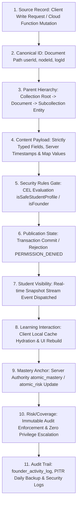

# Volume E & G — Backend Data Layer, Security & Trust Architecture

**Current acceptance:** working reference; path existence does not certify runtime behavior, production state or passing tests. Historical code excerpts and line ranges require SHA-specific readback before implementation use.

**GitHub source snapshot:** [`docs/rankcrackers_book/14_firestore_collections_and_security_rules_dictionary.md`](https://github.com/rankcrackersofficial-sys/RankCrackers/blob/5161592ddafb42f1ecc8923cc7b7b0309934cc83/docs/rankcrackers_book/14_firestore_collections_and_security_rules_dictionary.md) · source blob `cca35677a9ea68636691c4ec7886d2fe397d4ed7`. This Drive edition contains editorial corrections; it is not a claim that those corrections were committed to GitHub. See `github_source_manifest.json` and the current reconciliation register.


## Part 1 — Firestore Collections, Schema Contracts & Security Rules Exhaustive Dictionary

### Chapter 14 — Firestore Data Architecture, Collection Taxonomy, Field Specifications और Security Rules Governance

---

### Executive Overview & Architectural Philosophy

RankCrackers ecosystem का संपूर्ण बैकएंड डेटा मॉडल Google Cloud Firestore पर आधारित एक **Document-Oriented, Server-Authoritative NoSQL Architecture** है। यह पारंपरिक रिलेशनल डेटाबेस की तरह केवल तालिकाओं और पंक्तियों का संग्रह नहीं है; यह एक अत्यंत संरचित, अत्यधिक सुरक्षित, और सुरक्षा-नियमों (Security Rules) द्वारा दृढ़ता से संरक्षित डेटा ग्रिड है।

RankCrackers डेटा लेयर के मूल संवैधानिक नियम (Core Constitutional Invariants):
1. **Server Authority over Educational Truth:** छात्र का शैक्षणिक प्रदर्शन (Atomic Mastery Scores, Decay Risk, Syllabus Coverage) क्लाइंट डिवाइस द्वारा सीधे नहीं लिखा जा सकता। यह विशेष रूप से क्लाउड फ़ंक्शन्स और सर्वर-साइड इंजनों द्वारा गणना और अद्यतन किया जाता है।
2. **Strict Principle of Least Privilege:** प्रत्येक कलेक्शन और सब-कलेक्शन के लिए `read`, `create`, `update`, और `delete` अनुमतियां न्यूनतम आवश्यक स्तर पर सीमित हैं।
3. **Immutable Audit Trails:** ऑडिट और फोरेंसिक से संबंधित सभी संग्रह (जैसे `founder_activity_log`, `canonical_source_audit`, `lineage_registry`) में क्लाइंट-साइड से सीधे लिखने की अनुमति पूर्णतः शून्य (`allow write: if false`) है। वे केवल Firebase Admin SDK के माध्यम से परिशिष्ट-मात्र (append-only) मोड में लिखे जा सकते हैं।
4. **Governed Publication Contracts:** डिजिटल लाइब्रेरी (`digibook_refinery`) और क्वेश्चन बैंक (`question_bank`) से छात्र केवल उन दस्तावेज़ों को पढ़ सकते हैं जो कड़े प्रकाशन अनुबंध (`isGovernedStudentReadable`) को संतुष्ट करते हैं—अर्थात जो सत्यापित हैं, गैर-सिंथेटिक हैं, और स्रोत-अनुमोदित हैं।
5. **Separation of Operational Realms:** डेटाबेस को 7 विशिष्ट कार्यात्मक डोमेन (Functional Realms) में विभाजित किया गया है: Identity Realm, Academic Content Realm, Assessment Realm, Mission Realm, Ingestion & Worker Realm, Intelligence Realm, और Forensic Audit Realm।

---

### Section 1 — Data Architecture Overview & Realm Topology

नीचे दिए गए आरेख में RankCrackers Firestore Database के 7 प्रमुख कार्यात्मक क्षेत्रों और उनके अंतर-संबंधों को दर्शाया गया है:

```mermaid
graph TD
    subgraph IdentityRealm[1. Identity & Student Personal Realm]
        Users[users / userId]
        Users --> Prog[/progress - Node Traversal/]
        Users --> Mast[/atomic_mastery - Server Authority/]
        Users --> Cov[/atomic_coverage - Measured Scope/]
        Users --> Risk[/atomic_risk - Knowledge Decay/]
        Users --> Battle[/battle_priority - Daily Focus/]
        Users --> Rebuild[/rebuild_candidates - Citadel Holds/]
        Users --> Proto[/protocols - 98-Day Ring Modulo/]
        Warrior[warrior_profiles]
    end

    subgraph ContentRealm[2. Academic Content & DigiBook Realm]
        Subjects[study_library_subjects]
        StructNodes[structured_nodes]
        MicroNodes[micro_nodes]
        Atoms[syllabus_atoms]
        DigiRef[digibook_refinery]
        DigiRev[digibook_revisions]
        DigiPoint[digibook_pointers]
        Payloads[content_payloads]
    end

    subgraph AssessmentRealm[3. Question Bank & Assessment Realm]
        QBank[question_bank]
        PubQ[published_questions]
        SolVer[solution_verifications - SHA-256 Hashes]
        MicroAtt[micro_attempts - Daily Chamber 1-12]
        MacroAtt[macro_attempts - Citadel Day 14]
        TestArena[test_arena_papers & attempts]
    end

    subgraph MissionRealm[4. Mission & Recruitment Realm]
        MRealms[mission_realms - System Infrastructure]
        Recruits[recruitments - Official Vacancies]
        SCatalog[student_mission_catalog - Published Catalog]
        Blueprints[blueprints - Exam Blueprints]
    end

    subgraph IngestionRealm[5. Ingestion Refinery & AI Workers Realm]
        IngestRef[ingestion_refinery - Raw Document Pipelines]
        Workers[worker_registry - Scout & Parser Battalions]
        AIQueue[ai_queue & factory_impact_queue]
        Budget[system_budget - Token Consumption Limits]
        DLQ[ai_failed_tasks - Dead Letter Queue]
    end

    subgraph SentinelRealm[6. Intelligence Scouting Realm]
        Drafts[sentinel_drafts - Scouting Discoveries]
        Downloads[scout_downloads]
        OppUpdates[opportunity_updates]
    end

    subgraph AuditRealm[7. Forensic Governance & Trust Realm]
        FLog[founder_activity_log - Immutable System Log]
        SourceAudit[canonical_source_audit & events]
        ByteArtifacts[official_byte_artifacts & byte_artifacts]
        Lineage[lineage_registry & transformation_lineage]
        Telemetry[telemetry_nexus - Client Route Pings]
        Metrics[system_metrics - Content Summary Counters]
    end

    Users -. Reads Catalog .-> SCatalog
    Users -. Reads Content .-> DigiRef
    Users -. Submits Assessment .-> MicroAtt
    MicroAtt -. Evaluated by Cloud Function .-> Mast
    IngestRef -. Generates Drafts .-> Drafts
    Drafts -. Verified by Human Review .-> ContentRealm
    FLog -. Audits Everything .-> AuditRealm
```



### Subsection 1.2 — Database Access States & Security Rules Evaluation Matrix

फ़ायरस्टोर डेटा लेयर में प्रत्येक नेटवर्क अनुरोध और म्यूटेशन का मूल्यांकन सख्त सुरक्षा अवस्था मशीन (Security State Machine) के तहत किया जाता है:

| एक्सेस स्थिति (Access State) | ट्रिगर स्थिति (Trigger Condition) | सुरक्षा मूल्यांकन प्रक्रिया (Evaluation Flow) | क्लाइंट / कॉलर परिणाम (Resulting Action) | सुरक्षा गारंटी (Security Guarantee) |
| :--- | :--- | :--- | :--- | :--- |
| **1. Authorized Authenticated** | `request.auth.uid == userId` तथा लीस्ट प्रिविलेज कुंजियाँ | CEL नियम `true` लौटाते हैं | तात्कालिक म्यूटेशन कमिट; रीयल-टाइम स्नैपशॉट ब्रॉडकास्ट | छात्र केवल अपने निजी दस्तावेज़ लिख/पढ़ सकता है। |
| **2. Privilege Escalation Attempt**| पेलोड में `role`, `admin`, `founder`, `accessLevel` शामिल | CEL नियम प्रतिबंधित कुंजी पाते ही `false` करते हैं | `PERMISSION_DENIED` अपवाद; ऑपरेशन निरस्त | क्लाइंट-साइड से कोई विशेषाधिकार वृद्धि संभव नहीं। |
| **3. Private Mastery Mutation** | छात्र क्लाइंट द्वारा `/atomic_mastery` पर सीधे राइट | सब-कलेक्शन नियम में `allow write: if false` | `PERMISSION_DENIED` एरर; डेटाबेस अपरिवर्तित | The Non-Interference Law: मास्टरी केवल सर्वर द्वारा अद्यतन होती है। |
| **4. Offline Cache Persistence** | क्लाइंट नेटवर्क डिस्कनेक्ट लेकिन लोकल कैश उपलब्ध | स्थानीय SQLite/IndexedDB शेल्फ़ से रेंडर | ऑफ़लाइन रीडिंग मोड सक्रिय; राइट्स लोकल कतार में | ऑफ़लाइन से सर्वर पर पुनः कनेक्ट होने पर नियमों का पुनः मूल्यांकन। |
| **5. Governed Content Read** | छात्र द्वारा अनपब्लिश्ड ड्राफ्ट पढ़ने का प्रयास | `isGovernedStudentReadable` नियम `status != 'published'` पाता है | ड्राफ्ट नोड्स छात्रों के लिए अदृश्य (`status == unmapped`) | छात्र केवल 100% सत्यापित पाठ्य सामग्री पढ़ सकते हैं। |
| **6. Founder Sovereign Bypass** | `isFounder()` नियम सत्य (UID अथवा कस्टम क्लेम) | एडमिन / फाउंडर सत्यापन पास | पूर्ण प्लेटफ़ॉर्म ओवरसाइट व सुलह नियंत्रण | प्रत्येक संस्थापक म्यूटेशन `founder_activity_log` में अनिवार्य रूप से दर्ज। |
| **7. Quota / Transport Exceeded** | नेटवर्क ड्रॉप या फ़ायरस्टोर RPC टाइमआउट | 4-सेकंड क्लाइंट टाइमआउट सक्रिय | सुरक्षित फ़ॉलबैक डायलॉग या स्नैकबार | सिस्टम क्रैश होने के बजाय फ़ेल-क्लोज़्ड रहता है। |

### Subsection 1.3 — The 15 Core Attributes of Firestore Collections & Security Rules System

Chief Author Mandate के तहत Firestore Collections & Security Rules सिस्टम के 15 मूलभूत सिस्टम पैरामीटर्स का विनिर्देश:

| # | कोर विशेषता (Core Attribute) | कैनोनिकल विनिर्देश (Canonical Specification) | प्रामाणिक स्रोत फ़ाइल व संदर्भ (Source Evidence) |
| :--- | :--- | :--- | :--- |
| **1** | **Feature Name** | Firestore Data Architecture & Security Rules Dictionary | `firestore.rules` & `lib/core/firebase/firestore_service.dart` |
| **2** | **Canonical Domain ID** | `firestore_security_dictionary_v1` | `firestore.rules:1–688` |
| **3** | **Parent Hierarchy** | `Google Cloud Platform -> Firestore Database -> Collections -> Documents -> Subcollections` | `14_firestore_collections_and_security_rules_dictionary.md:26–97` |
| **4** | **Presentation / Service Point** | `FirestoreService` (`lib/core/firebase/firestore_service.dart`) | `lib/core/firebase/firestore_service.dart:1–800` |
| **5** | **State Management Engine**| Reactive Stream Providers (`StreamProvider`, `StreamBuilder`) | `lib/core/backend/crucible_repository.dart:801–828` |
| **6** | **Backend Topology & Storage** | 7 Functional Realms (Identity, Content, Assessment, Mission, Ingestion, Intel, Audit) | `14_firestore_collections_and_security_rules_dictionary.md:26–97` |
| **7** | **Offline Strategy & Caching**| Firestore Persistence Enabled + Local DB Shelf fallback | `lib/features/syllabus/data/local_syllabus_database.dart` |
| **8** | **Authority Boundary** | Common Expression Language (CEL) Security Rules evaluated on Google Cloud servers | `firestore.rules:411–494` |
| **9** | **Write Merge Semantics** | Profile updates use `SetOptions(merge: true)` to preserve unwritten fields | `lib/core/firebase/firestore_service.dart:742–750` |
| **10**| **Verification & Gate System** | Strict Function Firewalls: `isSafeStudentProfileCreate`, `isSafeStudentProfileUpdate`, `isGovernedStudentReadable` | `firestore.rules:440–494` |
| **11**| **Student Visibility Gate** | Unmapped and draft contents strictly fail-closed; student cannot read unverified drafts | `firestore.rules:220–250` |
| **12**| **Non-Interference Law** | Student mastery and decay scores are 100% immutable from client (`allow write: if false`) | `firestore.rules:420–435` |
| **13**| **Security & Anti-Cheat Rules**| Forbidden Key List: `['role', 'founder', 'admin', 'accessLevel', 'authorityKey']` rejected | `firestore.rules:475–494` |
| **14**| **Test Coverage & Suites** | Security rules emulator test suite (`functions/test_firestore_rules.js`) | `functions/test_firestore_rules.js:1–200` |
| **15**| **Failure Mode & Audit Policy**| Append-only `founder_activity_log` for all administrative actions; PITR daily backups | `functions/services/audit_service.js:8–18` |

---

### Section 2 — Identity & User Realm (`users` & Subcollections)

#### Subsection 2.1 — Root Document: `users/{userId}`

**Primary Purpose:** प्रत्येक छात्र की प्रामाणिक प्रोफ़ाइल, संपर्क जानकारी, चयनित परीक्षा मिशन और विधिक सहमति को संग्रहीत करना।

##### Field Specifications:
| Field Name | Data Type | Nullable | Description & Constraints | Authority |
| :--- | :--- | :--- | :--- | :--- |
| `name` | `String` | No | छात्र का पूरा नाम (Title Case)। | Client / User |
| `email` | `String` | Yes | Firebase Auth से प्राप्त ईमेल पता। | System / User |
| `mobile` | `String` | No | 10-अंकीय मानकीकृत भारतीय मोबाइल नंबर। | Client (Normalized) |
| `state` | `String` | No | भारत का राज्य या केंद्र शासित प्रदेश (`IndiaStates`)। | Client / User |
| `stateCode` | `String` | No | आधिकारिक 2-अंकीय पोस्टल कोड (जैसे `'RJ'`, `'UP'`)। | Client / Derived |
| `stateName` | `String` | Yes | `state` फ़ील्ड का बैकवर्ड-कम्पैटिबल उपनाम। | Client / Derived |
| `city` | `String` | Yes | छात्र का गृह नगर। | Client / Optional |
| `photoUrl` | `String` | Yes | प्रोफ़ाइल चित्र का यूआरएल (Google Auth या Firebase Storage)। | System / User |
| `status` | `String` | No | खाते की स्थिति: `'active'` अथवा `'deactivated'`। | Client (Reinstated) / Admin |
| `onboardingCompleted` | `Boolean` | No | क्या छात्र ने प्रोफ़ाइल सेटअप पूरा कर लिया है (`true`)। | Client / Validated |
| `selectedExamId` | `String` | Yes | सक्रिय रूप से चयनित कैनोनिकल मिशन आईडी (जैसे `'upsc_cse_prelims'`)। | Client / Validated |
| `selectedExamName` | `String` | Yes | चयनित मिशन का आधिकारिक शीर्षक। | System / Catalog |
| `selectedBoardId` | `String` | Yes | परीक्षा आयोजित करने वाले बोर्ड की आईडी (जैसे `'UPSC'`, `'RPSC'`)। | System / Catalog |
| `selectedRecruitmentId`| `String` | Yes | भर्ती अभियान का विशिष्ट पहचानकर्ता। | System / Catalog |
| `selectedVariantId` | `String` | Yes | परीक्षा का संस्करण (जैसे `'2026'`, `'PRELIMS'`)। | System / Catalog |
| `selectedBlueprintId` | `String` | Yes | संबंधित परीक्षा ब्लूप्रिंट की आईडी। | System / Catalog |
| `consent` | `Map` | No | सख्त नेस्टेड विधिक सहमति अनुबंध (Strict Nested Consent)। | Client / Mandatory |
| `consent.termsAccepted`| `Boolean`| No | नियम और शर्तों की स्वीकृति (`true` होना अनिवार्य)। | Client / Mandatory |
| `consent.termsVersion` | `String` | No | स्वीकृत किए गए नियमों का संस्करण (जैसे `'1.0.0'`)। | Client / Fixed |
| `consent.acceptedAt` | `Timestamp`| No | सहमति का सर्वर टाइमस्टैम्प। | Server Timestamp |
| `updatedAt` | `Timestamp`| No | अंतिम प्रोफ़ाइल अद्यतन का समय। | Server Timestamp |
| `createdAt` | `Timestamp`| Yes | खाता निर्माण का समय। | Server Timestamp |

##### Security Rules (`firestore.rules`, Lines 411–415, 463–494):
```javascript
match /users/{userId} {
  allow read: if isFounder() || (request.auth != null && request.auth.uid == userId);
  allow create: if isFounder() || isSafeStudentProfileCreate(userId);
  allow update: if isFounder() || isSafeStudentProfileUpdate(userId);
}
```
- **Read Rule:** केवल वही छात्र अपना दस्तावेज़ पढ़ सकता है जिसकी `uid == userId` हो, या अधिकृत संस्थापक पढ़ सकता है।
- **Create/Update Rules:** `isSafeStudentProfileCreate` और `isSafeStudentProfileUpdate` यह सुनिश्चित करते हैं कि छात्र कभी भी विशेषाधिकार प्राप्त कुंजियों (`role`, `accessLevel`, `founder`, `admin`, `authorityKey`) को संशोधित न कर सके।

---

#### Subsection 2.2 — Subcollection: `users/{userId}/progress/{nodeId}`

**Primary Purpose:** पाठ्यक्रम ट्री में छात्र की व्यक्तिगत सीखने की स्थिति, नोड विज़िट्स और पूर्णता को ट्रैक करना।

##### Field Specifications:
| Field Name | Data Type | Description |
| :--- | :--- | :--- |
| `nodeId` | `String` | पाठ्यक्रम नोड का कैनोनिकल पहचानकर्ता। |
| `completed` | `Boolean` | क्या छात्र ने इस नोड का अध्ययन पूर्ण कर लिया है। |
| `lastVisitedAt` | `Timestamp` | नोड को अंतिम बार खोले जाने का समय। |
| `timeSpentSeconds` | `Integer` | इस नोड पर बिताया गया कुल समय (सेकंड में)। |
| `confidenceRating`| `Double` | छात्र द्वारा स्वयं-रेट किया गया आत्मविश्वास ($0.0 - 1.0$)। |

##### Security Rule:
```javascript
match /progress/{nodeId} {
  allow read, write: if request.auth != null && request.auth.uid == userId;
}
```
छात्र को अपने स्वयं के प्रगति दस्तावेज़ों को पढ़ने और लिखने का पूर्ण अधिकार है।

---

#### Subsection 2.3 — Subcollection: `users/{userId}/atomic_mastery/{atomicId}`

**Primary Purpose:** Knowledge Engine द्वारा गणना किया गया छात्र का वैज्ञानिक मास्टरी स्कोर।

##### Field Specifications:
| Field Name | Data Type | Description |
| :--- | :--- | :--- |
| `atomicId` | `String` | पाठ्यक्रम के लीफ़ एटम (Leaf Atom) का विशिष्ट आईडी। |
| `masteryScore` | `Double` | मास्टरी स्कोर ($0.00$ से $1.00$ तक)। $\ge 0.85$ Mastered, $< 0.50$ Weak। |
| `attemptsCount` | `Integer` | इस एटम पर हल किए गए कुल प्रश्नों की संख्या। |
| `correctCount` | `Integer` | सही उत्तरों की संख्या। |
| `accuracy` | `Double` | ऐतिहासिक सटीकता ($\text{correctCount} / \text{attemptsCount}$)। |
| `lastEvaluatedAt`| `Timestamp` | मास्टरी स्कोर के अंतिम पुनर्गणना का समय। |
| `evidenceHash` | `String` | स्कोर की पुष्टि करने वाला मूल्यांकन हैश (SHA-256)। |

##### Security Rule (Constitutional Law of Server Authority):
```javascript
match /atomic_mastery/{atomicId} {
  allow read: if request.auth != null && request.auth.uid == userId;
  allow write: if isFounder();
}
```
> [!IMPORTANT]
> **Strict Read-Only for Students:** छात्र अपनी एटॉमिक मास्टरी को केवल **पढ़** सकता है। क्लाइंट-साइड से इसे लिखने का प्रयास Firestore Security Rules द्वारा सीधे अस्वीकार (`PERMISSION_DENIED`) कर दिया जाता है। स्कोर केवल क्लाउड फ़ंक्शन्स (Admin SDK) द्वारा ही लिखे जा सकते हैं।

---

#### Subsection 2.4 — Subcollection: `users/{userId}/atomic_coverage/{atomicId}`

**Primary Purpose:** पाठ्यक्रम कवरेज की स्थिति को ट्रैक करना।

##### Field Specifications:
- `atomicId`: एटम पहचानकर्ता।
- `coverageState`: कवरेज स्थिति: `'NOT_STARTED'`, `'IN_PROGRESS'`, `'COVERED'`।
- `depth`: अध्ययन की गहराई स्तर ($1$ से $3$ तक)।
- `coveredAt`: प्रथम बार पूर्ण होने का समय।

##### Security Rule:
```javascript
match /atomic_coverage/{atomicId} {
  allow read: if request.auth != null && request.auth.uid == userId;
  allow write: if isFounder();
}
```

---

#### Subsection 2.5 — Subcollection: `users/{userId}/atomic_risk/{atomicId}`

**Primary Purpose:** ज्ञान के क्षय (Knowledge Decay) और भूलने की संभावना (Ebbinghaus Forgetting Curve) का गणितीय मूल्यांकन।

##### Field Specifications:
- `atomicId`: एटम पहचानकर्ता।
- `decayScore`: क्षय गुणांक ($0.00$ कोई क्षय नहीं, $1.00$ पूर्ण क्षय)।
- `lastInteractedDaysAgo`: अंतिम बार अभ्यास किए जाने के बाद से बीते दिन।
- `rebuildUrgency`: पुनर्निर्माण तात्कालिकता: `'LOW'`, `'MEDIUM'`, `'HIGH'`, `'CRITICAL'`।
- `scheduledRebuildDate`: Crucible Day 13 Rebuild Chamber के लिए प्रस्तावित तिथि।

##### Security Rule:
```javascript
match /atomic_risk/{atomicId} {
  allow read: if request.auth != null && request.auth.uid == userId;
  allow write: if isFounder();
}
```

---

#### Subsection 2.6 — Subcollection: `users/{userId}/battle_priority/{atomicId}`

**Primary Purpose:** Battle Engine द्वारा छात्र के दैनिक डैशबोर्ड ("Today's Focus") के लिए प्राथमिकताओं का क्रम।

##### Field Specifications:
- `atomicId`: एटम पहचानकर्ता।
- `priorityRank`: पूर्णांक रैंक ($1, 2, 3 \dots$)।
- `weight`: समग्र प्राथमिकता भार (सटीकता, परीक्षा में महत्व, और क्षय का संयुक्त फलन)।
- `reason`: प्राथमिकता का कारण (जैसे `'HIGH_EXAM_WEIGHT_AND_WEAK_ACCURACY'`)।

##### Security Rule:
```javascript
match /battle_priority/{atomicId} {
  allow read: if request.auth != null && request.auth.uid == userId;
  allow write: if isFounder();
}
```

---

#### Subsection 2.7 — Subcollection: `users/{userId}/rebuild_candidates/{atomicId}`

**Primary Purpose:** Crucible Day 13 Sacred Rebuild Chamber के लिए चिह्नित कमजोर विषय।

##### Field Specifications:
- `atomicId`: एटम पहचानकर्ता।
- `accuracySnapshot`: असफलता के समय सटीकता दर।
- `microAttemptId`: जिस टेस्ट में विफलता हुई उसका संदर्भ।
- `status`: स्थिति: `'PENDING_REBUILD'`, `'REBUILT'`, `'FAILED_AGAIN'`।

##### Security Rule:
```javascript
match /rebuild_candidates/{atomicId} {
  allow read: if request.auth != null && request.auth.uid == userId;
  allow write: if isFounder();
}
```

---

#### Subsection 2.8 — Subcollection: `users/{userId}/protocols/{recruitmentId}`

**Primary Purpose:** Crucible 98-Day Continuous Schedule Modulo Ring की छात्र-विशिष्ट प्रगति स्थिति।

##### Field Specifications:
| Field Name | Data Type | Description |
| :--- | :--- | :--- |
| `recruitmentId` | `String` | परीक्षा मिशन पहचानकर्ता। |
| `currentCycle` | `Integer` | वर्तमान 14-दिवसीय चक्र संख्या ($1$ से $7$ तक)। |
| `currentCycleDay`| `Integer` | चक्र का वर्तमान दिन ($1$ से $14$ तक)। |
| `ringBatch` | `String` | 98-दिवसीय रिंग में सक्रिय बैच (जैसे `'B1'`, `'B2' \dots 'B7'`)। |
| `schedulesDone` | `Integer` | पूर्ण किए गए 2-दिवसीय अध्ययन कार्यपत्रकों की संख्या। |
| `modulesStudied` | `Integer` | अध्ययन किए गए कुल जनरेशन यूनिट्स (GU)। |
| `backlogScope` | `Integer` | विलंबित छात्रों के लिए छूटा हुआ अध्ययन दायरा। |
| `lastActiveDate` | `String` | अंतिम सक्रियता की तिथि (`YYYY-MM-DD`)। |

##### Security Rule:
```javascript
match /protocols/{recruitmentId} {
  allow read, write: if request.auth != null && request.auth.uid == userId;
}
```

---

#### Subsection 2.9 — Subcollection: `users/{userId}/notifications/{notificationId}`

**Primary Purpose:** छात्र के व्यक्तिगत इन-ऐप अलर्ट, परीक्षा सूचनाएं, और सिस्टम संदेश।

##### Field Specifications:
- `id`: अधिसूचना विशिष्ट पहचानकर्ता।
- `title`: शीर्षक।
- `body`: मुख्य संदेश।
- `type`: प्रकार (`'EXAM_ALERT'`, `'CRUCIBLE_REMINDER'`, `'SYSTEM_UPDATE'`)।
- `isRead`: क्या छात्र ने पढ़ लिया है (`Boolean`)।
- `createdAt`: प्रेषण समय।

##### Security Rule:
```javascript
match /notifications/{notificationId} {
  allow read, write: if request.auth != null && request.auth.uid == userId;
}
```

---

#### Subsection 2.10 — Subcollection: `users/{userId}/mission_stats/{realmId}`

**Primary Purpose:** किसी विशिष्ट परीक्षा क्षेत्र में छात्र के कुल युद्ध, जीत दर, और सक्रियता के एकत्रित आंकड़े।

##### Field Specifications:
- `realmId`: परीक्षा क्षेत्र आईडी।
- `totalBattles`: हल किए गए टेस्ट सेशंस की कुल संख्या।
- `totalQuestionsAttempted`: कुल प्रश्न।
- `streakDays`: लगातार अध्ययन के दिन।
- `overallReadiness`: समग्र परीक्षा तत्परता प्रतिशत ($0.0 - 100.0\%$)।

##### Security Rule:
```javascript
match /mission_stats/{realmId} {
  allow read, write: if request.auth != null && request.auth.uid == userId;
}
```

---

### Section 3 — Academic Content & DigiBook Publishing Realm

#### Subsection 3.1 — Collection: `digibook_refinery/{lessonId}`

**Primary Purpose:** DigiBook डिजिटल पाठों का आधिकारिक और अपरिवर्तनीय स्रोत।

##### Field Specifications:
| Field Name | Data Type | Description & Governance Invariants |
| :--- | :--- | :--- |
| `id` | `String` | पाठ पहचानकर्ता (Lesson ID / Generation Unit ID)। |
| `canonicalAtomId` | `String` | संबद्ध एटम का कैनोनिकल आईडी। |
| `canonicalMissionId` | `String` | संबंधित परीक्षा मिशन आईडी। |
| `title` | `String` | पाठ का शीर्षक। |
| `status` | `String` | स्थिति: `'draft'`, `'review'`, `'published'`, `'archived'`। |
| `studentVisibilityAuthorized`| `Boolean`| क्या छात्रों को पढ़ने की अनुमति है (`true` आवश्यक)। |
| `sourceApproved` | `Boolean` | क्या अधिकृत शिक्षक/संपादक ने अनुमोदन दिया है (`true` आवश्यक)। |
| `verificationStatus` | `String` | सत्यापन स्थिति: अनिवार्य रूप से `'VERIFIED'`। |
| `approvedSourceId` | `String` | मूल आधिकारिक स्रोत या संदर्भ पुस्तक का आईडी। |
| `verificationId` | `String` | मानव समीक्षक का अद्वितीय सत्यापन टोकन। |
| `contentRegistryId` | `String` | केंद्रीय सामग्री रजिस्ट्री पहचानकर्ता। |
| `isSynthetic` | `Boolean` | क्या सामग्री विशुद्ध एआई-जनरेटेड और असत्यापित है (`false` आवश्यक)। |
| `isStructuralHold` | `Boolean` | क्या संरचनात्मक विसंगति के कारण पाठ रोका गया है (`false` आवश्यक)। |
| `isStale` | `Boolean` | क्या पाठ्यक्रम संशोधन के बाद पाठ पुराना हो चुका है (`false` आवश्यक)। |
| `blocks` | `Array<Map>` | पाठ के संरचित सामग्री ब्लॉक (टेक्स्ट, टेबल, आरेख, फॉर्मूला)। |
| `atomicFacts` | `Array<String>`| पाठ में शामिल सत्यापित मुख्य तथ्य। |
| `updatedAt` | `Timestamp` | अंतिम प्रकाशन समय। |

##### Security Rule & Constitutional Helper (`firestore.rules`, Lines 13–29):
```javascript
function isGovernedStudentReadable(data) {
  return request.auth != null &&
         data != null &&
         data.status == 'published' &&
         data.studentVisibilityAuthorized == true &&
         (!('isSynthetic' in data) || data.isSynthetic == false) &&
         (!('isStructuralHold' in data) || data.isStructuralHold == false) &&
         (!('isStale' in data) || data.isStale == false) &&
         data.sourceApproved == true &&
         data.verificationStatus == 'VERIFIED' &&
         ('canonicalAtomId' in data) && data.canonicalAtomId is string && data.canonicalAtomId.size() > 0 &&
         ('canonicalMissionId' in data) && data.canonicalMissionId is string && data.canonicalMissionId.size() > 0 &&
         ('approvedSourceId' in data) && data.approvedSourceId is string && data.approvedSourceId.size() > 0 &&
         ('verificationId' in data) && data.verificationId is string && data.verificationId.size() > 0 &&
         ('contentRegistryId' in data) && data.contentRegistryId is string && data.contentRegistryId.size() > 0 &&
         (!('description' in data) || data.description != "Materialized via RELIABILITY FF01 progressive publication.");
}

match /digibook_refinery/{lessonId} {
  allow read: if isFounder() || isGovernedStudentReadable(resource.data);
  allow write: if isFounder();
}
```
> [!IMPORTANT]
> **The Governed Publication Contract:** छात्र केवल उन डिजिटल पाठों को पढ़ सकते हैं जो 14 कड़े तार्किक परीक्षणों को एक साथ उत्तीर्ण करते हैं। यदि कोई पाठ ड्राफ्ट है, सिंथेटिक है, या किसी समीक्षक के आईडी से रहित है, तो Firestore Security Rules स्तर पर छात्र का `read` ऑपरेशन स्वतः अस्वीकार हो जाता है।

---

#### Subsection 3.2 — Collections: `study_library_subjects` & `materials`

- `study_library_subjects/{subjectId}`: व्यापक अध्ययन विषयों (जैसे इतिहास, भौतिकी, सामान्य ज्ञान) का कंटेनर।
- `study_library_subjects/{subjectId}/materials/{materialId}`: विषय-विशिष्ट संदर्भ सामग्री और ई-बुक्स।

##### Security Rule:
```javascript
match /study_library_subjects/{subjectId} {
  allow read, write: if isFounder();
  match /materials/{materialId} {
    allow read, write: if isFounder();
  }
}
```

---

#### Subsection 3.3 — Collections: `structured_nodes`, `micro_nodes`, `syllabus_atoms`

**Primary Purpose:** official syllabus authority तथा variable-depth derived decomposition (`Subject -> Unit -> Topic -> MicroTopic -> AtomicTopic`, जहाँ लागू हो) का डेटा प्रतिनिधित्व। हर lower node की provenance, nearest official ancestor और verification state अलग से नियंत्रित होनी चाहिए।
- `structured_nodes/{nodeId}`: मुख्य विषय और यूनिट नोड्स।
- `micro_nodes/{microId}`: टॉपिक स्तर के नोड्स।
- `syllabus_atoms/{atomId}`: ज्ञान के अविभाज्य एटॉमिक फैक्ट्स (Atomic Facts) का आधिकारिक संकलन।

##### Security Rule:
```javascript
match /structured_nodes/{nodeId} {
  allow read: if request.auth != null;
  allow write: if isFounder();
}
match /micro_nodes/{microId} {
  allow read: if request.auth != null;
  allow write: if isFounder();
}
match /syllabus_atoms/{atomId} {
  allow read: if request.auth != null;
  allow write: if isFounder();
}
```
प्रमाणीकृत छात्रों को पढ़ने की अनुमति है; लिखने का अधिकार केवल संस्थापकों और बैकएंड रिफाइनरी के पास है।

---

### Section 4 — Question Bank, PYQ & Assessment Realm

#### Subsection 4.1 — Collection: `question_bank/{questionId}`

**Primary Purpose:** अभ्यास और मॉक परीक्षाओं के लिए आधिकारिक प्रश्न बैंक।

##### Field Specifications:
| Field Name | Data Type | Description |
| :--- | :--- | :--- |
| `id` | `String` | प्रश्न विशिष्ट पहचानकर्ता। |
| `canonicalAtomId` | `String` | संबद्ध एटम का कैनोनिकल आईडी। |
| `text` | `String` | प्रश्न का मुख्य पाठ (Markdown/LaTeX समर्थित)। |
| `options` | `Array<String>`| 4 या 5 बहुविकल्पीय विकल्प। |
| `correctOptionIndex`| `Integer` | सही उत्तर का सूचकांक ($0, 1, 2, 3$)। |
| `explanation` | `String` | विस्तृत शैक्षणिक व्याख्या और चरणबद्ध हल। |
| `difficulty` | `String` | कठिनाई स्तर: `'EASY'`, `'MEDIUM'`, `'HARD'`, `'CITADEL_TIER'`। |
| `examBoard` | `String` | परीक्षा बोर्ड (जैसे `'UPSC'`, `'SSC'`, `'RPSC'`)। |
| `pyqYear` | `Integer` | यदि विगत वर्षों का प्रश्न है, तो वर्ष (जैसे `2024`)। |
| `status` | `String` | स्थिति: `'draft'`, `'reviewed'`, `'published'`। |
| `sha256Hash` | `String` | प्रश्न और समाधान का क्रिप्टोग्राफ़िक सत्यता हैश। |
| `verifiedBy` | `String` | समीक्षक का पहचानकर्ता (मानव सत्यापन अनिवार्य)। |

##### Security Rule:
```javascript
match /question_bank/{questionId} {
  allow read: if isFounder() || (request.auth != null && resource.data.status == 'published');
  allow write: if isFounder();
}
```

---

#### Subsection 4.2 — Collection: `solution_verifications/{verificationId}`

**Primary Purpose:** प्रश्नों के हल और उत्तर कुंजी की क्रिप्टोग्राफ़िक अखंडता (Cryptographic Integrity)।

##### Field Specifications:
- `verificationId`: विशिष्ट सत्यापन आईडी।
- `questionId`: संबद्ध प्रश्न आईडी।
- `actualSha256`: प्रश्न पाठ, विकल्पों और सही उत्तर का संयुक्त SHA-256 हैश।
- `humanAuthorityId`: उत्तर की पुष्टि करने वाले शिक्षक/संपादक की यूआईडी।
- `verificationTimestamp`: सत्यापन का समय।

##### Security Rule:
```javascript
match /solution_verifications/{verificationId} {
  allow read: if request.auth != null;
  allow write: if isFounder();
}
```

---

#### Subsection 4.3 — Collections: `micro_attempts` & `macro_attempts`

**Primary Purpose:** Crucible मूल्यांकन सत्रों में छात्रों द्वारा दिए गए वास्तविक उत्तरों का अपरिवर्तनीय रिकॉर्ड।

##### Field Specifications:
| Field Name | Data Type | Description |
| :--- | :--- | :--- |
| `id` | `String` | प्रयास सत्र पहचानकर्ता। |
| `userId` | `String` | छात्र की यूआईडी। |
| `recruitmentId` | `String` | परीक्षा मिशन। |
| `cycle` | `Integer` | 14-दिवसीय चक्र संख्या। |
| `day` | `Integer` | चक्र का दिन (Day 1-12 Micro, Day 14 Macro)। |
| `answers` | `Map<String, Int>`| प्रश्न आईडी और छात्र द्वारा चुने गए विकल्प सूचकांक का मैप। |
| `score` | `Double` | प्राप्त अंक। |
| `accuracy` | `Double` | सत्र सटीकता प्रतिशत। |
| `timeSpentSeconds`| `Integer` | टेस्ट पूरा करने में लगा समय। |
| `submittedAt` | `Timestamp` | सबमिशन का समय। |
| `evaluated` | `Boolean` | क्या क्लाउड फ़ंक्शन द्वारा मूल्यांकन पूर्ण हो चुका है (`true`)। |

##### Security Rule:
```javascript
match /micro_attempts/{attemptId} {
  allow read: if isFounder() || (request.auth != null && resource.data.userId == request.auth.uid);
  allow create: if request.auth != null && request.resource.data.userId == request.auth.uid;
  allow update, delete: if isFounder(); // Attempts cannot be altered by student post-creation
}
```

---

### Section 5 — Mission Architecture & Recruitment Realm

#### Subsection 5.1 — Collection: `mission_realms/{realmId}`

**Primary Purpose:** सिस्टम-स्तरीय परीक्षा ब्लूप्रिंट्स, विषय भार, और संरचनात्मक स्कीमा।

##### Field Specifications:
- `id`: क्षेत्र पहचानकर्ता (जैसे `'jee_main'`, `'upsc_cse_prelims'`)।
- `name`: आधिकारिक नाम।
- `jurisdiction`: अधिकार क्षेत्र (`'CENTRAL'`, `'STATE'`)।
- `state`: संबंधित राज्य (यदि राज्य-स्तरीय परीक्षा हो)।
- `subjects`: परीक्षा में शामिल विषयों की सूची और प्रत्येक का अंक भार।
- `totalDurationMinutes`: परीक्षा अवधि।
- `negativeMarkingFactor`: नकारात्मक अंकन अनुपात (जैसे `0.33` या `0.25`)।

##### Security Rule:
```javascript
match /mission_realms/{realmId} {
  allow read: if request.auth != null;
  allow write: if isFounder();
}
```

---

#### Subsection 5.2 — Collection: `recruitments/{recruitmentId}`

**Primary Purpose:** आधिकारिक भर्ती अधिसूचनाओं का बहीखाता (रिक्तियां, आवेदन तिथियां, परीक्षा तिथियां)।

##### Field Specifications:
- `id`: भर्ती पहचानकर्ता (जैसे `'rpsc_ras_prelims_2026'`)।
- `examId`: संबद्ध मिशन क्षेत्र आईडी।
- `title`: आधिकारिक भर्ती शीर्षक।
- `boardId`: परीक्षा बोर्ड (जैसे `'RPSC'`, `'NTA'`)।
- `status`: स्थिति: `'draft'`, `'published'`, `'archived'`।
- `notificationDate`: अधिसूचना जारी होने की तिथि।
- `examDate`: प्रस्तावित परीक्षा तिथि।
- `officialPdfUrl`: आधिकारिक विज्ञापन पीडीएफ का सुरक्षित लिंक।

##### Security Rule:
```javascript
match /recruitments/{recruitmentId} {
  allow read: if request.auth != null;
  allow write: if isFounder();
}
```

---

#### Subsection 5.3 — Collection: `student_mission_catalog/{catalogId}`

**Primary Purpose:** छात्र मोबाइल ऐप में `MissionRealmScreen` पर प्रदर्शित होने वाला अंतिम प्रकाशित कैटलॉग।

##### Field Specifications:
- `id`: कैटलॉग पहचानकर्ता।
- `cardVisible`: क्या मिशन कार्ड दृश्यमान होना चाहिए (`Boolean`)।
- `userPanelVisible`: क्या छात्र इसे चुन सकते हैं (`Boolean`)।
- `archived`: क्या यह पुरानी परीक्षा है (`Boolean`)।
- `studentPublicationState`: स्थिति (`'LIVE'`, `'COMING_SOON'`, `'ENROLLMENT_CLOSED'`)।
- `activeStudentCount`: वर्तमान में नामांकित छात्रों की संख्या।

##### Security Rule:
```javascript
match /student_mission_catalog/{catalogId} {
  allow read: if request.auth != null;
  allow write: if isFounder();
}
```

---

### Section 6 — Ingestion Refinery & Autonomous AI Workers Realm

#### Subsection 6.1 — Collection: `ingestion_refinery/{refineryId}`

**Primary Purpose:** असंपादित पीडीएफ और दस्तावेजों के पार्सिंग और शोधन की स्थिति को ट्रैक करना।

##### Field Specifications:
- `id`: शोधन कार्य पहचानकर्ता।
- `documentName`: मूल फ़ाइल नाम।
- `storagePath`: Firebase Storage में फ़ाइल का सुरक्षित पथ (`gs://...`)।
- `sha256`: फ़ाइल का क्रिप्टोग्राफ़िक फिंगरप्रिंट।
- `status`: स्थिति: `'pending'`, `'processing'`, `'completed'`, `'failed'`।
- `extractedNodesCount`: निष्पादित किए गए कुल नोड्स।
- `errorMessage`: विफलता की स्थिति में विस्तृत त्रुटि संदेश।

##### Security Rule:
```javascript
match /ingestion_refinery/{refineryId} {
  allow read, write: if isFounder();
}
```

---

#### Subsection 6.2 — Collection: `worker_registry/{workerId}`

**Primary Purpose:** स्वायत्त एआई स्काउट्स, पार्सर्स, और बैकएंड बॉट्स का शासन और टेलीमेट्री।

##### Field Specifications:
- `id`: वर्कर पहचानकर्ता (जैसे `'sentinel_scout_upsc'`, `'syllabus_parser_worker'`)।
- `name`: वर्कर का नाम।
- `enabled`: क्या वर्कर सक्रिय है (`Boolean`)।
- `mode`: मोड: `'auto'` अथवा `'manual'`।
- `priority`: प्राथमिकता: `'critical'`, `'high'`, `'normal'`, `'low'`।
- `status`: स्थिति: `'ONLINE'`, `'IDLE'`, `'OFFLINE'`, `'DEAD'`।
- `lastHeartbeat`: अंतिम हार्टबीट का सर्वर टाइमस्टैम्प ($\le 60\text{s}$ ऑनलाइन होने के लिए)।
- `monthlyTokenUsage`: चालू माह में उपभोग किए गए एआई टोकन।
- `monthlyTokenLimit`: अधिकतम अनुमत टोकन बजट (डिफ़ॉल्ट `500,000`)।
- `monthlyCost`: अनुमानित लागत (अमेरिकी डॉलर में)।
- `monthlyCostLimit`: अधिकतम लागत सीमा (डिफ़ॉल्ट `$1000.0`)।

##### Security Rule:
```javascript
match /worker_registry/{workerId} {
  allow read, write: if isFounder();
}
```

---

#### Subsection 6.3 — Collection: `system_budget/{monthId}`

**Primary Purpose:** मासिक टोकन बजट और एपीआई उपभोग का वैश्विक बहीखाता (जैसे `system_budget/2026-10`)।

##### Field Specifications:
- `monthId`: माह पहचानकर्ता (`YYYY-MM`)।
- `monthlyTokens`: कुल उपभोग किए गए टोकन।
- `totalCostUsd`: कुल लागत।
- `geminiFlashCalls`: Gemini Flash मॉडल को की गई कॉल्स।
- `geminiProCalls`: Gemini Pro मॉडल को की गई कॉल्स।

##### Security Rule:
```javascript
match /system_budget/{monthId} {
  allow read: if isFounder();
  allow write: if false; // Only via backend Cloud Functions
}
```

---

#### Subsection 6.4 — Collection: `ai_failed_tasks/{taskId}` (Dead Letter Queue)

**Primary Purpose:** तीन प्रयासों के बाद भी विफल रहे एआई कार्यों का फोरेंसिक संग्रह।

##### Field Specifications:
- `taskId`: कार्य पहचानकर्ता।
- `workerId`: संबंधित वर्कर आईडी।
- `payload`: मूल इनपुट डेटा।
- `stackTrace`: पूर्ण स्टैक ट्रेस।
- `failedAt`: विफलता का समय।

##### Security Rule:
```javascript
match /ai_failed_tasks/{taskId} {
  allow read, write: if isFounder();
}
```

---

### Section 7 — Intelligence Scouting Realm (`sentinel_drafts`)

#### Subsection 7.1 — Collection: `sentinel_drafts/{draftId}`

**Primary Purpose:** स्वायत्त स्काउट्स द्वारा विभिन्न सरकारी भर्ती पोर्टलों से खींची गई नई अधिसूचनाओं के ड्राफ्ट्स।

##### Field Specifications:
| Field Name | Data Type | Description |
| :--- | :--- | :--- |
| `id` | `String` | ड्राफ्ट विशिष्ट पहचानकर्ता। |
| `type` | `String` | प्रकार (`'NOTIFICATION'`, `'SYLLABUS_CHANGE'`, `'DATE_EXT'`)। |
| `status` | `String` | संपादकीय स्थिति: `'draft'`, `'under_review'`, `'verified'`, `'published'`, `'rejected'`। |
| `sourceUrl` | `String` | सरकारी पोर्टल का आधिकारिक यूआरएल। |
| `portalName` | `String` | स्रोत पोर्टल (जैसे `'upsc.gov.in'`, `'ssc.gov.in'`)। |
| `rawData` | `Map` | निकाले गए शीर्षक, पद, रिक्तियों और तिथियों का असंपादित मैप। |
| `discoveredAt` | `Timestamp` | स्काउट द्वारा खोजे जाने का समय। |
| `reviewedBy` | `String` | समीक्षक का यूआईडी (यदि समीक्षाधीन हो)। |

##### Security Rule:
```javascript
match /sentinel_drafts/{draftId} {
  allow read, write: if isFounder();
}
```

---

### Section 8 — Forensic Governance, Audit & Trust Realm

#### Subsection 8.1 — Collection: `founder_activity_log/{logId}`

**Primary Purpose:** संस्थापक और एडमिन कंसोल पर निष्पादित प्रत्येक आदेश का अपरिवर्तनीय फोरेंसिक लॉग (Immutable Ledger)।

##### Field Specifications:
| Field Name | Data Type | Description |
| :--- | :--- | :--- |
| `id` | `String` | लॉग प्रविष्टि का अद्वितीय पहचानकर्ता। |
| `actorUid` | `String` | आदेश निष्पादित करने वाले संस्थापक/एडमिन की यूआईडी। |
| `type` | `String` | घटना का प्रकार: `'ACCESS_CHANGE'`, `'SENTINEL_ACTION'`, `'SYSTEM_CONFIG'`, `'PURGE_EXECUTE'`। |
| `impactLevel` | `String` | प्रभाव स्तर: `'INFO'`, `'LOW'`, `'MEDIUM'`, `'HIGH'`, `'CRITICAL'`। |
| `message` | `String` | मानव-पठनीय विवरण (जैसे `'Worker sentinel_scout toggled to OFF'`)। |
| `metadata` | `Map` | विस्तृत पेलोड, पूर्व स्थिति और नई स्थिति। |
| `timestamp` | `Timestamp` | सर्वर टाइमस्टैम्प। |

##### Security Rule (Constitutional Law of Immutability):
```javascript
match /founder_activity_log/{logId} {
  // AUDIT IMMUTABILITY: Immutable Ledger
  allow read: if isFounder();
  allow write: if false; // Writes must originate from Admin SDK / Cloud Functions only
}
```
> [!CAUTION]
> **Zero Client-Side Writing:** किसी भी क्लाइंट को (चाहे वह संस्थापक ही क्यों न हो) सीधे इस संग्रह में लिखने या संशोधित करने की अनुमति नहीं है। सभी लॉग प्रविष्टियां केवल बैकएंड क्लाउड फ़ंक्शन्स द्वारा ही दर्ज की जा सकती हैं, जिससे ऑडिट ट्रेल्स से किसी भी प्रकार की छेड़छाड़ असंभव हो जाती है।

---

#### Subsection 8.2 — Collection: `canonical_source_audit/{auditId}`

**Primary Purpose:** आधिकारिक पाठ्यक्रम दस्तावेजों और अधिसूचनाओं के बाइट-लेवल हैशेज और कानूनी सत्यता का बहीखाता।

##### Security Rule:
```javascript
match /canonical_source_audit/{auditId} {
  allow read: if request.auth != null;
  allow write: if isFounder();
}
```

---

#### Subsection 8.3 — Collection: `telemetry_nexus/{nexusId}`

**Primary Purpose:** छात्रों के सक्रिय सेशंस, खोले गए रूट्स, और एप्लिकेशन स्वास्थ्य के अनाम (Anonymous) पिंग्स।

##### Field Specifications:
- `id`: टेलीमेट्री प्रविष्टि आईडी।
- `eventName`: घटना का नाम (`'student_surface_opened'`, `'route_navigated'`)।
- `userId`: छात्र की यूआईडी (एनॉनिमस विश्लेषण के लिए)।
- `recruitmentId`: सक्रिय परीक्षा मिशन।
- `metadata.surface`: खोला गया रूट (जैसे `'/dashboard'`, `'/crucible'`)।
- `timestamp`: सर्वर टाइमस्टैम्प।

##### Security Rule:
```javascript
match /telemetry_nexus/{nexusId} {
  allow read: if isFounder();
  allow create: if request.auth != null;
  allow update, delete: if false; // Append-only stream
}
```

---

### Section 9 — Exhaustive Security Rules Permission Matrix

नीचे दी गई संदर्भ तालिका में RankCrackers के सभी प्रमुख Firestore संग्रहों के लिए अधिकृत अनुमतियों का पूर्ण विनिर्देश दिया गया है:

| Collection Path | Unauthenticated | Student Role | Reviewer / Admin | Founder | Special Guard Function |
| :--- | :--- | :--- | :--- | :--- | :--- |
| `/users/{uid}` | Denied | Read / Update (Own) | Denied | Full Access | `isSafeStudentProfileUpdate` |
| `/users/{uid}/progress` | Denied | Read / Write (Own) | Denied | Full Access | Owner UID Match |
| `/users/{uid}/atomic_mastery` | Denied | **Read Only (Own)** | Denied | Full Access | Server Authority Law |
| `/users/{uid}/atomic_risk` | Denied | **Read Only (Own)** | Denied | Full Access | Server Authority Law |
| `/users/{uid}/protocols` | Denied | Read / Write (Own) | Denied | Full Access | Owner UID Match |
| `/digibook_refinery/{id}` | Denied | **Read Only (Governed)**| Read / Review | Full Access | `isGovernedStudentReadable` |
| `/question_bank/{id}` | Denied | Read (Published Only)| Read / Review | Full Access | Status == 'published' |
| `/micro_attempts/{id}` | Denied | Create / Read (Own)| Read | Full Access | Append-Only (Student) |
| `/mission_realms/{id}` | Denied | Read Only | Read Only | Full Access | Published Catalogs |
| `/recruitments/{id}` | Denied | Read Only | Read / Write | Full Access | Official Releases |
| `/student_mission_catalog`| Denied | Read Only | Read / Write | Full Access | Published Missions |
| `/ingestion_refinery/{id}`| Denied | Denied | Read / Write | Full Access | Founder Console Only |
| `/worker_registry/{id}` | Denied | Denied | Read Only | Full Access | `isFounder()` |
| `/system_budget/{id}` | Denied | Denied | Read Only | Read Only (Write: CF) | Backend Budget Law |
| `/founder_activity_log` | Denied | Denied | Denied | **Read Only (Write: CF)**| Immutability Law |
| `/telemetry_nexus` | Denied | Create Only (Ping) | Read Only | Read Only | Append-Only Stream |

---

### Section 10 — Composite Indexes, Offline Caching & Maintenance Runbooks

#### Subsection 10.1 — Composite Index Specifications (`firestore.indexes.json`)

उच्च-स्तरीय प्रश्नों और रीयल-टाइम स्ट्रीम्स को बिना देरी के निष्पादित करने के लिए निम्नलिखित संयुक्त सूचकांक (Composite Indexes) आवश्यक हैं:

1. **Telemetry Stream Index:**
   - Collection: `telemetry_nexus`
   - Fields: `eventName` (ASC), `timestamp` (DESC)
2. **Review Queue Discovery Index:**
   - Collection: `sentinel_drafts`
   - Fields: `status` (ASC), `discoveredAt` (DESC)
3. **Active Worker Heartbeat Index:**
   - Collection: `worker_registry`
   - Fields: `enabled` (ASC), `lastHeartbeat` (DESC)
4. **Governed DigiBook Publication Index:**
   - Collection: `digibook_refinery`
   - Fields: `status` (ASC), `studentVisibilityAuthorized` (ASC), `updatedAt` (DESC)
5. **Question Bank PYQ Lookup Index:**
   - Collection: `question_bank`
   - Fields: `examBoard` (ASC), `pyqYear` (DESC), `difficulty` (ASC)

#### Subsection 10.2 — Local-First Offline Caching Rules

Flutter एप्लिकेशन में Firestore कैशिंग रणनीति निम्न सिद्धांतों पर आधारित है:
- **Student Profile Hydration:** प्रोफ़ाइल जांच के समय `Source.server` का उपयोग 3-सेकंड के टाइमआउट के साथ किया जाता है। यदि नेटवर्क अनुपलब्ध है, तो `SessionManager` का लोकल सिंक्रोनस कैश उपयोग में आता है।
- **Static Syllabus & Mission Trees:** पाठ्यक्रम नोड्स को लोकल SQLite / SharedPreferences में लंबे समय तक कैश किया जाता है और केवल तभी अद्यतन किया जाता है जब सर्वर से नया `revisionId` प्राप्त हो।
- **Assessment Submissions:** टेस्ट सबमिशन हमेशा सर्वर-फर्स्ट होते हैं। नेटवर्क विफलता की स्थिति में उत्तर क्लाइंट-साइड कतार में सुरक्षित रूप से रखे जाते हैं और कनेक्शन बहाल होने पर स्वचालित रूप से कमिट किए जाते हैं।

#### Subsection 10.3 — Data Disaster Recovery & Cold-Storage Backup Runbook

1. **दैनिक स्वचालित बैकअप:** Google Cloud Storage के माध्यम से प्रति 24 घंटे में Firestore डेटाबेस का संपूर्ण निर्यात (`gcloud firestore export gs://rankcrackers-backups/daily/`).
2. **सप्ताह-स्तरीय पॉइंट-इन-टाइम रिकवरी (PITR):** आकस्मिक डेटा हानि या मानवीय त्रुटि की स्थिति में 7 दिनों के भीतर के किसी भी बिंदु पर डेटाबेस को पुनर्स्थापित करने की क्षमता।
3. **फोरेंसिक डेटा अखंडता सत्यापन:** प्रति माह बैकएंड कार्यकर्ता सभी प्रकाशित प्रश्नों और डिजिटल पाठों के SHA-256 हैश की तुलना `canonical_source_audit` से करते हैं ताकि किसी भी अनपेक्षित डेटा विचलन (bit rot or tampering) को तुरंत पकड़ा जा सके।

---

### Section 11 — Formal Function Contracts Inventory (8-Dimension Specification)

Chief Author Mandate के तहत Firestore Data Contracts एवं Security Rules डोमेन के प्रमुख फलनों व गार्ड्स का 8-आयामी (8-Dimensional) संविदा विनिर्देश (Contract Specification) नीचे दर्ज है:

#### Subsection 11.1 — `isSafeStudentProfileCreate(userId)`
- **Source File & Location:** `firestore.rules` (Lines 463–473)
- **1. Caller:** Firestore Rule Evaluator जब `/users/{userId}` पर नया दस्तावेज़ बनाया जाता है (`allow create`)।
- **2. Inputs:** `String userId` (लक्षित दस्तावेज़ आईडी), `request.auth`, `request.resource.data`।
- **3. Outputs:** `bool`।
- **4. Mutations:** None (विशुद्ध सुरक्षा नियम मूल्यांकन)।
- **5. Retries:** Not applicable।
- **6. Timeout:** Instantaneous CEL (Common Expression Language) निष्पादन।
- **7. Security Boundary:**
  - `request.auth.uid == userId`
  - `hasVerifiedCanonicalPhoneClaim()` एवं `targetHasMatchingCanonicalMobile()`
  - विशेषाधिकार कुंजियों का पूर्ण निषेध: `!keys().hasAny(['phone', 'role', 'accessLevel', 'founder', 'admin', 'actualSha256', 'byteArtifactId', 'provenanceId', 'governanceStatus', 'isOfficial', 'authorityKey'])`।
- **8. Downstream Consumers:** Firestore Storage Engine (राइट अनुमति या `PERMISSION_DENIED`)।

#### Subsection 11.2 — `isSafeStudentProfileUpdate(userId)`
- **Source File & Location:** `firestore.rules` (Lines 475–494)
- **1. Caller:** Firestore Rule Evaluator जब `/users/{userId}` पर मौजूदा दस्तावेज़ अद्यतन किया जाता है (`allow update`)।
- **2. Inputs:** `String userId`, `request.auth`, `resource.data` (पूर्व डेटा), `request.resource.data` (नया डेटा)।
- **3. Outputs:** `bool`।
- **4. Mutations:** None।
- **5. Retries:** Not applicable।
- **6. Timeout:** CEL निष्पादन।
- **7. Security Boundary:**
  - Diff keys: विशेषाधिकार प्राप्त कुंजियों का उत्परिवर्तन अस्वीकार।
  - मोबाइल नंबर अपरिवर्तनीयता जब तक कि कैनोनिकल क्लेम से मेल न खाए।
  - `onboardingCompleted` को केवल `false` से `true` में संक्रमण की अनुमति।
- **8. Downstream Consumers:** Firestore Storage Engine, Client SDKs।

#### Subsection 11.3 — `isGovernedStudentReadable`
- **Source File & Location:** `firestore.rules` (Lines 220–250)
- **1. Caller:** छात्र द्वारा `/digibook_refinery/{id}` या `/question_bank/{id}` पढ़ने का प्रयास (`allow read`)।
- **2. Inputs:** `resource.data`।
- **3. Outputs:** `bool`।
- **4. Mutations:** None।
- **5. Retries:** Not applicable।
- **6. Timeout:** Instantaneous।
- **7. Security Boundary:**
  - `resource.data.status == 'published'`
  - `resource.data.studentVisibilityAuthorized == true`
  - ड्राफ्ट या अप्रमाणित सामग्री छात्रों के लिए पूर्णतः अदृश्य।
- **8. Downstream Consumers:** DigiBook Reader, Question Arena।

#### Subsection 11.4 — `hasVerifiedCanonicalPhoneClaim()`
- **Source File & Location:** `firestore.rules` (Lines 440–454)
- **1. Caller:** `isSafeStudentProfileCreate`, `isSafeStudentProfileUpdate`।
- **2. Inputs:** `request.auth.token`।
- **3. Outputs:** `bool`।
- **4. Mutations:** None।
- **5. Retries:** Not applicable।
- **6. Timeout:** Instantaneous।
- **7. Security Boundary:** Firebase Auth टोकन में `phone_number` क्लेम का अनिवार्य अस्तित्व।
- **8. Downstream Consumers:** प्रोफ़ाइल ऑनबोर्डिंग गेट।

#### Subsection 11.5 — `FirestoreService.saveUserProfile`
- **Source File & Location:** `lib/core/firebase/firestore_service.dart` (Lines 742–750; corrected path)
- **1. Caller:** `UnifiedIdentityScreen._establishIdentity()`, `MissionRealmScreen`।
- **2. Inputs:** `required String uid`, `required Map<String, dynamic> profileData`।
- **3. Outputs:** `Future<void>`।
- **4. Mutations:** Firestore `/users/{uid}` में मर्ज राइट।
- **5. Retries:** Firestore SDK आंतरिक पुनः प्रयास।
- **6. Timeout:** 4 सेकंड का सुरक्षित टाइमआउट।
- **7. Security Boundary:** `firestore.rules` के `isSafeStudentProfileUpdate` द्वारा संरक्षित।
- **8. Downstream Consumers:** `SessionManager`, Founder Console।

#### Subsection 11.6 — `FirestoreService.streamProtocolState`
- **Source File & Location:** `lib/core/firebase/firestore_service.dart` (Lines 230–238; corrected path and line range)
- **1. Caller:** `CrucibleRepository.streamProtocolState`।
- **2. Inputs:** `String uid`, `String recruitmentId`।
- **3. Outputs:** `Stream<CrucibleProtocolState?>`।
- **4. Mutations:** None।
- **5. Retries:** स्वचालित स्ट्रीम रीकनेक्शन।
- **6. Timeout:** रीयल-टाइम स्नैपशॉट लिसनर।
- **7. Security Boundary:** केवल छात्र के स्वयं के सब-कलेक्शन `/users/{uid}/protocols/{recruitmentId}` का पठन।
- **8. Downstream Consumers:** `crucibleProtocolStateProvider`।

#### Subsection 11.7 — `FirestoreService.streamSchedules`
- **Source File & Location:** `lib/core/firebase/firestore_service.dart` (Lines 252–259; corrected path and line range)
- **1. Caller:** `CrucibleRepository.streamSchedules`।
- **2. Inputs:** `String recruitmentId`।
- **3. Outputs:** `Stream<List<CrucibleSchedule>>`।
- **4. Mutations:** None।
- **5. Retries:** स्वचालित स्ट्रीम लिसनर।
- **6. Timeout:** रीयल-टाइम।
- **7. Security Boundary:** `/recruitments/{recruitmentId}/schedules` सार्वजनिक/प्राधिकृत पठन।
- **8. Downstream Consumers:** Crucible Phase Blocks UI।

#### Subsection 11.8 — `logFounderActivity`
- **Source File & Location:** `functions/services/audit_service.js` (Lines 8–18; corrected from the non-existent TypeScript audit path)
- **1. Caller:** `functions/callable/manage_access.js`, `toggle_ai_system.js`, और `handle_sentinel_action.js`।
- **2. Inputs:** एक activity object; live callers currently send fields such as `type`, `message` और `severity`।
- **3. Outputs:** `Promise<void>`।
- **4. Mutations:** `/founder_activity_log` collection में Admin SDK write।
- **5. Retries:** इस helper में अलग retry policy प्रमाणित नहीं; caller/runtime retry को अलग evidence चाहिए।
- **6. Timeout:** इस helper में explicit timeout प्रमाणित नहीं।
- **7. Security Boundary:** क्लाइंट callable को सीधे log collection write नहीं करता; immutable rule का exact enforcement अलग rules audit से प्रमाणित किया जाना चाहिए।
- **8. Downstream Consumers:** फोरेंसिक ऑडिट कंसोल, सुरक्षा विश्लेषक।

---

### Section 12 — End-to-End Atomic Trace Pipeline (Firestore Document Commit & Security Gate)

Chief Author Mandate के तहत Firestore डेटाबेस म्यूटेशन और सुरक्षा नियम गेट का 11-चरणीय अखंड ट्रेस (Trace Pipeline) नीचे दर्ज है:



#### Detailed Pipeline Step Breakdown:
1. **Source Record:** क्लाइंट डिवाइस द्वारा भेजा गया म्यूटेशन पेलोड अथवा क्लाउड फ़ंक्शन द्वारा उत्पन्न सर्वर-साइड राइट।
2. **Canonical ID:** पाथ-आधारित कैनोनिकल पहचानकर्ता:
   - `/users/{userId}` (UID)
   - `/users/{userId}/progress/{nodeId}` (Node ID)
   - `/founder_activity_log/{logId}` (UUID)
3. **Parent Hierarchy:** 3-स्तरीय डेटाबेस पदानुक्रम:
   $$\text{Firestore Database Root} \longrightarrow \text{Top-Level Collection} \longrightarrow \text{Subcollection Document}$$
4. **Content Payload:** संरचित स्कीमा पेलोड:
   ```json
   {
     "name": "Pooja Verma",
     "mobile": "9876543210",
     "state": "Uttar Pradesh",
     "stateCode": "UP",
     "onboardingCompleted": true,
     "status": "active",
     "updatedAt": "SERVER_TIMESTAMP"
   }
   ```
5. **Security Rules Gate:** फ़ायरस्टोर CEL इंजन द्वारा नियमों का मूल्यांकन:
   - क्या कॉलर अधिकृत है (`request.auth.uid == userId`)?
   - क्या कोई प्रतिबंधित कुंजी (`role`, `founder`, `admin`) मौजूद है?
   - यदि नियम विफल होता है, तो तात्कालिक विफलता (`PERMISSION_DENIED`)।
6. **Publication State / Commit:**
   - यदि पास हुआ: दस्तावेज़ डेटाबेस में स्थायी रूप से कमिट होता है।
   - यदि फेल हुआ: राइट अस्वीकार होता है और क्लाइंट SDK अपवाद पकड़ता है।
7. **Student Visibility:** रीयल-टाइम स्नैपशॉट लिसनर्स (`snapshots()`) द्वारा कनेक्टेड क्लाइंट्स को अपडेटेड दस्तावेज़ का प्रेषण।
8. **Learning Interaction:** क्लाइंट डिवाइस पर `StreamBuilder` या `StreamProvider` द्वारा नए डेटा की खपत और UI विजेट्स का स्वतः पुनर्निर्माण।
9. **Mastery Anchor:** सर्वर प्राधिकार नियम: छात्र कभी भी सीधे मास्टरी स्कोर नहीं लिख सकता; केवल असेसमेंट सबमिशन के पश्चात क्लाउड फ़ंक्शन द्वारा `/users/{uid}/atomic_mastery` अद्यतन होता है।
10. **Risk / Coverage Mitigation:**
    - विशेषाधिकार वृद्धि का शून्य जोखिम (Zero Privilege Escalation)।
    - निजी स्कोर से छेड़छाड़ का शून्य जोखिम (Zero Client Tampering)।
11. **Audit Trail:**
    - प्रत्येक संवेदनशील क्रिया का `founder_activity_log` में स्वतः पंजीकरण।
    - Google Cloud Platform में दैनिक स्वचालित बैकअप और PITR।
