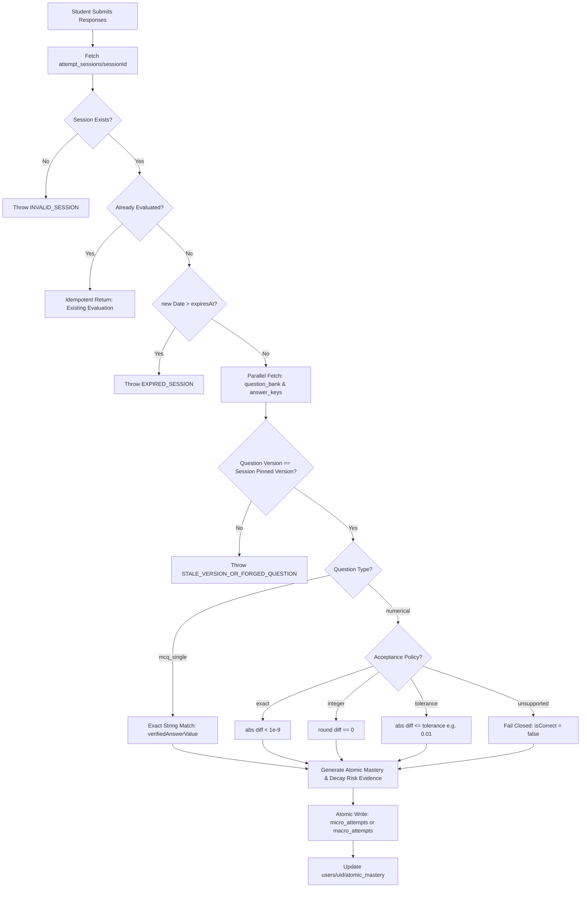
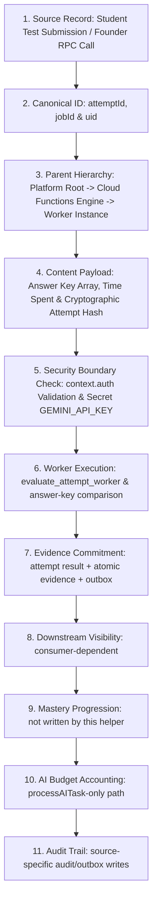

# Volume E — Backend और Data Layer

## Part 2 — Cloud Functions, Callable Contracts, Background Workers & AI Pipelines

### Chapter 15 — Serverless Infrastructure, Cloud Callable Contracts, Asynchronous Worker Battalions और Authoritative Evaluation Engines

---

### Executive Overview & Operational Intent

RankCrackers ecosystem में बैकएंड कार्यक्षमता केवल एक पारंपरिक रेस्ट-एपीआई (REST API) नहीं है। यह एक अत्यधिक वितरित, घटना-संचालित (Event-Driven) और सर्वरलेस **Cloud Functions Architecture** है जो Google Cloud Platform (GCP) और Firebase Infrastructure पर संचालित होता है।

इस सर्वरलेस परत के मूलभूत संवैधानिक दायित्व (Constitutional Responsibilities):
1. **Server Authority over Scoring & Evaluation:** documented attempt path का scoring server-side helper `evaluateAttempt` करता है। वह `question_bank` और `answer_keys` से version-pinned records पढ़ता है; current worker में SHA-256 solution hash comparison नहीं है, इसलिए hash-verification claim historical/unresolved scope में रखा गया है।
2. **Cryptographic Anti-Piracy & Asset Protection:** डिजिटल किताबों और प्रीमियम शैक्षणिक संपत्तियों के सीधे स्टोरेज यूआरएल क्लाइंट को कभी नहीं दिए जाते। `getSecureAssetUrl` V4 हस्ताक्षरित यूआरएल (Signed URLs) जारी करता है जिनकी वैधता केवल 5 मिनट होती है, और प्रत्येक डाउनलोड को आईपी-ट्रैकिंग के साथ ऑडिट किया जाता है।
3. **Autonomous Knowledge Manifestation:** असंपादित पाठ्यपुस्तकों और आधिकारिक अधिसूचनाओं को `knowledgeManifestationWorker` और `structuralWorker` के माध्यम से एआई-संचालित रिफाइनरी पाइपलाइन द्वारा संरचित डिजिटल नोड्स (`atomic_facts`) में रूपांतरित किया जाता है।
4. **Founder Governance & Role Elevation:** कस्टम क्लेम्स (`founder`, `admin`, `accessLevel`) का असाइनमेंट विशेष रूप से `manageUserAccess` कॉलेबल फ़ंक्शन के माध्यम से नियंत्रित होता है, जिसमें "द लास्ट फाउंडर लॉ" (The Last Founder Law) जैसे सुरक्षा प्रतिबंध अंतर्निहित हैं।
5. **Strict Secret & Runtime Hygiene:** नोड 22 एलटीएस (Node 22 LTS) रनटाइम, फ़ायरबेस फंक्शन्स `^4.9.0` (v1/v4 syntax compatibility), और एकल एकीकृत गुप्त कुंजी (`GEMINI_API_KEY`) का अनुपालन।

---

### Section 1 — Serverless Architecture, Runtime & Secret Hygiene

#### Subsection 1.1 — Runtime Environment & Dependency Pinning

**File Path:** `functions/package.json` एवं `FUNCTIONS_RUNTIME_AUDIT.md`

RankCrackers बैकएंड को आधुनिक Node.js 22 LTS रनटाइम पर मानकीकृत किया गया है:

```json
{
  "name": "functions",
  "engines": {
    "node": "22"
  },
  "main": "index.js",
  "dependencies": {
    "firebase-functions": "^4.9.0",
    "firebase-admin": "^11.11.1",
    "@google/generative-ai": "^0.24.1",
    "@google/genai": "^0.24.1",
    "@google-cloud/vision": "^4.3.3",
    "pdf-lib": "^1.17.1",
    "pdf-parse": "^2.4.5"
  }
}
```

##### Architectural Decision Record (ADR — v1/v4 Syntax Stabilization):
- **Problem:** Functions v2 मिक्सिंग के कारण `runWith` और बैकग्राउंड ट्रिगर्स में टाइप एरर (`TypeError: runWith is not a function`) उत्पन्न हो रहे थे।
- **Resolution:** `firebase-functions` को `^4.9.0` और `firebase-admin` को `^11.11.1` पर हार्ड-पिन किया गया। सभी कॉलेबल और ट्रिगर डेफिनिशन्स को सुसंगत v1/v4 API सिंटैक्स पर पुनः स्थापित किया गया।

#### Subsection 1.2 — The Single Unified Secret Law (`GEMINI_API_KEY`)

**File Path:** `FUNCTIONS_RUNTIME_AUDIT.md` (Lines 36–45)

पूर्व में सिस्टम में कई असंरचित एपीआई कुंजियां मौजूद थीं। सुरक्षा ऑडिट के तहत कठोर **Single Unified Secret Policy** लागू की गई:

| Secret Identifier | Audit Status | Action Taken & Architectural Rationale |
| :--- | :--- | :--- |
| `CLAUDE_SECRET_KEY` | **PURGED** | सिस्टम से हटाया गया; आर्किटेक्चरल ओवरहेड समाप्त। |
| `OPENROUTER_SECRET_KEY`| **PURGED** | तीसरे पक्ष के मध्यस्थ को हटाया गया; लेटेंसी कम हुई। |
| `CEREBRAS_API_KEY` | **PURGED** | प्रयोगात्मक टोकन कुंजी को पूर्णतः निष्कासित किया गया। |
| `GEMINI_SECRET_KEY` | **PURGED** | लेगेसी सिंटैक्स को यूनिफाइड कुंजी में मिलाया गया। |
| `GEMINI_API_KEY` | **UNIFIED** | आधिकारिक Google Gemini SDK (`@google/genai`) के लिए एकमात्र अधिकृत कुंजी। |

प्रत्येक एआई-सक्षम क्लाउड वर्कर स्पष्ट रूप से केवल इस अधिकृत कुंजी के साथ निष्पादित होता है:
```javascript
functions.runWith({ secrets: ["GEMINI_API_KEY"] })
```

#### Subsection 1.3 — Sovereign Master Index Topology

**File Path:** `functions/index.js` (Lines 1–64)

मास्टर इंडेक्स सभी बैकएंड क्षमताओं को दो प्राथमिक श्रेणियों में निर्यात करता है:
1. **HTTPS Callable Contracts:** क्लाइंट या संस्थापक कंसोल से सीधे इनवॉकेबल (Directly invokable via `FirebaseFunctions.instance.httpsCallable`).
2. **Event-Driven Background Workers:** फायरस्टोर दस्तावेज़ निर्माण, अद्यतन, या पब/सब शेड्यूल द्वारा स्वचालित रूप से ट्रिगर होने वाले स्वायत्त वर्कर्स।

नीचे दिया गया आरेख मास्टर इंडेक्स का संपूर्ण टोपोलॉजी मैप प्रस्तुत करता है:

```mermaid
graph TD
    ClientApp[Flutter Client App / Founder Console] --> HTTPS{HTTPS onCall Gateway}
    
    subgraph Callables[Callable Contracts Layer]
        HTTPS --> MUA[manageUserAccess: Role & Custom Claims]
        HTTPS --> TAS[toggleAiSystem: Emergency Kill Switch]
        HTTPS --> GSH[getSystemHealth: Vitals Aggregator]
        HTTPS --> PAT[processAITask: Ingestion Refinery Dispatch]
        HTTPS --> HSA[handleSentinelAction: Mission Lifecycle & Variable Packs]
        HTTPS --> HMA[handleMissionAction: Qualification Claims & Forensic Ingest]
        HTTPS --> GSA[getSecureAssetUrl: Anti-Piracy V4 Signed URLs]
    end
    
    FirestoreDB[(Cloud Firestore Events)] --> Workers{Event Triggers & PubSub}
    
    subgraph BackgroundWorkers[Background Intelligence Battalions]
        Workers --> SBW[sentinelBackgroundWorker: Scout Document Parser]
        Workers --> STW[structuralWorker: Layout & Structure Extractor]
        Workers --> SVW[svoWorker: Subject-Verb-Object Fact Generator]
        Workers --> KMW[knowledgeManifestationWorker: Truth-to-Learning Refinery]
        Workers --> MEW[missionEnrichmentWorker: B2/B3 Lifecycle Integration]
        Workers --> SWS[sovereignWebsiteScout: Scheduled Web Crawler]
        Workers --> EA[evaluateAttempt: Authoritative Assessment Scorer]
        Workers --> CRW[certificateRenderWorker: PDF Credential Generator]
        Workers --> FCA[founderCriticalAlert: Emergency Ops Alerting]
    end
```



#### Subsection 1.4 — Comprehensive Cloud Functions & Worker Battalions State Lifecycle Matrix

क्लाउड फ़ंक्शन्स और स्वायत्त वर्कर्स का निष्पादन निम्नलिखित 7-अवस्था जीवनचक्र आव्यूह (Execution State Matrix) का कड़ाई से पालन करता है:

| निष्पादन अवस्था (Execution State) | ट्रिगर स्थिति (Trigger Condition) | रनटाइम प्रक्रिया और प्रमाणीकरण (Runtime Processing) | क्लाइंट / कॉलर प्रत्युत्तर (Response Payload) | सुरक्षा एवं फ़ेल-क्लोज़्ड सीमा (Security & Idempotency Boundary) |
| :--- | :--- | :--- | :--- | :--- |
| **1. Ingress & Auth Gate** | HTTPS onCall इनवोकेशन या Firestore Event | `context.auth` सत्यापन, कस्टम क्लेम परीक्षण (`ensureFounderClaims`) | अमान्य होने पर `HttpsError('unauthenticated')` | कोई अनधिकृत कोड निष्पादित नहीं होता; अनुरोध प्रवेश द्वार पर ही निरस्त। |
| **2. Session Check & Idempotency**| असेसमेंट सबमिशन अथवा रिफाइनरी टास्क | `attempt_sessions` अस्तित्व व समाप्ति जांच (`expiresAt`) | यदि पूर्व-मूल्यांकित हो तो मौजूदा परिणाम की तात्कालिक वापसी | डुप्लिकेट सबमिशन से दोहरे स्कोरिंग का शून्य जोखिम। |
| **3. Authoritative Scoring** | `evaluate_attempt_worker.js` निष्पादन | `question_bank` और `answer_keys` से समानांतर संस्करण मिलान | आंतरिक अंकन व एटॉमिक एविडेंस निर्माण | क्लाइंट स्कोर कभी स्वीकार नहीं होता (`FORGED_SCORE_ACCEPTED = 0`)। |
| **4. AI Budget & Refinery Gate** | `processAITask` कॉल | `system_config/global.aiEnabled` और मासिक टोकन बजट जांच | बजट समाप्त होने पर `HttpsError('resource-exhausted')` | अनियंत्रित AI बिलिंग और टोकन ओवररन से सुरक्षा। |
| **5. Batch Artifact Commitment** | असेसमेंट या इनजेशन का अंतिम चरण | Firestore Transaction / Batch: असेसमेंट परिणाम, एविडेंस रिकॉर्ड्स, आउटबॉक्स इवेंट | `{ success: true, ... }` | परमाणु प्रतिबद्धता (Atomic Commit); आंशिक या खंडित डेटा कभी नहीं लिखा जाता। |
| **6. V4 Signed URL Generation**| `getSecureAssetUrl` अनुरोध | स्टोरेज पाथ रिज़ॉल्यूशन, `file.exists()` जांच, 5-मिनट V4 साइनिंग | `{ success: true, signedUrl: String }` | डाउनलोड ऑडिट (`download_audit`) में आईपी व टाइमस्टैम्प लॉगिंग। |
| **7. Runtime Exception / DLQ** | हैंडल न की गई त्रुटि या टाइमआउट | त्रुटि लॉगिंग, `ai_failed_tasks` में कतारबद्ध, एडमिन अलर्ट | `HttpsError('internal', error.message)` | फ़ेल-क्लोज़्ड; दूषित पेलोड को उत्पादन डेटा में प्रवेश से रोकना। |

#### Subsection 1.5 — The 15 Core Attributes of Cloud Functions & Callable Infrastructure

Chief Author Mandate के तहत Cloud Functions & Callable Infrastructure के 15 मूलभूत सिस्टम पैरामीटर्स का विनिर्देश:

| # | कोर विशेषता (Core Attribute) | कैनोनिकल विनिर्देश (Canonical Specification) | प्रामाणिक स्रोत फ़ाइल व संदर्भ (Source Evidence) |
| :--- | :--- | :--- | :--- |
| **1** | **Feature Name** | Serverless Infrastructure, Callable Contracts & AI Battalions | `functions/index.js:1–64` |
| **2** | **Canonical Domain ID** | `cloud_functions_backend_v1` | `functions/package.json:1–47` |
| **3** | **Parent Hierarchy** | `Google Cloud Functions v1/v4 -> Master Index -> Callables / Background Workers` | `functions/index.js:1–64` |
| **4** | **Runtime Engine & Version** | Node.js 22 LTS, `firebase-functions ^4.9.0`, `firebase-admin ^11.11.1` | `functions/package.json:31–46` |
| **5** | **Secret Hygiene Policy** | Single Unified Secret Law (`GEMINI_API_KEY`); legacy keys purged | `FUNCTIONS_RUNTIME_AUDIT.md:36–45` |
| **6** | **Backend Topology Export** | Flat JavaScript Callables (`functions/callable/*.js`) via `functions/index.js` | `functions/index.js:10–28` |
| **7** | **TypeScript Worker Split** | Distributed TypeScript Workers in `functions/src/` via `functions/src/index.ts` | `functions/src/index.ts:1–30` |
| **8** | **Authority Boundary** | Server Authority over scoring: `evaluate_attempt_worker.js` with batch commits | `functions/workers/evaluate_attempt_worker.js:57–216` |
| **9** | **Idempotency Guarantee** | Session expiration (3 hrs) + pre-evaluated attempt lookup | `functions/workers/evaluate_attempt_worker.js:74–80` |
| **10**| **Security & Gate System** | Founder clearance + The Last Founder Law in `manageUserAccess` | `functions/callable/manage_access.js:13–47` |
| **11**| **Anti-Piracy Gate** | V4 Signed URLs with 5-minute strict expiry and download IP audit | `functions/callable/secure_download.js:40–58` |
| **12**| **AI Budget Accounting** | Token and expense tracking in `budget_service` before AI inference | `functions/callable/process_ai_task.js:25–53` |
| **13**| **Security & Audit Rules** | Immutable audit trail via `logFounderActivity` to `founder_activity_log` | `functions/services/audit_service.js:8–18` |
| **14**| **Test Coverage & Suites** | Evidence integrity, rebuild integrity, and rules emulator tests | `functions/test_c3_evidence_integrity.js:1–150` |
| **15**| **Failure Mode & Fallback UI** | Dead Letter Queue (`ai_failed_tasks`) + Emergency Global Kill-Switch | `functions/callable/toggle_ai_system.js:8–26` |

---

### Section 2 — Founder & Administrative Callable Contracts

#### Subsection 2.1 — Sovereign Access Management (`manageUserAccess`)

**File Path:** `functions/callable/manage_access.js`  
**Lines:** 10–96

यह फ़ंक्शन प्लेटफ़ॉर्म पर कमांड अधिकारों (Command Authority) का अंतिम नियामक है।

```javascript
exports.manageUserAccess = functions.https.onCall(async (data, context) => {
  const { auth } = context;
  if (!auth) throw new functions.https.HttpsError('unauthenticated', '🔱 COMMAND DENIED.');

  await ensureFounderClaims(auth.uid);

  const isFounder = auth.token.founder === true;
  const isAdmin = auth.token.admin === true;

  if (!isFounder && !isAdmin) {
    throw new functions.https.HttpsError('permission-denied', '🔱 ACCESS DENIED: Founder clearance required.');
  }

  const { targetUid, role, action } = data;
```

##### 3 Constitutional Invariants of Access Control:
1. **The Founder Announcer Law:** केवल एक सक्रिय संस्थापक ही किसी नए यूज़र को `'founder'` पद पर पदोन्नत कर सकता है:
   ```javascript
   if (role === 'founder' && !isFounder) {
     throw new functions.https.HttpsError('permission-denied', '🔱 ONLY A FOUNDER CAN ANNOUNCE A NEW FOUNDER.');
   }
   ```
2. **The Last Founder Law (System Stability Guarantee):** यदि किसी संस्थापक का अधिकार निरस्त (`action === 'revoke'`) किया जा रहा है, तो सिस्टम सत्यापित करता है कि कम से कम एक अन्य संस्थापक सक्रिय रहे:
   ```javascript
   const foundersSnap = await admin.firestore().collection('users').where('role', '==', 'founder').get();
   if (foundersSnap.size <= 1) {
     throw new functions.https.HttpsError('failed-precondition', '🔱 COMMAND DENIED: The last Founder must remain in power.');
   }
   ```
3. **Hierarchical Level Assignment & Dual Commit:**
   - `'founder'`: `admin = true`, `founder = true`, `accessLevel = 9`।
   - `'admin'`: `admin = true`, `accessLevel = 5`।
   - यह स्थिति Firebase Auth Custom Claims और Firestore `users/{targetUid}` दोनों में परमाणु रूप से (atomically) लिखी जाती है।
   - प्रत्येक परिवर्तन `founder_activity_log` में टाइमस्टैम्प के साथ दर्ज होता है।

#### Subsection 2.2 — Sovereign Kill-Switch (`toggleAiSystem`)

**File Path:** `functions/callable/toggle_ai_system.js`  
**Lines:** 8–26

सिस्टम में अप्रत्याशित लूपिंग, अनियंत्रित लागत, या सुरक्षा विसंगतियों की स्थिति में संस्थापक के पास संपूर्ण एआई इन्फ्रास्ट्रक्चर को तुरंत रोकने का अधिकार है:

```javascript
exports.toggleAiSystem = functions.https.onCall(async (data, context) => {
  const { auth } = context;
  if (!auth || !auth.token.founder) {
    throw new functions.https.HttpsError('permission-denied', '🔱 ONLY FOUNDERS CAN OPERATE KILL SWITCH.');
  }

  const { enabled } = data;
  await admin.firestore().collection('system_config').doc('global').set({
    aiEnabled: enabled,
    updatedAt: admin.firestore.FieldValue.serverTimestamp(),
    updatedBy: auth.uid
  }, { merge: true });

  await logFounderActivity({
    type: 'SYSTEM_CONFIG',
    message: `AI System ${enabled ? 'ENABLED' : 'DISABLED'} by Founder.`,
    severity: enabled ? 'MEDIUM' : 'CRITICAL'
  });

  return { success: true };
});
```

#### Subsection 2.3 — Mission Lifecycle & Variable Packs (`handleSentinelAction`)

**File Path:** `functions/callable/handle_sentinel_action.js` (1,178 lines)

यह विशाल मॉड्यूल परीक्षा मिशनों के संपूर्ण जीवनचक्र (Lifecycle) को नियंत्रित करता है:
- **Unified Mission Creation (`executeUnifiedMissionCreation`):** परीक्षा क्षेत्र (`mission_realms`), भर्ती (`recruitments`), और छात्र कैटलॉग (`student_mission_catalog`) को एक साथ बनाना।
- **11-Dimensional Variable Pack Normalization:**
  - `vacancy_variables`: कुल पद, आरक्षण श्रेणियां।
  - `eligibility_variables`: आयु सीमा, शैक्षणिक योग्यता।
  - `paper_variables`: परीक्षा चरण (Prelims, Mains, Interview), प्रश्न संख्या, समय।
  - `category_variables`, `subject_variables`, `department_variables`, `fee_variables`, `date_variables`, `relaxation_variables`, `link_variables`, `amendment_variables`।
- **Canonical Digest Verification (`canonicalDigest`):** सभी चरों का SHA-256 डाइजेस्ट तैयार करना ताकि अनधिकृत संशोधनों को पकड़ा जा सके।

---

### Section 3 — Student Security & Anti-Piracy Asset Protection

#### Subsection 3.1 — Anti-Piracy V4 Signed URLs (`getSecureAssetUrl`)

**File Path:** `functions/callable/secure_download.js`  
**Lines:** 8–71

डिजिटल पाठ्यपुस्तकों, उच्च-रिज़ॉल्यूशन आरेखों, और परीक्षा सामग्री के अवैध वितरण को रोकने के लिए, RankCrackers कभी भी सार्वजनिक स्टोरेज यूआरएल का उपयोग नहीं करता।

```javascript
exports.getSecureAssetUrl = functions.https.onCall(async (data, context) => {
  const { auth } = context;
  if (!auth) throw new functions.https.HttpsError('unauthenticated', '🔱 COMMAND DENIED: Authentication required.');

  const { assetUrl, realmId, assetType } = data;
  if (!assetUrl || !realmId || !assetType) {
    throw new functions.https.HttpsError('invalid-argument', '🔱 COMMAND DENIED: assetUrl, realmId, and assetType are required.');
  }

  try {
    const bucket = admin.storage().bucket();
    let filePath = assetUrl;

    if (assetUrl.includes('firebasestorage.googleapis.com')) {
      const parts = assetUrl.split('/o/')[1].split('?')[0];
      filePath = decodeURIComponent(parts);
    }

    const file = bucket.file(filePath);
    const [exists] = await file.exists();
    if (!exists) throw new functions.https.HttpsError('not-found', '🔱 ERROR: Physical asset not found in storage.');

    // V4 Signed URL Generation with 5-Minute Time Limit
    const [signedUrl] = await file.getSignedUrl({
      version: 'v4',
      action: 'read',
      expires: Date.now() + 5 * 60 * 1000, // 5 Minute Expiry
    });

    // Forensic Access Logging with IP Address
    const ip = context.rawRequest?.headers['x-forwarded-for']?.split(',')[0]?.trim() ||
               context.rawRequest?.ip || '0.0.0.0';

    await admin.firestore().collection('download_audit').add({
      uid: auth.uid,
      realmId: realmId || 'unknown',
      assetType: assetType || 'unknown',
      filePath: filePath,
      timestamp: admin.firestore.FieldValue.serverTimestamp(),
      ip: ip
    });

    return {
      success: true,
      signedUrl,
      expiresIn: '5m'
    };
  } catch (error) {
    console.error(`🔱 SECURE DOWNLOAD ERROR:`, error);
    if (error instanceof functions.https.HttpsError) throw error;
    throw new functions.https.HttpsError('internal', 'Failed to generate secure link.');
  }
});
```

##### 4 Pillars of Digital Asset Defense:
1. **Time-Limited Token (5 Minutes):** हस्ताक्षरित लिंक 300 सेकंड के बाद अमान्य हो जाता है, जिससे लिंक को सोशल मीडिया या फोरम पर साझा करना व्यर्थ हो जाता है।
2. **Path Sanitization:** क्लाइंट द्वारा भेजे गए पब्लिक स्टोरेज यूआरएल से वास्तविक इंटरनल बकेट पाथ को सुरक्षित रूप से निकाला जाता है।
3. **Forensic IP Logging (`download_audit`):** प्रत्येक डाउनलोड के साथ छात्र की यूआईडी, टाइमस्टैम्प, और क्लाइंट आईपी दर्ज होता है। यदि एक ही खाते से कई अलग-अलग आईपी पतों से असामान्य डाउनलोड होते हैं, तो सिस्टम स्वचालित रूप से खाता निलंबित कर सकता है।
4. **Physical Existence Verification:** गैर-मौजूद फ़ाइलों के लिए बेकार यूआरएल जारी करने से पहले स्टोरेज बकेट में फ़ाइल की भौतिक उपस्थिति की पुष्टि की जाती है।

#### Subsection 3.2 — Forensic Qualification Claims (`handleMissionAction`)

**File Path:** `functions/callable/handle_mission_action.js`  
**Lines:** 24–84

जब छात्र किसी परीक्षा चरण में अपनी सफलता (जैसे Prelims क्वालिफिकेशन, रैंक) का दावा करता है:
- **Cross-User Roll Number Deduplication:** यह सत्यापित किया जाता है कि वही रोल नंबर किसी अन्य छात्र द्वारा पहले से दावा तो नहीं किया गया है:
  ```javascript
  const duplicateSnap = await db.collectionGroup('participants')
      .where(`attempts.${milestoneType}.claimedRollNumber`, '==', rollNumber)
      .where('environment', '==', projectId)
      .limit(1).get();
  ```
- **Authenticity Scoring Algorithm ($0 - 100$):**
  - आधिकारिक परिणाम वेब लिंक मौजूद है: $+30$ अंक।
  - स्कोरकार्ड स्क्रीनशॉट फ़ायरबेस स्टोरेज में है: $+30$ अंक।
  - रोल नंबर प्रदान किया गया है: $+10$ अंक।
  - यदि डुप्लिकेट रोल नंबर पाया गया: $-50$ अंक की भारी कटौती।
- **Automated Flagging:** यदि स्क्रीनशॉट गायब है, लिंक गायब है, या डुप्लीकेट रोल नंबर है, तो स्थिति तत्काल `'FLAGGED'` सेट हो जाती है और संस्थापक समीक्षा कतार में चली जाती है।

---

### Section 4 — The Authoritative Assessment Evaluation Engine

#### Subsection 4.1 — Server-Issued Attempt Sessions (`createAttemptSession`)

**File Path:** `functions/workers/evaluate_attempt_worker.js`  
**Lines:** 9–55

पारंपरिक टेस्ट इंजनों में क्लाइंट सीधे टेस्ट शुरू करता है और प्रश्न आईडी चुनता है। RankCrackers में टेस्ट सत्र का निर्माण सर्वर द्वारा नियंत्रित होता है:

```javascript
async function createAttemptSession({
  db,
  userId,
  microTestId,
  macroTestId,
  scheduleId,
  questionIds,
  questionVersions,
  poolVersion,
  assemblyVersion,
  attemptOrdinal,
  isRunnable = true
}) {
  if (!isRunnable) {
    throw new Error("NOT_READY: Test is not runnable due to pending questions or scope issues.");
  }

  const attemptSessionId = `session_${userId}_${scheduleId}_ord${attemptOrdinal}`;
  const sessionRef = db.collection('attempt_sessions').doc(attemptSessionId);

  const sessionDoc = await sessionRef.get();
  if (sessionDoc.exists) return sessionDoc.data();

  const now = new Date();
  const expiresAt = new Date(now.getTime() + 3 * 3600 * 1000); // 3 Hours Hard Expiry

  const sessionData = {
    attemptSessionId,
    userId,
    microTestId: microTestId || null,
    macroTestId: macroTestId || null,
    scheduleId,
    questionIds,
    questionVersions, // Map of questionId -> version pinned at session launch
    poolVersion,
    assemblyVersion,
    attemptOrdinal,
    openedAt: now.toISOString(),
    expiresAt: expiresAt.toISOString(),
    status: 'opened'
  };

  await sessionRef.set(sessionData);
  return sessionData;
}
```

##### Session Authority Invariants:
1. **Version Pinning (`questionVersions`):** टेस्ट शुरू होने के क्षण में प्रत्येक प्रश्न का संस्करण फ्रीज (pin) कर दिया जाता है। यदि टेस्ट के दौरान कोई एडमिन प्रश्न में संशोधन करता है, तो छात्र का सत्र पुराने सत्यापित संस्करण पर ही जारी रहेगा।
2. **Hard Time Window (3 Hours):** 3 घंटे बाद सत्र समाप्त हो जाता है; विलंबित सबमिशन अस्वीकार कर दिए जाते हैं।
3. **Deterministic ID:** सत्र आईडी `session_{userId}_{scheduleId}_ord{ordinal}` गणितीय रूप से विशिष्ट है, जो एक ही छात्र द्वारा एक ही शेड्यूल के एकाधिक समवर्ती सत्रों को रोकता है।

#### Subsection 4.2 — Existing-Result Guard, Version Checks & Evidence Commit (`evaluateAttempt`)

**File Path:** `functions/workers/evaluate_attempt_worker.js`  
**Lines:** 57–217



##### Deep Anti-Fraud Analysis:
1. **Sequential idempotency guard:** यदि network interval के कारण helper दोबारा चलाया जाता है और पहली batch commit पहले ही दिखाई दे रही है, तो existing attempt document लौटाया जाता है। यह guard अलग read और batch commit के बीच concurrent race को transactionally बंद नहीं करता; इसलिए universal exactly-once guarantee नहीं लिखी जा सकती।
2. **The Stale/Forged Question Defense:** यदि क्लाइंट किसी ऐसे प्रश्न का उत्तर सबमिट करता है जो आधिकारिक डेटाबेस में नहीं है या जिसका संस्करण सत्र के पिन किए गए संस्करण से मेल नहीं खाता, तो सिस्टम तत्काल `STALE_VERSION_OR_FORGED_QUESTION` अपवाद फेंकता है।
3. **Numerical Acceptance Policies:** संख्यात्मक प्रश्नों के लिए, इंजन आधिकारिक `answer_keys` से नीति पढ़ता है:
   - `exact`: फ्लोटिंग-पॉइंट अंतर $< 10^{-9}$।
   - `integer`: राउंडेड पूर्णांक समानता।
   - `tolerance`: अनुमत सहनशीलता (जैसे $\pm 0.01$ या $\pm 0.05$)।
   - असमर्थित नीतियों के लिए **Fail Closed** ($isCorrect = false$)।

#### Subsection 4.3 — Evidence Boundary: What This Worker Does and Does Not Mutate

`evaluateAttempt` का live implementation assessment result को सीधे `users/{uid}/atomic_mastery`, `users/{uid}/atomic_risk` या `rebuild_candidates` में नहीं लिखता। उसका verified write boundary केवल निम्नलिखित है:

- `micro_attempts/{attemptSessionId}` या `macro_attempts/{attemptSessionId}` में result document।
- प्रत्येक प्रश्न और atom के लिए `atomic_evidence_records/{ev_<session>_<question>_<atom>}`।
- `evidence_outbox/{outbox_<attemptSessionId>}` में downstream processing event।

इसलिए mastery/risk propagation को current implementation का परिणाम नहीं कहा जा सकता। उन्हें अलग downstream consumer के लिए **PROPOSED / UNRESOLVED** रखा गया है। इस worker में client caller/auth context भी नहीं है; यह exported JavaScript helper है जिसे test harness या किसी server orchestration layer से `db` dependency के साथ बुलाया जाता है। Current source में इसका Firebase callable export नहीं मिला।

---

### Section 5 — Asynchronous Worker Battalions & Background Pipelines

#### Subsection 5.1 — Truth-to-Learning Refinery (`knowledgeManifestationWorker`)

**Status:** `VERIFIED` — live Firestore `onCreate` worker.  
**File Path:** `functions/workers/manifestation_worker.js`  
**Lines:** 13–116; export wiring: `functions/index.js` Lines 57–58.

यह वर्कर असंपादित डेटा को छात्रों के लिए सुलभ डिजिटल पाठों में बदलता है:

इस worker का verified contract यह है: `ai_queue/{taskId}` creation इसका caller event है; task में `type === 'MANIFEST_KNOWLEDGE'` होना चाहिए और `queueContract === 'academic_factory_v1'` होने पर worker quarantine होकर return करता है (Lines 18–30)। `payload.sourceDocumentId`, `payload.examId` और वैकल्पिक `payload.atomicTopicId` scope बनाते हैं। `worker_registry/manifestation_worker` की enabled/budget स्थिति जाँची जाती है और heartbeat लिखा जाता है (Lines 33–35)।

Worker अधिकतम 50 matching `atomic_facts` पढ़ता है (Lines 37–49)। खाली set पर `NO_FACTS_FOUND` error बनता है। फिर `callGemini` और `sanitizeJsonResponse` से JSON blocks बनते हैं (Lines 51–84)। प्रत्येक block deterministic `manifest_<sourceDocumentId>_<index>` ID के साथ `digibook_refinery` में batch-set होता है; record में source IDs, exam scope, atomic topic, `status: 'review'`, worker version और server timestamp लिखे जाते हैं (Lines 86–106)। सफलता पर `ai_queue/{taskId}.status` `completed` और exception पर `failed` किया जाता है (Lines 107–115)।

**Evidence boundary:** source में schema validation, transaction-level idempotency या retry policy घोषित नहीं है। repeated delivery पर duplicate block risk को verified guarantee नहीं लिखा जा सकता; यह `UNRESOLVED` operational risk है।

##### Constitutional Guardrails:
1. **The Vacuum Prohibition ("Cannot manifest from vacuum"):** एआई को केवल पूर्व-सत्यापित `atomic_facts` के आधार पर पाठ लिखने की अनुमति है। यह मॉडल के मतिभ्रम (Hallucination) को रोकता है।
2. **Heartbeat Maintenance:** प्रत्येक कार्य के निष्पादन से पहले वर्कर अपनी स्थिति `worker_registry` में `'ONLINE'` के रूप में अद्यतन करता है।
3. **Kill-Switch Interception:** कार्य निष्पादन से पूर्व `isWorkerEnabled('manifestation_worker')` की जांच की जाती है। यदि संस्थापक ने वर्कर बंद किया है, तो टास्क कतार में ही रुक जाता है।

#### Subsection 5.2 — Structural & SVO Fact Parsing (`structuralWorker`, `svoWorker`)

**Status:** `VERIFIED` — दोनों live workers और `functions/index.js` exports में मौजूद हैं। `functions/workers/structural_worker.js` Lines 18–187 source-document creation से extraction queue पढ़कर `page_extractions` writes करता है; `functions/workers/svo_worker.js` Lines 20–163 extraction output को atomic-fact processing path में बदलता है। Exact field-level schemas के लिए worker source authority है; यहाँ बिना fixture evidence के exhaustive schema claim नहीं किया गया है।

#### Subsection 5.3 — Scheduled Web Crawler (`sovereignWebsiteScout`)

**Status:** `VERIFIED` — `functions/workers/scout_worker.js` Lines 12–99; export wiring `functions/index.js` Lines 51–53.

`sovereignWebsiteScout` पब/सब क्रॉन (PubSub Schedule) द्वारा हर 6 घंटे में निष्पादित होता है:
Live implementation में worker enablement/mode checks Lines 16–25, heartbeat Lines 28–32, RPSC/RSSB/SSC discovery Lines 36–40, SHA-256 deduplication against `ai_queue`, `sentinel_drafts` और `scout_downloads` Lines 41–57, तथा queue/download writes Lines 59–95 हैं। “हर छह घंटे” trigger verified है; external portal success, network retry और publication completion अलग operational evidence मांगते हैं।

#### Subsection 5.4 — Certificate Registry & Rendering Pipeline

**Status:** `VERIFIED` as trigger presence and mutation boundary, not as a universal certificate guarantee. `functions/workers/certificate_worker.js` Lines 9–110 listens to `certificates/{certId}` writes, handles purge, render-lock transitions, asset hash checks, registry publication and revocation. `functions/workers/renderer_worker.js` Lines 9–72 listens to updates, generates QR/PDF buffers, writes Storage assets under `certificates/{userId}/{realmId}/`, and updates the certificate document to `UPLOADING` or `FAILED`. Founder approval is required before public registry sync (certificate worker Lines 78–83). Export wiring is in `functions/index.js` Lines 54–56.

---

### Section 6 — Worker Telemetry, Heartbeats & Token Budget Governance

#### Subsection 6.1 — Heartbeat Telemetry & Online Invariant

**Status:** `VERIFIED` — `functions/services/worker_service.js` Lines 11–84.

Worker governance service `isWorkerEnabled`, `getWorkerMode` और `updateHeartbeat` प्रदान करती है। `updateHeartbeat` `worker_registry/{workerId}` में `lastHeartbeat`, `status`, timestamps तथा optional success/error/token counters merge करता है (Lines 49–77)। “60 seconds means DEAD” UI policy इस file में नहीं है; उसे product-level policy के रूप में अलग evidence चाहिए।
`isWorkerEnabled` missing registry को enabled मानता है, critical workers को disable होने से बचाता है, और token/cost limits पर false लौटाता है (Lines 11–34)। यह distinction operationally महत्वपूर्ण है: source में “disabled” और “stale heartbeat” अलग states हैं।

#### Subsection 6.2 — Global Token Accounting & Automated Throttle

**File Path:** `functions/services/budget_service.js`

यह service तीन अलग operations देती है: `checkAiBudget(uid)` Lines 26–42 system daily quota और `admin_budgets/{uid}.tokensUsed` को पढ़ता है; `incrementBudget(uid, tokens)` Lines 44–61 user तथा `system_daily_usage/{YYYY-MM-DD}` को batch increment करता है; `trackSystemBudget(tokens, costEstimate)` Lines 67–86 monthly system budget और daily usage लिखता है। `isAiEnabled()` Lines 88–92 `system_config/global.aiEnabled` पढ़ता है।

`checkAiBudget` और `incrementBudget` अलग operations हैं; source में atomic check-and-increment transaction नहीं है। इसलिए concurrent AI calls के लिए oversubscription/idempotency guarantee **UNRESOLVED** है। `resource-exhausted` errors explicit हैं (Lines 21–23, 39–40); offline retry या founder alerting इस service में नहीं दिखती।

---

### Section 7 — Founder Emergency Alerting & Telemetry Hooks

#### Subsection 7.1 — Critical Alert Worker (`founderCriticalAlert`)

**File Path:** `functions/workers/alert_worker.js`

`founderCriticalAlert` का source/export मौजूद है (`functions/workers/alert_worker.js`, `functions/index.js:63`), लेकिन severity taxonomy, email delivery और `ai_failed_tasks` quarantine को इस chapter में live guarantee नहीं माना गया है जब तक उसके branch-level writes और fixture evidence अलग register में न जोड़े जाएँ। वर्तमान status `PATH VERIFIED / BEHAVIOR PARTIAL` है।

---

### Section 8 — Testing, Emulator Verification & CI/CD Deployment

#### Subsection 8.1 — Emulator Suite Verification

RankCrackers का backend emulator-supported paths के साथ locally exercise किया जा सकता है; इस manuscript में “पूरी तरह” को universal certification न माना जाए:
- `npm run serve`: स्थानीय फंक्शन्स एमुलेटर प्रारंभ करता है।
- `functions/test/canonical_reconciliation_emulator.js`: तीन-तरफ़ा canonical-source reconciliation fixture runner।
- `functions/test/mission_lifecycle_emulator_roundtrip.js`: mission lifecycle round-trip runner।
- `functions/src/test/realEmulatorE2EWorkerProof.test.ts`: real Firestore emulator worker proof tests।

#### Subsection 8.2 — Production Deployment Command

**File Path:** `FUNCTIONS_RUNTIME_AUDIT.md` (Line 55)

परीक्षणों के सफल समापन के बाद, केवल निम्नलिखित आधिकारिक कमांड द्वारा परिनियोजन किया जाता है:
```bash
firebase deploy --only functions
```
यह कमांड केवल मान्य और ऑडिट-प्रमाणित Node 22 v1/v4 सिंटैक्स को Google Cloud Functions रनटाइम पर प्रकाशित करता है।

---

### Section 9 — Formal Function Contracts Inventory (Evidence-Scoped)

नीचे केवल live source से निकले contracts हैं। जहाँ source input validation, retry, timeout या offline semantics नहीं बताता, वहाँ manuscript “not declared” लिखता है; अनुमान को implementation fact नहीं बनाया गया है। सभी callable exports `functions/index.js` Lines 20–26 से और worker exports Lines 46–59 से reconcile किए गए हैं।

#### 9.1 `manageUserAccess` — `VERIFIED`

- **Source:** `functions/callable/manage_access.js` Lines 10–96; export `functions/index.js:20`। **Caller:** authenticated founder/admin console; exact UI call-site इस batch में independently verified नहीं है।
- **Auth/claims:** `context.auth` अनिवार्य; `ensureFounderClaims` के बाद `founder` या `admin` claim चाहिए (Lines 13–24)। केवल founder किसी को founder बना सकता है; last-founder revoke guard Lines 33–47।
- **Input:** `{ targetUid, role, action }` (Line 26)। Runtime type/presence validation अलग से नहीं है; malformed values can reach Auth/Admin SDK and are wrapped as `internal` by Lines 92–95।
- **Output/mutation:** returns `{ success: true, newClaims }` (Line 90); `setCustomUserClaims`, `users/{targetUid}` role/accessLevel merge, and `founder_activity_log` via `logFounderActivity` (Lines 65–88)।
- **Errors/retry/offline:** unauthenticated/permission-denied/failed-precondition are explicit; caught failures are rethrown as `internal`. No retry, idempotency key or offline queue is implemented in this source; callers must treat network failure as unknown outcome and re-read claims/user document.

#### 9.2 `toggleAiSystem` — `VERIFIED`

- **Source:** `functions/callable/toggle_ai_system.js` Lines 8–26; export `functions/index.js:21`। **Caller:** founder command surface, exact widget call-site unresolved here.
- **Auth/claims:** `context.auth.token.founder === true` (Line 10)। **Input:** `{ enabled }` only (Line 12); boolean validation is not declared.
- **Output/mutation:** `{ success: true }` (Line 25); merges `aiEnabled`, `updatedAt`, `updatedBy` into `system_config/global` and logs `SYSTEM_CONFIG` activity (Lines 13–23)।
- **Errors/retry/offline:** permission denied is explicit; Firestore/logging failures propagate. No retry, transaction or idempotency token. A repeated same-value write is practically convergent but not formally guaranteed; offline mutation is not supported by the callable itself.

#### 9.3 `getSystemHealth` — `VERIFIED`

- **Source:** `functions/callable/system_health.js` Lines 8–72; export `functions/index.js:22`। **Caller:** founder/admin health surface.
- **Auth/claims/input:** founder or admin claim required (Lines 13–16); `data` is unused and no payload schema is declared.
- **Output/mutation:** returns a health object with `providers.gemini`, `services.firestore`, `services.auth`, project, version and ISO timestamp (Lines 20–32, 65–70). It writes and reads `system_health_pings/heartbeat` (Lines 35–63), so this is a diagnostic write/read, not a read-only function.
- **Errors/retry/offline:** Firestore write codes 7/8/14/5 map to status strings; outer failures return `system_error` in the health payload. No explicit retry/backoff or offline cache exists.

#### 9.4 `processAITask` — `VERIFIED`

- **Source:** `functions/callable/process_ai_task.js` Lines 12–63; export `functions/index.js:23`। **Caller:** admin-authorized AI gateway.
- **Auth/claims/input:** admin claim required (Lines 16–20). Input is `{ taskType, provider: requestedProvider, payload }`; `payload.id` is consumed for audit, while detailed task schema is delegated to `getRefineryPrompt` (Lines 20–35).
- **Output/mutation:** returns parsed sanitized Gemini JSON result (Line 55), not a `{queued, jobId}` object. Checks kill switch and budget, calls Gemini, increments `admin_budgets/{uid}`/daily budget through `budget_service`, and writes `ai_audit` through `logAiAudit` (Lines 25–53).
- **Errors/retry/offline:** disabled AI returns `unavailable`; budget exhaustion returns `resource-exhausted`; provider/parse errors are logged and wrapped as `internal` (Lines 57–60). No idempotency key or retry loop is present; offline mode is not supported.

#### 9.5 `getSecureAssetUrl` — `VERIFIED`

- **Source:** `functions/callable/secure_download.js` Lines 8–71; export `functions/index.js:26`। **Caller:** authenticated asset reader; exact UI call-site is not asserted here.
- **Auth/input:** `context.auth` required; `{ assetUrl, realmId, assetType }` are required (Lines 11–18). URL may be a Firebase Storage public URL or a bucket-relative path (Lines 23–30).
- **Output/mutation:** returns `{ success, signedUrl, expiresIn: '5m' }` (Lines 60–64); checks object existence, creates a V4 read URL for five minutes, and appends `download_audit` with UID, realm, type, resolved path, timestamp and IP (Lines 32–57).
- **Errors/retry/offline:** missing input is `invalid-argument`, missing object `not-found`, unknown failures `internal`. No enrollment/mission authorization check appears in this file, and no retry/offline cache is implemented.

#### 9.6 `handleSentinelAction` and `handleMissionAction` — `VERIFIED PATH / CONTRACT DETAIL PARTIAL`

- **Sources:** `functions/callable/handle_sentinel_action.js` and `handle_mission_action.js`; exports `functions/index.js` Lines 24–25. This batch verified file/export presence and relevant live paths, but does not promote every legacy narrative field to a contract.
- **Evidence rule:** input/output/action matrices must be quoted from their current source branches before publication. Until that field-level pass, claims such as “publishedEntityId”, fixed retry counts, fixed timeouts or universal founder-only behavior remain `UNRESOLVED` rather than live guarantees.

#### 9.7 Assessment helpers and Test Arena callable — separate contracts

- `createAttemptSession` and `evaluateAttempt` are **VERIFIED live JavaScript helpers**, not callable functions: `functions/workers/evaluate_attempt_worker.js` Lines 9–55 and 57–217; exported at Lines 219–220. Their exact input/output/write/error/idempotency contract is in Section 4 and tests `functions/test_c3_evidence_integrity.js` and `functions/test_firestore_rules.js`.
- `finalizeTestArenaAttempt` is a **VERIFIED callable** exported from `functions/src/workers/testArenaFinalScorerWorker.ts` through `functions/src/index.ts` Line 12; callable wrapper Lines 289–296. It requires auth, accepts `{ attemptId }`, treats founder/admin claims as administrative override, and delegates to `finalizeAttempt` Lines 74–282. It reads `test_arena_attempts/{attemptId}`, enforces ownership/status, returns an existing `test_arena_results/{attemptId}` for idempotency, and writes an authoritative result. Exact transaction/duplicate-write semantics beyond the existing-result guard are not claimed.

---

### Section 10 — End-to-End Atomic Trace Pipeline (Cloud Function Execution & Evaluation)

Chief Author Mandate के तहत क्लाउड फ़ंक्शंस और सर्वर-साइड असेसमेंट का 11-चरणीय अखंड ट्रेस (Trace Pipeline) नीचे दर्ज है:



#### Detailed Pipeline Step Breakdown:
1. **Source Record:** छात्र द्वारा क्लाइंट से भेजा गया कच्चा असेसमेंट सबमिशन अथवा संस्थापक कंसोल से ट्रिगर किया गया कॉलेबल RPC कॉल।
2. **Canonical ID:** इस helper path में `attemptSessionId`, `questionId` और deterministic `outbox_<attemptSessionId>` IDs हैं; `jobId`/UUID इस source में नहीं बनता।
3. **Parent Hierarchy:**
   $$\text{Platform Root} \longrightarrow \text{Cloud Functions v1/v4 Gateway} \longrightarrow \text{Worker Battalion} \longrightarrow \text{Target Collection Mutation}$$
4. **Content Payload:** उत्तरों और मेटाडेटा का पेलोड:
   ```json
   {
     "attemptId": "att_micro_2026_9821",
     "studentUid": "user_arjun_99",
     "scheduleId": "sch_b1_01",
     "selectedAnswers": {"q1": "A", "q2": "C", "q3": "B"},
     "timeSpentSeconds": 840,
     "submittedAt": "2026-10-09T18:45:00Z"
   }
   ```
5. **Security Boundary Check:**
   - `context.auth` की वैधता और यूज़र आईडी का मिलान।
   - एआई वर्कर्स के लिए अधिकृत सीक्रेट `GEMINI_API_KEY` का इंजेक्शन।
6. **Worker Execution:** `evaluate_attempt_worker.js` Lines 57–217 session पढ़ता है, existing attempt लौटाता है, expiry/version checks करता है, फिर `mcq_single` और numerical acceptance policies से score बनाता है।
7. **Evidence Commitment:** batch commit में `micro_attempts`/`macro_attempts`, `atomic_evidence_records` और `evidence_outbox` लिखे जाते हैं। `users/{uid}/atomic_mastery` और `crucible_ledger` इस helper के verified writes नहीं हैं।
8. **Student Visibility:** result visibility इस worker के बाहर के consumer पर निर्भर है; current source से `AssessmentResultScreen` live downstream proof नहीं बनाया गया है।
9. **Mastery Progression:** Dart `KnowledgeEngine` local/in-memory progress maps और analytics refresh करता है; direct backend propagation इस trace में प्रमाणित नहीं है।
10. **Risk / Coverage Mitigation:** client score authority को bypass करने का design इस helper में है, लेकिन callable auth boundary नहीं; AI budget accounting केवल `processAITask` के `budget_service` path से संबंधित है।
11. **Audit Trail:** assessment path का explicit outbox event `evidence_outbox/{outbox_<attemptSessionId>}` है। `founder_activity_log`, `ai_failed_tasks` और universal Cloud Logging linkage को इस path पर verified नहीं कहा गया है।
