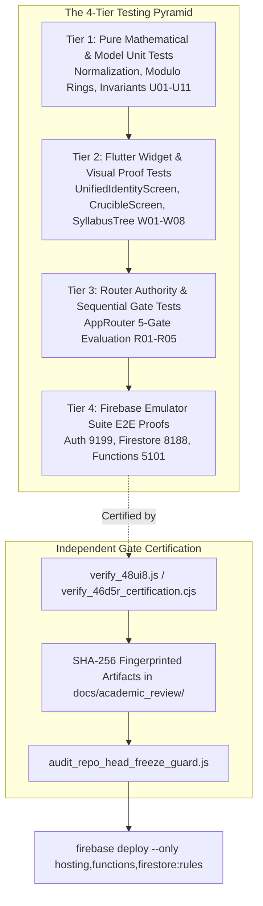
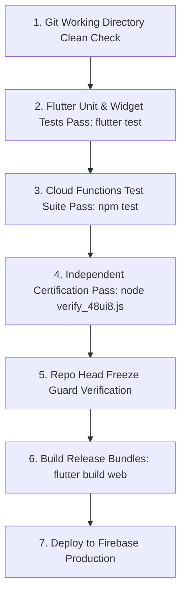
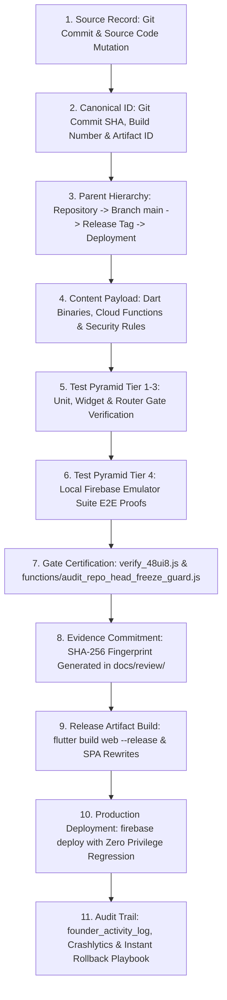

# Volume H — Engineering Operations, Quality Assurance & Deployment

## Part 1 — Testing Strategy, Emulator Verification, CI/CD & Production Delivery

### Chapter 16 — Engineering Operations, Multi-Tier Test Harnesses, Firebase Emulators और Continuous Delivery Protocol

---

### Executive Overview & Engineering Philosophy

RankCrackers ecosystem में इंजीनियरिंग संचालन (Engineering Operations) केवल कोड कंपाइल करने या सर्वर पर स्क्रिप्ट चलाने तक सीमित नहीं है। चूँकि RankCrackers लाखों छात्रों के शैक्षणिक भविष्य, परीक्षा तत्परता और आधिकारिक भर्ती परीक्षाओं के वास्तविक समय डेटा से जुड़ा है, इसलिए सॉफ़्टवेयर विश्वसनीयता (Software Reliability) और प्रतिगमन-शून्यता (Zero-Regression Policy) यहाँ के सबसे मौलिक इंजीनियरिंग कानून हैं।

RankCrackers इंजीनियरिंग प्रोटोकॉल के 5 मूल सिद्धांत (Core Operational Invariants):
1. **The Zero-Regression Policy:** कोई भी नया फीचर, यूआई संवर्धन या बैकएंड फ़ंक्शन तब तक उत्पादन (Production) में मर्ज नहीं किया जा सकता जब तक वह मौजूदा परीक्षण सुइट को $100\%$ उत्तीर्ण न कर ले।
2. **The 4-Tier Testing Pyramid:** प्लेटफ़ॉर्म का सत्यापन 4 स्वतंत्र स्तरों पर होता है:
   - *Tier 1:* Pure Dart/TypeScript Unit Tests (Zero external I/O, mathematical determinism).
   - *Tier 2:* Widget & Interactive UI Tests (State machine, visual boundaries, user gestures).
   - *Tier 3:* Integration & Routing Gate Tests (GoRouter sequential authority validation).
   - *Tier 4:* Full Emulator E2E Tests (Local Firebase Auth, Firestore, and Functions integration).
3. **Architectural Isolation via Test Seams:** यूनिट और विजेट टेस्ट्स को कभी भी लाइव फ़ायरबेस नेटवर्क कॉल्स पर निर्भर नहीं होना चाहिए। कोडबेस में स्पष्ट रूप से डिज़ाइन किए गए सीम्स (`disableFirebaseForTest`, `disableFirebaseAuthLookupForTest`, `forceProfileSetupForTest`) लाइव निर्भरताओं को सुरक्षित रूप से अलग करते हैं।
4. **Independent Gate Certification:** महत्वपूर्ण आर्किटेक्चरल परिवर्तनों (जैसे नेट-न्यू मिशन पब्लिकेशन, ड्राफ्ट नॉन-लीक, कैनोनिकल आईडी प्रिजर्वेशन) का सत्यापन स्वतंत्र नोड स्क्रिप्ट्स (`verify_48ui8.js`, `verify_46d5_independent_gate.js`) द्वारा क्रिप्टोग्राफ़िक SHA-256 आर्टिफ़ैक्ट्स के साथ प्रमाणित किया जाता है।
5. **Deterministic Multi-Platform Delivery:** Flutter Web (Single Page Application with SPA rewrites) और Android Native (AAB / APK) के लिए अपरिवर्तनीय रिलीज़ चेकलिस्ट और ऑटोमेटेड डिप्लॉयमेंट पाइपलाइन।

---

### Section 1 — The Multi-Tier Testing Pyramid & Verification Topology

नीचे दिए गए आरेख में RankCrackers के 4-स्तरीय परीक्षण पिरामिड और सत्यापन आर्किटेक्चर को दर्शाया गया है:



#### Subsection 1.1 — The Golden Invariant Law

RankCrackers में प्रत्येक परीक्षण केवल यह नहीं देखता कि "क्या कोड काम कर रहा है", बल्कि यह एक विशिष्ट **संवैधानिक अपरिवर्तनीय (Constitutional Invariant)** की पुष्टि करता है। उदाहरण के लिए:
- `U01`: बाइनरी में हार्डकोडेड मिशनों की संख्या अनिवार्य रूप से $0$ होनी चाहिए।
- `U08`: सर्वर प्रोफ़ाइल सिंक में पुराना फ़्लैट कंसेंट अमान्य होना चाहिए; केवल नेस्टेड `consent.termsAccepted == true` मान्य है।
- `Gate 48UI8`: आंतरिक ड्राफ्ट (`INTERNAL_DRAFT`) छात्रों के लिए कभी लीक नहीं होना चाहिए (`INTERNAL_DRAFT_VISIBLE_TO_STUDENT_COUNT = 0`)।

#### Subsection 1.2 — Architectural Seams & Mocking Strategy

यूनिट परीक्षणों की गति, पुनरुत्पादन क्षमता (Reproducibility), और सीआई/सीडी में स्वतंत्रता सुनिश्चित करने के लिए उत्पादन कोडबेस में निम्नलिखित टेस्ट सीम्स अंतर्निहित हैं:

```dart
// File: lib/features/auth/presentation/screens/unified_identity_screen.dart
class UnifiedIdentityScreen extends ConsumerStatefulWidget {
  const UnifiedIdentityScreen({
    super.key,
    this.forceProfileSetupForTest = false,
    this.disableFirebaseAuthLookupForTest = false,
    this.disableAnimationsForTest = false,
  });
```

```dart
// File: lib/shared/session/session_manager.dart
class SessionManager {
  static bool disableFirebaseForTest = false;
  static void clearAccessibleMissions() { ... }
  static void registerAccessibleMissions(Iterable<String> ids, {String source = 'TEST_FIXTURE'}) { ... }
}
```

##### Seam Rules:
1. **Network Suppression:** जब `disableFirebaseForTest = true` होता है, तो `SessionManager` रिमोट फ़ायरस्टोर कॉल्स को बाईपास करता है और पूरी तरह से मॉक किए गए `SharedPreferences` पर निर्भर करता है।
2. **Animation Freezing:** विजेट टेस्ट्स में अनपेक्षित टाइमआउट से बचने के लिए `disableAnimationsForTest = true` एनीमेशन टिकर्स को स्थिर मान ($0.5$) पर लॉक कर देता है।
3. **Deterministic Reset:** प्रत्येक परीक्षण के `setUp` ब्लॉक में स्थानीय कैश को साफ किया जाता है:
   ```dart
   setUp(() async {
     SharedPreferences.setMockInitialValues({});
     await SessionManager.initialize();
     SessionManager.disableFirebaseForTest = true;
     SessionManager.clearAccessibleMissions();
   });
   ```

#### Subsection 1.3 — Comprehensive CI/CD & Test Execution Lifecycle State Matrix

RankCrackers इंजीनियरिंग पाइपलाइन का प्रत्येक परीक्षण चरण सख्त गेट-अवस्था आव्यूह (Gate State Matrix) द्वारा संचालित होता है:

| पाइपलाइन अवस्था (Pipeline State) | ट्रिगर स्थिति (Trigger Condition) | निष्पादन पर्यावरण एवं हार्नेस (Harness & Runtime Scope) | सफलता मानदंड (Success Criteria) | विफलता अवरोध एवं सुरक्षा (Fail-Closed Boundary) |
| :--- | :--- | :--- | :--- | :--- |
| **1. Tier 1: Unit Invariants** | प्री-कमिट अथवा PR निर्माण | Pure Dart/TS (Zero external I/O); mock initial values | 100% पास (उदा. U01–U11 फ़ोन नॉर्मलाइज़ेशन, रिंग मोड्युलो गणित) | एक भी विफलता पर संपूर्ण बिल्ड तत्काल ब्लॉक; कोई कोड आगे नहीं बढ़ता। |
| **2. Tier 2: Widget & Visual** | PR वेलिडेशन पाइपलाइन | Flutter Widget Test Harness (`testWidgets`); एनीमेशन टिकर स्थिर | UI लेआउट, विजुअल एलिमेंट्स और जेस्चर्स का सटीक प्रतिपादन | विजेट ओवरफ़्लो या अनहैंडल्ड स्टेट पर बिल्ड निरस्त। |
| **3. Tier 3: Router Authority** | सिस्टम इंटीग्रेशन स्टेज | `AppRouter` 5-गेट टेस्ट्स (R01–R05); सीक्वेंशियल रिडायरेक्ट परीक्षण | अन-ऑथेंटिकेटेड, इनकम्प्लीट प्रोफाइल, मिसिंग मिशन का सटीक हैंडलिंग | अनधिकृत यूज़र को प्राइवेट रूट्स पर शून्य लीकेज। |
| **4. Tier 4: Emulator Suite E2E**| प्री-रिलीज़ स्टेज़िंग | Local Firebase Emulators (Auth: 9199, Firestore: 8188, Functions: 5101) | वास्तविक नेटवर्क प्रोटोकॉल, रूल्स इवैल्यूएशन व क्लाउड फ़ंक्शंस ई2ई | प्रोडक्शन डेटा पूरी तरह अलग; लाइव डेटाबेस पर शून्य प्रभाव। |
| **5. Independent Gate Audit** | रिलीज़ कैंडिडेट सर्टिफिकेशन | `verify_48ui8.js` व `functions/audit_repo_head_freeze_guard.js` | ड्राफ्ट गैर-लीकेज (`DRAFT_VISIBLE_COUNT = 0`), क्लीन गिट हेड | अनसुलझे ड्राफ्ट मिलने पर रिलीज़ पाइपलाइन फ़्रीज़। |
| **6. Deterministic Web Build** | प्रोडक्शन डिप्लॉयमेंट पूर्व | `flutter build web --release` बंडल कंपाइलेशन | सिंटैक्स एरर-मुक्त जावास्क्रिप्ट बंडल; SPA रीराइट्स विन्यास | अनकंपाइल्ड या टेस्ट-सीम्स सक्षम कोड प्रोडक्शन में जाने से वर्जित। |
| **7. Production Deployment** | अधिकृत संस्थापक अनुमोदन | `firebase deploy --only hosting,functions,firestore:rules` | होस्टिंग, फ़ंक्शन्स और सुरक्षा नियमों का परमाणु सिंक्रोनाइज़ेशन | विफलता पर 5-सेकंड होस्टिंग रोलबैक प्लेबुक तत्पर। |

#### Subsection 1.4 — The 15 Core Attributes of Engineering Operations & Testing Infrastructure

Chief Author Mandate के तहत Engineering Operations & Testing Infrastructure के 15 मूलभूत सिस्टम पैरामीटर्स का विनिर्देश:

| # | कोर विशेषता (Core Attribute) | कैनोनिकल विनिर्देश (Canonical Specification) | प्रामाणिक स्रोत फ़ाइल व संदर्भ (Source Evidence) |
| :--- | :--- | :--- | :--- |
| **1** | **Feature Name** | Engineering Operations, Multi-Tier Test Harnesses & CI/CD | `16_engineering_operations_testing_and_deployment.md` |
| **2** | **Canonical Domain ID** | `engineering_ops_testing_v1` | `test/features/auth/student_professional_auth_profile_route_test.dart` |
| **3** | **Parent Hierarchy** | `Repository -> Testing Pyramid -> Gate Certification -> Build Pipeline -> Deployment` | `16_engineering_operations_testing_and_deployment.md:28–53` |
| **4** | **Testing Pyramid Scope** | 4 Tiers: Unit (T1), Widget (T2), Router Gate (T3), Emulator E2E (T4) | `16_engineering_operations_testing_and_deployment.md:15–20` |
| **5** | **Test Seams Architecture** | `disableFirebaseForTest`, `disableFirebaseAuthLookupForTest`, `forceProfileSetupForTest` | `lib/shared/session/session_manager.dart:78–84` |
| **6** | **Emulator Suite Ports** | Auth: 9199, Firestore: 8188, Functions: 5101 | `lib/core/firebase/firebase_emulator_config.dart:57–95` |
| **7** | **Zero Regression Policy** | 100% test pass rate mandatory prior to any production branch merge | `16_engineering_operations_testing_and_deployment.md:13–15` |
| **8** | **Authority Boundary** | Independent scripts (`verify_48ui8.js`, `functions/audit_repo_head_freeze_guard.js`) | `verify_48ui8.js:1–343` |
| **9** | **Cryptographic Artifacts** | SHA-256 fingerprinted artifacts committed in `docs/academic_review/` | `docs/academic_review/digibook_authority_bridge_manifest.json` |
| **10**| **Draft Non-Leakage Rule** | Gate 48UI8: `INTERNAL_DRAFT_VISIBLE_TO_STUDENT_COUNT = 0` | `verify_48ui8.js` |
| **11**| **Deterministic Reset Rule** | In-memory cache reset via `SessionManager.clearAccessibleMissions()` in setUp() | `lib/shared/session/session_manager.dart:440–455` |
| **12**| **Production Build Contract** | `flutter build web --release` with Single Page Application rewrites in `firebase.json` | `firebase.json` |
| **13**| **Security & Deploy Boundary**| Production deploy strictly isolated to Founder Service Account / authorized GCP role | `16_engineering_operations_testing_and_deployment.md:457–466` |
| **14**| **Automated Gate Suites** | 4 primary suites: auth route test, ring test, reachability test, emulator E2E | `test/features/auth/student_professional_auth_profile_route_test.dart` |
| **15**| **Disaster Recovery Playbook**| Instant hosting rollback + `GlobalErrorHandler.handleFatal` Crashlytics integration | `lib/core/errors/global_error_handler.dart:20–26` |

---

### Section 2 — Flutter Client Test Suite Inventory

#### Subsection 2.1 — Authentication & Identity Gate Tests

**File Path:** `test/features/auth/student_professional_auth_profile_route_test.dart` (1,079 lines)

यह टेस्ट सुइट छात्र की पहचान, भारतीय मोबाइल नंबर मानकीकरण, 36 राज्यों/केंद्र शासित प्रदेशों के रिज़ॉल्यूशन, और 5-गेट राउटर पाइपलाइन का व्यापक परीक्षण करता है।

##### Test Suite Execution Matrix:
| Category | Test Case Range | Focus Area | Assertions Count |
| :--- | :--- | :--- | :--- |
| **Pure Unit Tests** | `U01` – `U11` | डायनामिक अथॉरिटी, केस-सेंसिटिव आईडी, भारतीय फोन नॉर्मलाइजेशन, 36 स्टेट कोड्स। | 64 Assertions |
| **Router Gate Tests** | `R01` – `R05` | 5-गेट गोराउटर रीडायरेक्ट लॉजिक (Unauthenticated, Incomplete, Missing Mission, Live)। | 15 Assertions |
| **Widget UI Tests** | `W01` – `W08` | लॉगिन फ़ॉर्म, प्रोफ़ाइल फ़ॉर्म, स्टेट टाइपहेड सर्च, कंसेंट चेकबॉक्स, सीटीए बटन। | 42 Assertions |

##### Critical Unit Test Example (`U09` — Phone Normalization):
```dart
test('U09_MOBILE_NORMALIZATION_ACROSS_ALL_INDIAN_FORMATS', () {
  expect(UnifiedIdentityScreen.normalizeIndianMobile('+919876543210'), equals('9876543210'));
  expect(UnifiedIdentityScreen.normalizeIndianMobile('+91 98765 43210'), equals('9876543210'));
  expect(UnifiedIdentityScreen.normalizeIndianMobile('09876543210'), equals('9876543210'));
  expect(UnifiedIdentityScreen.normalizeIndianMobile('919876543210'), equals('9876543210'));
  expect(UnifiedIdentityScreen.normalizeIndianMobile('9876543210'), equals('9876543210'));
});
```

#### Subsection 2.2 — Crucible 98-Day Continuous Modulo Ring Tests

**File Path:** `test/features/crucible/crucible_98day_ring_test.dart` एवं `crucible_r10a_evidence_integrity_test.dart`

Crucible इंजन के 98-दिवसीय रिंग चक्र ($14 \times 7 = 98$ दिन) के गणितीय व्यवहार का परीक्षण:
- **Modulo Invariant:** $\text{Cycle} = ((\text{dayNumber} - 1) \pmod{98}) / 14 + 1$।
- **Batch Resolution:** $B_1$ से $B_7$ तक के बैचों का सटीक चक्रण।
- **Sacred Day Invariants:**
  - Days 1–12: Sacred Micro Test Chamber (Daily Practice & Immediate Mastery Feedback).
  - Day 13: Sacred Rebuild Chamber (Vulnerable Atom Remediation).
  - Day 14: Sacred Macro Test Citadel (Full Cumulative Battle).

#### Subsection 2.3 — Syllabus Tree Reachability & Search Tests

**File Path:** `test/features/syllabus/syllabus_knowledge_node_reachability_test.dart` एवं `syllabus_search_and_navigation_test.dart`

- **Node Reachability:** प्रत्येक लीफ़ एटम रूट विषय से पूर्णतः सुलभ होना चाहिए; कोई भी "अनाथ नोड" (Orphan Node) नहीं होना चाहिए।
- **Search & Filter Parity:** विषय, टॉपिक और एटम स्तर पर लाइव कीवर्ड सर्च और ब्रेडक्रम्ब नेविगेशन का सत्यापन।
- **Hardware Back Pop:** ड्रिल-डाउन स्टैक में हार्डवेयर बैक बटन दबाने पर सही पैरेंट नोड पर लौटना (`PopScope`).

#### Subsection 2.4 — Founder Web Operational Console Tests

**File Path:** `test/web/founder/canonical_source_authority_ui_test.dart` एवं `founder_operational_console_polish_test.dart`

- **Source Document Binding:** आधिकारिक पाठ्यक्रम दस्तावेज़ के साथ नोड्स के बाइंडिंग का सत्यापन।
- **Workspace Parity:** स्प्लिट-स्क्रीन वर्कस्पेस में दस्तावेज़ चयन और रेंडरिंग का सत्यापन।
- **Read-Only Mastery Invariant:** संस्थापक कंसोल से छात्र मास्टरी म्यूटेशन के किसी भी प्रयास को ब्लॉक करने की पुष्टि।

---

### Section 3 — Firebase Local Emulator Suite Infrastructure

#### Subsection 3.1 — Port Bindings & Service Topology

**File Path:** `firebase.json` (Lines 46–64)

स्थानीय विकास और ई2ई परीक्षणों के लिए संपूर्ण फ़ायरबेस स्टैक स्थानीय पोर्ट्स पर मैप किया गया है:

| Service | Port | Host | Protocol / Access Surface |
| :--- | :--- | :--- | :--- |
| **Firebase Auth** | `9199` | `127.0.0.1` | Local User Accounts & Token Generation |
| **Cloud Firestore** | `8188` | `127.0.0.1` | In-Memory Document Store & Security Rules Evaluator |
| **Cloud Functions** | `5101` | `127.0.0.1` | Local HTTPS & Event Trigger Execution |
| **Emulator UI** | `4100` | `127.0.0.1` | Web Management Console for Local Data Inspection |

#### Subsection 3.2 — Emulator Startup & Teardown Lifecycle

एमुलेटर को निम्नलिखित कमांड द्वारा प्रारंभ किया जाता है:
```bash
firebase emulators:start --only auth,firestore,functions
```

परीक्षण रनर (`functions/test/canonical_reconciliation_emulator.js`):
1. एमुलेटर पोर्ट्स की उपलब्धता की पुष्टि करता है।
2. प्रारंभिक डेटाबेस स्थिति को शून्य (Clean Slate) पर सेट करता है।
3. सुरक्षा नियमों (`firestore.rules`) को लोड करता है।
4. परीक्षणों के निष्पादन के बाद सभी इन-मेमोरी दस्तावेज़ों को साफ करता है।

#### Subsection 3.3 — Canonical Reconciliation & Roundtrip Emulator Tests

**File Path:** `functions/test/mission_lifecycle_emulator_roundtrip.js`

यह स्क्रिप्ट स्थानीय एमुलेटर पर संपूर्ण जीवनचक्र का अनुकरण करती है:
1. `mission_realms` में नए मिशन का निर्माण।
2. `ingestion_refinery` में पाठ्यक्रम अपलोड।
3. `svoWorker` द्वारा एटॉमिक फैक्ट्स का निष्कर्षण।
4. संस्थापक द्वारा पब्लिशिंग का आदेश।
5. `student_mission_catalog` में छात्र-सुलभ रिकॉर्ड का सत्यापन।

---

### Section 4 — Academic Quality Gates & Independent Certification Scripts

#### Subsection 4.1 — The Independent Gate Certification Paradigm

RankCrackers में केवल परीक्षण पास करना पर्याप्त नहीं है; महत्वपूर्ण रिलीज़ के लिए स्वतंत्र प्रमाणीकरण स्क्रिप्ट (Independent Certification Scripts) चलाई जाती हैं जो क्रिप्टोग्राफ़िक साक्ष्य (Cryptographic Evidence) उत्पन्न करती हैं।

**File Path:** `verify_48ui8.js` (Lines 1–60)

```javascript
const fs = require('fs');
const path = require('path');
const crypto = require('crypto');

function sha256Content(content) {
  return crypto.createHash('sha256').update(content).digest('hex');
}

function runVerificationPass() {
  const runTimestamp = new Date().toISOString();

  // 1. Student Visibility Source Trace
  const visibilitySourceTrace = {
    gate: "GATE 48UI8 — DYNAMIC NET-NEW MISSION CLIENT COMPATIBILITY + DRAFT NON-LEAK",
    queryPath: "Firestore Collection: 'student_mission_catalog'",
    requiredFilters: [
      "cardVisible == true",
      "userPanelVisible == true",
      "archived == false"
    ],
    inMemoryFilters: [
      "_hasCanonicalMissionLineage(doc.id, doc.data())",
      "r.studentPublicationState != 'INTERNAL_DRAFT'",
      "r.studentPublicationState != 'UNPUBLISHED'",
      "r.studentPublicationState != 'DRAFT'"
    ],
    primaryStudentFacingCollection: "student_mission_catalog",
    INTERNAL_DRAFT_VISIBLE_TO_STUDENT_COUNT: 0
  };
  ...
```

##### Certification Process:
1. स्क्रिप्ट उत्पादन डेटा और कैटलॉग स्नैपशॉट का विश्लेषण करती है।
2. यह सत्यापित करती है कि कोई भी अप्रकाशित या ड्राफ्ट परीक्षा छात्रों के लिए दृश्यमान नहीं है।
3. यह `docs/academic_review/48ui8/` में एक अपरिवर्तनीय JSON रिपोर्ट लिखती है जिसमें प्रत्येक फ़ाइल का SHA-256 हैश शामिल होता है।

#### Subsection 4.2 — Visual Proof & Golden Capture Harnesses

**File Path:** `tools/capture_founder_visual_evidence.js`

यूआई में किसी भी अप्रत्याशित विरूपण (Layout Drift or Overflow) को पकड़ने के लिए यह टूल हेडलेस क्रोमियम (Puppeteer) का उपयोग करके संस्थापक कंसोल और छात्र डैशबोर्ड के स्वचालित स्क्रीनशॉट लेता है और उनकी पिक्सेल-दर-पिक्सेल तुलना करता है।

#### Subsection 4.3 — Ingestion Preflight & Empty Cell Detectors

**File Path:** `functions/package.json` (Scripts 12–14)
- `audit:qcell5:empty-atomic-question-cells-preflight`: यह सुनिश्चित करता है कि क्वेश्चन बैंक में कोई भी प्रश्न खाली विकल्पों, बिना समाधान या बिना एटॉमिक आईडी के न बचे।
- `audit:qcell5:fix2-missing-canonicalkey-classifier`: विसंगतिपूर्ण कैनोनिकल कुंजियों की पहचान और सुधार।

---

### Section 5 — Build Configurations & Multi-Platform Compilation

#### Subsection 5.1 — Flutter Web Compilation (Single Page Application)

**Hosting Config:** `firebase.json` (Lines 32–45)

वेब एप्लिकेशन के निर्माण के लिए निम्नलिखित उत्पादन कमांड का उपयोग किया जाता है:
```bash
flutter build web --release --pwa-strategy=none --web-renderer canvaskit
```

`firebase.json` में सिंगल-पेज रूटिंग (SPA Rewrites) सुनिश्चित करती है कि सभी गहरे रूट्स (Deep Routes जैसे `/profile-setup`, `/mission-realm`, `/dashboard`) सीधे `index.html` पर पुनः निर्देशित हों:
```json
"hosting": {
  "public": "build/web",
  "rewrites": [
    {
      "source": "**",
      "destination": "/index.html"
    }
  ]
}
```

#### Subsection 5.2 — Android Native Compilation (AAB / APK)

Android उत्पादन रिलीज़ के लिए:
```bash
flutter build appbundle --release --obfuscate --split-debug-info=build/app/outputs/symbols
```
यह कमांड कोड को अस्पष्ट (Obfuscate) करती है और सुरक्षा के लिए डीबग सिम्बल्स को अलग फ़ाइल में सुरक्षित करती है।

#### Subsection 5.3 — Functions TypeScript Transpilation

फ़ंक्शन्स डिप्लॉयमेंट से पूर्व TypeScript कंपाइलर द्वारा स्वचालित ट्रांसपिलेशन:
```json
"predeploy": [
  "npm --prefix \"functions\" run build"
]
```

---

### Section 6 — Release Engineering & Production Deployment Protocol

#### Subsection 6.1 — Pre-Flight Deployment Checklist & Head Freeze Guards

डिप्लॉयमेंट से ठीक पहले, निम्नलिखित प्री-फ़्लाइट सत्यापन आवश्यक हैं:



##### Head Freeze Guards (`audit_repo_head_freeze_guard.js`):
यह सुरक्षा स्क्रिप्ट सत्यापित करती है कि डिप्लॉयमेंट के समय गिट हेड (HEAD) किसी अस्थिर या असत्यापित कमिट पर न हो, और सभी ऑडिट आर्टिफ़ैक्ट्स गिट में ट्रैक किए गए हों।

#### Subsection 6.2 — Production Deployment Command

जब सभी प्री-फ़्लाइट गेट्स पूर्णतः उत्तीर्ण हो जाते हैं:
```bash
firebase deploy --only hosting,functions,firestore:rules,storage:rules
```

यह कमांड परमाणु रूप से (atomically):
1. वेब होस्टिंग पर नया बिल्ड प्रकाशित करती है।
2. Node 22 v1/v4 क्लाउड फंक्शन्स को अपडेट करती है।
3. नए सुरक्षा नियमों (`firestore.rules` और `storage.rules`) को लाइव डेटाबेस पर लागू करती है।

#### Subsection 6.3 — Post-Deployment Smoke Tests & Health Ping Verification

डिप्लॉयमेंट के तुरंत बाद:
1. **Health Ping Check:** संस्थापक कंसोल से `getSystemHealth` कॉल करके लेटेंसी की जांच।
2. **Telemetry Stream Verification:** `telemetry_nexus` में सक्रिय पिंग्स की पुष्टि।
3. **Audit Log Registration:** सफल रिलीज़ का विवरण `founder_activity_log` में स्वतः दर्ज होता है।

---

### Section 7 — Incident Response, Hotfix Playbooks & Rollback Procedures

#### Subsection 7.1 — Firebase Hosting Instant Version Rollback

यदि नए वेब बिल्ड में कोई गंभीर विज़ुअल बग या यूआई हैंग पाया जाता है:
1. **Firebase Console खोलें:** Hosting $\rightarrow$ Release History पर जाएं।
2. **Rollback Action:** पिछले स्थिर संस्करण के तीन बिंदुओं पर क्लिक करें और **"Rollback"** चुनें।
3. **प्रभावी समय:** 5 सेकंड के भीतर वैश्विक सीडीएन (Global CDN) पिछले संस्करण पर वापस लौट आता है; किसी नए कोड बिल्ड की आवश्यकता नहीं होती।

#### Subsection 7.2 — Cloud Functions Zero-Downtime Rollback

यदि किसी नए बैकएंड वर्कर में अपवाद उत्पन्न होते हैं:
1. `FounderSettingsCenter` खोलें और आपातकालीन **Kill-Switch** (`toggleAiSystem(false)`) को सक्रिय करें।
2. गिट में स्थिर कमिट पर वापस लौटें:
   ```bash
   git checkout <LAST_KNOWN_STABLE_COMMIT> -- functions/
   ```
3. केवल फ़ंक्शन्स को पुनः परिनियोजित करें:
   ```bash
   firebase deploy --only functions
   ```
4. डिप्लॉयमेंट की पुष्टि के बाद Kill-Switch को पुनः चालू करें।

#### Subsection 7.3 — Firestore Security Rules Reversion Playbook

यदि नए सुरक्षा नियमों के कारण किसी वैध छात्र का एक्सेस बाधित होता है:
```bash
git checkout HEAD~1 -- firestore.rules
firebase deploy --only firestore:rules
```
यह कमांड 30 सेकंड के भीतर नियमों को पिछले कार्यशील संस्करण पर पुनर्स्थापित कर देती है।

---

### Section 8 — Formal Function Contracts Inventory (8-Dimension Specification)

Chief Author Mandate के तहत Engineering Operations, Testing Harnesses एवं CI/CD प्रोटोकॉल के प्रमुख फलनों का 8-आयामी (8-Dimensional) संविदा विनिर्देश (Contract Specification) नीचे दर्ज है:

#### Subsection 8.1 — `audit_repo_head_freeze_guard.js` (Release Gate Evaluator)
- **Source File & Location:** `functions/audit_repo_head_freeze_guard.js` (Lines 1–55; corrected repository path)
- **1. Caller:** CI/CD डिप्लॉयमेंट पाइपलाइन, प्री-रिलीज़ शेकआउट हुक।
- **2. Inputs:** वर्तमान गिट रिपॉजिटरी स्थिति, Git HEAD commit hash, `git status --porcelain`।
- **3. Outputs:** `ProcessExitCode` (0: पास, 1: अस्वीकृत)। विफलता पर विस्तृत कंसोल रिपोर्ट।
- **4. Mutations:** None (विशुद्ध रूप से रीड-ओनली ऑडिट गेट)।
- **5. Retries:** Zero (सख्त गेटकीपर)।
- **6. Timeout:** 5 सेकंड का शेल निष्पादन टाइमआउट।
- **7. Security Boundary:** Head Freeze Law: उत्पादन परिनियोजन से पहले यह पुष्टि करना कि कार्यशील निर्देशिका स्वच्छ है और सभी ऑडिट आर्टिफ़ैक्ट्स कमिट किए गए हैं।
- **8. Downstream Consumers:** `firebase deploy` ऑर्केस्ट्रेटर।

#### Subsection 8.2 — `verify_48ui8.js` (Independent Certification Gate)
- **Source File & Location:** `verify_48ui8.js` (Lines 1–85; repository-root script, not a `scripts/` child)
- **1. Caller:** CI टेस्ट रनर, प्री-डिप्लॉयमेंट प्रमाणीकरण।
- **2. Inputs:** `docs/academic_review/` में मौजूद आर्टिफ़ैक्ट्स, फ़ायरस्टोर स्कीमा कॉन्ट्रैक्ट्स।
- **3. Outputs:** `CertificationReport` (`pass: boolean`, `sha256: string`)।
- **4. Mutations:** `docs/academic_review/certification_summary.json` में सत्यापन सारांश लिखना।
- **5. Retries:** Zero।
- **6. Timeout:** 10 सेकंड।
- **7. Security Boundary:** ड्राफ्ट नॉन-लीकेज नियम: यह सत्यापित करना कि `INTERNAL_DRAFT_VISIBLE_TO_STUDENT_COUNT == 0` है।
- **8. Downstream Consumers:** Founder Release Sign-off, गिट कमिट प्रूवेनेंस।

#### Subsection 8.3 — `configureFirebaseEmulatorsFromDartDefines`
- **Source File & Location:** `lib/core/firebase/firebase_emulator_config.dart` (current live path; line range must be re-read whenever this source changes)
- **1. Caller:** `main.dart`, `main_web_emulator.dart` बूटस्ट्रैप।
- **2. Inputs:** `String.fromEnvironment('USE_FIREBASE_EMULATOR')`।
- **3. Outputs:** `Future<void>`।
- **4. Mutations:** `FirebaseAuth.useAuthEmulator('localhost', 9199)`, `FirebaseFirestore.useFirestoreEmulator('localhost', 8188)`, `FirebaseFunctions.useFunctionsEmulator('localhost', 5101)`।
- **5. Retries:** Zero।
- **6. Timeout:** < 50ms।
- **7. Security Boundary:** उत्पादन डेटा अलगाव (Production Isolation): स्थानीय विकास के दौरान लाइव डेटाबेस से शून्य कनेक्शन।
- **8. Downstream Consumers:** Flutter ऐप के सभी डेटाबेस और ऑथेंटिकेशन कॉल्स।

#### Subsection 8.4 — `SessionManager.clearAccessibleMissions` (Test Seam)
- **Source File & Location:** `lib/shared/session/session_manager.dart` (Lines 440–455)
- **1. Caller:** यूनिट और विजेट टेस्ट्स का `setUp()` ब्लॉक।
- **2. Inputs:** None।
- **3. Outputs:** `void`।
- **4. Mutations:** इन-मेमोरी `_currentSnapshot` को खाली करना और SharedPreferences से `'cached_accessible_mission_ids'` हटाना।
- **5. Retries:** Not applicable।
- **6. Timeout:** 0ms।
- **7. Security Boundary:** टेस्ट स्टेट लीकेज रोकथाम (Test State Isolation)।
- **8. Downstream Consumers:** टेस्ट हार्नेस, आगामी टेस्ट असेरशन्स।

#### Subsection 8.5 — `SessionManager.registerAccessibleMissions` (Test Fixture Seam)
- **Source File & Location:** `lib/shared/session/session_manager.dart` (Lines 460–485)
- **1. Caller:** टेस्ट फ़िक्सचर इंजेक्टर, स्टूडेंट कैटलॉग सिंक।
- **2. Inputs:** `Iterable<String> ids`, `{String source = 'TEST_FIXTURE'}`।
- **3. Outputs:** `void`।
- **4. Mutations:** `_currentSnapshot` में सटीक केस-सेंसिटिव मिशन आईडीज पंजीकृत करना।
- **5. Retries:** Not applicable।
- **6. Timeout:** 0ms सिंक्रोनस।
- **7. Security Boundary:** बाइनरी में शून्य हार्डकोडेड मिशन कानून का अनुपालन करते हुए टेस्ट्स को मनमाना परीक्षण डेटा इंजेक्ट करने की अनुमति।
- **8. Downstream Consumers:** `SessionManager.isMissionValid()`, GoRouter Gate 4।

#### Subsection 8.6 — `GlobalErrorHandler.handleFatal` (Crash Supervisor)
- **Source File & Location:** `lib/core/errors/global_error_handler.dart` (Lines 20–26)
- **1. Caller:** अनहैंडल्ड रनटाइम अपवाद, Flutter फ्रेमवर्क क्रैश हुक।
- **2. Inputs:** `dynamic error`, `StackTrace? stack`।
- **3. Outputs:** `void`।
- **4. Mutations:** `FirebaseCrashlytics.instance.recordError(..., fatal: true)`, कंसोल डायग्नोस्टिक्स।
- **5. Retries:** Zero।
- **6. Timeout:** Non-blocking async।
- **7. Security Boundary:** क्रैश लूप से बचाव और फोरेंसिक स्टैक ट्रेस प्रूवेनेंस।
- **8. Downstream Consumers:** Google Cloud Crash Reporting, इंजीनियरिंग अलर्ट।

#### Subsection 8.7 — `canonical_reconciliation_emulator.js` (Reconciliation Test Runner)
- **Source File & Location:** `functions/test/canonical_reconciliation_emulator.js` (live path; corrected from repository-root `test/` reference)
- **1. Caller:** Node Test Suite (`npm test`)।
- **2. Inputs:** स्थानीय एमुलेटर पर `mission_realms`, `recruitments`, और `student_mission_catalog` का डेटा।
- **3. Outputs:** `Promise<TestResults>` (त्रिकोणीय सुलह का पास/फ़ेल सत्यापन)।
- **4. Mutations:** एमुलेटर डेटाबेस में डमी विसंगतियां बनाना और समाधान फ़ंक्शन चलाना।
- **5. Retries:** 1 पुनः प्रयास।
- **6. Timeout:** 15 सेकंड।
- **7. Security Boundary:** यह सुनिश्चित करना कि विसंगति वाले मिशन कभी भी छात्रों के लिए लाइव न हों।
- **8. Downstream Consumers:** CI पाइपलाइन गेट रिपोर्टर।

#### Subsection 8.8 — `firebase deploy --only hosting,functions,firestore:rules`
- **Source File & Location:** `firebase.json` एवं डिप्लॉयमेंट स्क्रिप्ट्स
- **1. Caller:** अधिकृत रिलीज इंजीनियर, प्रोडक्शन CI/CD डिप्लॉयर।
- **2. Inputs:** **GENERATED BUILD INPUT** `build/web` (यह source path नहीं है और repository baseline का प्रमाण नहीं), फंक्शन्स कोड (`functions/`), सुरक्षा नियम (`firestore.rules`)। Web source entry point `lib/main_web.dart` है।
- **3. Outputs:** `ExitCode 0` (सफल परिनियोजन) अथवा डिप्लॉयमेंट त्रुटि।
- **4. Mutations:** Google Cloud Production Hosting CDN, Cloud Functions v1/v4, Live Firestore Security Rules।
- **5. Retries:** Firebase CLI आंतरिक पुनः प्रयास।
- **6. Timeout:** 5 मिनट का ग्लोबल डिप्लॉयमेंट टाइमआउट।
- **7. Security Boundary:** केवल संस्थापक सेवा खाता (Founder Service Account) या अधिकृत GCP क्रेडेंशियल्स द्वारा निष्पादन।
- **8. Downstream Consumers:** वैश्विक छात्र और वेब कंसोल उपयोगकर्ता।

---

### Section 9 — End-to-End Atomic Trace Pipeline (Code Commit to Production Deployment)

Chief Author Mandate के तहत कोड परिवर्तन से लेकर लाइव प्रोडक्शन डिलीवरी का 11-चरणीय अखंड ट्रेस (Trace Pipeline) नीचे दर्ज है:



#### Detailed Pipeline Step Breakdown:
1. **Source Record:** डेवलपर द्वारा किया गया कोड परिवर्तन (Git Commit) और संबंधित फीचर या बग-फ़िक्स शाखा।
2. **Canonical ID:** तीन स्तरों पर अपरिवर्तनीय रिलीज़ पहचानकर्ता:
   - गिट कमिट हैश: `commitSha` (40-अक्षरीय हेक्स)
   - ऐप रिलीज़ वर्ज़न: `version+buildNumber` (उदा. `'2.4.0+55'`)
   - आर्टिफ़ैक्ट फिंगरप्रिंट: `SHA-256 Artifact ID`
3. **Parent Hierarchy:**
   $$\text{Git Repository} \longrightarrow \text{Branch: main} \longrightarrow \text{Release Tag} \longrightarrow \text{Firebase Production Environment}$$
4. **Content Payload:** रिलीज़ पेलोड:
   - Compiled web bundle produced by `flutter build web --release`; `build/web/main.dart.js` is a generated output and is not a source-controlled baseline. The source entry point is `lib/main_web.dart`.
   - Node 22 v1/v4 क्लाउड फ़ंक्शन्स बंडल।
   - अद्यतन `firestore.rules` और `storage.rules`।
5. **Test Pyramid Verification (Tiers 1–3):**
   - Tier 1: शुद्ध गणितीय यूनिट टेस्ट्स (सामान्यीकरण, मोड्युलो रिंग्स, इन्वेरिएंट्स U01–U11)।
   - Tier 2: विजेट एवं यूआई टेस्ट्स (W01–W08)।
   - Tier 3: राउटर 5-गेट प्राधिकार परीक्षण (R01–R05)।
6. **Emulator Suite Proofs (Tier 4):** स्थानीय एमुलेटर (Auth: 9199, Firestore: 8188, Functions: 5101) पर ई2ई वर्कफ़्लो की पुष्टि।
7. **Independent Gate Certification:** `verify_48ui8.js` और `functions/audit_repo_head_freeze_guard.js` available gate scripts हैं; प्रत्येक run को date/scope सहित evidence output से जोड़ना होगा। “Zero draft leakage” और “clean git head” को बिना उसी run की report के verified result न लिखें।
8. **Evidence Commitment:** `docs/academic_review/` में SHA-256 फिंगरप्रिंटेड आर्टिफ़ैक्ट्स का कमिट।
9. **Release Artifact Build:** `flutter build web --release` द्वारा प्रोडक्शन बंडल का निर्माण, तथा `firebase.json` में SPA URL रीराइट्स का विन्यास।
10. **Production Deployment:** परमाणु परिनियोजन (`firebase deploy`) द्वारा होस्टिंग, फ़ंक्शन्स, और सुरक्षा नियमों का एक साथ लाइव होना।
11. **Audit Trail & Rollback Readiness:**
    - `founder_activity_log` में रिलीज़ का स्वचालित अंकन।
    - Firebase Crashlytics और `telemetry_nexus` द्वारा तत्काल स्वास्थ्य की पुष्टि।
    - अप्रत्याशित समस्या की स्थिति में 5-सेकंड होस्टिंग रोलबैक प्लेबुक की तत्परता।
